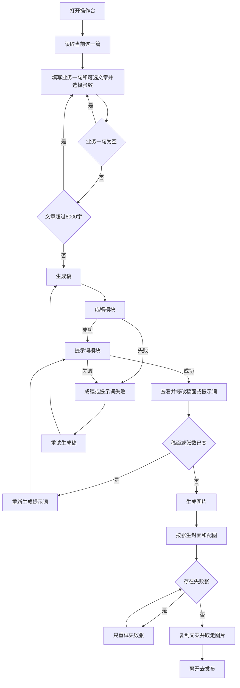
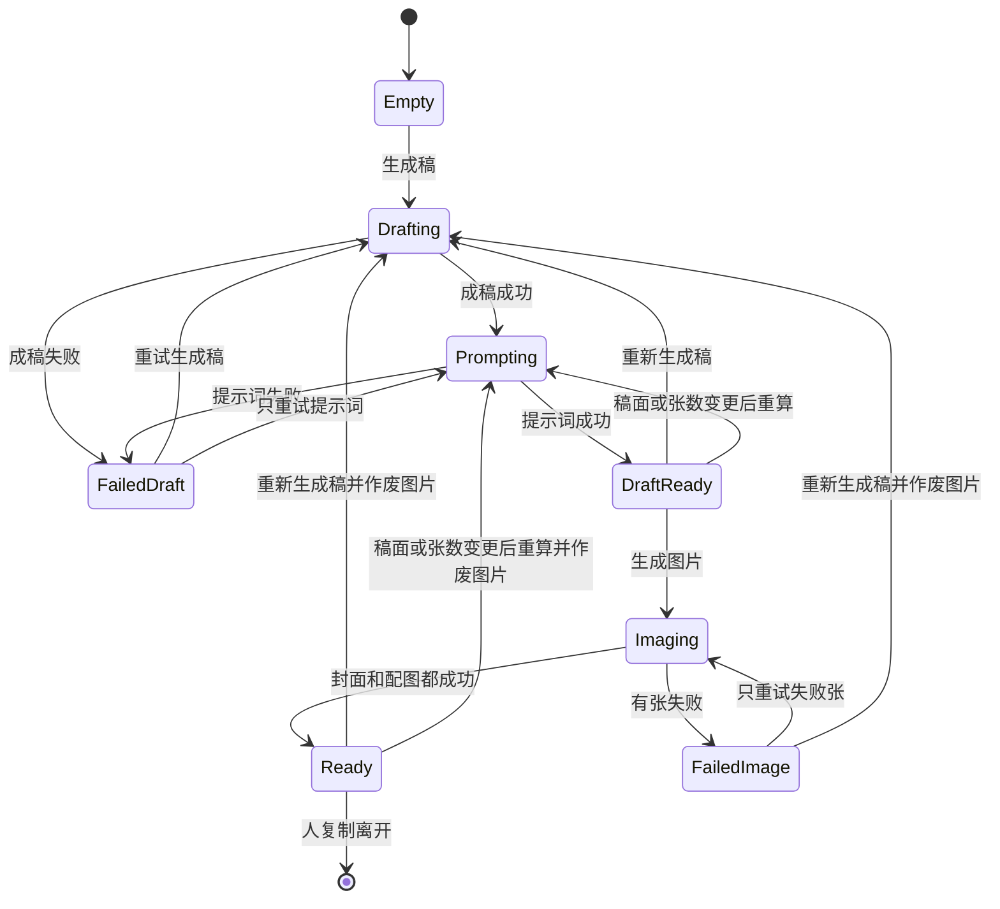
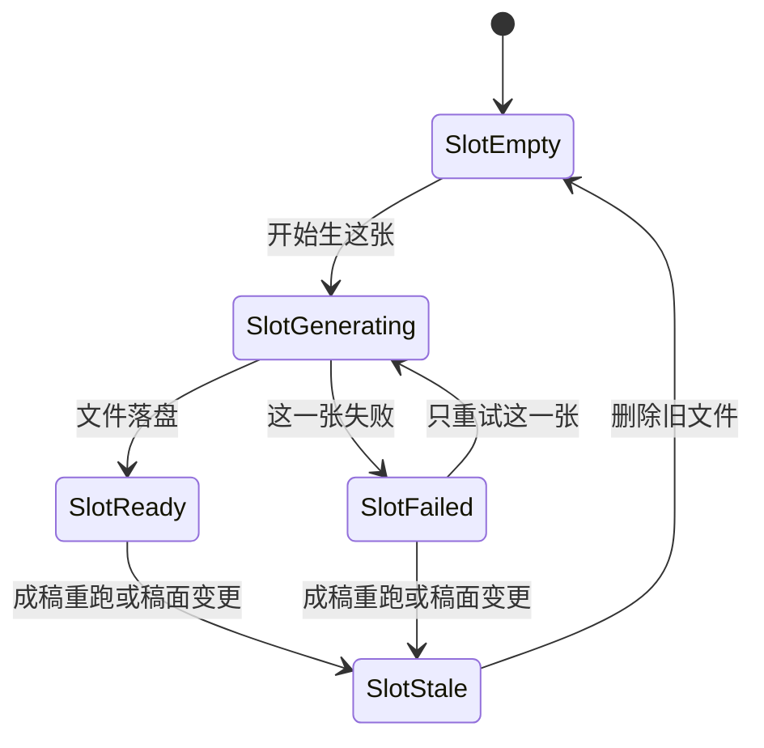

# PRD: 一篇可复制去发的图文

| 属性 | 值 |
|------|----|
| 状态 | 工程：partial。见文末「工程验收状态」 |
| 范围 | MVP-1，Release 0 与 Release 1 |
| 顺序号 | 00001 |
| 关联文档 | `docs/mvp-map.md`、`docs/DESIGN.md`、`AGENTS.md` |
| 参考（不连接） | 飞书《2026-06-05-练习册》表「小红书数据采集」 |

## 背景与问题

运营要在一天内发出一篇小红书图文。今天没有操作台：材料在脑子里或在一篇文章里，成稿、封面和配图靠手工来回切换。

飞书练习册里跑通过的旧流程把一件事拆成改写、口播分镜、从口播结果抽封面、再写配图描述。封面被口播挡住。提示词写在表字段里，改一句就要改表，不能单独演进。

`docs/mvp-map.md` 原先把 MVP-1 收成「一句业务进、一篇文字出」，封面只是稿上的一句话，没有真图。这次把入口放宽到可选文章，并把封面和配图放进同一刀的出口。地图里的红线不变：人自己点发布，不自动发，不爬取，不与捞客仓对接。

## 目标与非目标

### 目标

Release 0 结束时，运营在一张操作台里完成这一篇：

1. 写下句业务；有文章就贴上，没有也能出稿。
2. 得到标题、正文、3 到 5 个话题、封面一句。
3. 看到并可修改 1 条封面提示词，以及 0 到 9 条配图提示词。
4. 得到 1 张封面图，以及与所选张数一致的配图。
5. 把文案复制走，把图片拿走，自己去小红书发布。
6. 刷新页面后，最近这一篇还在。

### 非目标

- 口播分镜、视频脚本、视频成片。
- 米咖五标题、第二种口吻、口吻切换。
- 选题三选一（留给 MVP-2）。
- 广告法、违禁词、站外引流词检查（留给 MVP-4）。
- 运行时读取或写回飞书多维表格。
- 自动发布、自动评论、自动私信。
- 模拟登录、爬取笔记或评论区。
- 与捞客仓对接。
- 多篇同时在页面上编辑。一次只打开一篇。
- 取消进行中的模型或生图请求。
- 把图内中文排字做对。封面一句在稿上，由人复制。
- 八类动机引擎、四类账号矩阵、词库爬取、数据回流。

## 术语

| 术语 | 含义 |
|------|------|
| 业务一句 | 必填。品牌、卖什么、对谁说，写成一段话。 |
| 文章 | 可选素材。有则供成稿取事实和例子；成稿用锁定口吻重写。 |
| 稿面 | 标题、正文、话题、封面一句。人复制的就是这些。 |
| 封面一句 | 稿上的短句，给人用在标题或封面文案。不要求画进图片。 |
| 封面 | 固定 1 张竖图，比例 3:4。 |
| 配图 | 0 到 9 张竖图，比例同为 3:4。张数在生成前由人选择，默认 1。 |
| 提示词模块 | 独立的提示词文件。代码只负责装填变量和解析结果。 |
| 当前这一篇 | 正在打开的那一稿，目录是 `output/one-post/posts/<年月日-时分秒>/`。打开页面时不自动进入历史里的任何一篇。 |

## 已拍板规则

| 项 | 决定 |
|----|------|
| 入口 | 业务一句 trim 后非空。文章可空。 |
| 文章长度 | trim 后超过 8000 个字符（含标点）则拒绝，提示人先删短。页面和桥都要拦，避免只拦页面。不截断后偷偷送模。 |
| 口吻与骨架 | 只有素人号图文。骨架为「开头钩子 → 三点干货 → 结尾一句」。具体措辞写在成稿提示词文件里。 |
| 文章的用法 | 文章是素材。成稿不复述原文结构，不照搬原图。无文章时只根据业务一句写。 |
| 选题 | 本刀不展示选题列表，直接出这一篇。 |
| 话题 | 3 到 5 个。复制时每个话题前加 `#`，话题之间用空格分隔；话题文本里已有 `#` 则不重复加。 |
| 模块顺序 | 成稿 → 提示词 → 生图。封面提示词和配图提示词都从当前稿面来。 |
| 提示词文件 | `assets/prompts/one-post/draft.md`、`cover.md`、`gallery.md`。长提示词只出现在这三个文件里。 |
| 「生成稿」 | 一次用户动作，桥按顺序跑成稿模块，成功后再跑提示词模块。人同时看到稿面和提示词。 |
| 配图张数为 0 | 跳过配图提示词的模型调用，配图列表为空。封面提示词仍然生成。 |
| 稿面变更 | 人改过标题、正文、话题或封面一句后，已有提示词和图片作废。必须先「重新生成提示词」（只跑提示词模块，不重跑成稿），才能再生图。 |
| 重跑成稿 | 再次「生成稿」时，删掉这一篇里的旧图片，提示词按新稿重算。空白稿上的「生成稿」另开一篇。 |
| 改配图张数 | 张数变化使提示词和图片作废，规则与稿面变更相同。 |
| 生图 | Replicate 模型 `openai/gpt-image-2.5-flare`。比例 `3:4`，质量 `medium`，输出 PNG。封面必生 1 张。配图张数等于当时有效的提示词条数。 |
| 图内文字 | 提示词描述画面。验收不要求图里的中文正确。 |
| 单张失败 | 成功的张保留。只重试失败的那一张，使用该张当前提示词。 |
| 进行中 | 成稿、提示词或生图进行中，对应动作不能再次提交。 |
| 模型 | DeepSeek Chat Completions，OpenAI 兼容。`DEEPSEEK_API_KEY` 必填。`DEEPSEEK_BASE_URL` 默认 `https://api.deepseek.com`。`DEEPSEEK_MODEL` 默认 `deepseek-chat`。 |
| 生图密钥 | `REPLICATE_API_TOKEN` 必填。缺失时在生图步骤失败，已有稿面和提示词保留。 |
| 历史 | 每篇一个目录：`output/one-post/posts/<id>/draft.json` 和图片。`index.json` 记下 id、创建时间、更新时间和标题。打开页面是空白新稿。历史可以打开或复制。没有数据库。 |
| 页面 | 服从 `docs/DESIGN.md`：一份 HTML，Alpine 管状态，daisyUI 5 浅色，白底，强调色只在按钮和状态标记上。不上构建链。 |

## 冲突与决议

| 冲突 | 决议 |
|------|------|
| `docs/mvp-map.md` 旧 MVP-1 只收一句业务，出口没有真图，封面只是一句文案 | 入口改为业务一句必填、文章可选。出口增加封面 1 张和配图 0–9 张。地图该小节已改成与本 PRD 相同的边界。验收以本 PRD 为准。 |
| 飞书旧字段先出口播，再从口播抽出封面 | 本刀不做出镜口播。封面提示词只读稿面。 |
| 兄弟项目的 DeepSeek 与生图实现是 Python | 只沿用接口契约和模型名。本仓用 Node 写在 `src/`，不引用其他仓库的代码。 |

## 用户与角色

| 角色 | 目标 |
|------|------|
| 账号运营（主要用户） | 当天拿出一篇能复制去发的图文，含封面和自己要的配图张数。 |
| 提示词维护者（内部） | 改三个 markdown 文件就能改口吻和画面要求，不用改调用代码。 |
| 工程（内部） | 按下面的模块边界实现。页面不写业务规则。 |

## 功能域

仓库当前没有业务源码。本刀按这个形状长。根目录只增加 Dex Buddy 的两份合同文件，业务源码不放根。

```text
plugin.manifest.json              # uiEntry 指向页面
index.js                          # dex.call 转到 src
assets/prompts/one-post/draft.md
assets/prompts/one-post/cover.md
assets/prompts/one-post/gallery.md
src/studio/static/index.html      # 只有页面
src/llm/                          # DeepSeek 客户端，不知道提示词正文
src/prompts/                      # 读三个文件、装填、校验条数
src/draft/                        # 成稿：组消息、请求、校验稿面
src/image/                        # GPT Image 2，输入是一条提示词，输出是一个文件
output/one-post/posts/            # gitignore，可删可重建。每篇一个子目录
```

`src/llm`、`src/prompts`、`src/draft`、`src/image` 不引用 `src/studio`。页面向 `window.dex.call` 发请求。`index.js` 把请求转到上述包。

### 成稿结果

模型返回 JSON。桥校验失败则整次「生成稿」失败，不把半截稿面写进页面。

| 字段 | 规则 |
|------|------|
| title | 非空字符串 |
| body | 非空字符串，结构上能看出钩子、三点、收束 |
| topics | 数组，长度 3 到 5，每项非空 |
| coverLine | 非空字符串 |

无文章时，送给成稿模块的文章变量为空，提示词文件用自己的空文章分支，不另写一套调用。

### 提示词结果

| 文件 | 输入 | 输出 |
|------|------|------|
| `cover.md` | 当前稿面 | 恰好 1 条画面提示词 |
| `gallery.md` | 当前稿面 + 张数 N | 恰好 N 条画面提示词。N 为 0 时不调用模型，结果为 `[]` |

条数不对视为这一步失败。人可以在页面上改提示词文本。改稿面或改张数之后，这些文本作废。

### 图片文件

目录 `output/one-post/posts/<id>/`：

| 文件 | 含义 |
|------|------|
| `draft.json` | 业务一句、文章、配图张数、稿面、提示词、每张图的状态和相对路径 |
| `cover.png` | 封面 |
| `gallery-01.png` … `gallery-09.png` | 配图，序号从 1 开始，与提示词顺序一致 |

作废时删除对应图片文件，并把 `draft.json` 里的图片状态写成作废。张数变少时，多出来的 `gallery-*.png` 删掉。

### 页面

一张操作台，宽屏左右分栏，窄屏上下堆叠。区域顺序固定，方便键盘按视觉顺序走：

1. 业务一句（必填）、文章（可选）、配图张数（整数，最小 0，最大 9，默认 1）。
2. 主按钮「生成稿」。校验失败时，错误写在字段旁，焦点落到第一处错误。
3. 稿面：标题、正文、话题、封面一句。每块可编辑，每块有复制。
4. 提示词：封面 1 条，配图 N 条。稿面或张数已变时，这里标成待重算，并给出「重新生成提示词」。
5. 主按钮「生成图片」。提示词待重算、或还没有稿面时，按钮不可用。
6. 图片：封面在前，配图按序在后。每张显示等待、成功或失败。失败张有「重试这张」。成功张在 Release 0 没有单独重生。
7. 进行中显示当前步骤（成稿、提示词、或第几张图）。等待可以长达数分钟，页面保持可复制已有文案。

图标用矢量，不用表情符号当按钮或状态图标。装饰性图标对辅助技术隐藏。控件有可见焦点。`prefers-reduced-motion: reduce` 时不做位移动画，状态只用文字和颜色以外的标记（文字「失败」「进行中」）一起表达。正文对比度按浅色主题保持可读。不引入落地页式滚动叙事，不另写一套脱离 daisyUI 的配色。

离开 Dex Buddy 且不是本机操作台时，动作按钮不可用，并说明需要在工作台或本机操作台里打开。不假装请求已发出。

## 用户故事地图与版本切片

### 旅程主干

| 步 | 人在做什么 | 起止 |
|----|------------|------|
| 1 | 在工作台打开操作台 | Entry |
| 2 | 看到空白新稿，历史列在旁边 | |
| 3 | 写下业务一句，可选贴上文章，选定配图张数 | |
| 4 | 点「生成稿」，等到稿面和提示词出现 | |
| 5 | 改稿面则重算提示词；不改则进入生图 | |
| 6 | 点「生成图片」，按张看到进度 | |
| 7 | 有失败张就只重试那一张，直到封面和所选配图都在 | |
| 8 | 复制文案，取走图片，离开去发布 | Exit / Teardown |

人可以在第 4 步之后再次「生成稿」，旧图被清掉，旅程回到第 4 步。人可以在任一步关掉页面，下次从第 2 步读回最近一次成功写入的状态。

### 故事地图

#### Release 0

1. 作为运营，我想只填一句业务就得到一篇图文，以便手头没有文章时也能发。
   - 验收：文章为空且业务一句非空时，「生成稿」成功，稿面四项都在，话题 3 到 5 个。

2. 作为运营，我想把一篇文章当素材贴进去，以便成稿按我们的口吻重写，而不是空写。
   - 验收：文章非空时，成稿请求带上文章。超过 8000 字时页面和桥都拒绝，不发起模型调用，并提示删短。

3. 作为运营，我想业务一句没写时被拦住，以便不会发出一次空请求。
   - 验收：trim 后为空时不调用模型，字段旁有错误，焦点在该字段。

4. 作为提示词维护者，我想口吻和画面要求写在独立文件里，以便改提示词不用改代码。
   - 验收：三次模型调用（成稿、封面提示词、配图提示词）读取的正文来自 `assets/prompts/one-post/` 下对应文件。`src/` 里没有另一份长提示词。N 为 0 时配图文件不被调用。

5. 作为运营，我想在生图前看见并修改提示词，以便画面跟着这篇稿走。
   - 验收：成功后提示词为封面 1 条加配图 N 条，N 等于当时选择的张数，默认 1。提示词可编辑。条数不符时这一步失败，不进入生图。

6. 作为运营，我想改完稿面再重算提示词，以便画面不要沿用旧稿。
   - 验收：稿面任一字段或配图张数变化后，生图按钮不可用，直到「重新生成提示词」成功。该动作不调用成稿模块。

7. 作为运营，我想得到封面和我选的配图张数，以便直接拿去发。
   - 验收：封面 1 张 PNG，比例 3:4。配图张数与提示词条数一致，为 0 时目录里没有 `gallery-*.png`。质量为 medium。

8. 作为运营，我想某一张失败时留下已经成功的图，以便不用整套重来。
   - 验收：失败张显示失败。点「重试这张」只再请求这一张。其他张的文件和路径不变。

9. 作为运营，我想重跑成稿后不再看到旧图，以便图和文是同一篇。
   - 验收：再次「生成稿」成功后，旧的 `cover.png` 和 `gallery-*.png` 不存在，`draft.json` 里图片状态为作废或空。

10. 作为运营，我想复制标题、正文和话题，以便贴进小红书。
    - 验收：三块各自复制。话题剪贴板内容为 `#话题` 用空格连接。

11. 作为运营，我想留下生成过的每一篇，以便一次做两到三篇再分别复制。
    - 验收：每一步成功写入 `output/one-post/posts/<id>/`。打开页面是空白新稿，历史列出已有的篇，可以打开或复制。生图中途刷新仍停在正在生成的这一篇。

12. 作为运营，我想进行中不会连点出两套结果，以便这一篇不被写乱。
    - 验收：成稿、提示词或生图未结束时，同一动作的按钮不可用，桥拒绝第二次并发调用。

13. 作为运营，我想密钥没配时知道停在哪一步，以便文案还在。
    - 验收：缺 `DEEPSEEK_API_KEY` 时成稿失败，页面保持可编辑的输入。缺 `REPLICATE_API_TOKEN` 时生图失败，稿面和提示词仍在。

#### Release 1

14. 作为运营，我想只改一条已经成功的图的提示词并重生那一张，以便不动正文和其他图。
    - 验收：该动作不调用成稿模块，也不调用其他张的生图。只替换这一张文件。稿面和其他图片路径保持不变。

### Release 0 可验收结果

操作台里走完旅程第 1 到第 8 步。用一句业务、不贴文章，配图张数选 0，能复制稿面并得到 1 张封面。再贴一篇不超过 8000 字的文章，配图张数选 1，能得到封面和 1 张配图。人为让一张失败时，另一张仍在，重试只补失败张。

### Release 1 可验收结果

在 Release 0 的成稿之上，改封面提示词或某一条配图提示词，只重生对应的那一张。正文和其他图片文件不被替换。

本期不做的能力都在「非目标」，不另开 Release 2。

## 核心流程与状态机图



人从「查看并修改」再次点「生成稿」时，走回成稿模块，并先作废图片。这是逆向退出，不是另一条产品线。

稿的状态：



单张图的状态。作废后文件删除，槽位回到空，避免稿已换、图还在。



Release 1 在 `Ready` 上增加一条边：改某一条提示词后，只把那一张从 `SlotReady` 送回 `SlotGenerating`，其他槽位保持 `SlotReady`，稿的状态仍为 `Ready`。Release 0 不提供这条边。

## 数据与 API 衔接

没有数据库。状态在页面内存。每一篇落在 `output/one-post/posts/<id>/draft.json`，`index.json` 只记列表。

`draft.json` 至少包含：`business`、`article`、`galleryCount`、`draft`（title、body、topics、coverLine）、`prompts.cover`、`prompts.gallery`、`images.cover`、`images.gallery[]`。每张图含 `status` 与相对路径。`status` 取空、生成中、成功、失败、作废。

桥上的调用：

| 调用 | 行为 |
|------|------|
| `onePost.loadLatest` | 读当前打开的这一篇。没有打开则空态，不读历史第一篇。 |
| `onePost.listPosts` | 历史列表，新的在前。每条含标题和可复制的整帖；没有稿面时整帖为空。 |
| `onePost.openPost` | 打开历史中的一篇。 |
| `onePost.startNew` | 清掉当前打开的篇，不新建空目录。 |
| `onePost.generateDraft` | 校验输入，跑成稿，再跑提示词，写 `draft.json`，删除旧图。 |
| `onePost.generatePrompts` | 用当前稿面和张数重算提示词，不跑成稿。成功后图片作废。 |
| `onePost.generateImages` | 按当前提示词生封面和全部配图。提示词作废时拒绝。 |
| `onePost.retryImage` | 参数指明封面或配图序号。只重生那一张失败图。 |

Release 1 增加 `onePost.regenerateImage`：参数同 `retryImage`，允许对成功张使用编辑后的提示词重来，且不跑成稿、不碰其他张。

DeepSeek 使用 Chat Completions，要求 JSON 对象返回，由对应模块校验字段。客户端参照兄弟项目的环境变量约定自行实现，不链接那个仓库。生图参照 `openai/gpt-image-2.5-flare` 的比例枚举，只传 `3:4`。质量用 `medium`。

密钥只从环境变量读取，不写入 `draft.json`，不出现在页面上。

## 假设与待确认

| 项 | 处理 |
|----|------|
| 业务一句没有另设字数上限 | 按已拍板，只要求非空。若实现时上下文不够，再开问题，不在本刀截断。 |
| Dex Buddy 的 manifest 字段细节 | 实现时按宿主现有合同填写。`uiEntry` 指向 `src/studio/static/index.html`。 |
| 生图耗时会到数分钟 | 按张显示进度。Release 0 不支持取消。 |
| 模型偶发不遵守 JSON | 视为该步失败，人重试。不展示半截结果。 |
| 飞书练习册 | 只说明旧流程为什么要拆模块。运行时无飞书依赖。 |

## 成功标准

- 无文章、配图张数为 0：一次「生成稿」加一次「生成图片」，人能复制整帖，并在该篇目录拿到 `cover.png`。
- 有文章、配图张数为 1：该篇目录同时有 `cover.png` 和 `gallery-01.png`，稿面话题数量在 3 到 5。
- 8000 字以上的文章：零次模型调用。
- 重跑成稿后：旧图片文件不在。
- 三个提示词文件可单独替换，调用点不用改提示词正文。

## 修订记录

| 日期 | 说明 |
|------|------|
| 2026-10-12 | 初稿。入口、生图张数和模块边界按讨论拍板。 |

## 1. 工程验收状态

> 由 `/team:prd-accept` 维护；勿手工编造「通过」。最后更新：2026-10-12T08:58:25Z，master@无提交，范围：R0,R1。

### 总览

- 工程状态：`partial`
- 验收判定：Release 0 没有「未实现」，但有三条验收与仓库不一致；Release 1 未实现，且正文把 R1 放进本期范围，不能标成验收通过
- 最近验收：2026-10-12T08:58:25Z
- 代码提交：仓库在 `master`，尚无 git 提交
- 一句业务可成稿、文章 8000 字双端拦截、三个提示词文件、3:4 PNG、失败张单独重试、多篇目录和空白新稿都有测试
- 页面不展示、也不编辑提示词；复制是整帖一次，不是三块分开复制；整页刷新不会停在正在生图的那一篇
- 页面用词已改成「写成笔记 / 让画面跟上 / 以前的笔记」，与正文里的「生成稿 / 重新生成提示词 / 历史列在旁边」不一致。目标第 6 条仍写「刷新后最近这一篇还在」，已拍板规则改为打开即空白新稿，实现按后者

### Release 交付

| Release | 状态 | 说明 |
|---------|------|------|
| R0 | 部分 | 故事 1–4、6–9、12–13 通过。故事 5、10、11 为部分 |
| R1 | 未实现 | 故事 14：成功张按改过的提示词单独重生。`src/` 与 `index.js` 没有 `regenerateImage` |

### 功能验收清单（Agent 优先读此表）

| ID | 能力摘要 | Release | 状态 | 证据 |
|----|----------|---------|------|------|
| US-01 | 只填一句业务也能出稿，话题 3 到 5 个 | R0 | 通过 | `tests/one-post/run.test.js`「配图张数为 0」：`article: ''` 仍得到标题与封面提示词 |
| US-02 | 文章送进成稿；超过 8000 字时页面和桥都不调用模型 | R0 | 通过 | `src/one-post/run.js` 把 `checked.article` 送入成稿；`tests/one-post/run.test.js`「空业务一句和超长文章都不会调用模型」；`tests/draft/validate.test.js` 8000 字边界 |
| US-03 | 业务一句为空白时不调用模型，错误在字段旁并聚焦 | R0 | 通过 | `src/draft/validate.js` `EMPTY_BUSINESS`；`src/studio/static/pages/note.js` `focusField`；同上超长/空业务测试 |
| US-04 | 口吻和画面只在三个提示词文件里；张数为 0 不读配图文件 | R0 | 通过 | `tests/prompts/fill.test.js`「三个提示词文件能装填，长提示词不在 src 里」；`tests/one-post/run.test.js` 张数为 0 时未见 `GALLERY` |
| US-05 | 生图前看见并可修改封面 1 条、配图 N 条提示词；条数不对不生图 | R0 | 部分 | 条数失败见 `tests/one-post/run.test.js`「提示词条数不对时不生图」。`src/studio/static/pages/note.html` 没有提示词编辑区 |
| US-06 | 稿面或张数变化后，生图不可用，重算提示词不跑成稿 | R0 | 通过 | `tests/one-post/run.test.js`「改稿面后要重算提示词，重算本身不跑成稿」；页面按钮为「让画面跟上」（`note.html` `#regenerate-prompts`） |
| US-07 | 封面 1 张 3:4 PNG，质量 medium；配图张数与提示词一致，为 0 时无 `gallery-*.png` | R0 | 通过 | `tests/image/generate.test.js`「生图只传 3:4 和 medium，并在完成后落成 PNG」；`src/image/generate.js` `MODEL_URL` 为 `openai/gpt-image-2.5-flare`；张数 0 见 US-01 同测 |
| US-08 | 失败张可单独重试，其他张文件不变 | R0 | 通过 | `tests/one-post/run.test.js`「失败的一张可以单独重试，另一张文件不变」；`src/one-post/run.js` `retryImage` 只接受状态为失败的槽 |
| US-09 | 再次生成稿后旧封面和配图文件不在 | R0 | 通过 | `tests/one-post/run.test.js`「配图张数为 0 时不读配图提示词，重跑成稿会删掉旧图」；`tests/draft/store.test.js`「作废时删掉封面和配图文件」 |
| US-10 | 复制标题、正文和话题；话题为 `#话题` 空格连接 | R0 | 部分 | `tests/draft/validate.test.js`「复制话题时补上井号并用空格隔开」「整帖是标题、正文、话题，中间空一行」。页面 `note.js` `onCopyPost` 一次复制整帖，没有三块各自的复制按钮 |
| US-11 | 每篇一个目录；打开是空白新稿；历史可打开或复制；生图中途刷新仍停在这一篇 | R0 | 部分 | 多篇与空态见 `tests/one-post/run.test.js`「连续生成两篇，空态不打开历史第一篇」。历史页为 `src/studio/static/pages/history.html`，不在左侧。整页刷新时 `note.js` `init` 调用 `startNew`，失败后的 `refresh` 在没有 `postId` 时直接返回，不会停在正在生成的那一篇 |
| US-12 | 进行中不能连点出第二套结果 | R0 | 通过 | `tests/one-post/run.test.js`「进行中的第二次调用被拒绝」；`note.html` 主按钮在 `job.running` 时不可用 |
| US-13 | 缺 DeepSeek 密钥停在成稿并保留输入；缺 Replicate 密钥停在生图并保留稿面和提示词 | R0 | 通过 | `tests/one-post/run.test.js`「缺密钥时停在对应步骤，稿面还在」；`tests/llm/client.test.js`、`tests/image/generate.test.js` |
| US-14 | 只改一条已成功图的提示词并重生那一张 | R1 | 未实现 | 正文要求 `onePost.regenerateImage`。`index.js` 与 `src/` 无此方法。`retryImage` 拒绝非失败张 |

### 未完成与遗留

- Release 1：成功张单独重生（US-14）未做
- 页面不展示、不编辑提示词（US-05）。待重算时只能点「让画面跟上」
- 复制是整帖一次，不是标题、正文、话题三块分开复制（US-10）
- 生图过程中刷新整页，不会留在正在生成的那一篇（US-11）
- 旅程仍写「历史列在旁边」。实现是笔记页上的「以前的笔记」，再进单独一页
- 仓库还没有任何 git 提交，本次验收没有 `accepted_commit`

### 质量检查

| 检查项 | 状态 |
|--------|------|
| 测试 | 通过。`node --test tests/**/*.test.js`，26 通过，0 失败（2026-10-12T08:58:25Z）。没有 `pnpm test` 脚本 |
| Lint | N/A。本仓无 lint 命令 |
| 文档与 OpenAPI | 本项目无 OpenAPI，跳过。操作台步骤在 `docs/workflows/one-post-studio.md` |

---

统计：通过 10 / 部分 3 / 未实现 1 / 范围外 0
