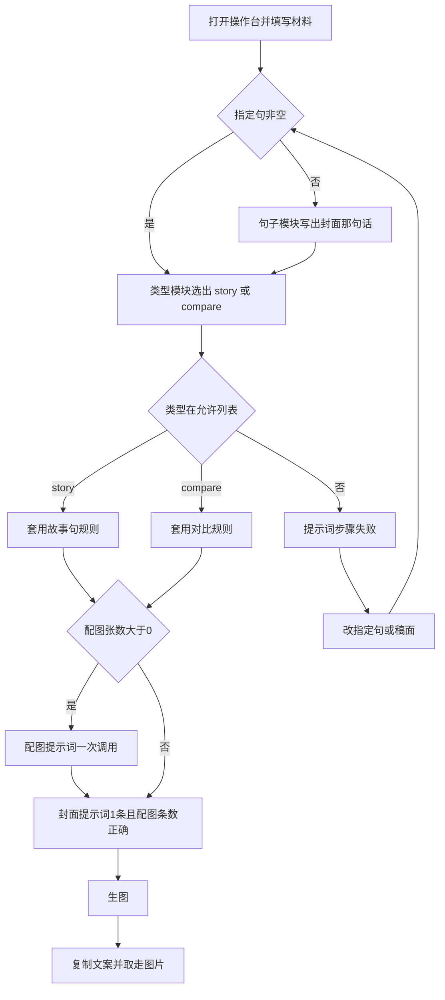
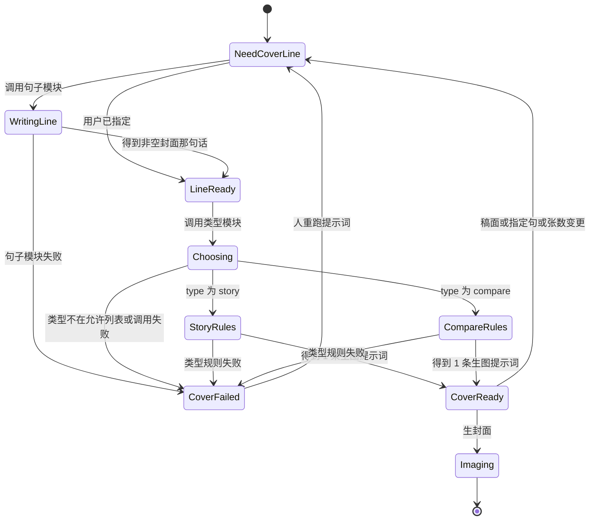

# PRD: 封面类型模块

| 属性 | 值 |
|------|----|
| 状态 | backlog |
| 范围 | 一篇图文里的封面提示词。Release 0 |
| 顺序号 | 00002 |
| 关联文档 | `specs/prds/prd-00001-one-post-from-article.md`、`docs/mvp-map.md`、`docs/workflows/one-post-studio.md`、`docs/DESIGN.md`、`AGENTS.md` |

## 背景与问题

`prd-00001` 已经能出一篇可复制的图文，并固定生 1 张 3:4 封面。封面提示词今天写在 `assets/prompts/one-post/cover.md`：只描述主体、场景、光线和构图，并明确不要把可阅读的中文排进画面。`coverLine` 被定义成稿上的短句，不要求画进图片。

信息流里，人是先看见封面再决定点不点。一张只有氛围、看不出在讲什么的图，会被划走。首页上愿意被点开的封面，结构是稳定的：一个主体，加上能把这件事说清楚的字；或者同一主体的两个状态，让人一眼看出前后。字和图必须是同一件事。写成一段新闻、画面和标题各说各的、只有场景没有信息，都留不住人。

整套图是总分总。封面是开头的「总」：它是钩子，同时要把这篇在干什么交代清楚。配图里的「分」和收束的「总」不在本 PRD。

封面不能继续是一条写死的无字提示词。类型要能增加，语气以后要能从素人号换成官号，封面上的那句话和「这种封面怎么画」也不是同一件事。

## 目标与非目标

### 目标

Release 0 结束时：

1. 封面提示词按三段走完：有没有用户指定的那句话 → 否则由句子模块写出 → 类型模块选出一种封面 → 套用该类型的画面和文字规则，得到恰好 1 条生图提示词。
2. 这一期有且只有两种类型：`story`（故事句）、`compare`（对比）。模型自己选，选不中允许列表则这一步失败，不生图。
3. 封面上的那句话交代清楚这篇在讲什么。它不是只留悬念的纯钩子，也不照抄原文里的某一句。
4. 用户可以在材料里指定这一句。指定了就用这一句，不调用句子模块。
5. 素人号语气写在单独文件里，填进句子模块和类型模块。换语气时换文件，不改调用顺序。
6. 生图仍用现有模型和参数，封面仍是 1 张。配图提示词的调用方式不变。

### 非目标

- 官号或其他语气的提示词正文。
- 用程序把字叠到图上。图内中文仍由生图模型画，不验收每个字都写对。
- 把配图改成「分」和收束的「总」。
- 页面上让人选封面类型。
- 用首页点赞或别的数据自动选版。
- 标注教程、纯字海报等更多类型。加一种等于加一个类型文件，并把 id 放进允许列表。那是以后的事，不在本期占一版。
- 改生图模型、比例、质量、输出格式。
- 自动发布、爬取、与捞客仓对接。
- 广告法、违禁词检查。

## 术语

| 术语 | 含义 |
|------|------|
| 封面那句话 | 写进 `draft.coverLine` 的一句。它要让人看出这篇在讲什么。故事句封面把这一句画上图。对比封面用它做意思来源，字的排法由对比类型自己定。 |
| 用户指定句 | 材料页上的可选输入。trim 后非空时，封面那句话就是它，句子模块不运行。 |
| 句子模块 | `sentence.md`。从稿面写出封面那句话。 |
| 类型模块 | `choose-type.md`。只输出允许列表里的一个类型 id。 |
| 类型规则 | `types/<id>.md`。规定这种封面的画面和字，输出恰好 1 条生图提示词。 |
| 语气文件 | `tone-amateur.md`。素人号口吻。作为变量填进句子模块和类型规则，不单独调用模型。 |
| 故事句 | 类型 id `story`。一个主体加上封面那句话。 |
| 对比 | 类型 id `compare`。同一主体的两个状态。 |

## 已拍板规则

| 项 | 决定 |
|----|------|
| 谁选类型 | 模型。页面没有版式开关。 |
| 允许的类型 | 只有 `story` 和 `compare`。别的 id、空字符串、多类型都算这一步失败。 |
| 失败后 | 不调用生图。已有配图提示词若还没写完，也不写入成功状态。封面流程任一步失败，整次提示词步骤失败。 |
| 封面那句话从哪来 | 用户指定句优先。否则句子模块写。成稿模块不再写 `coverLine`。 |
| 不照抄 | 句子模块从稿面提炼，不把原文或正文里的某一句原样搬上封面。用户指定句不受这条限制。 |
| 必须交代清楚 | 封面那句话要让人知道这篇在讲什么。不能只留「你绝对想不到」这类悬念。 |
| 不编造 | 句子模块和类型规则都不得写出稿面里没有的数字、人名、头衔。用户指定句里已有的可以保留。 |
| 字数 | 不设全局字数上限，也不设对比标签的字数上限。字的长短和排法写在对应类型文件里。 |
| 语气 | 本期只装载素人号文件。官号以后替换这个文件，或按同一变量另备一份，本 PRD 不写官号正文。 |
| 故事句的字 | 图上的可阅读中文必须是封面那句话本身，不另写一句。 |
| 对比的字 | 类型规则自己决定怎么标两个状态、要不要再加一句总题。意思必须来自封面那句话，不能换成另一件事。 |
| 故事句的画面 | 一个主体：人、一个物件，或干净的底。字和图讲同一件事。缩略图里这句话仍是画面主角。不要写成一段新闻，不要只剩没有信息的场景。 |
| 对比的画面 | 同一主体的两个状态，左右或上下。两个格子必须是同一件事的前后或两侧。 |
| 配图 | 仍按 `gallery.md` 一次调用，张数规则沿用 `prd-00001`。配图继续不要求图内可阅读中文。 |
| 生图 | 沿用 `prd-00001`：`openai/gpt-image-2.5-flare`，比例 `3:4`，质量 `medium`，PNG，封面 1 张。 |
| 提示词落点 | 长提示词只出现在下面列出的 markdown 文件里。`src/` 只负责按顺序读文件、装填变量、校验 JSON。 |
| 语气怎么填 | 读入语气文件全文，作为 `{{tone}}` 填进句子模块和两份类型规则。这不是一次模型调用。 |
| 稿面变更 | 标题、正文、话题、用户指定句或配图张数变化后，已有封面类型、封面提示词、配图提示词和图片作废。必须重跑提示词步骤才能再生图。成稿模块不因此重跑。 |
| 重跑成稿 | 再次写成笔记时，删掉旧图，提示词按新稿重算。用户指定句留在材料里，不跟着成稿被清掉。 |
| 图内中文画错 | 人改提示词或重跑提示词后再重生封面。本期不因单字错误自动判失败。 |

## 冲突与决议

| 冲突 | 决议 |
|------|------|
| `prd-00001` 禁止封面提示词要求图内可阅读中文，并写明验收不要求图里的中文正确 | 封面改为必须把字画进画面。验收看提示词有没有按类型把要画的字写进去，不看生成图的每个汉字是否正确。配图仍不要求图内文字。 |
| `prd-00001` 把 `coverLine` 定义成「不要求画进图片」，并由成稿 JSON 返回 | `coverLine` 改为封面那句话。成稿 JSON 不再包含它，成稿校验不再要求它。封面流程成功后写入稿面。 |
| `prd-00001` 的非目标含「把图内中文排字做对」 | 仍然不做程序排字。本 PRD 只要求提示词提出要画的字。画错字的处理见上表，不收回这条非目标里的「程序保证写对」。 |
| `prd-00001` 规定封面提示词只来自 `cover.md` 一次调用 | `cover.md` 退出封面流程。封面改为句子（可跳过）、选类型、类型规则三次模型调用边界。配图仍是一次。 |
| `docs/mvp-map.md` 写「封面一句」随稿面一起由成稿产出 | 地图里 MVP-1 的出口仍是一篇可复制的图文加封面。封面一句改由本 PRD 的封面流程产出。实现时把地图该句改成与本 PRD 一致。验收以本 PRD 为准。 |
| 成稿校验今天拒绝空的 `coverLine` | 空的封面那句话只在封面流程尚未成功时出现。提示词步骤失败时可以留下稿面，此时 `coverLine` 允许为空，生图按钮不可用。 |

## 用户与角色

| 角色 | 目标 |
|------|------|
| 账号运营 | 封面在信息流里能看出这篇在讲什么，并且愿意点进来。不想自己先选版式。 |
| 提示词维护者 | 改语气、改句子写法、或改某一种封面的画面规则时，只改对应文件。加一种封面时加一个文件，并让允许列表认识这个 id。 |
| 工程 | 按固定顺序调用这些文件，校验类型 id 和条数。页面不写选版规则。 |

## 功能域

业务代码边界沿用 `prd-00001`。本刀只改封面提示词的读法和材料页上的一个可选字段。

```text
assets/prompts/one-post/draft.md
assets/prompts/one-post/gallery.md
assets/prompts/one-post/cover/tone-amateur.md
assets/prompts/one-post/cover/sentence.md
assets/prompts/one-post/cover/choose-type.md
assets/prompts/one-post/cover/types/story.md
assets/prompts/one-post/cover/types/compare.md
src/prompts/          # 读上述文件、装填、校验类型 id 和条数
src/one-post/         # 提示词步骤里按本 PRD 的顺序调用
src/studio/           # 材料页增加可选的一句
```

`cover.md` 不再被封面流程读取。实现时删掉或停止引用，避免两套封面规则并存。

### 材料

在「要发什么」里，业务一句、原文、配图张数之后，增加可选字段「封面上的这句话」。

| 项 | 规则 |
|----|------|
| 必填 | 否。空着就走句子模块。 |
| 空白 | trim 后为空视为没指定。 |
| 校验失败 | 这个字段本身不产生错误。业务一句和原文长度的校验不变。 |
| 保存 | 写在这一篇的材料里，刷新后还在。重跑成稿不清掉它。 |

页面服从 `docs/DESIGN.md`：仍是现有这一张操作台，不新增版式选择，不新增第二种主题。

### 成稿

成稿模块的输入仍是业务一句和可选原文。返回的 JSON 只有 `title`、`body`、`topics`。不再返回 `coverLine`。话题数量等其余规则沿用 `prd-00001`。

### 封面流程

提示词步骤在成稿成功之后运行。输入是当前稿面的标题、正文、话题，以及用户指定句（可空）。顺序固定：

1. 用户指定句非空：`coverLine` 等于该句 trim 后的文本，不读 `sentence.md`。
2. 用户指定句为空：调用 `sentence.md`，得到非空 `coverLine`。
3. 调用 `choose-type.md`，得到 `type`。
4. `type` 必须是 `story` 或 `compare`。按 id 读取 `types/story.md` 或 `types/compare.md`，得到恰好 1 条生图提示词。
5. 配图张数大于 0 时，再按现有方式调用 `gallery.md`。张数为 0 时不调用。

任一步的 JSON 不合格，或类型 id 不在允许列表，整次提示词步骤失败。不保留半截新的封面提示词去覆盖上一份成功结果。失败信息写给操作的人，不进入生图。

句子模块、类型模块、类型规则都看得到标题、正文、话题和封面那句话（句子模块除外，它负责写出这句话）。类型规则还看得到类型 id。语气全文用 `{{tone}}` 注入句子模块和两份类型规则。

### 各文件要写出的规则

实现时把下列规则写进对应文件，不要写进 `src/`。

`tone-amateur.md`：像一个普通人在分享自己刚弄明白的事。句子短，不端着，不喊口号，不像广告。不编造稿子里没有的数字、人名和头衔。

`sentence.md`：从稿面提炼一句封面那句话。交代清楚这篇在讲什么，让人愿意点开。不能只留悬念。不照抄原文或正文里的原句。不在这一层规定字数和排版。只返回 JSON：`coverLine` 为非空字符串。

`choose-type.md`：根据稿面和封面那句话，在 `story` 与 `compare` 里选一个。稿子的核心是同一件事的前后或两侧，选 `compare`。否则选 `story`。不要为了用对比而硬拆成两个无关的格子。只返回 JSON：`type` 为上述 id 之一。

`types/story.md`：一个主体，上面是封面那句话的原文。字和图是同一件事。这句话在缩略图里仍占画面的主要位置，高对比，不要排成一段新闻，不要只出没有信息的场景。只返回 JSON：`prompt` 为恰好 1 条非空字符串，且包含封面那句话。

`types/compare.md`：同一主体的两个状态，左右或上下。两个状态都来自封面那句话。字的排法由本文件规定，可以是两个状态标签，也可以再加一句总题。不得引入封面那句话和稿面里都没有的事实。只返回 JSON：`prompt` 为恰好 1 条非空字符串，并且写明要画上的那些字。

### 页面上其余行为

材料页之外的步骤沿用现在的操作台：写成笔记、待重算时让画面跟上、再做出封面和配图。不在笔记预览里增加类型开关。封面那句话不强制单独占一块编辑区。人要改字，改材料里的指定句，或重跑提示词。

## 用户故事地图与版本切片

### 旅程主干

| 步 | 人在做什么 | 起止 |
|----|------------|------|
| 1 | 打开操作台，写下业务一句，原文和封面上的这句话可空 | Entry |
| 2 | 点写成笔记，等到稿面出现 | |
| 3 | 封面流程自己选出类型并写出 1 条封面提示词；有配图张数时同时得到配图提示词 | |
| 4 | 点做出封面和配图 | |
| 5 | 封面能看出这篇在讲什么；不满意就改指定句或重跑提示词，再只关心封面那一张 | |
| 6 | 复制文案，取走图片，自己去发布 | Exit / Teardown |

人在第 2 步之后改标题、正文、话题、指定句或张数，画面标成待重算，回到第 3 步。关掉页面再打开，材料里的指定句还在。

### 故事地图

#### Release 0

1. 作为运营，我想不填封面上的字也能得到一张有主题的封面，以便不用先想文案。
   - 验收：指定句为空时，提示词步骤读取并调用 `sentence.md`，成功后 `coverLine` 非空。成稿提示词不再要求模型返回 `coverLine`。是否照抄原文写在 `sentence.md` 里，代码不做逐句比对。

2. 作为运营，我想自己指定封面上的那句话，以便这句话不要被模型改掉。
   - 验收：指定句 trim 后非空时，不读 `sentence.md`。`coverLine` 与 trim 后的指定句一致。重跑成稿后指定句仍在。

3. 作为运营，我想封面自己变成故事句或对比，以便我不用选版式。
   - 验收：提示词步骤调用 `choose-type.md`。返回 `story` 时下一步只读 `types/story.md`；返回 `compare` 时只读 `types/compare.md`。页面上没有类型选择控件。

4. 作为运营，我想模型选了一个不存在的类型时停下来，以便不会用错规则生图。
   - 验收：`type` 不是 `story` 或 `compare` 时，提示词步骤失败，不调用生图，不把这份非法结果写成当前封面提示词。

5. 作为提示词维护者，我想语气、句子、选型和每种封面的画面分开，以便改一处不会改到别的规则。
   - 验收：上述文件各自存在，长提示词不在 `src/`。语气文件被装填进句子模块和类型规则，装填本身不是模型调用。`cover.md` 不被读取。

6. 作为运营，我想故事句封面上的字就是封面那句话，以便缩略图里能读懂这篇在讲什么。
   - 验收：`story` 的生图提示词包含 `coverLine` 全文。提示词文件要求一个主体、字图同一件事、这句话在缩略图里仍是主角。

7. 作为运营，我想对比封面呈现两个状态，以便前后这件事一眼能看出来。
   - 验收：`compare` 的生图提示词按该类型文件的规则写出要画的字，并要求同一主体的两个状态。测试不把故事句的单句规则套到这份文件上。

8. 作为运营，我想配图保持原来的方式，以便这刀只改封面。
   - 验收：配图张数为 0 时不读 `gallery.md`。张数大于 0 时仍是一次调用，条数必须等于张数。配图提示词文件仍不要求图内可阅读中文。

9. 作为运营，我想改了指定句之后旧封面不能继续用，以便图上的字和我想的是同一句。
   - 验收：指定句变化后，生图不可用，直到提示词步骤成功。成功后按新的那句话重算类型和封面提示词。

10. 作为运营，我想封面流程失败时稿子还在，以便不用从头写业务一句。
    - 验收：句子、选型或类型规则失败时，标题、正文、话题保留，错误可见，生图不开始。缺 `DEEPSEEK_API_KEY` 时同样停在这一步。

### Release 0 可验收结果

操作台里不填指定句，写成一篇笔记，封面提示词来自 `story` 或 `compare` 二者之一，并带上要画进图里的字。再填上一句指定句，重跑提示词，封面那句话与指定句一致，且不再调用句子模块。把类型结果换成允许列表之外的值时，不生图。配图张数选 0 时仍然有封面提示词，且不读配图文件。

本期没有 Release 1。官号、程序叠字、配图的总分总、更多封面类型，都在非目标里，不另开一版。

## 核心流程与状态机图



句子模块、选型或类型规则抛错时，都进 `failStep`，不写新的封面提示词，不生图。人改材料后重跑提示词，走回 `specified`。

封面提示词这条线的状态：



`CoverReady` 之后若配图条数不对，整次提示词步骤仍失败，封面不算可生图。配图张数为 0 时，`CoverReady` 就可以生封面。

没有死胡同：失败回到重跑提示词；稿面变更把已成功的封面提示词送回 `NeedCoverLine`，旧图作废。

## 数据与 API 衔接

没有新的数据库。仍写在 `output/one-post/posts/<id>/draft.json`。

在 `prd-00001` 的字段上增加和改写：

| 字段 | 规则 |
|------|------|
| `coverLineSpecified` | 字符串。材料里的指定句，可空。 |
| `draft.coverLine` | 封面那句话。封面流程成功后非空。成稿刚结束、封面流程尚未成功时允许为空。 |
| `draft.title` / `body` / `topics` | 仍只由成稿模块写入。 |
| `prompts.coverType` | `story` 或 `compare`。提示词步骤成功时必有。 |
| `prompts.cover` | 恰好 1 条生图提示词。 |
| `prompts.gallery` | 沿用 `prd-00001`。 |

`onePost.generateDraft` 仍是先成稿、再提示词。成稿不再解析 `coverLine`。提示词阶段改为封面流程，然后才是配图。

`onePost.generatePrompts` 不跑成稿。指定句非空则跳过句子模块；为空则重跑句子模块。然后总是重跑选型和对应的类型规则。

生图、重试单张、密钥和「进行中不可再点」沿用 `prd-00001`。封面生图读的是 `prompts.cover`，不在生图阶段再选类型。

## 假设与待确认

| 项 | 处理 |
|----|------|
| 句子模块偶尔仍写出接近原文的一句 | 规则写在 `sentence.md`。本期不用代码做「与原文逐句比对」来判失败。 |
| 对比类型把一句话拆成两个标签 | 允许。意思必须仍是封面那句话，由该类型文件约束，代码只校验 `prompt` 非空。 |
| 生图模型把中文画错 | 沿用非目标。人重跑这一张。不因此加叠字程序。 |
| 指定句很长 | 不设字数上限。故事句会把整句要求画上图。过长导致缩略图难读时，人改短指定句。 |
| 首页那一屏的点赞 | 只用来决定本期的两种结构。运行时不读取，也不按点赞选类型。 |

## 修订记录

| 日期 | 说明 |
|------|------|
| 2026-10-13 | 初稿。封面改为类型模块；封面那句话独立；本期只有故事句和对比。 |
