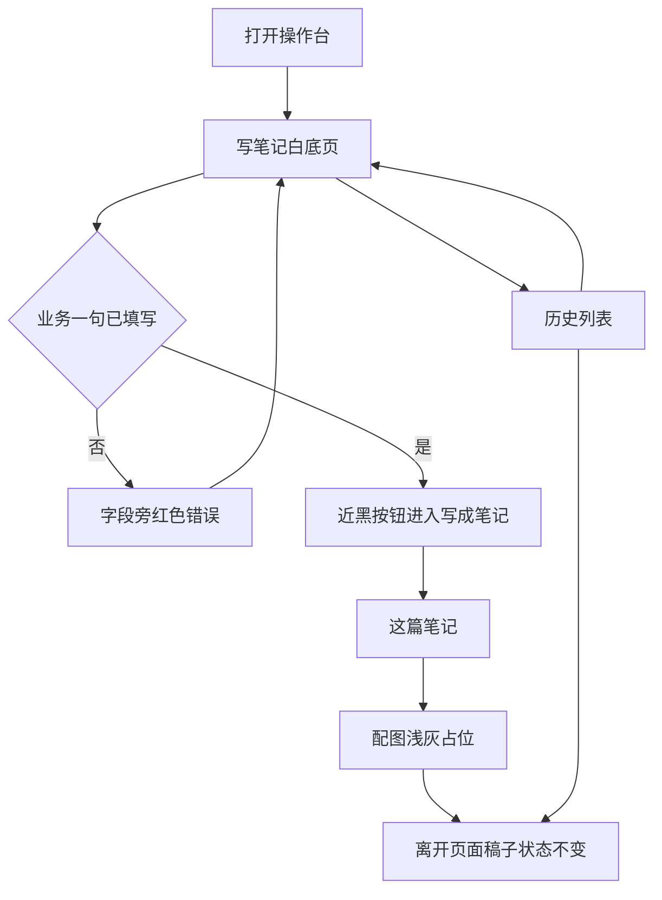

# PRD: 操作台 Cal 配色

| 属性 | 值 |
|------|----|
| 状态 | backlog |
| 范围 | 操作台壳层、写笔记、历史的配色。Release 0 |
| 顺序号 | 00003 |
| 关联文档 | `docs/DESIGN.md`、`docs/workflows/one-post-studio.md`、`docs/mvp-map.md`、`AGENTS.md` |

## 背景与问题

操作台是一份 HTML：侧栏壳、写笔记三步、历史列表。控件用 daisyUI 5 浅色，主按钮跟着默认主题，是紫蓝色。

Cal.com 的设计规范把主操作色定成近黑 `#111111`，页面底是白 `#ffffff`，浅灰面是 `#f5f5f5`，分割线是 `#e5e7eb`，错误是 `#ef4444`。运营要的是同一套写笔记流程，看起来换成这套色。

现有视觉事实源要求色值走 daisyUI 语义色，不另写一套控件。两套要求同时成立的办法是：语义 class 不动，只改主题变量。

## 目标与非目标

### 目标

Release 0 结束时：

1. `docs/DESIGN.md` 仍是改外观前要读的事实源。页侧技术约束保留。配色改成 Cal 色板，并写明每个色值对应哪一个 daisyUI 语义变量。
2. 壳层、写笔记、历史共用这一套变量。主按钮近黑、白字；页面底白；卡片和分割线用浅灰；错误文字是 `#ef4444`。
3. 写笔记的三步、历史的打开和复制、侧栏里未就绪项不可点，行为与改色前相同。

### 非目标

- 不把 Cal 规范放到仓库根目录。根目录不散放文件。
- 不引入 Cal Sans，不改圆角，不改按钮高度，不加顶栏、Hero、功能卡栅格或深色页脚。
- 不把 Cal 的正文色 `#374151` 拆成单独 class。daisyUI 只有一个 `base-content`，本期默认文字用 `#111111`。
- 不改 `note.js`、`history.js`、`shell.js` 的业务行为，不加依赖，不上构建链。
- 不改选题、成稿、封面、生图规则。那些以 `prd-00001` 和 `prd-00002` 为准。

## 术语

| 术语 | 含义 |
|------|------|
| Cal 色板 | 从 Cal.com 设计规范取来的这一组颜色。本期只用色，不用它的营销组件和字体。 |
| 语义变量 | daisyUI 5 的 `--color-*`。页面继续写 `btn-primary`、`bg-base-100` 这类 class。 |
| 壳层 | `src/studio/static/index.html`。侧栏和子页注入点。 |
| 写笔记 | `pages/note.html`。要发什么、这篇笔记、配图。 |
| 历史 | `pages/history.html`。从写笔记页进入，不在侧栏。 |

## 已拍板规则

| 项 | 决定 |
|----|------|
| 事实源位置 | 替换 `docs/DESIGN.md` 的配色约定。不新建根目录 `DESIGN.md`。 |
| 技术栈 | 一份 HTML、Alpine、daisyUI 5、JSON。不改。 |
| 改动方式 | 只在壳层覆盖 `data-theme="light"` 的颜色变量。不改页面 class。 |
| 主按钮 | `--color-primary` `#111111`，`--color-primary-content` `#ffffff`。 |
| 页面底 | `--color-base-100` `#ffffff`。 |
| 浅灰面 | `--color-base-200` `#f5f5f5`。 |
| 分割线 | `--color-base-300` `#e5e7eb`。 |
| 默认文字 | `--color-base-content` `#111111`。 |
| 错误 / 成功 / 警告 | `#ef4444` / `#10b981` / `#f59e0b`。 |
| 点缀蓝 | `--color-accent` `#3b82f6`。不拿来做主按钮。 |
| 正文灰 | `#374151` 本期不单独落地。 |

## 用户与角色

| 角色 | 目标 |
|------|------|
| 运营 | 在同一套步骤里写笔记、复制、看历史。主操作一眼能认出来。 |
| 维护者 | 改外观时先读 `docs/DESIGN.md`，用语义变量，不在组件里写死另一套色。 |

## 功能域

色值只写在壳层的主题覆盖里。写笔记和历史由壳层注入同一文档，因此跟着变，不必各写一份。

对应关系：

| 语义变量 | 色值 | 页面上看见的 |
|----------|------|----------------|
| `--color-primary` | `#111111` | 「写成笔记」「让画面跟上」「写新的一篇」 |
| `--color-primary-content` | `#ffffff` | 上述按钮上的字 |
| `--color-base-100` | `#ffffff` | 页面底、侧栏底 |
| `--color-base-200` | `#f5f5f5` | 配图占位等浅灰面 |
| `--color-base-300` | `#e5e7eb` | 边框、侧栏分隔 |
| `--color-base-content` | `#111111` | 标题和正文 |
| `--color-error` | `#ef4444` | 字段错误、任务错误 |
| `--color-error-content` | `#ffffff` | 错误底上的字 |
| `--color-success` | `#10b981` | 成功语义 |
| `--color-success-content` | `#ffffff` | 成功底上的字 |
| `--color-warning` | `#f59e0b` | 警告语义 |
| `--color-warning-content` | `#111111` | 警告底上的字 |
| `--color-accent` | `#3b82f6` | 点缀，不是主按钮 |
| `--color-accent-content` | `#ffffff` | 点缀底上的字 |

圆角、按钮尺寸、间距继续跟 daisyUI 5 浅色默认控件。

## 用户故事地图与版本切片

### 旅程主干

| 步 | 人在做什么 | 起止 |
|----|------------|------|
| 1 | 打开操作台，看见白底侧栏和写笔记页 | Entry |
| 2 | 填写要发什么，点近黑的「写成笔记」 | |
| 3 | 看这篇笔记，需要时点「让画面跟上」，再看配图 | |
| 4 | 点「以前的笔记」，在历史里复制或打开 | |
| 5 | 从历史回到写新的一篇 | |
| 6 | 关掉页面。配色不改变稿子是否写完 | Exit / Teardown |

未填业务一句时，「写成笔记」仍不可用或点了只在字段旁报错，不发请求。这条沿用现有操作台，不因改色放宽。

### 故事地图

#### Release 0

1. 作为运营，我想主按钮是近黑白字，以便知道哪一个是下一步。
   - 验收：写笔记页的「写成笔记」「让画面跟上」，以及历史页的「写新的一篇」，背景为 `#111111`，文字为 `#ffffff`。

2. 作为运营，我想页面保持白底、浅灰边，以便读稿时不被色块打断。
   - 验收：壳层、写笔记、历史的页面底为 `#ffffff`，边框为 `#e5e7eb`，配图占位一类浅灰面为 `#f5f5f5`。

3. 作为运营，我想填错时错误仍然是红的，以便和正文分开。
   - 验收：业务一句为空就点生成时，字段旁错误文字为 `#ef4444`。不因此发出成稿请求。

4. 作为运营，我想换了颜色之后步骤还是原来的三步，以便不用重新学。
   - 验收：仍是「要发什么」「这篇笔记」「配图」。没有笔记时后两步去不了。侧栏里「选题」等未就绪项仍不可点。

5. 作为运营，我想从写笔记进历史再回来，以便接着写或复制旧稿。
   - 验收：「以前的笔记」打开历史列表。「写新的一篇」回到写笔记。复制按钮仍在，不因配色消失。

6. 作为维护者，我想以后改色只改事实源和主题变量，以便页面 class 不再散落色值。
   - 验收：`docs/DESIGN.md` 写明上表。壳层只覆盖这些变量。`note.html` 与 `history.html` 不新增手写颜色。

### Release 0 可验收结果

打开操作台：白底，主按钮近黑白字，边框浅灰，错误为红。写笔记仍是三步，历史仍从写笔记进入再返回。未就绪菜单不可点。没有 Release 1。字体、圆角、营销页结构、正文灰 `#374151` 都在非目标里，不另开一版。

## 核心流程与状态机图



生成是否成功、待重算、生图，仍按 `prd-00001` 与 `prd-00002`。本图只约束配色跟着这些页面走，不新开一条业务分支。

配色本身没有业务状态。页面在三处之间切换，色值不随页面改变：

```mermaid
stateDiagram-v2
  [*] --> Shell
  Shell --> Note: 默认进入写笔记
  Note --> History: 以前的笔记
  History --> Note: 写新的一篇
  Note --> Note: 三步之间切换
  Note --> [*]: 离开
  History --> [*]: 离开
```

没有死胡同：历史可以回到写笔记；写笔记可以进入历史。未就绪侧栏项不产生新状态。

## 数据与 API 衔接

没有新字段，没有新接口。成稿、提示词、生图仍走现有 `onePost`。配色不读写 `output/one-post/posts/`。

## 假设与待确认

| 项 | 处理 |
|----|------|
| daisyUI 默认主色是紫蓝 | 用主题变量覆盖。不改 class 名。 |
| 子页是注入进壳层的片段 | 变量写在 `index.html`，子页继承。 |
| 禁用按钮 | 继续用 daisyUI 的禁用态，不另做 Cal 的 `#e5e7eb` 禁用底。 |
| 侧栏当前项 | 继续用现有 `menu-active`，不改 class。颜色跟着被覆盖的语义变量走。 |
| 正文 `#374151` | 本期不拆。默认文字全部 `#111111`。 |

## 修订记录

| 日期 | 说明 |
|------|------|
| 2026-10-14 | 初稿。操作台只换 Cal 色板，技术栈和步骤不动。 |
