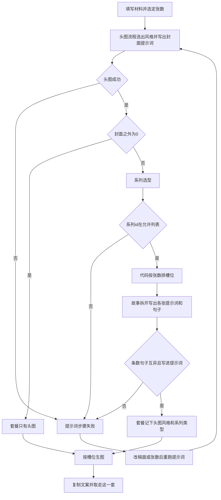
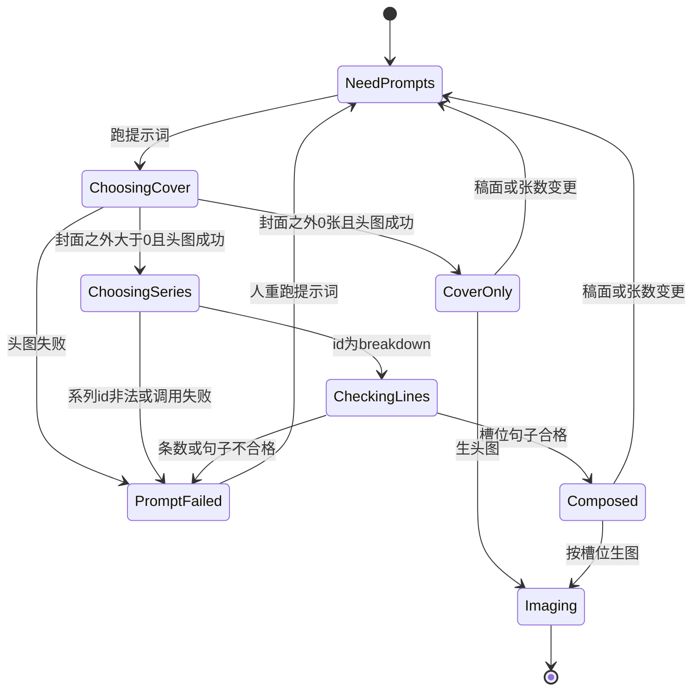
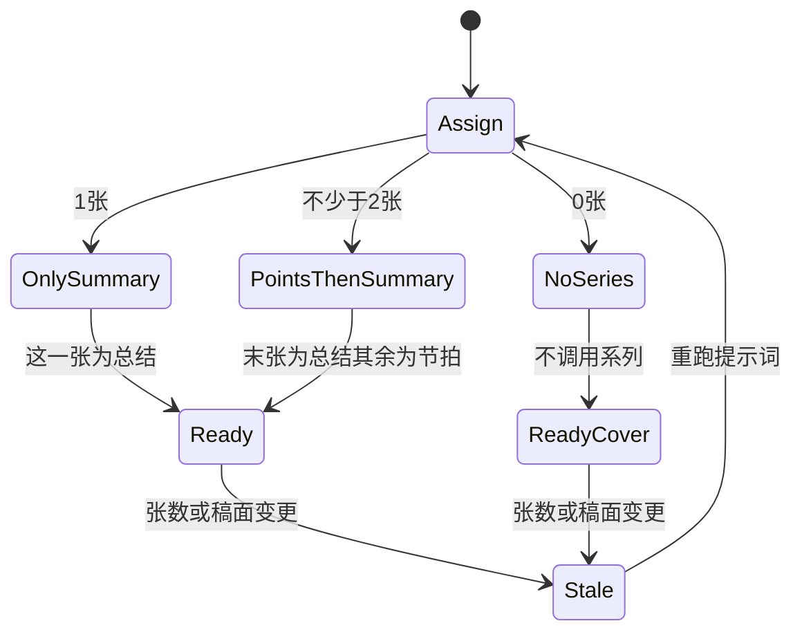

# PRD: 图集：头图风格 × 系列类型

| 属性 | 值 |
|------|----|
| 状态 | backlog |
| 范围 | 一篇图文的整套图。Release 0 |
| 顺序号 | 00004 |
| 关联文档 | `specs/prds/prd-00001-one-post-from-article.md`、`specs/prds/prd-00002-cover-feed-hook.md`、`docs/mvp-map.md`、`docs/workflows/one-post-studio.md`、`docs/DESIGN.md`、`AGENTS.md` |

## 背景与问题

`prd-00001` 能出 1 张封面和 0–9 张配图。配图提示词今天在 `assets/prompts/one-post/gallery.md`：按张数一次写完，画面彼此分开，并明确不要把可阅读的中文排进画面。

`prd-00002` 把头图改成可扩展的风格。模型在故事句（`story`）和对比（`compare`）里选一种，再套用该风格的画面和文字规则。那一篇写明：整套图是总分总，封面是开头的「总」；配图里的「分」和收束的「总」留到后面。

素人号发出去的是一套图，不是一张氛围图加几张互不相关的配图。头图用哪一种画法，和后面几张怎么把故事拆开，是两件事。步骤「第一、第二、第三」和并列要点，槽位相同：中间每一张只讲一个节拍，最后一张收束。张数仍由人定，因为存在只发头图的情况。

把每一种头图和每一种系列的搭配各写一份提示词，加一种就要改一整片。头图风格和系列类型要分开选、分开改，运行时再拼成这一套。

## 目标与非目标

### 目标

Release 0 结束时：

1. 人仍用现在的控件填写「封面之外还要几张」，整数，最小 0，最大 9。
2. 头图继续按 `prd-00002` 选择风格。本期风格仍是 `story` 与 `compare`。风格只决定封面那一张怎么画。
3. 封面之外的张数大于 0 时，模型在系列允许列表里选一种。本期列表只有 `breakdown`（故事拆开）。选中后按张数排槽位，写出等长的系列提示词。
4. 槽位由代码按张数决定，模型不能改结构。0 张不跑系列。1 张时这一张是总结。2 张及以上时，最后一张是总结，前面每一张是一个节拍。
5. 这一套在数据里记成一对：头图风格 id，加上系列类型 id。张数为 0 时系列 id 为空。不为每一种搭配另写提示词文件。
6. 系列图每一张有一句可阅读中文。这一句写进该张生图提示词。验收看提示词里有没有这句原文。
7. 长提示词只在 markdown。语气和大字规则继续只装填，并注入本期的系列类型文件。

### 非目标

- 第二种系列的提示词正文。加一种等于加 `sets/types/<id>.md`，并把 id 放进允许列表。那是以后的事，不在本期占一版。
- 新的头图风格。`story` 与 `compare` 的规则仍以 `prd-00002` 为准。
- 把痛点总起写成唯一的头图。封面那句话可以写成痛点，也可以按稿面写成别的交代方式。头图画法仍在现有风格里选。
- 把「步骤拆解」和「并列要点」拆成两种系列。本期都走 `breakdown` 的节拍槽。
- 为「故事句 + 故事拆开」这类搭配各写一份套餐提示词。
- 页面上让人选头图风格或系列类型。
- 官号或其他语气的提示词正文。
- 用程序把字叠到图上。图内中文仍由生图模型画，不验收每个字都写对。
- 改生图模型、比例、质量、输出格式，或改成一轮生成全部图片。
- 自动发布、爬取、与捞客仓对接。
- 广告法、违禁词检查。
- 按点赞或别的数据自动改张数、改风格、改系列。

本期没有 Release 1。上面这些溢出项都留在非目标里。

## 术语

| 术语 | 含义 |
|------|------|
| 图集 | 这一篇要发出去的全部图片。至少含 1 张头图。封面之外有图时，头图和系列图属于同一套。 |
| 头图风格 | A 组。id 为 `story` 或 `compare`。只作用于封面那一张。规则文件仍在 `assets/prompts/one-post/cover/`。 |
| 系列类型 | B 组。封面之外的图用哪一种结构。本期 id 只有 `breakdown`。 |
| 套餐 | C。一次提示词成功后的一对 `{ coverType, setType }`。它是运行结果，不是第三组提示词文件。 |
| 节拍 | 槽位角色 `point`。故事拆开后的一拍。正文若有先后，这一句可以写成第几步；正文若是并列，这一句写成一个要点。槽位合同相同。 |
| 总结 | 槽位角色 `summary`。收束整篇的一句。不新开一个节拍。 |
| 系列那一句 | `lines[i]`。要画进第 i 张系列图的可阅读中文，必须原样出现在该张生图提示词里。 |
| 封面之外的张数 | 现有字段 `galleryCount`。0 到 9。整套张数是 1 加上这个数。 |

## 已拍板规则

| 项 | 决定 |
|----|------|
| 谁选头图风格 | 模型。规则沿用 `prd-00002`。页面没有风格开关。 |
| 谁选系列 | 模型。只在封面之外的张数大于 0 时调用。页面没有系列开关。 |
| 系列允许列表 | 只有 `breakdown`。别的 id、空字符串、多类型都算这一步失败。 |
| 谁排槽位 | 代码。模型只为已经排好的槽位写句子和画面。 |
| 0 张 | 只发头图。不读系列选型，不读系列类型文件。`setType` 为空字符串。系列提示词为空数组。 |
| 1 张 | 整套两张：头图，加上这一张总结。角色数组为 `['summary']`。 |
| 2 张及以上 | 角色数组长度等于张数。最后一项是 `summary`，前面每一项是 `point`。例如封面之外 8 张时，整套 9 张：第 1 张是头图，第 2 到第 8 张是节拍，第 9 张是总结。 |
| 步骤和要点 | 合成 `breakdown`。不因为「有先后」或「并列」再选一次系列。 |
| 失败后 | 不调用生图。不把半截新的头图提示词或系列提示词写成当前成功结果。标题、正文、话题保留。 |
| 系列图上的字 | 每张的可阅读中文就是该张 `lines[i]`，不另写一句。 |
| 头图上的字 | 仍按 `prd-00002` 的对应风格。系列规则不改头图。 |
| 不编造 | 系列那一句不得写出稿面和封面那句话里都没有的数字、人名、头衔。 |
| 句子互异 | 全部系列那一句彼此不同，且每一句都不同于封面那句话。代码做字符串比对。空句、重复句、与封面那句话相同，都算系列这一步失败。 |
| 生图 | 沿用 `prd-00001`：`openai/gpt-image-2.5-flare`，比例 `3:4`，质量 `medium`，PNG。一次仍只生一张。文件名仍是 `cover.png` 与 `gallery-01.png` 起。 |
| 提示词落点 | 长提示词只出现在本篇列出的 markdown 里。`src/` 只负责读文件、装填变量、按张数排槽位、校验 JSON。 |
| 语气和大字 | 读入 `cover/tone-amateur.md` 与 `cover/large-type.md` 的全文，作为 `{{tone}}`、`{{largeType}}` 填进系列类型文件。这不是模型调用。头图侧的装填方式不变。 |
| 稿面或张数变更 | 标题、正文、话题、用户指定句或封面之外的张数变化后，已有头图风格、系列类型、全部提示词和图片作废。必须重跑提示词才能再生图。成稿模块不因此重跑。 |
| 人改提示词正文 | 允许改已经生成的头图或某一张系列的提示词文本，再只生这一张。模型返回时的「这一句必须在提示词里」只校验模型输出。人改掉句子后，以人留下的提示词生图。 |
| 扩展 | 新系列：新增 `sets/types/<id>.md`，并让代码允许列表和 `sets/choose-type.md` 同时认识这个 id。新头图风格仍按 `prd-00002` 的加文件方式。新搭配自动出现，不用新的套餐文件。 |

## 冲突与决议

| 原规则 | 本 PRD |
|--------|--------|
| `prd-00001`：配图提示词来自 `gallery.md` 一次调用，且不要求图内可阅读中文 | `gallery.md` 退出系列流程。张数大于 0 时改为系列选型加 `breakdown` 类型规则。系列图必须把该张那一句画进画面。 |
| `prd-00002` 非目标：不把配图改成「分」和收束的「总」；配图继续不要求图内文字 | 本篇接上留下的那一半。头图流程仍以 `prd-00002` 为准。封面之外的图改为节拍加总结，并要求图内这一句。 |
| `prd-00002`：配图张数大于 0 时调用 `gallery.md` | 同一位置改为调用系列模块。张数为 0 时两侧都不调用配图或系列文件。 |
| `prd-00001`：验收不要求图里的中文正确 | 系列图与头图相同：验收提示词含要画的那句原文。不验收生成图的每个汉字。 |

头图的句子模块、用户指定句、`story` / `compare` 的画面规则，本篇不改。若与 `prd-00002` 字面冲突，头图以 `prd-00002` 为准，系列以本篇为准。

## 用户与角色

| 角色 | 目标 |
|------|------|
| 账号运营 | 按自己要的张数得到一套图。可以只发头图。张数够时，中间把故事拆开，最后一张收束。不用先选画法或系列。 |
| 提示词维护者 | 改头图风格时只动 `cover/`。改故事拆开的写法时只动 `sets/types/breakdown.md`。以后加一种系列时加一个文件，并让允许列表认识这个 id。 |
| 工程 | 头图调用顺序不变。张数大于 0 时再选系列、排槽位、校验条数和句子。页面不写选版规则。 |

## 功能域

业务代码边界沿用 `prd-00001` 与 `prd-00002`。本刀替换系列提示词的读法，并在笔记页展示这次选中的一对 id。

```text
assets/prompts/one-post/cover/          # 头图。本篇不改这些文件的职责
assets/prompts/one-post/sets/choose-type.md
assets/prompts/one-post/sets/types/breakdown.md
src/prompts/          # 读系列文件、装填、排槽位、校验 id、条数和句子
src/one-post/         # 头图成功后，按张数决定是否调用系列
src/studio/           # 展示头图风格和系列类型；张数控件仍是 0 到 9
```

`gallery.md` 不再被系列流程读取。实现时停止引用，避免无字配图和系列规则并存。

实现时同步 `docs/workflows/one-post-studio.md`：系列提示词不再写「来自单条配图提示词」，并补上类型不在系列允许列表时的停法。该篇已在 `docs/doc_index.md`，摘要若未改变则不必改索引行。

### 张数

控件保持现在的「封面之外还要几张」，加减范围 0 到 9。说明改成三句，让人看出槽位，不新增第二种控件：

- 0：只发头图。
- 1：这一张是总结。
- 2 张起：最后一张是总结，前面每一张是一个节拍。

页面服从 `docs/DESIGN.md`。不新增版式选择，不新增主题。

### 调用顺序

提示词步骤在成稿成功之后运行。头图段的顺序固定，与 `prd-00002` 相同：用户指定句或句子模块，然后头图选型，然后对应的头图类型规则，得到恰好 1 条封面提示词和 `coverType`。

头图段失败则整次失败，不调用系列。

头图段成功之后：

1. 张数为 0：`setType` 为空，系列提示词与系列那一句都是空数组。提示词步骤到此成功。
2. 张数大于 0：代码先排出角色数组。调用 `sets/choose-type.md`。返回的 id 必须是 `breakdown`。再只读 `sets/types/breakdown.md`，得到与张数等长的 `prompts` 和 `lines`。

任一步 JSON 不合格、系列 id 不在允许列表、条数不符、句子为空、句子彼此重复、句子与封面那句话相同、或某一句没有出现在对应提示词里，整次提示词步骤失败。不进入生图。

### 各文件要写出的规则

实现时把下列规则写进对应文件，不要写进 `src/`。头图各文件的正文仍按 `prd-00002`。

`sets/choose-type.md`：根据稿面、封面那句话和封面之外的张数，在允许列表里选一个系列类型。本期允许列表只有 `breakdown`。只返回这个 id，不要发明列表外的类型。只返回 JSON：`type` 为该 id。

`sets/types/breakdown.md`：竖图，比例 3:4。输入里已经写好每一张的角色，按该顺序写。节拍张只讲故事里的一拍，不把两拍画进同一张，不重复头图那一个构图。总结张收束整篇，不新开一拍。每一张的可阅读中文必须是该张那一句的原文，不另写一句。大字规则和素人语气使用注入的 `{{largeType}}`、`{{tone}}`。不得编造稿面和封面那句话里没有的数字、人名、头衔。只返回 JSON：`prompts` 与 `lines` 为等长数组，长度等于张数，项均为非空字符串，且 `prompts[i]` 包含 `lines[i]` 全文。

槽位说明由代码拼成文本再装填，例如张数为 3 时：

```text
1 point
2 point
3 summary
```

模型不返回角色数组。

### 页面上其余行为

提示词成功后，在现有提示词区域用只读文字写出这次的头图风格和系列类型。展示名：`story` 为故事句，`compare` 为对比，`breakdown` 为故事拆开，系列 id 为空为无。没有下拉框，不能改这一对。

人要改某一张的画面或那一句，改该条提示词文本，或重跑提示词。生图、单张重试、待重算和「让画面跟上」沿用现在的操作台。

## 用户故事地图与版本切片

### 旅程主干

| 步 | 人在做什么 | 起止 |
|----|------------|------|
| 1 | 打开操作台，写下业务一句，选定封面之外的张数，原文和封面上的这句话可空 | Entry |
| 2 | 点写成笔记，等到稿面出现 | |
| 3 | 提示词步骤选出头图风格；张数大于 0 时再选出系列并写好每一槽 | |
| 4 | 看见这一对的名字，需要时改某一条提示词 | |
| 5 | 按槽位做出头图和系列图 | |
| 6 | 复制文案，取走这一套图片，自己去发布 | Exit / Teardown |

人在第 2 步之后改标题、正文、话题、指定句或张数，画面标成待重算，回到第 3 步。张数改成 0 再重跑后，只剩头图，系列类型为无。提示词失败时停在第 3 步，稿面还在，不生图。关掉页面再打开，材料和张数还在。

### 故事地图

#### Release 0

1. 作为运营，我想封面之外填 0，以便只发一张头图。
   - 验收：张数为 0 时不读 `sets/choose-type.md`，不读 `sets/types/breakdown.md`，也不读 `gallery.md`。成功后 `setType` 为空，系列提示词为空数组。头图提示词仍按 `prd-00002` 得到 1 条。

2. 作为运营，我想一共只加一张时，这一张是总结，以便两张图也能收束。
   - 验收：张数为 1 且提示词成功时，角色只有 `summary`。`lines` 长度为 1，该句出现在这一条生图提示词里，且不同于封面那句话。

3. 作为运营，我想张数再多时中间拆开、最后收束，以便一套图是总分总。
   - 验收：张数大于或等于 2 时，角色长度等于张数，末项为 `summary`，其余为 `point`。封面之外 8 张时系列为 7 个节拍加 1 个总结。每条提示词包含对应的那一句。

4. 作为运营，我想步骤和并列要点走同一种系列，以便不用先判断稿子属于哪一类套图。
   - 验收：允许列表只有 `breakdown`。选型文件要求只返回这个 id。代码不根据「有先后」或「并列」切换到另一个类型文件。

5. 作为运营，我想模型选了不存在的系列时停下来，以便不会用错规则生图。
   - 验收：`type` 不是 `breakdown` 时，提示词步骤失败，不调用生图，不把这份非法结果写成当前系列提示词，也不把这次未完成的头图提示词写成成功结果。

6. 作为运营，我想头图风格和系列分开，以便封面仍可以是故事句或对比。
   - 验收：同一次成功结果里同时有 `coverType`（`story` 或 `compare`）和 `setType`（张数大于 0 时为 `breakdown`）。不存在按搭配命名的第三份提示词文件。头图类型文件与系列类型文件分别读取。

7. 作为提示词维护者，我想系列的选型和结构分开，以便以后加一种系列时不用改头图。
   - 验收：`sets/choose-type.md` 与 `sets/types/breakdown.md` 各自存在。长提示词不在 `src/`。`{{tone}}` 与 `{{largeType}}` 被装填进系列类型文件，装填本身不是模型调用。`gallery.md` 不被读取。

8. 作为运营，我想每一张系列图上的字就是这一拍或这句总结，以便划过去能看懂。
   - 验收：模型返回的 `prompts[i]` 包含 `lines[i]` 全文。类型文件要求不另写一句、竖图 3:4、节拍不重复头图构图。测试不把头图的单句规则套到系列文件的槽位数量上。

9. 作为运营，我想句子重复或空着时停下来，以便不会硬凑出一套一样的图。
   - 验收：任一句为空、任两句相同、或任一句等于封面那句话时，提示词步骤失败，不生图。

10. 作为运营，我想改了张数之后旧图不能继续用，以便槽位和张数是同一套。
    - 验收：张数变化后生图不可用，直到提示词步骤成功。成功后按新张数重排角色。张数变少时，多出来的 `gallery-*.png` 删掉。

11. 作为运营，我想系列失败时稿子还在，以便不用从头写业务一句。
    - 验收：选型或系列规则失败时，标题、正文、话题保留，错误可见，生图不开始。缺 `DEEPSEEK_API_KEY` 时同样停在这一步。

12. 作为运营，我想看见这次用了哪种头图和哪种系列，以便知道这一套是怎么拼的。
    - 验收：提示词成功后页面有只读的头图风格名和系列名。张数为 0 时系列名为无。页面上没有可以改这两个值的控件。

### Release 0 可验收结果

操作台里把封面之外的张数设为 0，写成一篇笔记并跑完提示词：有 1 条头图提示词，系列类型为无，不读系列文件，也不读 `gallery.md`。把张数设为 1 再跑：系列类型为故事拆开，仅有的一张角色是总结。把张数设为 3 再跑：前两张是节拍，最后一张是总结，三句互不相同且都写进对应提示词。把系列 id 换成允许列表之外的值时，不生图。页面能看见这次的头图风格和系列名，且不能手改。

本期没有 Release 1。第二种系列、新的头图风格、官号语气、程序叠字、自动发布，都在非目标里，不另开一版。

## 核心流程与状态机图



头图段的内部步骤以 `prd-00002` 为准，本图不再展开。系列选型、条数或句子不合格都进 `failStep`，不写新的成功提示词，不生图。人改张数或稿面后重跑，走回头图流程，再按新张数决定有没有系列。

图集这一对的状态：



槽位如何跟着张数走：



没有死胡同。失败回到重跑提示词。稿面或张数变更把已成功的套餐送回 `NeedPrompts`，旧图作废。张数改成 0 后，下一次成功落在 `CoverOnly`，系列槽位不再存在。

## 数据与 API 衔接

没有新的数据库。仍写在 `output/one-post/posts/<id>/draft.json`。

在 `prd-00002` 的字段上增加：

| 字段 | 规则 |
|------|------|
| `galleryCount` | 仍是 0 到 9 的整数。含义仍是封面之外的张数。 |
| `prompts.coverType` | `story` 或 `compare`。提示词步骤成功时必有。 |
| `prompts.cover` | 恰好 1 条头图生图提示词。 |
| `prompts.setType` | 张数为 0 时为空字符串。张数大于 0 且成功时为 `breakdown`。 |
| `prompts.gallery` | 字符串数组，长度等于张数。项是生图提示词。 |
| `prompts.galleryLines` | 字符串数组，与 `gallery` 等长。项是该张要画上的那一句。张数为 0 时为 `[]`。 |
| `prompts.galleryRoles` | 字符串数组，与 `gallery` 等长。项只允许 `point` 或 `summary`。由代码写入，不由模型返回。 |

`onePost.generateDraft` 仍是先成稿、再提示词。成稿不写系列类型。

`onePost.generatePrompts` 不跑成稿。头图段按 `prd-00002` 重跑。然后按当前张数决定跳过系列，或重跑系列选型与 `breakdown`。

生图读的是已经落盘的 `prompts.cover` 与 `prompts.gallery`。生图阶段不再选风格、不再选系列、不再排槽位。

## 假设与待确认

| 项 | 处理 |
|----|------|
| 本期只有一种系列，选型仍要调用模型 | 调用。返回值必须是 `breakdown`。这样加第二种系列时不用改调用顺序。 |
| 稿子里的节拍少于人所填的张数 | 类型文件要求不得复制句子、不得编造事实。做不到则这一步失败。人把张数改小后重跑。代码不另做「节拍够不够」的语义判断。 |
| 生图模型把中文画错 | 沿用非目标。人改该条提示词或重跑提示词后再生这一张。不因此加叠字程序。 |
| 人改提示词后，`galleryLines` 和文本不一致 | 允许。生图以人改过的 `prompts.gallery` 为准。`galleryLines` 留到下一次提示词成功再覆盖。 |
| 封面那句话本身是痛点 | 允许，由头图句子和头图风格决定。系列模块不把痛点写成头图的固定角色。 |

## 修订记录

| 日期 | 说明 |
|------|------|
| 2026-10-14 | 初稿。头图风格与系列类型分开；本期系列只有故事拆开；槽位按封面之外的张数排。 |
