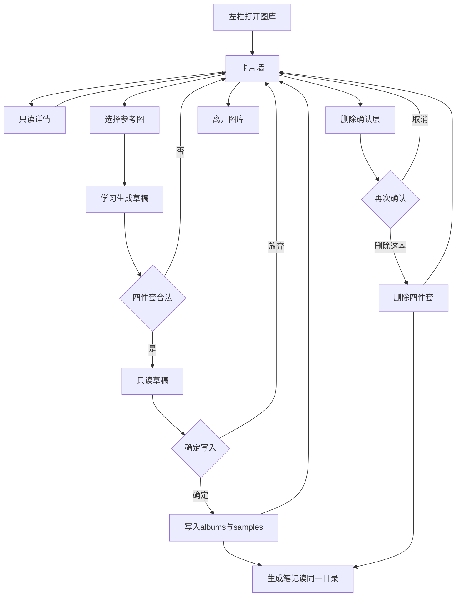
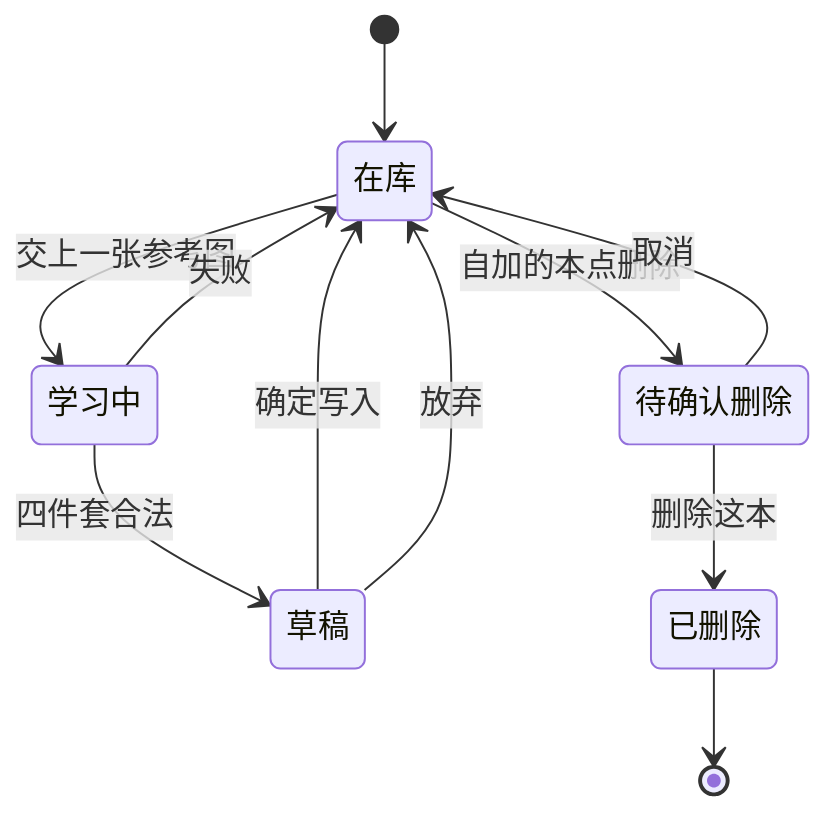

# PRD: 图库管理

| 属性 | 值 |
|------|----|
| 状态 | 工程：accepted（见文末「工程验收状态」） |
| 范围 | 操作台图册库。Release 0 |
| 顺序号 | 00005 |
| 关联文档 | `docs/workflows/one-post-studio.md`、`docs/DESIGN.md`、`docs/mvp-map.md`、`AGENTS.md`、`specs/prds/prd-00001-one-post-from-article.md` |

## 背景与问题

一篇图文的画面风格落在图册上。今天五本出厂图册在 `assets/prompts/one-post/albums/`，生成笔记页的浅灰工具卡里可以展开「图册风格」：竖卡看样图，点开看说明和题词，再按风格重算提示词。

运营要管柜子时没有独立入口。要先写成一篇笔记，才能看见图册。加一本新风格没有页面动作。删一本也没有。把「管理柜子」和「写这一篇」绑在同一步，柜子永远围着稿转。

图库要回答三件事：柜子里有哪些本、加一本、拿走一本。生成笔记继续回答：这一篇用哪本、要不要按风格重算提示词。

## 目标与非目标

### 目标

Release 0 结束时：

1. 操作台左栏在「生成笔记」下面有一项「图库」，可以点开，不再标「还没做」。
2. 图库页列出当前全部图册，竖卡与样图的呈现与生成笔记里「图册风格」一致。
3. 点开一本，看见样图、名称、说明与图册题词。这一页没有当前笔记，没有「按此风格重算提示词」，不能改标题或正文。
4. 人可以「增加」：交一张参考图。系统学习成标准四件套的**草稿**。草稿只读。人点「确定写入」后才落盘；点「放弃」或学习失败时，`albums/` 与 `samples/` 文件数不变。
5. 人可以删除自己加过的整本图册，须二次确认。出厂五本（`000001`～`000005`）没有删除入口。
6. 学习结果允许出现**新的 kind**（不在出厂五种闭集里）。确认写入后，生成笔记的图册列表能看见它，并能按该册的 `copySchema` 与题词占位符走完策划和绘图，不必为每一种新 kind 再写一段 JS 分支。出厂五种的现有分支保持不动。
7. 页面服从 `docs/DESIGN.md`：白底、近黑主按钮、浅灰卡片、daisyUI 5，不另起一套色板或字体。

### 非目标

- 在图库页改当前笔记的标题、正文、话题，或出现「按此风格重算提示词」。重算留在生成笔记页。
- 学习出草稿后，在草稿上改字再写入。本期草稿只读：确定或放弃。
- 写入后再改 json / md / copy-sample / 样图的在线编辑器。
- 批量导入多张参考图、拖拽排序、给图册改名、撤销删除。
- 从网上下载或爬取参考图。
- 自动发布、与捞客仓对接、广告法检查。
- 为插件安装目录不可写单独做一套用户数据镜像。Release 0 以本机操作台写入仓库 `assets/prompts/one-post/` 为准；插件可写性见开放项。
- 改生图模型、比例、质量，或改成一轮生成全部图片。

本期没有 Release 1。上面这些溢出项都留在非目标或开放项里。

## 术语

| 术语 | 含义 |
|------|------|
| 图库 | 操作台左栏独立页面。只管理图册，不编辑某一篇笔记。 |
| 图册 | 一本画面风格。标准四件套：`albums/<id>.json`、`albums/<id>.md`、`albums/<id>.copy-sample.md`、`samples/<id>.jpg`（或既有扩展名约定）。 |
| 图册 id | `{六位序号}.{kind}.{slug}`，例如 `000001.magazine.dazibao`。序号递增；kind 与 slug 为小写英文与连字符。 |
| kind | 文案 layout 族。出厂五种：`magazine`、`scrapbook`、`conceptual`、`card`、`infographic`。学习可以产出新 kind。 |
| 出厂五本 | id 前缀为 `000001`～`000005` 的五本。不可删除。 |
| 自加图册 | 经图库「确定写入」落盘的图册。可以删除。 |
| 学习 | 人交一张参考图后，模型产出标准四件套内容，先落在内存或临时草稿中，未写入 `albums/` / `samples/`。 |
| 草稿 | 学习成功后的只读预览：样图（人交的那张）、拟用的 id / label / hint、题词正文、copySchema 等。未确定前目录不变。 |
| 通用槽 | 对新 kind：生成笔记按该册 `copySchema` 解析策划字段，按题词中的 `{{占位符}}` 装填绘图，不再按 kind 名写死分支。 |

## 已拍板规则

| 项 | 决定 |
|----|------|
| 菜单位置 | `shell.js` 的 `menu` 里，「生成笔记」下一项为「图库」，`id` 建议 `albums` 或 `library`，`ready: true`。文案固定为「图库」。 |
| 页面职责 | 只管理图册。无当前笔记上下文。详情浮层有样图、名称、说明、题词；无「按此风格重算提示词」。 |
| 与生成笔记的关系 | 两边读同一份图册目录。笔记页的「图册风格」与重算按钮保留，行为不变。图库写入或删除后，笔记页再打开或再拉列表时看见新结果。 |
| 增加的输入 | 仅一张参考图片。不要表单墙（不要人手填 kind、slug、hint）。 |
| 学习结果 | 模型产出完整四件套字段。kind 可以是出厂五种之一，也可以是新 kind。序号接在当前最大序号之后。参考图本身成为 `samples/<id>.jpg`（写入时再落盘）。 |
| 草稿再确认 | 学完先出草稿。人点「确定写入」才写文件。「放弃」或学习失败：零落盘。 |
| 删除范围 | 删整本：json、md、copy-sample、样图一起删。不提供只删样图。 |
| 删除确认 | 先点「删除」，再在确认层点「删除这本」。取消为默认安全出口。 |
| 出厂保护 | `000001`～`000005` 无删除控件；接口若收到删除请求也拒绝。 |
| 新 kind | Release 0 必须让确认写入的新 kind 在生成笔记里可用：列表可见、策划与绘图走通用槽。出厂五种的 `frame` / `render` 分支不拆。 |
| 生成进行中 | 若某一篇笔记正在用某本图册做提示词或生图，删除该本时拒绝，并说明等这一轮结束。 |
| 视觉 | 沿用 `docs/DESIGN.md`。卡片墙复用笔记页竖卡节奏（大屏多列、窄屏少列）。空列表时给出「增加」入口，不留空白屏。 |
| 写入根路径 | Release 0：本机操作台写 `assets/prompts/one-post/` 下现有约定目录。 |

## 为什么图库没有「重算提示词」

生成笔记回答「这一篇用哪本」。图库回答「柜子里有哪些本」。重算提示词依赖当前稿面的标题、正文、张数与已有策划结果；人从左栏进图库时没有这篇稿。若在图库放重算，就会长出第二套笔记编辑器。重算继续只出现在生成笔记的图册详情里。

## 用户与角色

| 角色 | 目标 |
|------|------|
| 账号运营 | 一眼看见全部图册；丢一张参考图长出一本；删掉不要的自加图册。 |
| 写笔记的人（同一人） | 生成笔记时仍从同一柜子抽册、看样图、按风格重算。 |
| 工程 | 学习失败不落半套文件；新 kind 走通用槽，避免每加一种 layout 就改一截 JS。 |

## 功能域

```text
src/studio/static/shell.js              # 左栏菜单增加「图库」
src/studio/static/pages/<图库页>.*      # 卡片墙、详情、增加、删除确认
src/one-post/ 或 src/prompts/album/     # list / 学习草稿 / 确认写入 / 删除
assets/prompts/one-post/albums/         # 图册三件套落盘
assets/prompts/one-post/samples/        # 样图落盘
```

长提示词仍只出现在 markdown；学习用的系统提示若需要新文件，放在 `assets/prompts/one-post/` 下，不写进 `src/`。实现时同步 `docs/workflows/one-post-studio.md` 与 `docs/DESIGN.md` 中关于新页面的一句说明。

### 增加（学习 → 草稿 → 写入）

1. 人点「增加」，选择一张本机图片。
2. 系统校验类型与大小；不合格则停在选择步，不调用模型。
3. 调用学习：产出拟用的 id、kind、slug、label、hint、copySchema、题词 md、copy-sample，以及将作为样图的那张图（仍在草稿）。
4. 页面展示只读草稿。人点「确定写入」：原子写入四件套；任一步失败则回滚到写入前，目录不变。人点「放弃」：丢弃草稿。
5. 写入成功后卡片墙出现新卡；生成笔记再拉 `listAlbums` 时能看见。

### 删除

1. 仅自加图册显示「删除」。
2. 确认层写清将删除的图册名称与「不可撤销」。
3. 确认后删除四件文件；列表刷新。正在被进行中的生成任务占用时拒绝删除。

### 新 kind 与通用槽

出厂五种继续走现有 `normalizeFrame` / `renderAlbumPrompt` 分支。

对**不在出厂五种列表里**的 kind：

- 目录枚举：`albums/*.json` 扫描即可入库，不再用闭集把新 kind 挡在门外。
- 策划：按该册 `copySchema` 约定的字段形状校验模型返回（至少能得到每一张用于上图的展示句）。
- 绘图：题词 md 里的 `{{占位符}}` 与策划字段同名装填；须满足题词结构 v2（`promptSheetVersion: 2`：1～10 规格槽与第 11 项主题绘画内容；无「系列统一规则」槽）。
- 验收：用一本新 kind 的自加图册，在生成笔记里指定该 look 重算提示词或首轮抽到该册时，提示词步骤能成功，不因「kind 不在允许列表」失败。

## 用户故事地图与版本切片

### 旅程主干

| 步 | 人在做什么 | 起止 |
|----|------------|------|
| 1 | 打开操作台，在左栏点「图库」 | Entry |
| 2 | 看见卡片墙（至少出厂五本样图或「无样图」占位） | |
| 3 | 点开一本，只读样图、名称、说明、题词；关闭浮层回到墙 | |
| 4a | 点「增加」，交一张参考图，等待学习 | |
| 4b | 查看只读草稿，点「确定写入」或「放弃」 | |
| 5 | 对自加图册点「删除」，在确认层取消或「删除这本」 | |
| 6 | 离开图库；需要写稿时再进「生成笔记」用同一柜子 | Exit / Teardown |

学习失败停在第 4a，目录不变，人可重选图再试。删除取消停在第 5，图册仍在。关掉页面时未确认的草稿丢弃，不落盘。

### 故事地图

#### Release 0

1. 作为运营，我想在左栏打开图库，以便管理风格时不必先写成一篇笔记。
   - 验收：菜单「图库」可点；进入后主区是图册卡片墙，不是「要发什么 / 这篇笔记」两步条。

2. 作为运营，我想在图库里看到和生成笔记里一样的样图竖卡，以便辨认风格。
   - 验收：出厂五本在列表中；有样图的显示样图，无样图显示「无样图」。点卡打开详情：样图、label、hint、题词正文。

3. 作为运营，我想在图库详情里不要出现重算提示词，以便不会误以为这里在改某一篇。
   - 验收：图库详情无「按此风格重算提示词」、无标题正文编辑。生成笔记页的重算按钮仍在。

4. 作为运营，我想交一张参考图后先看到草稿再决定写入，以便半成品不会进随机抽册池。
   - 验收：学习成功后出现只读草稿与「确定写入」「放弃」。在点确定之前，`albums/` 与 `samples/` 不出现新 id 对应文件。放弃后草稿消失且目录不变。

5. 作为运营，我想学习失败时柜子原样，以便可以换一张图再试。
   - 验收：模型失败或四件套校验失败时，可见人话错误；目录文件集合与学习前一致。

6. 作为运营，我想确定写入后新图册立刻出现在图库，并在生成笔记的风格列表里可用。
   - 验收：确定后四件套落盘；图库刷新可见；`listAlbums`（或等价接口）含新 id；生成笔记展开图册风格可见该册。

7. 作为运营，我想学习可以长出新的 kind，以便风格不限于出厂五种画法族。
   - 验收：存在至少一条路径：草稿 kind 不在出厂五种内，确定写入后生成笔记仍能对该 look 完成提示词步骤（通用槽），不报「kind 不在允许列表」。

8. 作为运营，我想删除自己加的图册时再确认一次，以便手滑不会直接删掉。
   - 验收：第一次点删除只打开确认层；点取消后文件仍在；点「删除这本」后四件文件皆不存在，列表不再显示。

9. 作为运营，我想出厂五本删不掉，以便柜子不会被清空到无法抽册。
   - 验收：出厂五本无删除控件；即便调用删除接口也返回失败且文件仍在。

10. 作为运营，我想空柜子时知道下一步，以便不会对着白屏发呆。
    - 验收：若列表为空（测试夹具可造），页面有说明与「增加」入口。

### Release 0 可验收结果

左栏进入图库，看见出厂五本卡片。详情只读、无重算。增加：交图 → 草稿 → 确定后多一套四件套；放弃或失败零落盘。自加图册二次确认后删净；出厂五本不可删。一本新 kind 的自加图册能在生成笔记里被选中并跑通提示词。视觉仍是现有壳与 Cal 色板。

本期没有 Release 1。

## 核心流程与状态机图



图册生命周期：



出厂五本没有「待确认删除」边。未确认的草稿不是「在库」状态，重启或离开页面后丢弃。

## 数据与 API 衔接（高层）

| 能力 | 说明 |
|------|------|
| 列表 | 复用或扩展现有 `listAlbums` / `previewAlbumSample` / `getAlbumDetail`。详情在图库侧不暴露重算。 |
| 学习草稿 | 新方法：入参为参考图（本机路径或字节约定由实现定）；出参为草稿对象，**不写盘**。 |
| 确认写入 | 新方法：入参为草稿 id 或完整草稿；成功则四件套落盘；失败则目录与调用前一致。 |
| 删除 | 新方法：入参图册 id；出厂五本与进行中占用拒绝；成功则四件套删除。 |
| 生成笔记 | 继续用 look / 图册 id；新 kind 走通用槽，出厂五种走旧分支。 |

具体 JSON 字段名由工程在实现时与现有 `onePost` 桥对齐，本 PRD 不锁字段名。

## 假设与开放项

| 项 | 说明 |
|----|------|
| 假设 | Release 0 在本机 `node scripts/run-studio.js` 下，对仓库内 `assets/prompts/one-post/` 可写。 |
| 开放 | Dex Buddy 插件安装目录只读时，增加/删除如何提示或是否改写用户数据目录。 |
| 开放 | 参考图体积上限与允许 MIME（建议 jpeg/png/webp，上限由工程定一个明确数）。 |
| 开放 | 学习所用模型与是否复用 DeepSeek 视觉能力；缺密钥时的人话错误。 |
| 开放 | 自加图册的「出厂」标记除序号前缀外是否再加 json 字段 `builtin: true`（实现可选，验收以五本 id 为准）。 |
| 待与工程对齐 | 通用槽的最小 `copySchema` 形状与题词必填占位符列表，写成测试夹具。 |

## 修订记录

| 日期 | 说明 |
|------|------|
| 2026-10-19 | 初稿。左栏图库管理页；学习草稿后确认写入；出厂五本不可删；新 kind 通用槽；明确无重算、无笔记编辑。 |

## 1. 工程验收状态

> 由 `/team:prd-accept` 维护；勿手工编造「通过」。最后更新：2026-10-20T01:11:33Z，dev@2ec200b，范围：R0。用户确认验收通过并关闭本 PRD。

### 总览

| 项 | 值 |
|----|-----|
| 工程状态 | accepted |
| 验收判定 | Release 0 能力已落地；用户确认验收通过 |
| 最近验收 | 2026-10-20T01:11:33Z / dev@2ec200b |
| 代码提交 | 2ec200b |

摘要：

1. 左栏入口产品演进为「资料库」壳 + Tab「图库」（PRD 原文菜单文案为「图库」；能力等价，用户确认通过）。
2. 浏览 / 只读详情（无重算）/ 新建→学习草稿→确认写入 / 自加删除二次确认 / 出厂保护均已接通 `onePost`。
3. 用户图册序号自 `100000` 起；新 kind 走 `frame` / `render` 通用槽；`tests/prompts/album-learn.test.js` 覆盖学习、写入、删除与通用槽。
4. `docs/DESIGN.md`、`docs/workflows/one-post-studio.md` 已写资料库与图库 Tab。
5. 开放项（插件只读目录等）仍在「假设与开放项」，不纳入本期判定。

### Release 交付

| Release | 状态 | 说明 |
|---------|------|------|
| R0 | 通过 | 图库管理闭环 + 新 kind 通用槽 |
| R1 | 范围外 | PRD 声明本期无 R1 |

### 功能验收清单（Agent 优先读此表）

| ID | 能力摘要 | Release | 状态 | 证据 |
|----|----------|---------|------|------|
| R0-1 | 左栏可进图库管理（卡片墙，非笔记两步条） | R0 | 通过 | `shell.js` `library`/`资料库`；`pages/library.html` + Tab「图库」；`library/albums.js` |
| R0-2 | 竖卡列表与只读详情（样图/label/hint/题词） | R0 | 通过 | `library.html` 卡片墙与 `#library-detail-modal`；`listAlbums`/`previewAlbumSample`/`getAlbumDetail` in `run.js` |
| R0-3 | 图库详情无重算、无笔记编辑；笔记页重算仍在 | R0 | 通过 | `library.html` 无「按此风格重算」；`note.html` 仍有该按钮 |
| R0-4 | 交参考图 → 只读草稿 → 确定写入 / 放弃；确定前零落盘 | R0 | 通过 | `learnAlbum`/`commitAlbum`/`discardAlbum` in `run.js`；`store.commitAlbumDraft`；UI 草稿浮层 |
| R0-5 | 学习失败人话错误、目录不变 | R0 | 通过 | `album-learn.test.js` 失败路径；`library/albums.js` error 展示 |
| R0-6 | 写入后列表与笔记页可读同一柜子 | R0 | 通过 | `listAlbums` 共用；`note.js` 亦调 `listAlbums` |
| R0-7 | 新 kind 通用槽可跑提示词 | R0 | 通过 | `frame.js`/`render.js` 通用槽；`album-learn.test.js`「新 kind 通用槽」 |
| R0-8 | 自加删除二次确认 | R0 | 通过 | `#library-delete-modal`；`deleteAlbum` / `deleteAlbumFiles` |
| R0-9 | 出厂五本不可删（UI + 接口） | R0 | 通过 | `deletable: !isBuiltinAlbum`；`deleteAlbum` 拒绝出厂；测试断言 |
| R0-10 | 空列表有说明与新建入口 | R0 | 通过 | `library.html` 空态文案 +「新建」 |
| R0-11 | 生成占用中拒绝删除 | R0 | 通过 | `run.js` `deleteAlbum`「这本图册正在用于生成…」 |
| R0-12 | DESIGN / workflow 文档同步 | R0 | 通过 | `docs/DESIGN.md` 资料库；`docs/workflows/one-post-studio.md` |

### 未完成与遗留

- 开放项未关（不阻塞 accepted）：Dex Buddy 安装目录只读时的写入策略；学习模型/缺密钥文案已有实现可再打磨。
- PRD 拍板表菜单位「图库」与现网「资料库」文案不一致：已按产品演进验收；若需改 PRD 正文术语，另开修订。

### 质量检查

| 检查项 | 状态 |
|--------|------|
| 测试 | 通过：`tests/prompts/album-learn.test.js`（学习/写入/删除/出厂拒绝/新 kind 通用槽）；仓库有 `pnpm test` |
| Lint | N/A（无独立 lint 脚本；后端改动约定 `pnpm run check:types`） |
| 文档与 OpenAPI | 文档已同步；本项目无 OpenAPI，跳过 |

---
统计：通过 12 / 部分 0 / 未实现 0 / 范围外 1（R1）
