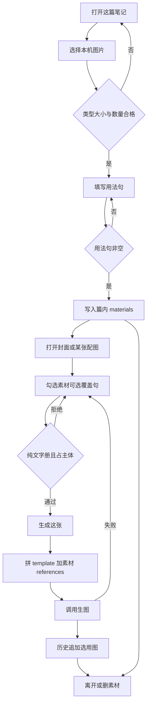
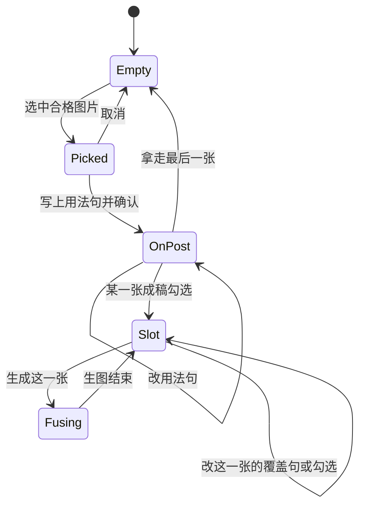

# PRD: 生图时融进上传的素材

| 属性 | 值 |
|------|----|
| 状态 | 工程：accepted。见文末「工程验收状态」 |
| 范围 | 一篇图文生图时的上传素材。Release 0 与 Release 1 |
| 顺序号 | 00006 |
| 关联文档 | `docs/workflows/one-post-studio.md`、`docs/DESIGN.md`、`docs/mvp-map.md`、`AGENTS.md`、`assets/prompts/one-post/image-refs.md`、`specs/prds/prd-00001-one-post-from-article.md`、`specs/prds/prd-00005-album-library.md` |

## 背景与问题

生图已经会把图册样图送进模型：`input_images` 上传参考图，提示词按顺序拼「第 N 张是…」。今天只挂图册样图，角色固定 `template`，锁版式。出厂 `image-refs.md` 已有 `logo` 说明，但没有上传入口，也没有把用户的人物、标识或实物送进同一次生图。

运营要发的图不是纯风格氛围，而是把自家的人、logo、实物画进同一张成稿。事后用程序贴一层水印解决不了「按 Hero 站在中央、锁这张脸」。融合必须走现有生图模型的参考图通道。

图册（`prd-00005`）回答画面风格。图集（`prd-00004`）回答头图加系列的成稿结构。本篇回答：**这一篇上传了哪些图、怎么用、生成哪一张时带上哪几张**。这三样叫**素材**，不叫图集，不叫图库。

模板样图和题词 1～10 上已经有人物或插画区域。那不是要保留的那个人，是版式留出的**主体空位**。上传的人换进这个空位。脸以上传图为准，摆法以人写的用法句为准。配色、字体、文字块、装饰仍跟图册走。

## 目标与非目标

### 目标

#### Release 0

1. 在「这篇笔记」浅灰工具卡里，图册风格下面、小图上面，有一条「这篇的素材」。
2. 人可以上传本机图片（JPEG / PNG / WebP，单张 ≤8MB）。一篇最多 3 张。空着用法句不能确认进列表。
3. 每张素材有一句人写的**用法句**：同时说清「这是什么」和「这一次怎么摆」。不设角色按钮、不设三档摆法预设。一两句为止。
4. 封面与每一张配图各自勾选要用哪些素材。没勾的不进这一次 `input_images`。某一张可另写一句**覆盖句**，只影响这一张；空则用素材上的用法句。
5. 生图时：有图册样图则仍为第一张 `template`；其后按勾选顺序接上素材。提示词「第 N 张是」后接该条的有效用法（覆盖句优先）。另拼一段固定的**主体空位规则**（见已拍板规则），人不用每次重写。
6. 改素材、改勾选、改用法句：不重写文案，不废已有提示词，不覆盖已经生成的图。下一次「生成这张」或「再抽一张」才带上当前勾选。
7. 纯文字图册：素材仍可上传保存；勾选会占主体空位的素材时拒绝，并说明换一本有主体的图册。用法句写明「角落小标，不占主体」的标识可以勾，不触发换人规则。
8. 页面服从 `docs/DESIGN.md`：白底、近黑主按钮、浅灰卡片、daisyUI 5；芯片横排换行，用法单行截断并可看全文。

#### Release 1

1. 资料库壳增加「素材」Tab（与「图库」并列）。可浏览本机素材库；从这篇「存进库」；新笔记可从库里挑，复制进这篇目录（含用法句）。
2. 入库时可用识图模型起草用法句，人改完再确认。每次上传（R0 路径）仍不自动跑识图。
3. 库路径 `runtime/materials/`，与 `runtime/albums/`、`runtime/image-refs/` 分开。旧稿不依赖库路径。

### 非目标

- 用画布、水印或客户端合成在成稿上后贴一层。融合只走现有 `input_images`。
- 角色按钮、三档摆法预设、像素级拖位置。
- 用法句超过两句的长文当主路径。
- Release 0 每次上传调用识图。识图只在 Release 1 入库时起草用法句。
- Release 0 账号级素材库、文件夹、标签、搜索（库在 Release 1；仍不做文件夹与标签搜索）。
- 把素材学成图册四件套，或改图册学习，或改题词 1～10 去迁就某一张上传图。
- 改文案模型、生图模型、比例、质量，或改成一轮生成全部图片。
- 自动发布、爬取、与捞客仓对接、广告法检查。
- 超过 3 张的批量导入。

禁止定义 Release 2 及更高版本。溢出能力进非目标、开放项或独立 PRD。

## 术语

| 术语 | 含义 |
|------|------|
| 素材 | 人上传、要融进成稿的图片。挂在某一篇上（R0）；也可进本机素材库（R1）。 |
| 用法句 | 挂在素材上的一两句人话：这是什么 + 这一次怎么摆。空着不能确认上传。 |
| 覆盖句 | 挂在某一成稿槽位 × 某一素材上的可选句子。只改这一张的摆法，不改素材上的用法句。空则用用法句。 |
| 有效用法 | 某一张成稿生成时，某条被勾选素材实际发给模型的句子：有覆盖句用覆盖句，否则用用法句。 |
| 成稿槽位 | 封面，或某一张配图（如 gallery-01）。各自有一份勾选列表与可选覆盖句。 |
| 主体空位 | 图册样图与题词 1～10 标明的人物/插画区域。生成时用上传主体换掉模板假人，不并排两个主角。 |
| 图册样图 / template | 现有版式锁。有样图时仍是 `input_images` 第一张，说明来自出厂 `image-refs.md` 的 `## template`。 |
| 素材库 | Release 1：`runtime/materials/` 下的本机库。条目含文件与用法句。 |

## 已拍板规则

| 项 | 决定 |
|----|------|
| 命名 | 叫「素材」。不叫图集、不叫图库。 |
| 入口位置 | 「这篇笔记」浅灰工具卡：图册风格下、小图上，文案「这篇的素材」。 |
| 上传格式 | JPEG / PNG / WebP；单张 ≤8MB；与图库学习一致。不合格停在选择步。 |
| 篇内上限 | 一篇最多 3 张素材。同一张成稿最多把这 3 张都勾上。 |
| 用法句 | 必填；一两句；同时含「是什么」与「怎么摆」。无角色按钮、无摆法预设。占位例句：「人物照片。按 Hero 放在画面中央，锁脸。」 |
| 勾选范围 | 封面与每一张配图各自勾选。默认：新上传的素材不自动勾到任何槽位；人打开某一张再勾。 |
| 覆盖句 | 可选；默认空。只作用于该槽位 × 该素材。 |
| 参考图顺序 | 有图册样图 → 第一张 `template`；其后按该槽位勾选列表顺序接上素材。与提示词「第 N 张」同序。 |
| 素材侧提示词 | 「第 N 张是」+ 有效用法。不写回全局 `image-refs.md`。不要求每条素材有出厂 `## role` 小节。 |
| 主体空位规则（固定拼装） | 有会占主体的素材时：用上传主体换掉模板假人；脸/衣服/器物以上传为准；不要两个主角并排、不要留下模板脸；用法句只覆盖主体位置与姿势；配色/字体/文字块/装饰/留白仍跟图册题词与模板；用法未写位置时落在题词已写明的插画区域；第 11 项故事里的人改成参考图里的这个人来演。 |
| 纯文字图册 | 可上传；勾选占主体的素材时拒绝。用法句含「角落小标，不占主体」的标识可勾，不触发换人规则。 |
| 改素材后 | 不重写文案、不废提示词、不覆盖已生成图。下次生成该槽位才带新列表。 |
| 删除素材 | 从篇内清单与 `materials/` 文件拿走；并从所有槽位的勾选与覆盖句中去掉该 id。 |
| 识图 | R0 不调用。R1 入库时可起草用法句，人确认。复用 `DEEPSEEK_VISION_MODEL`（默认 `deepseek-flash`）。 |
| 视觉 | 沿用 `docs/DESIGN.md`。芯片 `flex-wrap`；用法 `truncate` 且可展开看全文；图标用线性 SVG，不用 emoji。 |
| 写入根路径 R0 | 该笔记目录下 `materials/` + `draft.json` 内清单与槽位勾选。 |
| 写入根路径 R1 | `{dataDir}/runtime/materials/`；挑进一篇时复制文件与用法句到该篇 `materials/`。 |

## 用户与角色

| 角色 | 目标 |
|------|------|
| 账号运营 | 上传自家人物/标识/实物，写一句怎么用，生成某一张时勾上，成稿里是这个人、这个标。 |
| 写笔记的人（同一人） | 封面与配图可以用不同素材组合；某张要不同摆法时只改这一张的覆盖句。 |
| 工程 | 复用 `composeImagePrompt` / `generatePng` 的 references 通道；扩展列表与拼装，不另起贴图层。 |

## 功能域

```text
src/studio/static/pages/note.*          # 「这篇的素材」条；槽位勾选与覆盖句
src/prompts/album/refs.js               # imageReferencesFor / formatImageRefsBlock 扩展
src/one-post/run.js                     # 上传、删素材、读槽位勾选；生图传入 references
assets/prompts/one-post/                # 主体空位规则短文（或代码常量）；不强制改 image-refs.md 角色表
output/one-post/posts/<id>/materials/   # 篇内素材文件
output/one-post/posts/<id>/draft.json   # 清单 + 槽位勾选（字段名由工程定）
runtime/materials/                      # 仅 Release 1
src/studio/static/pages/library/        # R1：素材 Tab
```

实现时同步 `docs/workflows/one-post-studio.md` 与 `docs/DESIGN.md` 中关于素材条与（R1）资料库 Tab 的说明。

### 上传（R0）

1. 人点「上传」，选择本机图片。
2. 校验类型与大小；已有 3 张则拒绝。
3. 填写用法句；空着不能确认。
4. 确认后文件落入该篇 `materials/`，清单增加一条；默认不勾到任何成稿槽位。

### 勾选与生成（R0）

1. 人点开封面或某一张配图，勾选要用的素材；可选填覆盖句。
2. 点「生成这张」或「再抽一张」。
3. 系统组装 references：样图（若有）+ 勾选素材；拼提示词参考图段与主体空位规则；调用现有生图。
4. 失败时素材与勾选保留，人话错误可见。

### 存库与挑库（R1）

1. 从这篇某条素材「存进库」：复制到 `runtime/materials/`，带上用法句。
2. 资料库「素材」Tab 浏览；可删库内条目（二次确认，实现时定）。
3. 新笔记「从库挑」：复制进该篇 `materials/` 与清单，用法句一并带上；勾选仍由人在槽位上做。
4. 入库可选识图起草用法句 → 人改 → 确认；放弃则不入库。

## 用户故事地图与版本切片

### 旅程主干

| 步 | 人在做什么 | 起止 |
|----|------------|------|
| 1 | 打开一篇已有笔记（或先写成笔记） | Entry |
| 2 | 在「这篇的素材」点上传，选中合格图片 | |
| 3 | 写上用法句并确认；芯片出现在列表 | |
| 4 | 点开封面（或某一张配图），勾选要用的素材；需要时写覆盖句 | |
| 5 | 点「生成这张」；等待融合出图 | |
| 6 | 预览选用图；不满意再抽一张（仍带当前勾选） | |
| 7 | （可选 R1）把素材存进库；下一篇从库挑 | |
| 8 | 拿走不要的素材，或离开这篇 | Exit / Teardown |

上传取消停在第 2，清单不变。用法句为空不能进入第 3。纯文字册勾主体失败停在第 4，已勾其他合法素材可继续。生图失败停在第 5，勾选仍在。删素材时未确认则文件仍在（若实现确认层；最少要求：拿走后槽位勾选同步清理）。

### 故事地图

#### Release 0

1. 作为运营，我想在这篇笔记里上传自家图片并写一句用法，以便生图时模型知道这是什么、怎么摆。
   - 验收：选中合格图后须填用法句才能进列表；空句确认被拒绝；芯片显示缩略图与用法截断。

2. 作为运营，我想封面和每一张配图各自勾选素材，以便同一张人物只给封面当 Hero。
   - 验收：封面勾了素材 A、配图 01 未勾时，生成封面的 `references` 含 A，生成配图 01 的不含 A（有样图时两侧均可含 template）。

3. 作为运营，我想某一张用不同摆法时只改这一张，以便不弄脏素材上的默认用法。
   - 验收：槽位写了覆盖句后，该次生图提示词「第 N 张是」后为覆盖句；素材清单上的用法句不变；其他槽位未写覆盖句时仍用用法句。

4. 作为运营，我想模板上的假人被换成我上传的人，以便成稿里只有一个主角。
   - 验收：勾选人物类素材并生成时，发给模型的提示词含主体空位规则（换主体、不并排、锁上传脸）；有图册样图时仍为第一张 template。

5. 作为运营，我想改素材后已经生成的图还在，以便可以只再抽一张。
   - 验收：改用法句或勾选后，历史选用图文件仍在；再点「再抽一张」才用新 references。

6. 作为运营，我想纯文字图册不要误勾进主体人物，以便不破坏纯文字版式。
   - 验收：当前 look 为纯文字册时，勾选未声明「不占主体」的素材被拒绝并有人话说明；声明「角落小标，不占主体」的可勾。

7. 作为运营，我想一篇最多三张素材且单张不超过 8MB，以便列表和上传保持可控。
   - 验收：第 4 张上传被拒；超大或非法类型停在选择步且不落盘。

8. 作为运营，我想拿走一张素材后各槽位不再勾着它，以便不会引用已删文件。
   - 验收：删除后 `materials/` 无该文件；所有槽位勾选与覆盖句不再含该 id；再生成不传该路径。

#### Release 1

9. 作为运营，我想把这篇用过的素材连同用法句存进资料库，以便下一篇不用重新上传。
   - 验收：资料库有「素材」Tab；存进库后 `runtime/materials/` 出现条目；用法句可读。

10. 作为运营，我想从库挑进新笔记，以便文件和用法句一起进这篇。
    - 验收：挑库后该篇 `materials/` 与清单有副本；勾选仍为空，须人在槽位上勾。

11. 作为运营，我想入库时可选让识图起草用法句再改，以便少打字。
    - 验收：入库流程可出草稿句；人改后确认才写入库；放弃不入库；篇内「上传」路径仍不自动识图。

### Release 0 可验收结果

打开一篇笔记，上传最多 3 张素材并各写用法句；封面与配图各自勾选；生成时样图（若有）加勾选素材进入 `input_images`，提示词含「第 N 张」与有效用法及主体空位规则；改勾选不删旧图；纯文字册拒绝占主体勾选；删除清理勾选。视觉仍是现有壳与 Cal 色板。

### Release 1 可验收结果

资料库「素材」Tab 可浏览；从篇内存进库、从库挑进篇（复制文件与用法句）；入库可选识图起草用法句经人确认。不做文件夹与标签搜索。

## 核心流程与状态机图



素材与槽位生命周期：



生图失败时素材和勾选都还在。没有「融完就消失」的死胡同。R1 另有「在库」状态：从 OnPost 存进库；从库复制回到 OnPost。

## 数据与 API 衔接（高层）

| 能力 | 说明 |
|------|------|
| 上传素材 | 新方法：入参图片字节或本机路径 + 用法句；校验后写入该篇 `materials/` 与 draft 清单。 |
| 更新用法句 | 改清单中某条用法句。 |
| 删除素材 | 删文件；清理所有槽位勾选与覆盖句。 |
| 槽位勾选 | 按槽位（封面 / gallery 序号）读写勾选 id 列表与可选覆盖句。 |
| 生图 | 扩展现有生成路径：`composeImagePrompt`（或等价）在 template 之后追加勾选素材；拼主体空位规则；`generatePng` 已支持多 `references`。 |
| 列表预览 | 返回缩略图可读 URL 或 data 约定，供芯片展示。 |
| R1 存库 / 列表 / 挑库 / 删库 | 读写 `runtime/materials/`；挑库为复制进篇。 |
| R1 识图起草 | 可选；入参库候选图，出参用法句草稿，确认前不落库。 |

具体 JSON 字段名由工程在实现时与现有 `onePost` 桥对齐，本 PRD 不锁字段名。建议清单字段语义：`id`、`fileName`、`usage`；槽位：`materialIds[]`、`overrides: { [materialId]: string }`。

## 假设与开放项

| 项 | 说明 |
|----|------|
| 假设 | R0 在本机操作台或 Dex Buddy dataDir 下，笔记目录可写。 |
| 假设 | 生图模型继续接受多张 `input_images`，顺序与提示词「第 N 张」一致。 |
| 开放 | 该生图模型 `input_images` 的实际上限以联调为准；产品侧先卡 1 张版式样图 + 最多 3 张素材。 |
| 开放 | 「占主体」与「角落小标不占主体」的判定：R0 以用法句关键词/显式声明为准；是否加勾选项留给实现，验收以声明句可勾、未声明主体在纯文字册被拒为准。 |
| 开放 | 主体空位规则落在独立 markdown 还是代码常量；须在每次带主体素材的生图提示词中出现。 |
| 开放 | 删除素材是否二次确认（建议与图库删除一致用页内浮层）。 |
| 开放 | R1 库内删除、重命名、去重策略。 |
| 待与工程对齐 | draft.json 中素材与槽位字段的准确形状；与历史旧稿缺字段时的默认空列表。 |

## 修订记录

| 日期 | 说明 |
|------|------|
| 2026-10-21 | 初稿。用法句替代角色按钮；模板主体空位换人；每张成稿各自勾选；R0 篇内素材、R1 资料库素材 Tab 与可选识图起草。 |

## 1. 工程验收状态

> 由 `/team:prd-accept` 维护；勿手工编造「通过」。最后更新：2026-10-21T11:03:27Z，dev@c776614，范围：R0,R1。产品侧口头确认验收通过；清单按**现网实现口径**（产品名「上传参考」）对照能力，PRD 原文差异见遗留。

### 总览

| 项 | 值 |
|----|----|
| 工程状态 | accepted |
| 验收判定 | R0/R1 核心能力已交付并有测试与文档证据；用户确认关闭 |
| 最近验收 | 2026-10-21T11:03:27Z |
| 代码提交 | c776614（dev） |

摘要：

1. 篇内上传参考：用法句、按槽勾选、compose 进 `input_images`；用法句不硬拦（纯文字约束只在题词拼装禁插画句）。
2. 生图改勾选不废稿面；删除清理文件与 picks。
3. 资料库「上传参考」Tab：存进库 / 从库挑 / 识图起草 / 库内删除；库路径 `runtime/materials/upload-refs/`。
4. 产品演进：池最多 48、每槽勾最多 9；新图默认勾全槽；不拼固定「主体空位」长文（用法句 + 硬约束）。
5. 资料库亦可「新建 → 上传参考」直建，属 R1 之上便利项。

### Release 交付

| Release | 状态 | 说明 |
|---------|------|------|
| R0 | 通过 | 篇内上传参考 + 槽位勾选 + 融进生图 |
| R1 | 通过 | 资料库上传参考 Tab、存进库、从库挑、入库识图起草 |

### 功能验收清单（Agent 优先读此表）

| ID | 能力摘要 | Release | 状态 | 证据 |
|----|----------|---------|------|------|
| R0-1 | 上传本机图并必填用法句进篇内清单 | R0 | 通过 | `src/one-post/run.js` `addUploadRef`；`src/upload-refs/files.js` `writePostUploadRef`；`note.html` 上传浮层 |
| R0-2 | 封面/配图各自勾选；未勾不进该次 references | R0 | 通过 | `setSlotPick`；`composeImagePrompt` + `uploadRefReferencesFor`；`tests/one-post/run.test.js` 勾选用例 |
| R0-3 | 覆盖句优先于用法句 | R0 | 通过 | `effectiveUsage`；`tests/upload-refs/rules.test.js` |
| R0-4 | 样图为 template 后接勾选上传参考；「第 N 张是」+ 有效用法 | R0 | 通过 | `src/prompts/album/refs.js`；`tests/prompts/album-refs.test.js`（不拼主体空位长文，见遗留） |
| R0-5 | 改用法/勾选不删已生成图 | R0 | 通过 | `run.test.js`「上传参考默认勾全槽…不覆盖旧图」 |
| R0-6 | （产品改口）用法句不硬拦；纯文字约束在题词拼装禁插画句 | R0 | 通过 | `textOnlyPickBlockReason` 恒空；`TEXT_ONLY_LOCK`；`rules.test.js` / `run.test.js` |
| R0-7 | 数量与体积可控 | R0 | 通过 | 池 ≤48、每槽应用 ≤9、单张 ≤8MB（JPEG/PNG/WebP）；`rules.js` 常量；UI/API 拦截 |
| R0-8 | 删除清理文件与各槽 picks | R0 | 通过 | `deleteUploadRef` + `removeUploadRefFromPicks`；测试覆盖 |
| R1-1 | 资料库上传参考 Tab；存进库落盘 | R1 | 通过 | `library.js` Tab；`saveUploadRefToLibrary`；`runtime/materials/upload-refs/` |
| R1-2 | 从库挑进篇（文件+用法） | R1 | 通过 | `pickLibraryUploadRef`；`run.test.js` 存库与挑库 |
| R1-3 | 入库识图起草用法句；篇内上传不自动识图 | R1 | 通过 | `draftUploadRefUsage` + `material-usage/system.md`；笔记上传浮层无自动识图 |

### 未完成与遗留

- PRD 原文 R0-6 / 故事仍写「纯文字册拒占主体」；实现已按产品改口：用法句不审不拦，纯文字只靠 `TEXT_ONLY_LOCK` 拼进生图提示词（2026-10-22）。不重开大 PRD。
- PRD 原文仍写「这篇的素材 / 一篇最多 3 张 / 默认不勾 / 固定主体空位规则 / Tab 名素材 / `runtime/materials/`」；实现已演进为「上传参考」、池 48、每槽 9、默认勾全槽、不拼主体空位长文、Tab「上传参考」、`runtime/materials/upload-refs/`。建议另开修订或补丁 PRD 对齐文案（不阻塞本次 accepted）。
- 覆盖句：后端与规则支持；笔记页主路径以改用法句 / 悬停预览为主，槽位级覆盖句 UI 若需完整暴露可后续补。
- 资料库直建上传参考为交付加项，PRD 未单列故事。

### 质量检查

| 检查项 | 状态 |
|--------|------|
| 测试 | 相关 `node --test tests/upload-refs/rules.test.js tests/prompts/album-refs.test.js` 通过；本仓无统一 `pnpm test` 脚本记 N/A |
| Lint | 本仓无 lint 命令，N/A |
| 文档与 OpenAPI | `docs/workflows/one-post-studio.md`、`docs/DESIGN.md` 已同步；无 OpenAPI，跳过 |

---
统计：通过 11 / 部分 0 / 未实现 0 / 范围外 0

