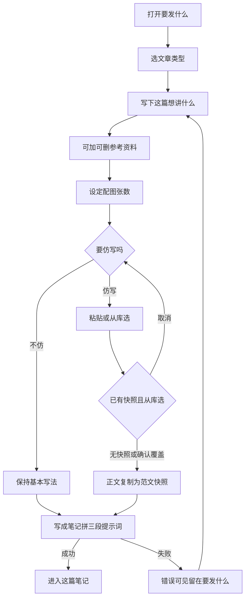
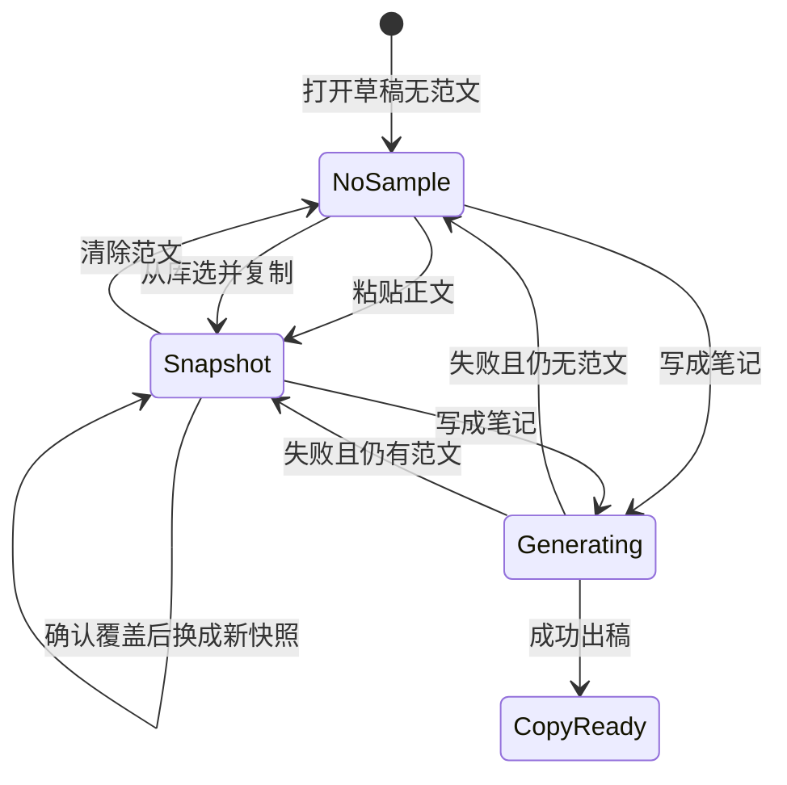

# PRD: 多种风格笔记（类型 · 范文 · 参考资料）

| 属性 | 值 |
|------|----|
| 状态 | 工程：accepted（见文末「工程验收状态」） |
| 范围 | 「要发什么」成稿入口与资料库范文。仅 Release 0 |
| 顺序号 | 00007 |
| 关联文档 | `docs/workflows/one-post-studio.md`、`docs/DESIGN.md`、`docs/mvp-map.md`、`AGENTS.md`、`assets/prompts/one-post/article/`、`specs/prds/prd-00001-one-post-from-article.md`、`specs/prds/prd-00005-album-library.md`、`specs/prds/prd-00006-fuse-reference-images.md` |

## 背景与问题

运营在「写一篇笔记」的「要发什么」里选文章类型、写一句业务、可选贴一篇文章，再点「写成笔记」。今天有三颗并排按钮（种草 / 引流 / 素人），类型清楚，但下面只有一块「按范文仿写」文本框。

这一块同时被当成两件事用：有时是要学的**格式**（爆款结构），有时是要写进稿里的**事实**（课程信息、日期、卖点）。成稿壳 [`assets/prompts/one-post/article/shell.md`](../../assets/prompts/one-post/article/shell.md) 把可选文章当事实来源，并写明「不要复述原文结构」。人若贴爆款范文，模型反而被要求别学结构——和仿写意图相反。

资料库已有「图库」「上传参考」，没有可复用的**范文笔记库**。人每次仿写都要重新粘贴同一篇固定格式。

本篇回答三件事：

1. 文章类型用一个单选控件表达（下拉），不再用三颗按钮占一行。
2. **范文**管结构；**参考资料**管事实；没有范文时只用该类型的基本写法。
3. 范文可粘贴，也可从资料库选；选中后**复制进当前笔记**，库里后改不影响这篇。

配图张数、封面与生图、上传参考融图（`prd-00006`）本篇不动。

## 目标与非目标

### 目标（Release 0）

1. 「文章类型」改为带可见标签的单选下拉，选项仍是种草、引流、素人；默认素人；生成中不可改。
2. 每种类型继续使用现有三份基本写法（`seed.md` / `lead.md` / `amateur.md`）。无范文时只走基本写法。
3. 有范文时，把范文**原文整段**放进成稿提示词，并要求按它的结构写、事实以新内容为准。本篇不另做「提炼爆款结构」模型调用。
4. 范文可粘贴，也可从资料库「范文」选。一篇笔记零篇或一篇范文。
5. 从库选中时，正文（及可选标题）**复制**进当前笔记草稿，人可再改；库内条目后改不改写这篇草稿。
6. 「这篇想讲什么」下方可增删多条**文本**参考资料；默认零条；空条不送模；一条都没有则提示词不出现参考资料段。
7. 成稿提示词一次拼装为三段：角色与类型（含基本写法）→ 范文（有/无）→ 新内容（业务一句 + 参考资料）。输出仍为标题 / 正文 / 话题 JSON。
8. 资料库增加「范文」Tab 与「新建 → 范文」；条目为标题 + 正文，本机路径 `runtime/materials/samples/`。
9. 旧稿 `draft.json` 里原「文章」字段（`article`）迁移为当前笔记的范文正文快照，行为与粘贴范文一致。
10. 页面服从 [`docs/DESIGN.md`](../../docs/DESIGN.md)：窄栏 `max-w-2xl`、白底、近黑主按钮、daisyUI 5；控件有可见标签；删除钮有可读名称。

### 非目标

- 自动「提炼爆款结构」再按结构写（另开 PRD）。
- 范文按文章类型强制归类、标签、搜索文件夹。
- 从「这篇笔记」一键「范文存进库」。
- 参考资料贴图片、上传文件、链接抓取。
- 新增第四种文章类型或改三种基本写法的口吻骨架文案（本篇只改入口与拼装；骨架文件内容可随工程微调措辞，不另开产品线）。
- 改配图张数、封面故事类型、图册、生图、上传参考融图。
- 自动发布、爬取、与捞客仓对接、广告法检查。
- Release 1 及更高版本切片。溢出能力进本节或开放项。

禁止定义 Release 2 及更高版本。

## 术语

| 术语 | 含义 |
|------|------|
| 文章类型 | 种草、引流、素人三选一。决定套入哪份基本写法。 |
| 基本写法 | 该类型出厂骨架（`article/seed.md` 等）：口吻与必含结构层。无范文时成稿只靠它 + 新内容。 |
| 范文 | 可选。一篇完整小红书笔记原文（或粘贴文本），用于**学结构**。一篇笔记最多一篇。 |
| 范文快照 | 选中或粘贴后留在当前笔记草稿里的范文正文（及可选标题）。与库条目脱钩。 |
| 范文库 | 资料库「范文」Tab 下的本机条目集合，路径 `runtime/materials/samples/`。 |
| 参考资料 | 可选的多条纯文本事实材料（课程信息、日期、卖点等）。管事实，不管结构。 |
| 业务一句 | 「这篇想讲什么」。必填。品牌、卖什么、对谁说，或「9 月 5 日这堂课要引流」一类意图。 |
| 成稿三段提示词 | 一次发给模型的三段：角色与类型 → 范文 → 新内容。 |

## 已拍板规则

| 项 | 决定 |
|----|------|
| 类型控件 | 单选下拉（原生 `select` 或等价 daisyUI），标签「文章类型」始终可见。去掉三颗按钮。 |
| 类型取值 | 仍为 `种草` / `引流` / `素人`；默认 `素人`；非法值回落素人。 |
| 无范文 | 提示词写明采用该类型基本写法；不注入范文原文。 |
| 有范文 | 原文整段注入；要求按范文结构层次写；事实、数字、人名、案例以新内容为准，不搬范文事实。删除壳里「不要复述原文结构」对范文场景的用法。 |
| 提炼结构 | 本篇不做。整篇原文当格式参考即可。 |
| 范文绑定 | **快照复制**。从库选 → 复制标题与正文进草稿；粘贴 → 写入同一快照字段。库后改不影响已打开的这篇。 |
| 范文数量 | 0 或 1。已有快照再从库选，先页内确认覆盖，再替换。 |
| 范文长度 | trim 后超过 8000 字符拒绝，提示先删短；页面与桥都拦。不截断后偷偷送模（与旧「文章」上限一致）。 |
| 参考资料 | 默认 0 条；点「加一条参考」追加一条文本框；每条可删。仅文本。trim 后为空的条不送模。 |
| 参考资料上限 | 建议最多 10 条；超限拒绝新增并人话说明。具体上限工程可调，须写进实现与测试。 |
| 布局顺序 | 类型 → 这篇想讲什么 → 参考资料 → 封面之外还要几张 → 范文区 → 「写成笔记」。 |
| 范文区默认 | 不默认摊开大文本区。无快照时显示「基本写法」+「粘贴」「从库选」。有快照时显示标题或首行、字数、清除；需要时可展开编辑正文。 |
| 粘贴路径 | 「粘贴」展开或打开可编辑区，人贴入正文；可选填短标题，空则用正文首行作展示名。 |
| 从库选 | 浮层或抽屉列范文库条目；选中后快照写入草稿；不整页跳走「要发什么」表单。 |
| 清除范文 | 去掉快照，回到「基本写法」；不删库内条目。 |
| 资料库范文 | 新建：标题 + 正文；可改、可删；删除用页内确认，不用 `window.confirm`。空列表浅灰说明 + 新建。 |
| 库路径 | `runtime/materials/samples/`，与 `runtime/albums/`、`runtime/materials/upload-refs/`（或现行上传参考路径）分开。只留本机、不入库 git。 |
| 旧稿迁移 | 若草稿有非空 `article` 且尚无范文快照字段：视为范文正文快照；`article` 语义退役。参考资料默认 `[]`。 |
| 进行中 | `job.running` 时类型、业务、参考、范文、生成按钮不可改或不可再次提交（与现网一致）。 |
| 视觉 | 沿用 `docs/DESIGN.md`；图标 Lucide / iconify，不用 emoji 当结构图标。 |

## 用户与角色

| 角色 | 目标 |
|------|------|
| 账号运营 | 为某一堂课或产品写一篇种草 / 引流 / 素人笔记；固定几套范文反复用；课程事实放进参考资料。 |
| 写笔记的人（同一人） | 少点三颗按钮；清楚「学哪篇格式」和「写哪些事实」；不选范文也能出稿。 |
| 工程 | 扩展 `buildDraftPrompt` 入参与壳模板；资料库加第三种资源模块；草稿字段与旧 `article` 兼容。 |

## 功能域

```text
src/studio/static/pages/note.html|.js   # 类型下拉；参考资料增删；范文区粘贴/从库选/清除
src/draft/store.js                      # articleType；范文快照；references[]；旧 article 迁移
src/prompts/article.js                  # buildDraftPrompt 入参扩展
assets/prompts/one-post/article/        # shell.md 三段拼装；三种基本写法保留
src/studio/static/pages/library.*       # Tab「范文」；新建菜单项
src/studio/static/pages/library/samples.js  # 范文列表 / 详情 / 新建 / 删
runtime/materials/samples/              # 本机范文库
docs/workflows/one-post-studio.md       # 实现时同步入口说明
docs/DESIGN.md                          # 「要发什么」与资料库范文区说明
```

### 要发什么（成稿入口）

1. 人选文章类型。
2. 写「这篇想讲什么」（必填）。
3. 可选：加若干参考资料文本。
4. 选配图张数（既有）。
5. 可选：粘贴或从库选一篇范文；或保持基本写法。
6. 点「写成笔记」→ 拼三段提示词 → 出稿进「这篇笔记」。

### 资料库范文

1. 打开资料库 →「范文」Tab；或顶栏「新建 → 范文」。
2. 填写标题与正文，确认写入 `runtime/materials/samples/`。
3. 列表浏览；点开可改；删除须页内二次确认。
4. 笔记页「从库选」读取同一库，选中后快照进当前草稿。

## 用户故事地图与版本切片

### 旅程主干

| 步 | 人在做什么 | 起止 |
|----|------------|------|
| 1 | 打开「写一篇笔记」→「要发什么」 | Entry |
| 2 | 在类型下拉选种草 / 引流 / 素人 | |
| 3 | 写下这篇想讲什么（如「9 月 5 日这堂课要引流」） | |
| 4 | （可选）加一条或多条参考资料；可删 | |
| 5 | 设定封面之外还要几张（既有） | |
| 6a | 不仿写：保持「基本写法」 | |
| 6b | 仿写：粘贴范文，或从库选后确认（必要时覆盖） | |
| 7 | 点「写成笔记」；等待成稿 | |
| 8 | 进入「这篇笔记」看稿；失败则留在「要发什么」并见错误 | Exit（成功）/ 停留（失败） |
| 9 | （可选，可另开时段）在资料库维护范文条目 | 库侧 Entry/Exit |

取消从库选或取消覆盖确认：快照不变。清除范文：回到基本写法。删掉全部参考资料：等同无参考。离开页面：草稿按现网 persist 规则保存。

### 故事地图（Release 0）

1. 作为运营，我想用一个下拉选文章类型，以便少占一行、仍是单选。
   - 验收：三颗按钮不在；下拉可选三种；默认素人；标签可见；生成中不可改。

2. 作为运营，我想不贴范文也能写成笔记，以便只用该类型基本写法。
   - 验收：无范文快照时发出的提示词含对应 `seed`/`lead`/`amateur` 骨架，且无范文原文段（或明确「无范文，采用基本写法」）。

3. 作为运营，我想粘贴一篇范文再生成，以便按它的结构写新课。
   - 验收：提示词含范文全文；含「按结构写、事实以新内容为准」类约束；不再出现禁止复述原文结构的范文用法。

4. 作为运营，我想从资料库选一篇常用范文，以便不用每次手贴。
   - 验收：从库选后草稿有正文快照；展示标题或首行与字数；库内原条目仍在；改库内正文后已打开这篇的快照不变。

5. 作为运营，我想已有范文时再选库内另一篇前先确认，以便不误覆盖。
   - 验收：有快照时再从库选弹出页内确认；取消则快照不变；确认后换成新快照。

6. 作为运营，我想在业务一句下面加几条参考资料，以便课程信息不和范文混在一个框里。
   - 验收：可增删文本框；空条不进提示词；有非空条时新内容段含这些文本；零条时无参考资料段。

7. 作为运营，我想在资料库维护范文笔记，以便固定几套格式可复用。
   - 验收：资料库有「范文」Tab 与新建项；可建、改、删；删除页内确认；文件在 `runtime/materials/samples/`。

8. 作为运营，我想打开旧稿时原来贴的「文章」还在，以便不丢材料。
   - 验收：仅有旧 `article` 的草稿打开后，范文区显示该正文为快照；可清除或覆盖；生成行为与粘贴范文一致。

### Release 0 可验收结果

「要发什么」用类型下拉；可零或多条参考资料；范文零或一（粘贴或库选快照）；无范文走基本写法，有范文整篇进提示词且学结构；三段提示词一次成稿；资料库可管范文；旧 `article` 迁为范文快照。配图与生图线行为与改前一致。视觉仍是现有壳与 Cal 色板。

本 PRD **不定义 Release 1**。爆款结构提炼、范文存进库、参考资料图片等见非目标。

## 核心流程与状态机图



范文快照与库条目生命周期：



库侧：`[*] --> InLibrary`（新建确认）；`InLibrary --> InLibrary`（改）；`InLibrary --> [*]`（删除确认）。从库选只产生草稿侧 `Snapshot`，不删除 `InLibrary`。没有「选中后库条目消失」的死胡同。

## 数据与 API 衔接（高层）

| 能力 | 说明 |
|------|------|
| 草稿字段 | `articleType`；范文快照（建议语义：`sampleTitle`、`sampleBody`，或工程等价命名）；`references: string[]`。原 `article` 读时迁入 `sampleBody`。 |
| 成稿 | 扩展 `buildDraftPrompt(promptsDir, articleType, { business, sampleBody, references })`（参数名由工程定）；读类型骨架 + 新壳模板。 |
| 壳模板 | `article/shell.md`（或拆文件）表达三段；无范文 / 无参考时对应段省略或短句声明。 |
| 范文库列表 | 列 `runtime/materials/samples/` 条目（id、标题、更新时间、正文预览）。 |
| 范文库读写 | 新建 / 更新 / 删除；删除前二次确认由页面完成。 |
| 从库选 | 只读库 → 返回标题与正文 → 前端写入草稿快照；不修改库文件。 |
| 校验 | 业务一句非空；范文 ≤8000 字符；参考条数上限；类型允许列表（与现 `ARTICLE_TYPES` 一致）。 |

具体 JSON 字段名与 bridge 方法名由工程与现有 `onePost` / draft store 对齐。本 PRD 锁语义，不锁字段字符串。

## 假设与开放项

| 项 | 说明 |
|----|------|
| 假设 | 三种基本写法文件路径与现网一致；类型中文名不变。 |
| 假设 | 成稿仍走 DeepSeek Chat Completions，出参仍为 title / body / topics JSON。 |
| 假设 | 资料库加 Tab 的方式与 `docs/DESIGN.md`「以后加其它资源类型」一致。 |
| 开放 | 范文库单条是否需要独立 `.json` 元数据 + `.md` 正文，或单文件；由工程定，验收以可列、可读、可删为准。 |
| 开放 | 「粘贴」是展开本地面板还是小浮层；验收以能写入快照、能清除为准。 |
| 开放 | 参考资料是否在 UI 上显示条数上限提示；建议接近上限时提示。 |
| 待与工程对齐 | 旧稿同时存在新字段与 `article` 时以新字段为准；仅 `article` 时迁移一次并是否写回清理旧键。 |
| 冲突与决议 | `prd-00001` 写「文章是素材、不复述原文结构」。本篇起：**范文**学结构；**参考资料 + 业务一句**供事实。`prd-00001` 中「文章」语义由本篇替代，实现时在 workflow 文档改表述，不要求改 `prd-00001` 历史正文。 |

## 修订记录

| 日期 | 说明 |
|------|------|
| 2026-10-22 | 初稿。类型下拉；范文与参考资料拆开；范文快照绑定；资料库范文 Tab；成稿三段提示词；仅 Release 0；不做结构提炼。 |
| 2026-10-22 | 工程验收：status=accepted；交付以人设×目的 + `article-samples` 为准（超初稿三类型文案）；见文末「工程验收状态」。 |

## 1. 工程验收状态

> 由 `/team:prd-accept` 维护；勿手工编造「通过」。最后更新：2026-10-22T10:03:55Z，dev@c522a90，范围：R0。产品确认关闭本 PRD。

### 总览

| 项 | 值 |
|----|----|
| 工程状态 | accepted |
| 验收判定 | Release 0 核心能力已交付；产品形态演进为人设×目的与范文库 `article-samples`，以现行 `docs/DESIGN.md` / `docs/workflows/one-post-studio.md` 为准 |
| 最近验收 | 2026-10-22T10:03:55Z |
| 代码提交 | c522a9084c818ce05d2889445cbf382ab8288688（验收时 HEAD；工作区尚有未提交交付） |
| 分支 | dev |

摘要：

1. 「要发什么」去掉三颗类型按钮，改为人设 + 目的双下拉与组合说明（taxonomy 扩面，覆盖初稿三类型意图）。
2. 范文与参考资料拆开：草稿 `sampleTitle`/`sampleBody` + `references[]`（上限 5）；成稿 system/user 拼装。
3. 资料库「范文」Tab：建改删、页内确认、toast 成功提示；路径 `runtime/materials/article-samples/`。
4. 旧稿非空 `article` 迁为 `sampleBody`；库选快照复制进当前笔记。
5. 测试覆盖范文库、参考上限、迁移、成稿装填与 Studio 静态串。

### Release 交付

| Release | 状态 | 说明 |
|---------|------|------|
| R0 | 通过 | 范文/参考/库/迁移/拼装已落地；形态见 DESIGN/workflow |
| R1 | 范围外 | PRD 声明不定义 R1 |

### 功能验收清单（Agent 优先读此表）

| ID | 能力摘要 | Release | 状态 | 证据 |
|----|----------|---------|------|------|
| G1 | 成稿入口可选口吻/目的（替代三颗按钮） | R0 | 通过 | `note.html` 人设/目的下拉；`note.js` `personaOptions`/`goalOptions`；`docs/references/xhs-prompt-taxonomy.md` |
| G2 | 无范文走基本写法骨架 | R0 | 通过 | `article.js` `buildSampleBlock` 空范文短句；`article-types/*.md` + `article-voices/*.md` |
| G3 | 有范文时原文整段进提示词；事实以新内容为准 | R0 | 通过 | `article.js` `buildSampleBlock`；`fill.test.js`；现行文案为「抓住重点…不要复述原文结构」（与初稿「学结构」措辞不同，产品确认以现行为准） |
| G4 | 范文 0/1；从库挑或新建入库并快照；可清除 | R0 | 通过 | `note.js` `openPickSample`/`confirmCreateSample`/`clearSample`；`note.html` `#sample-actions` |
| G5 | 库选快照复制；库后改不影响已打开草稿 | R0 | 通过 | `note.js` `confirmPickSample` 写 `sampleTitle`/`sampleBody`；草稿无库 id 绑定 |
| G6 | 多条文本参考资料；空条不送模 | R0 | 通过 | `note.js` `REFERENCES_MAX=5`；`validate.js`；`buildContentBlock` |
| G7 | 成稿三段式拼装（角色骨架 + 范文块 + 新内容） | R0 | 通过 | `buildDraftMessages` system=`shell`+voice+skeleton；user=sample+content |
| G8 | 资料库范文 Tab / 新建 / 改删 / 页内确认 | R0 | 通过 | `library.html` Tab；`library/article-samples.js`；删除浮层无 `window.confirm` |
| G9 | 旧 `article` → 范文快照迁移 | R0 | 通过 | `draft/store.js`；`tests/draft/store.test.js` |
| G10 | 视觉与壳服从 DESIGN | R0 | 通过 | `docs/DESIGN.md`「要发什么」「资料库」范文段；daisyUI / Lucide |
| S1 | 故事：类型控件单选 | R0 | 通过 | 见 G1（演进为双轴下拉） |
| S2 | 故事：无范文可生成 | R0 | 通过 | 见 G2 |
| S3 | 故事：粘贴/仿写进提示词 | R0 | 通过 | 见 G3–G4（新建=贴入库并快照） |
| S4 | 故事：从库选常用范文 | R0 | 通过 | 见 G5 |
| S5 | 故事：再选覆盖前确认 | R0 | 通过 | 「换一篇」直接替换快照；产品确认无需二次确认浮层 |
| S6 | 故事：参考资料与范文拆开 | R0 | 通过 | 见 G6 |
| S7 | 故事：资料库维护范文 | R0 | 通过 | 见 G8；路径为 `article-samples/`（非初稿 `samples/`） |
| S8 | 故事：旧文章字段不丢 | R0 | 通过 | 见 G9 |

### 未完成与遗留

- PRD 正文仍写「三类型下拉 / `runtime/materials/samples/` / 学结构删勿复述句」——**文档债**；实现与 `DESIGN.md`、`one-post-studio.md`、taxonomy 已对齐人设×目的与 `article-samples`。若需档案一致，另开修订 PRD 正文（不阻塞关闭）。
- 草稿内范文预览只读；改正文走资料库详情或换一篇，无「展开改快照」路径（产品接受）。
- 工作区尚有未提交的 00007 相关改动；验收锚在 HEAD `c522a90`，合入后可用新 commit 回写 `accepted_commit`。

### 质量检查

| 检查项 | 状态 |
|--------|------|
| 测试 | 有：`tests/article-samples/`、`tests/draft/store.test.js`、`tests/draft/validate.test.js`、`tests/prompts/fill.test.js`、`tests/studio/run-studio.test.js` 等（`pnpm test` / `pnpm run check`） |
| Lint | 类型检查：`pnpm run check:types`（改 `src/` 业务 JS 时） |
| 文档与 OpenAPI | 本项目无 OpenAPI；workflow / DESIGN / doc_index 已跟范文库 |

---
统计：通过 18 / 部分 0 / 未实现 0 / 范围外 1（R1）
