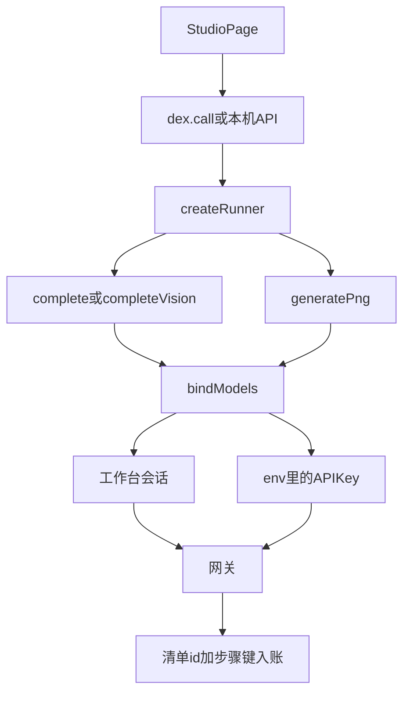
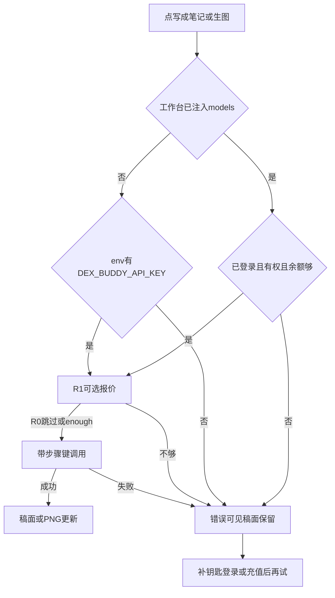
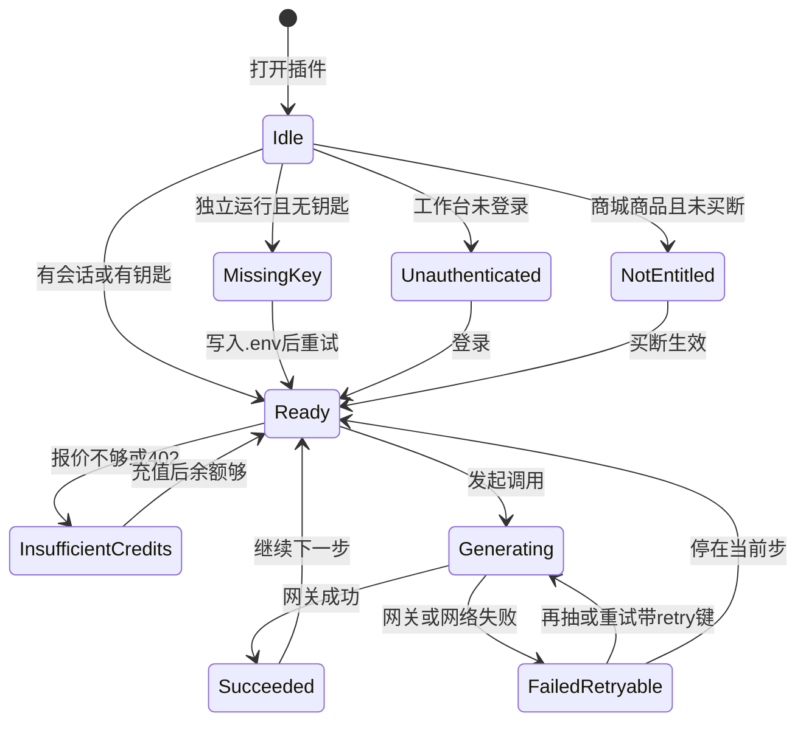

# PRD: 宿主模型与官方插件 ID

| 属性 | 值 |
|------|----|
| 状态 | 工程：accepted（见文末「工程验收状态」章） |
| 范围 | 清单 id、显示名、模型出口、本机钥匙、步骤入账。提示词与成稿产品规则不动。Release 0 必做，Release 1 可选报价展示 |
| 顺序号 | 00008 |
| 关联文档 | `plugin.manifest.json`、`.env.example`、`docs/workflows/one-post-studio.md`、`AGENTS.md`、`specs/prds/prd-00001-one-post-from-article.md`；宿主指南 `../0001-HyHarness/docs/plugin-development/models.md`、`../0001-HyHarness/docs/plugin-development/manifest.md`、`../0001-HyHarness/docs/plugin-development/snippets/dex-models.js` |

## 背景与问题

操作台已经能写一篇可复制去发的笔记：成稿、提示词、封面、配图、学图册。烧钱的调用仍直连供应商。清单 `id` 是 `xhs-growth-engine`，侧栏叫「小红书增长引擎」，设置页向终端用户要 DeepSeek 和 Replicate 钥匙。

| 现状 | 问题 |
|------|------|
| [`src/llm/client.js`](../../src/llm/client.js) 用 `DEEPSEEK_API_KEY` 打 DeepSeek；写稿默认 `deepseek-chat`，识图默认 `deepseek-flash` | 用户自备供应商 Key；装进工作台无法按官方插件扣积分 |
| [`src/image/generate.js`](../../src/image/generate.js) 用 `REPLICATE_API_TOKEN` 请求 `openai/gpt-image-2.5-flare`，另有 sunburst；自己上传、轮询、下载 | 协议停在供应商侧；宿主生图只收渠道 Model ID 和本机路径 |
| [`plugin.manifest.json`](../../plugin.manifest.json) 的 `configSchema` 暴露四项供应商设置 | 官方插件指南禁止向终端用户要这些 Key |
| 本机 `node scripts/run-studio.js` 与工作台共用 `createRunner`，但模型客户端自己 `fetch` | 独立运行和工作台会再分叉一套 HTTP |
| 调用不带步骤名 | 账本上看不出是成稿、识图还是某一张图 |
| 清单 id 过短、显示名过大 | 官方新插件要用 `app-dexbuddy-` 前缀；本插件只做一篇笔记的生文生图，不是整站运营 |

宿主已经提供 `bindModels(ctx)`：有工作台会话就走宿主；没有就用本机 `DEX_BUDDY_API_KEY` 打同一网关。方法名对齐 OpenAI Chat Completions 和现有 `images.generate`。本篇把这份插件接到那条路上。

## 目标与非目标

### 目标（Release 0）

1. 清单 `id` 改为 `app-dexbuddy-xiaohongshu-standard-editor`。`displayName` 改为「笔记生文生图」。宿主与独立运行都用这个 id 盖 `X-Plugin-Id`。
2. 拷宿主指南里的 `dex-models.js` 到 `lib/dex-models.js`。生文、识图、生图内部只走 `bindModels`。不拷 Python 助手。
3. 业务入口不改：`createLlm` 仍是 `complete` / `completeVision`；`generatePng` 仍收 `prompt`、`outputPath`、本地参考图。`src/one-post/run.js` 和页面不新学一套客户端。
4. 生文与识图共用 `chat` 渠道。目录按 `kind === 'chat'` 取，空目录回退 `dexbuddy-chat`。识图仍用 `image_url`。正文仍从 `choices[0].message.content` 取。不再单独配视觉模型。
5. 生图保留两档渠道 Model ID：默认快档 `dexbuddy/image-standard`（原 flare）；保真档 `dexbuddy/image-pro`（原 sunburst）。不拼 Replicate URL。比例仍是 `3:4`。参考图用本机路径放进 `input.input_images`，由助手上传。不再传 `quality`、`output_format`、`number_of_images`，不再自己轮询。
6. 每次生文、识图、生图带步骤键（`Idempotency-Key` = `<稿id>:<步骤>`）。同一步成功后的重放用同一键。失败后再抽追加 `:retry-N`。
7. 设置页去掉全部模型项。删空后不留空的 `configSchema`。
8. 作者独立运行在仓库 `.env` 填写 `DEX_BUDDY_API_KEY`（可选 `DEX_GATEWAY_BASE_URL`）。`.env.example` 只留这两项。钥匙不进设置页，不进 zip。装进 Dex Buddy 后走登录会话，不读这把钥匙。
9. 本仓把 `.env` 收成普通对象后必须传给 `bindModels(ctx, { env })`。助手默认只读 `process.env`，漏传则本机填了钥匙也像没钥匙。
10. 错误可见：本机缺钥匙、工作台未登录、未开通、积分不足。已有稿面和提示词保留。

### 目标（Release 1）

生成前在页面上展示这次报价（大约扣多少、余额够不够）。报价失败或余额不足时不发起正式生成。

### 非目标

- 保留 DeepSeek 或 Replicate 作备用通道。
- 设置页手填模型 id 或任何 API Key。
- 双清单 id 并存，或把旧 `xhs-growth-engine` 的 `plugin-settings.json`、数据目录自动迁到新 id。
- 改提示词、图册、范文、封面规则（仍以 `prd-00001` 至 `prd-00007` 为准）。
- 本轮打 tag、改工牌合同字段、发到插件中心。
- 单独的「步骤上传」HTTP 接口（网关没有这个接口；步骤挂在幂等键上）。
- 为独立运行再做一套长任务轮询协议。页面在本机仍走 `POST /api/one-post/<方法>`，在工作台仍走 `window.dex.call`。
- 流式输出。
- 违规自动化、与捞客仓对接。

禁止定义 Release 2 及更高版本。溢出能力进本节或开放项。

### 成功标准

- 装进工作台后，生文 / 识图 / 生图请求的 `X-Plugin-Id` 为 `app-dexbuddy-xiaohongshu-standard-editor`，body 不含 `pluginId`。
- 本机 `.env` 填了合法 `DEX_BUDDY_API_KEY` 后，`node scripts/run-studio.js` 能完成一次成稿和一次默认档生图。
- 设置页不再出现 DeepSeek / Replicate 字段。
- 成稿、提示词、学图册、封面、第一张配图分别带稳定步骤键。
- 缺钥匙或积分不足时，页面可编辑，已有稿面和提示词仍在。

## 术语

| 术语 | 含义 |
|------|------|
| 清单 id | `plugin.manifest.json` 的 `id`，也是盖到 `X-Plugin-Id` 的值。本期为 `app-dexbuddy-xiaohongshu-standard-editor` |
| 显示名 | 侧栏名字。本期为「笔记生文生图」 |
| 助手 | 拷进 `lib/dex-models.js` 的 `bindModels` / 独立客户端 |
| 宿主路径 | 工作台已登录时走 `ctx.models`，扣使用者积分 |
| 独立运行 | `node scripts/run-studio.js` 或开发目录未注入 `ctx.models`；用本机 `DEX_BUDDY_API_KEY` 打网关，扣作者账号 |
| 渠道 Model ID | `GET /v1/models` 返回的 `data[].id`，不是供应商路径 |
| 标准生图 | `dexbuddy/image-standard`，对应原 flare（默认、快） |
| 专业生图 | `dexbuddy/image-pro`，对应原 sunburst（保真） |
| 步骤键 | `options.idempotencyKey`，变成 `Idempotency-Key` 头，不写进 JSON |
| 薄适配 | 只改 `createLlm` / `generatePng` 内部，业务入口与页面不变 |

## 已拍板规则

| 项 | 决议 | 状态 |
|----|------|------|
| 插件 id | `app-dexbuddy-xiaohongshu-standard-editor` | 已定 |
| 显示名 | 笔记生文生图 | 已定 |
| 旧设置 | 不迁移 `xhs-growth-engine` 下的密钥和地址 | 已定 |
| 旧数据目录 | 开发挂载仍写本仓；插件中心安装后为 `plugin-data/app-dexbuddy-xiaohongshu-standard-editor/`。本篇不写自动搬家 | 已定 |
| 本机钥匙 | 只在 `.env` 填 `DEX_BUDDY_API_KEY`；可选 `DEX_GATEWAY_BASE_URL`。不进设置、不进 zip | 已定 |
| 工作台钥匙 | 登录会话。不读本机 Key | 已定 |
| 调用形状 | OpenAI Chat Completions + 现有 `images.generate({ model, input, outputPath })` | 已定 |
| 生文 / 识图模型 | 目录 `kind=chat`，空则 `dexbuddy-chat`。不再用 `DEEPSEEK_VISION_MODEL` | 已定 |
| 生图两档 | 标准 `dexbuddy/image-standard`；专业 `dexbuddy/image-pro`。默认标准 | 已定 |
| 生图入参 | `prompt`、`aspect_ratio: 3:4`、本机 `input_images`。助手负责 files + generate | 已定 |
| 步骤上报 | 无独立上传接口。步骤名进幂等键 `<稿id>:<步骤>` | 已定 |
| 稳定步骤名 | `copy`、`prompts`、`vision`、`cover`、`gallery-01` 起 | 已定 |
| 重试键 | 失败后再抽同一张：`<稿id>:<步骤>:retry-N` | 已定 |
| `pluginId` | 参数和 JSON 体都不传 | 已定 |
| 页面 | 只调自己的服务，不 `fetch` 网关 | 已定 |
| 产品规则 | 提示词、图册、范文、封面仍以既有 PRD 为准 | 已定 |

## 用户与角色

| 角色 | 目标 |
|------|------|
| 运营（主要用户） | 在工作台打开插件，登录后写成笔记、出封面和配图，自己付积分 |
| 作者 / 开发（次要） | 本机填 Dex Buddy 钥匙，独立跑操作台改提示词和客户端，少改业务代码 |
| 工作台宿主 | 用清单 id 盖章、转发模型、拦未登录 / 未开通 / 余额不足 |
| 网关 | 按插件 id 和步骤键记账、扣积分、调上游 |
| 工程 | 薄适配两个客户端、删供应商设置、拷助手 |

## 功能域

### 清单与显示

- 改 `plugin.manifest.json`：`id`、`displayName`。删整个 `configSchema`（指南：没有声明就不要写空对象）。
- 实现时同步 workflow 里侧栏名和 `plugin-data/<id>/` 路径。本篇不改工牌 `name` / `origin` / `depends_on`。

### 薄适配客户端

- `src/llm/client.js`：去掉 DeepSeek 地址、Key、写稿模型和视觉模型。`complete` / `completeVision` 改为 `models.chat.completions.create`。识图内容块保持 `image_url`。JSON 字段名不改。
- `src/image/generate.js`：去掉 Replicate URL、轮询、本仓上传。`generatePng` 改为 `models.images.generate`。`model` 为两档渠道 ID 之一。参考图改为本地路径数组。
- 删掉或停用仅服务 Replicate 上传的路径（[`src/image/files.js`](../../src/image/files.js)）。
- 构造客户端时传入已合并的 `env` 和可选的 `ctx`，以便工作台走宿主、本机走钥匙。

### 本机环境

- [`src/one-post/env.js`](../../src/one-post/env.js) 继续把 `.env` 补进普通对象，不覆盖已有进程值。
- [`index.js`](../../index.js) 与 [`scripts/run-studio.js`](../../scripts/run-studio.js) 把该对象传给 `bindModels(ctx, { env })`。不要第二套 dotenv。
- [`.env.example`](../../.env.example) 只保留：

```text
DEX_BUDDY_API_KEY=
# 可选。默认 https://www.dexbuddy.app
# DEX_GATEWAY_BASE_URL=
```

### 步骤键

| 步骤 | 键（首次） | 何时 |
|------|------------|------|
| 成稿 | `<稿id>:copy` | `complete` 写标题正文话题 |
| 提示词 | `<稿id>:prompts` | `complete` 写画面提示词 |
| 学图册 | `<稿id>:vision` 或学习任务 id | `completeVision` |
| 封面 | `<稿id>:cover` | 默认档或专业档生图 |
| 配图 | `<稿id>:gallery-01` 起 | 按张 |

`idempotencyKey` 放在调用 options 里，不放进 body。学图册若尚无稿 id，用学习任务的稳定 id 代替稿 id。

### 错误

| 条件 | 用户可见 |
|------|----------|
| 独立运行且缺 `DEX_BUDDY_API_KEY` | 说明在本机 `.env` 填写这把钥匙 |
| 工作台 `UNAUTHORIZED` | 未登录或会话失效 |
| 工作台 `NOT_ENTITLED` | 该清单 id 在商城出售且当前账号未买断 |
| `INSUFFICIENT_CREDITS` 或报价不够 | 积分不足 |
| 其它网关码 | 插件自己写中文，保留 `code` 便于排障 |

是否把本插件上架收费不在本篇决定。两种都要能显示对应错误。

## 用户故事地图与版本切片

### 旅程主干

#### J1 本机独立跑通（Entry：仓库 `.env` 已填钥匙）

| 步 | 节点 | 类型 |
|----|------|------|
| 1 | 复制 `.env.example` 为 `.env`，写入 `DEX_BUDDY_API_KEY` | Entry |
| 2 | `node scripts/run-studio.js --open` | |
| 3 | 写一句业务，点写成笔记 | |
| 4 | 成稿成功；请求带 `X-Plugin-Id` 与 `:copy` | |
| 5 | 生成提示词与默认档封面 | |
| 6 | 本机看到封面 PNG | Exit |
| 7 | 关掉操作台；`.env` 仍在本机，不进 git | Teardown |

缺钥匙：停在成稿或生图，输入可编辑（逆向 Exit）。

#### J2 工作台登录后跑通（Entry：开发目录或已安装包）

| 步 | 节点 | 类型 |
|----|------|------|
| 1 | 在 Dex Buddy 侧栏打开「笔记生文生图」 | Entry |
| 2 | 已登录 | |
| 3 | 写成笔记、出封面 | |
| 4 | 扣使用者积分；步骤键入账 | Exit |
| 5 | 关掉插件窗口；数据留在对应 data 目录 | Teardown |

未登录 / 未开通 / 积分不足：停在对应步骤，稿面保留（逆向 Exit）。

#### J3 再抽一张失败过的配图

| 步 | 节点 | 类型 |
|----|------|------|
| 1 | 某张配图失败，提示词仍在 | Entry |
| 2 | 点再抽这一张 | |
| 3 | 新键 `<稿id>:gallery-NN:retry-N` | |
| 4 | 成功则该槽位 PNG 更新 | Exit |
| 5 | 仍失败则槽位错误可见，其它图不动 | 逆向 Exit |

### 故事地图

1. 作为作者，我想在 `.env` 填一把 Dex Buddy 钥匙就独立跑操作台，以便改提示词时少改代码。
   - 验收：`.env.example` 只有 `DEX_BUDDY_API_KEY` 与可选网关地址；填入后本机成稿与默认档生图成功；设置页没有这把钥匙。

2. 作为运营，我想在工作台打开「笔记生文生图」并登录后直接生成，以便自己付积分、不用供应商 Key。
   - 验收：侧栏显示名为「笔记生文生图」；设置页无 DeepSeek / Replicate；生成走宿主会话。

3. 作为运营，我想成稿和学图册仍像现在一样出 JSON 文案，以便提示词文件不用改。
   - 验收：`complete` / `completeVision` 入参出参与现网一致；识图仍是 `image_url`；文本来自 `choices[0].message.content`。

4. 作为运营，我想封面默认走标准生图、保真实验走专业生图，以便原来的 flare / sunburst 档还在。
   - 验收：默认 `model` 为 `dexbuddy/image-standard`；专业档为 `dexbuddy/image-pro`；比例 `3:4`；参考图为本机路径。

5. 作为财务 / 运营后台，我想每次调用带上是哪一步，以便按插件和步骤统计与计费。
   - 验收：成稿、提示词、识图、封面、配图各自有稳定 `Idempotency-Key`；body 无 `pluginId`；独立运行与工作台盖同一清单 id。

6. 作为运营，我想同一张成功过的图刷新页面不要再扣一次，失败后再抽可以扣新的一次。
   - 验收：同一步成功重放用同一键；再抽使用 `:retry-N`。

7. 作为运营，我想缺钥匙或积分不够时稿子还在，以便补钥匙或充值后继续。
   - 验收：本机缺钥匙、工作台未登录 / 未开通 / 积分不足时，错误可见，已有稿面和提示词保留。

8. 作为作者，我想工作台和本机操作台共用同一套 `complete` / `generatePng`，以便不维护两套 HTTP。
   - 验收：两个入口都经 `bindModels`；本仓不再请求 DeepSeek 或 Replicate；`.env` 对象传入 `bindModels` 的 `env`。

9. 作为运营（Release 1），我想生成前看到大概扣多少、余额够不够，以便不够就先停。
   - 验收：报价展示在发起正式生成之前；`enough === false` 或报价失败则不调用 create / generate。

### Release 0 可验收结果

新 id 与显示名生效；助手已拷入；生文 / 识图 / 两档生图走网关；本机 `.env` 可独立跑；每次调用带步骤键；供应商设置与 Replicate 轮询删除；错误可见。提示词产品行为与改前一致。

### Release 1 可验收结果

页面在成稿或生图前展示报价。余额不足或报价失败不发起该次正式生成。

本 PRD 不定义 Release 2。设置里手填模型、双 id、数据搬家见非目标或开放项。

## 核心流程与状态机图



独立运行与工作台共用 runner。缺钥匙或宿主拒请求时从 bind 失败回到页面，不另开供应商分支。



生成能力状态（无死胡同：失败可回到可编辑，再走同一入口）：



预警：不要把「未登录」做成只能重装插件才能退出的状态。关掉窗口再打开仍是 Idle。不要把成功态做成不能再抽下一张。

## 数据与 API 衔接

| 能力 | 说明 |
|------|------|
| 助手 | `lib/dex-models.js` 从指南拷入。独立运行读清单 id 盖头 |
| 文案 | `POST /v1/chat/completions`。`model`、`messages`、`response_format`、`temperature`。options 带 `idempotencyKey` |
| 识图 | 同一接口。`messages[].content` 含 `image_url` |
| 生图 | `images.generate`。助手内部 `POST /v1/files` + `POST /v1/images/generate`。插件只见到本地 `outputPath` |
| 目录 | `GET /v1/models`。chat 用 `kind` 选用；image 两档写死渠道 ID，不取「第一张 image」 |
| 报价 | `POST /v1/billing/quote`。R0 可在客户端先拦不够；R1 展示给页面 |
| 环境 | 工作台 `pluginEnv()` 不再含供应商键。独立运行合并 `.env` 后传入 `bindModels` |
| 数据目录 | 开发挂载：本仓 `output/` 与 `runtime/`。安装包：`plugin-data/app-dexbuddy-xiaohongshu-standard-editor/` |

具体 bridge 方法名保持现有 `onePost` 服务。本 PRD 锁语义：薄适配、盖章、步骤键、两档模型。

## 假设与开放项

| 项 | 说明 |
|----|------|
| 假设 | 线上网关已提供 chat、files、images.generate、quote、models 目录 |
| 假设 | `dexbuddy/image-standard` 与 `dexbuddy/image-pro` 已在目录中或网关按 id 接受 |
| 假设 | 助手不读 `.env` 文件；本仓继续用现有 `fillMissingFromDotEnv` 补对象再传入 |
| 假设 | 专业档目前仅测试与 `MODEL_URLS.sunburst` 暴露，产品入口仍默认标准档；若页面尚无切换，R0 至少代码与测试能指定专业档 |
| 开放 | 学图册步骤键在无稿 id 时用哪一个稳定学习任务 id |
| 开放 | `:retry-N` 的 N 从版本数组长度还是失败次数计 |
| 开放 | R0 是否在服务端错误文案里带 `code` 原文；建议带 |
| 待与工程对齐 | `package.json` 的 `name` 是否改为新 id；不影响宿主盖章，宿主只认清单 `id` |
| 待与工程对齐 | workflow / DESIGN 中「小红书增长引擎」侧栏名与 `plugin-data/xhs-growth-engine/` 路径，实现本篇时改文档 |
| 冲突与决议 | `prd-00001` 及后续篇写 DeepSeek / Replicate / `DEEPSEEK_API_KEY`。自本篇起，模型出口以本篇为准。不回头改那些文件的历史正文 |
| 冲突与决议 | 指南示例按 `kind` 取第一张 image；本篇生图不取第一张，只用两档固定渠道 ID |

## 修订记录

| 日期 | 说明 |
|------|------|
| 2026-10-26 | 初稿。官方 id `app-dexbuddy-xiaohongshu-standard-editor`；显示名「笔记生文生图」；薄适配宿主模型；本机 `.env` 填 Dex Buddy 钥匙；生图两档 standard / pro；步骤键入账；R0 + 可选 R1 报价展示。 |

## 1. 工程验收状态

> 由 `/team:prd-accept` 维护；勿手工编造「通过」。最后更新：2026-10-26T09:56:40Z，dev@7fd305a，范围：R0,R1。产品确认关闭本 PRD。

### 总览

| 项 | 值 |
|----|----|
| 工程状态 | accepted |
| 验收判定 | Release 0 核心能力已交付；显示名以现行「小红书增长引擎」为准；R1 页面报价产品确认本期不做 |
| 最近验收 | 2026-10-26T09:56:40Z |
| 代码提交 | 7fd305ab80b598a8ae3bd380c9f808483e605b25（验收时 HEAD；工作区尚有未提交交付） |
| 分支 | dev |

摘要：

1. 清单 id 已改为 `app-dexbuddy-xiaohongshu-standard-editor`；独立客户端从清单盖 `X-Plugin-Id`，JSON 体不传 `pluginId`。
2. 生文 / 识图 / 两档生图走 `lib/dex-models.js` 的 `bindModels`；本机 `.env` 的 `DEX_BUDDY_API_KEY` 传入 `env`；设置页无 `configSchema`。
3. 步骤键成稿 `:copy`、提示词 `:prompts:plan` / `:prompts:scenes`、封面 `:cover`、配图 `:gallery-NN`、失败再抽 `:retry-N`；识图用学习任务稳定前缀。
4. 缺钥匙 / 未登录 / 未开通 / 积分不足有中文错误且带 `code`；已有稿面保留。
5. R1 页面「大约扣多少」产品确认不展示；`complete` / `generatePng` 内部仍先 `billing.quote`，`enough !== true` 不发正式请求。

### Release 交付

| Release | 状态 | 说明 |
|---------|------|------|
| R0 | 通过 | 官方 id、宿主模型、本机钥匙、步骤键、删供应商设置已落地；显示名见现行产品决议 |
| R1 | 范围外 | 可选报价展示；产品确认页面不展示，内部 enough 闸门保留 |

### 功能验收清单（Agent 优先读此表）

| ID | 能力摘要 | Release | 状态 | 证据 |
|----|----------|---------|------|------|
| G1 | 清单 id 官方前缀，盖 `X-Plugin-Id` | R0 | 通过 | `plugin.manifest.json` `id`；`lib/dex-models.js` `resolvePluginId` / `X-Plugin-Id` |
| G2 | 侧栏显示名 | R0 | 通过 | 现行 `displayName` / 壳层「小红书增长引擎」（产品确认）；PRD 正文仍写「笔记生文生图」 |
| G3 | 拷 `lib/dex-models.js`，内部只走 `bindModels` | R0 | 通过 | `lib/dex-models.js`；`src/llm/client.js`；`src/image/generate.js` |
| G4 | 业务入口仍是 `complete` / `completeVision` / `generatePng` | R0 | 通过 | `src/one-post/run.js` 仍调这三项；页面不 `fetch` 网关 |
| G5 | 生文识图共用 chat；`image_url`；正文从 choices | R0 | 通过 | `src/llm/client.js` `pickModel(..., 'chat', 'dexbuddy-chat')`；`tests/llm/client.test.js` |
| G6 | 两档生图 `image-standard` / `image-pro`，`3:4`，本机 `input_images` | R0 | 通过 | `src/image/generate.js`；`tests/image/generate.test.js`；`src/image/files.js` 已删 |
| G7 | 步骤键 `<稿id>:<步骤>`，失败再抽 `:retry-N` | R0 | 通过 | `src/one-post/run.js` `stepKey`；`tests/one-post/run.test.js`（提示词拆成 `prompts:plan` / `prompts:scenes`） |
| G8 | 删空 `configSchema`；无 DeepSeek / Replicate 设置 | R0 | 通过 | `plugin.manifest.json` 无该字段；`src/` 无 `DEEPSEEK` / `REPLICATE` |
| G9 | `.env` 只留 Dex Buddy 钥匙并传入 `bindModels({ env })` | R0 | 通过 | `.env.example`；`src/one-post/env.js`；`index.js` `readEnv`；`scripts/run-studio.js` `createStudio` |
| G10 | 缺钥匙 / 未登录 / 未开通 / 积分不足可见，稿面保留 | R0 | 通过 | `src/one-post/model-error.js`；`tests/llm/client.test.js`；`tests/one-post/run.test.js` 缺钥匙停步 |
| S1 | 故事：本机 `.env` 独立跑 | R0 | 通过 | 见 G9；产品确认本机独立操作台可跑通成稿/生图 |
| S2 | 故事：工作台打开后走宿主、不用供应商 Key | R0 | 通过 | 见 G1–G2、G8；`bindModels` 有 `ctx.models` 走宿主 |
| S3 | 故事：成稿/识图 JSON 入参出参不变 | R0 | 通过 | 见 G4–G5 |
| S4 | 故事：封面默认标准档、保真走专业档 | R0 | 通过 | 见 G6 |
| S5 | 故事：成稿、提示词、识图、封面、配图各有稳定键 | R0 | 通过 | 见 G7 |
| S6 | 故事：成功重放同键，再抽 `:retry-N` | R0 | 通过 | `tests/one-post/run.test.js` `:cover:retry-1` |
| S7 | 故事：缺钥匙或积分不够时稿子还在 | R0 | 通过 | 见 G10 |
| S8 | 故事：工作台与本机共用 `complete` / `generatePng` | R0 | 通过 | 见 G3–G4、G9 |
| S9 | 故事：生成前展示报价 | R1 | 范围外 | 产品确认页面不展示；内部 `quoteChat` / `quoteImage` enough 闸门仍在 |

### 未完成与遗留

- PRD 正文仍写显示名「笔记生文生图」、R1 页面报价——**文档债**；实现与 `plugin.manifest.json`、`docs/DESIGN.md`、`docs/workflows/one-post-studio.md` 已对齐「小红书增长引擎」且无报价文案。不回头改历史正文。
- 提示词步骤键拆成 `:prompts:plan` / `:prompts:scenes`（两段 complete）；学图册无稿 id 时用 `album-learn:<hash>:vision`（开放项允许学习任务 id）。
- 工作区尚有未提交的 00008 相关改动；验收锚在 HEAD `7fd305a`，合入后可用新 commit 回写 `accepted_commit`。
- 本轮不打 tag、不改工牌合同字段、不发插件中心（非目标）。

### 质量检查

| 检查项 | 状态 |
|--------|------|
| 测试 | 有：`tests/llm/client.test.js`、`tests/image/generate.test.js`、`tests/one-post/run.test.js`、`tests/one-post/env.test.js`、`tests/index.test.js`（`pnpm test` / `pnpm run check`） |
| Lint | 类型检查：`pnpm run check:types`（改 `src/` 业务 JS 时） |
| 文档与 OpenAPI | 本项目无 OpenAPI；workflow / DESIGN / `.env.example` 已跟宿主模型与本机钥匙 |

---
统计：通过 18 / 部分 0 / 未实现 0 / 范围外 1（R1）
