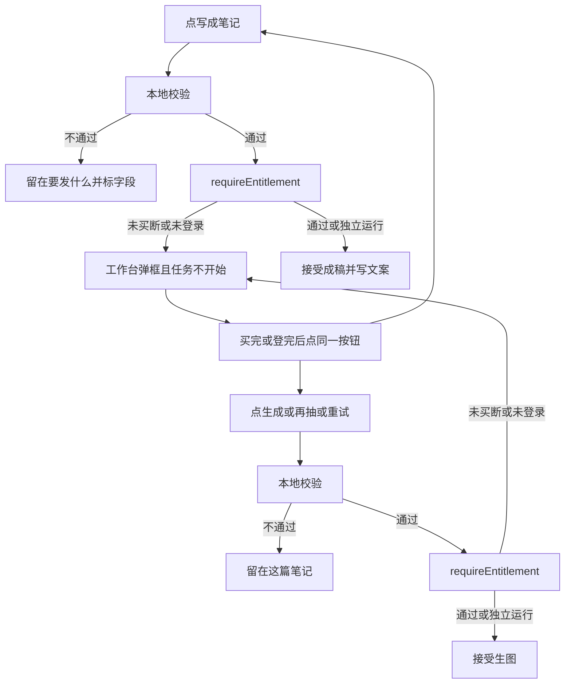
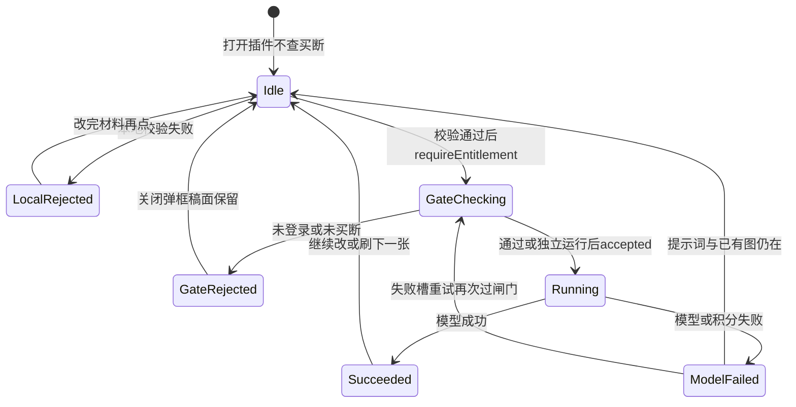

# PRD: Dex Buddy SDK 换代与买断闸门

| 属性 | 值 |
|------|----|
| 状态 | 工程：accepted（见文末「工程验收状态」章） |
| 范围 | 拷新 SDK、调用方改引用、在「写成笔记」与「刷图」两处提前买断。成稿规则、生图规则、清单 id 不动。仅 Release 0 |
| 顺序号 | 00009 |
| 关联文档 | `plugin.manifest.json`、`lib/dex-models.js`、`index.js`、`src/one-post/run.js`、`src/studio/static/pages/note.js`、`src/studio/static/shell.js`、`docs/workflows/one-post-studio.md`、`specs/prds/prd-00008-dexbuddy-host-models.md`；宿主指南 `../0001-HyHarness/docs/plugin-development/models.md`、`../0001-HyHarness/docs/plugin-development/snippets/dex-buddy-sdk.js` |

## 背景与问题

[prd-00008](prd-00008-dexbuddy-host-models.md) 已经把生文、识图、生图接到宿主模型：工作台走 `ctx.models`，独立运行用本机 `DEX_BUDDY_API_KEY`。助手文件仍是当时指南里的 `dex-models.js`，拷在 [`lib/dex-models.js`](../../lib/dex-models.js)。那份文件没有 `requireEntitlement`，也没有 `SDK_VERSION`。

宿主现行插件开发文档把接触方式改成了 Dex Buddy SDK `1.0.0`：整文件拷 [`dex-buddy-sdk.js`](../../../0001-HyHarness/docs/plugin-development/snippets/dex-buddy-sdk.js) 到插件 `lib/`，从 SDK 调 `requireEntitlement(ctx)` 和 `bindModels(ctx)`，不要直接碰 `ctx.models` / `ctx.requireEntitlement`。买断何时查，由插件自己决定。打开插件时不要自动调用。失败时工作台弹「需要购买插件」或「需要登录」，插件不要再画购买或登录文案。

运营侧现在的痛点是：未买断账号点「写成笔记」或刷图后，任务已经被接受、页面已经切到「正在写 / 正在画」，才在真正烧模型时被宿主兜底拦住。用户看到一轮空跑，稿面或错误文案里还可能出现「未开通 / NOT_ENTITLED」。插件现在可以自己控制校验时机，应在这两处付费动作开始前拦住。

| 现状 | 问题 |
|------|------|
| [`lib/dex-models.js`](../../lib/dex-models.js) 对照旧指南 `dex-models.js` | 与现行母版 `dex-buddy-sdk.js`（`SDK_VERSION` 1.0.0）不一致；没有 `requireEntitlement` |
| [`src/llm/client.js`](../../src/llm/client.js)、[`src/image/generate.js`](../../src/image/generate.js) `require('../../lib/dex-models')` | 调用方仍绑旧路径 |
| [`generateDraft`](../../src/one-post/run.js) / [`generateImages`](../../src/one-post/run.js) / [`retryImage`](../../src/one-post/run.js) 本地校验通过后立刻 `lock` 并 `accepted` | 未买断也会进入进行中，页面切到等待态 |
| [`formatModelError`](../../src/one-post/model-error.js) 把 `NOT_ENTITLED` 写成「当前账号未开通这个插件」 | 指南要求购买提示只由工作台弹框，页面不贴错误码 |
| [`studioHost.call`](../../src/studio/static/shell.js) 捕获抛错后变成 `{ ok: false, message }` | 宿主弹框之后，notice 仍可能写出购买或登录原文 |

## 目标与非目标

### 目标（Release 0）

1. 用宿主文档母版整文件替换旧助手，落到 [`lib/dex-buddy-sdk.js`](../../lib/dex-buddy-sdk.js)。`SDK_VERSION` 必须为 `1.0.0`。对照不一致就整文件再拷。不拷 Python SDK。
2. 生文、识图、生图内部仍只走 `bindModels`。`createLlm` / `generatePng` 业务入口不变。本机把 `.env` 收成普通对象后仍传入 `bindModels(ctx, { env })`。SDK 自己不读 `.env` 文件。
3. 调用方不再引用 `lib/dex-models.js`。旧文件从本仓删除或不再被任何入口加载。
4. 买断闸门只加在两处，且必须在任务被接受、页面切到「正在写 / 正在画」之前：
   - 写成笔记：`generateDraft` 本地校验通过之后、`lock` 与 `accepted` 之前。
   - 刷图：`generateImages` 与 `retryImage` 本地校验通过之后、接受生图之前。刷图包含「生成这张」「再抽一张」和失败后的「重试」。
5. 调用形状：`await requireEntitlement(ctx)`，无参，不传 `pluginId`。不要直接调用 `ctx.requireEntitlement`。
6. 工作台里未买断或未登录：这一轮不启动；页面不写购买、登录或错误码。提示只来自工作台弹框。用户买完或登完后再点一次同一按钮。
7. 独立运行（`node scripts/run-studio.js`）：同一行 `requireEntitlement` 直接通过，不打 entitlements，也不要求登录。写笔记和刷图行为与现在一致。缺 `DEX_BUDDY_API_KEY` 仍在真正打网关时提示填钥匙。
8. 打开插件、浏览历史、保存文案、复制、选历史图、显示文件：不查买断。
9. 空业务句、范文超长、缺提示词等本地错误仍先于买断出现，且不弹购买框。

### 非目标

- 打开插件时自动查买断。
- 「重算提示词」（`generatePrompts`）和「学习图册」（`learnAlbum`）本期不加提前闸门。它们仍会在真正 `chat` 时被宿主兜底拦住并弹框，可能发生在任务已经标成进行中之后。
- 插件自绘购买页、登录页、充值页；把 `NOT_ENTITLED` / `UNAUTHORIZED` 贴到操作台 notice。
- 改商城商品、限免策略、清单 `id`（仍是 `app-dexbuddy-xiaohongshu-standard-editor`）、显示名。
- 改成稿、提示词、图册、范文、封面规则、生图张数与比例。
- 改步骤键、两档生图渠道 ID、本机钥匙字段。
- 流式输出、Python 子进程、`childEnv` 新用法（本仓无 Python 模型脚本）。
- 本轮打 tag、改工牌合同字段、发到插件中心。
- 违规自动化、与捞客仓对接。

禁止定义 Release 2 及更高版本。溢出能力进本节或开放项。本期不做 Release 1。

### 成功标准

- `lib/dex-buddy-sdk.js` 与文档母版同版：`SDK_VERSION === '1.0.0'`。仓库内无对 `lib/dex-models.js` 的引用。
- 工作台未买断账号：点「写成笔记」或刷图（含失败重试）时，工作台弹出购买提示；`job.running` 仍为 false；页面不出现「未开通」「NOT_ENTITLED」或插件自写的购买文案。
- 工作台未登录账号：同一两处弹出登录提示；任务同样不开始；页面不出现插件自写的登录文案。
- 已买断或平台限免账号：这两处闸门放行，随后仍走现有模型和积分逻辑（积分不够仍在 `chat` / `images` 被拦）。
- 独立运行：闸门不因买断停住；缺钥匙的提示仍在真正请求时出现。
- 本地校验失败（空业务句、缺提示词等）时不调用 `requireEntitlement`，也不弹购买框。

## 术语

| 术语 | 含义 |
|------|------|
| SDK | 宿主指南母版 `dex-buddy-sdk.js`，拷进 `lib/dex-buddy-sdk.js`。导出 `bindModels`、`requireEntitlement`、`SDK_VERSION`、`DexModelsError` |
| 母版 | `0001-HyHarness/docs/plugin-development/snippets/dex-buddy-sdk.js`。对照用 `SDK_VERSION` |
| 买断闸门 | 插件在付费动作前调用 `requireEntitlement(ctx)`。通过后才 `accepted` |
| 写成笔记 | 材料页底栏 CTA，对应服务 `onePost.generateDraft` |
| 刷图 | 笔记页「生成这张 / 再抽一张」对应 `generateImages`；失败槽位重试对应 `retryImage` |
| 工作台弹框 | 宿主对 `UNAUTHORIZED` / `NOT_ENTITLED` 弹出的登录或购买框。插件不画 |
| 宿主兜底 | `chat.completions.create` 与 `images.generate` 在真正烧模型时仍会查买断。本篇闸门是提前拦，不取代兜底 |
| 独立运行 | `node scripts/run-studio.js` 或未注入 `ctx.requireEntitlement`；SDK 该函数直接返回 |

## 已拍板规则

| 项 | 决议 | 状态 |
|----|------|------|
| 助手文件 | 整文件拷母版到 `lib/dex-buddy-sdk.js`，不以补丁改旧 `dex-models.js` 冒充新 SDK | 已定 |
| 旧文件 | 调用方改引用后删除 `lib/dex-models.js` | 已定 |
| Python SDK | 不拷 | 已定 |
| 校验 API | `await requireEntitlement(ctx)`，无参，不传 `pluginId` | 已定 |
| 写成笔记闸门 | `generateDraft` 本地校验通过之后、`lock` / `accepted` 之前 | 已定 |
| 刷图闸门 | `generateImages` 与 `retryImage` 本地校验通过之后、接受生图之前 | 已定 |
| 打开插件 | 不调用 | 已定 |
| `generatePrompts` / `learnAlbum` | 本期不加提前闸门 | 已定 |
| 失败展示 | 购买与登录只由工作台弹框；页面不写这类文案、不贴错误码 | 已定 |
| 积分 | 闸门不看积分；`INSUFFICIENT_CREDITS` 仍在后来的文案 / 生图 | 已定 |
| 独立运行 | 同一行直接通过 | 已定 |
| 本机 `.env` | 仍合并后传入 `bindModels` 的 `env` | 已定 |
| 清单 id | 不改，仍为 `app-dexbuddy-xiaohongshu-standard-editor` | 已定 |
| 用户再试 | 买完或登完后点同一按钮再走一遍；插件不自动重放 | 已定 |

## 用户与角色

| 角色 | 目标 |
|------|------|
| 运营（主要用户） | 在工作台写成笔记、刷封面和配图；未买断时立刻看到购买提示，而不是空等一轮 |
| 未买断访客 | 先逛材料、历史、已有稿面；真正写或画时被请去购买 |
| 作者 / 开发（次要） | 本机独立跑操作台改提示词，不被买断逻辑打断 |
| 工作台宿主 | 执行买断确认并弹框；插件只决定何时调用 |
| 工程 | 换 SDK、把闸门接到两个服务入口、保证页面不抢宿主文案 |

## 功能域

### 换 SDK

- 从宿主指南整文件拷贝到 `lib/dex-buddy-sdk.js`。不要手改母版后再伪装版本号。
- [`src/llm/client.js`](../../src/llm/client.js) 与 [`src/image/generate.js`](../../src/image/generate.js) 的 `require` 与 JSDoc 类型指向新文件。
- 删除 `lib/dex-models.js`。`dex-buddy-plugin.pack` 已含 `lib/`，不必为新文件名改打包清单。
- `bindModels` 行为与 00008 一致：有 `ctx.models` 走宿主，否则用传入的 `env.DEX_BUDDY_API_KEY`。

### 闸门接入

- `generateDraft`、`generateImages`、`retryImage` 改为可 `await` 的服务方法（当前三处在校验通过后同步 `accepted`）。
- 顺序固定：本地校验 → `requireEntitlement(ctx)` → 成功才 `lock` 并返回 `{ ok: true, accepted: true }`。
- 本地校验失败：立即返回现有 `{ ok: false, message, field? }`，不调用闸门。
- 闸门抛 `UNAUTHORIZED` / `NOT_ENTITLED`：不写 `job.running`，不切等待骨架，不把错误格式化进稿面 `job.error`。
- 实现可把 `requireEntitlement` 收成 runner 的可注入函数，便于独立运行测试；生产路径必须走 SDK，禁止业务代码直接读 `ctx.requireEntitlement`。

### 页面不抢文案

- [`src/studio/static/shell.js`](../../src/studio/static/shell.js) 的 `call` 捕获到带 `UNAUTHORIZED` / `NOT_ENTITLED` 的失败时，不要把宿主或 SDK 的购买 / 登录原文写进 `message` 给 notice。可返回「已由宿主处理」的空失败（例如 `{ ok: false, silenced: true }`），页面 `noteRejection` 对这种结果不写 notice。
- [`formatModelError`](../../src/one-post/model-error.js) 不再作为闸门失败的页面文案来源。模型出口兜底若仍落到 `job.error`（例如 `generatePrompts` 本期不加闸门），可保留现有中文，但「写成笔记」和「刷图」两条提前拦住的路径不得走这条。
- 页面不新增购买按钮、不跳转商城。

### 独立运行

- `scripts/run-studio.js` 没有宿主 `ctx.requireEntitlement` 时，SDK 直接返回。本机 HTTP 桥把服务方法的 Promise 结果交给页面，行为与现在一致。

## 用户故事地图与版本切片

### 旅程主干

#### J1 未买断时点写成笔记（Entry：工作台已打开插件，材料已填）

| 步 | 节点 | 类型 |
|----|------|------|
| 1 | 运营填好「这篇想讲什么」，点「写成笔记」 | Entry |
| 2 | 本地校验通过 | |
| 3 | 插件调用 `requireEntitlement(ctx)` | |
| 4 | 宿主判定未买断，弹出购买框 | |
| 5 | 任务未接受；仍停在「要发什么」；无「正在写这篇笔记」 | Exit |
| 6 | 运营关闭弹框；稿面输入仍在；不自动重放 | Teardown |

购买完成后同一按钮再走 J3（逆向再进入）。

#### J2 未买断时刷图（Entry：已有稿面和提示词）

| 步 | 节点 | 类型 |
|----|------|------|
| 1 | 运营在笔记页点「生成这张」或失败槽「重试」 | Entry |
| 2 | 本地校验通过（有提示词、槽位合法） | |
| 3 | 插件调用 `requireEntitlement(ctx)` | |
| 4 | 宿主弹出购买框 | |
| 5 | 生图未开始；当前选用图仍在；无新的进行中状态 | Exit |
| 6 | 关闭弹框；提示词与已有图保留 | Teardown |

#### J3 已买断后写成笔记并刷一张（Entry：账号已买断或限免）

| 步 | 节点 | 类型 |
|----|------|------|
| 1 | 点「写成笔记」 | Entry |
| 2 | 闸门通过，任务被接受，切到笔记骨架 | |
| 3 | 成稿成功 | |
| 4 | 点「生成这张」封面 | |
| 5 | 闸门再次通过，封面生成 | Exit |
| 6 | 关掉插件；数据留在对应 data 目录 | Teardown |

积分不足发生在第 3 或第 5 步的模型出口，不由本篇闸门处理。

#### J4 本地校验先于买断（Entry：业务句为空）

| 步 | 节点 | 类型 |
|----|------|------|
| 1 | 业务句为空时点「写成笔记」 | Entry |
| 2 | 字段旁错误，不发模型、不调闸门 | Exit |
| 3 | 工作台不弹购买框 | Teardown |

#### J5 独立运行写一篇（Entry：仓库 `.env` 已填钥匙）

| 步 | 节点 | 类型 |
|----|------|------|
| 1 | `node scripts/run-studio.js --open` | Entry |
| 2 | 点写成笔记；`requireEntitlement` 直接通过 | |
| 3 | 成稿；再刷封面 | Exit |
| 4 | 关掉操作台 | Teardown |

缺钥匙：闸门仍通过，真正请求时提示填 `.env`（逆向 Exit）。

#### J6 未登录（Entry：工作台会话失效）

| 步 | 节点 | 类型 |
|----|------|------|
| 1 | 点写成笔记或刷图 | Entry |
| 2 | 闸门失败，宿主弹登录 | |
| 3 | 任务不开始 | Exit |
| 4 | 登完后点同一按钮 | Teardown |

### 故事地图

1. 作为工程，我想把模型助手换成文档母版 SDK 1.0.0，以便对照 `SDK_VERSION` 整文件再拷，不再维护旧 `dex-models.js`。
   - 验收：存在 `lib/dex-buddy-sdk.js` 且 `SDK_VERSION === '1.0.0'`；`src/llm/client.js` 与 `src/image/generate.js` 只引用新文件；仓库无 `lib/dex-models.js` 引用。

2. 作为运营，我想点「写成笔记」时如果还没买断，立刻看到工作台购买框，以便先买再写、不等一轮空转。
   - 验收：未买断时 `generateDraft` 在 `accepted` 之前失败；`job.running` 为 false；页面无「未开通 / NOT_ENTITLED」；有工作台购买弹框。

3. 作为运营，我想刷图（生成、再抽、失败重试）时同样先过买断，以便没买的人不会进入「正在做封面」。
   - 验收：`generateImages` 与 `retryImage` 在接受生图前调用闸门；未买断时不进入进行中。

4. 作为运营，我想买完或登完后再点同一个按钮就能继续，以便不用重填材料。
   - 验收：输入和已有稿面保留；插件不自动重放；再次点击走完整校验 + 闸门。

5. 作为未买断访客，我想先看历史和已有稿面、改标题正文、复制，以便决定买之前能逛。
   - 验收：打开插件、`listPosts`、`saveEditor`、`chooseImage`、复制、显示文件不调用 `requireEntitlement`。

6. 作为运营，我想空着业务句点写成笔记时只看到字段错误，以便先把材料写完，不被购买框打断。
   - 验收：本地校验失败路径零次调用 `requireEntitlement`。

7. 作为作者，我想本机独立跑时写笔记和刷图不被买断拦住，以便改提示词。
   - 验收：无 `ctx.requireEntitlement` 时闸门直接通过；成稿与生图仍走 `bindModels` 与本机钥匙。

8. 作为运营，我想已买断或限免时这两处闸门安静通过，以便后面仍按现在的模型和积分走。
   - 验收：闸门成功后行为与改前一致；积分不足仍只出现在文案 / 生图出口。

### Release 0 可验收结果

新 SDK 已替换旧助手；「写成笔记」与「刷图」（含失败重试）在任务开始前调用 `requireEntitlement`；未买断 / 未登录由工作台弹框且任务不开始；页面不贴购买或登录文案；本地校验先于闸门；独立运行直通；清单 id 与成稿生图产品规则不变。

本 PRD 不定义 Release 1 或更高版本。`generatePrompts` / `learnAlbum` 提前闸门、自绘购买页见非目标或开放项。

## 核心流程与状态机图

写成笔记与刷图共用「本地校验 → 买断闸门 → 接受任务」；打开插件不进入本图。

宿主弹框后调用仍失败。页面把这类失败当成已处理，不写 notice。生成停住，等用户再点。

预警：`GateRejected` 不是死胡同，关闭弹框回到 `Idle`，买完后同一按钮再进入 `GateChecking`。不要在 `GateRejected` 把 `job.running` 设为 true。不要把成功态做成不能再抽下一张。`generatePrompts` / `learnAlbum` 本期仍可能从 `Running` 被宿主兜底弹框，属已知缺口，不在本状态图当提前闸门。

## 数据与 API 衔接

| 能力 | 说明 |
|------|------|
| SDK | `lib/dex-buddy-sdk.js` 从指南整文件拷入。`bindModels(ctx, { env })`、`requireEntitlement(ctx)` |
| 买断 | 工作台转交 `ctx.requireEntitlement()`；独立运行空实现。不打 `/v1/entitlements` 以外的插件自建接口 |
| 文案 / 识图 / 生图 | 仍经 `bindModels`，与 [prd-00008](prd-00008-dexbuddy-host-models.md) 相同。模型出口继续兜底查买断 |
| `list` / `quote` | 不拦未买断，也不弹框。闸门之后若业务仍先 quote，行为不变 |
| 服务方法 | 仍是 `onePost.generateDraft`、`generateImages`、`retryImage`；三者在工作台路径上变为 async |
| 页面 | 只 `window.dex.call` / 本机 `POST /api/one-post/<方法>`，不 `fetch` 网关 |

## 假设与开放项

| 项 | 说明 |
|----|------|
| 假设 | 工作台对 `requireEntitlement` 的 `UNAUTHORIZED` / `NOT_ENTITLED` 自行弹框，插件无需也不应补文案 |
| 假设 | 平台限免时 `requireEntitlement` 与模型出口一样跳过买断，登录仍要过 |
| 假设 | 不在商城出售的清单 id 买断视为通过；本插件官方 id 在商城按实际上架为准，本篇不决定是否收费 |
| 假设 | 母版 `SDK_VERSION` 在实现时仍为 `1.0.0`；若母版已升版，整文件再拷并以当时母版号为准，不手改版本号 |
| 开放 | `generatePrompts` / `learnAlbum` 是否在后续独立 PRD 里补同一提前闸门 |
| 开放 | `studioHost.call` 对宿主已处理错误的具体返回形状（`silenced` 或其他），由实现选定，验收看页面无购买文案 |
| 待与工程对齐 | `generateDraft` 现为同步函数，测试直接读返回值；改为 async 后测试须 `await` |
| 待与工程对齐 | workflow「当前账号未开通这个插件」排查行：闸门路径改为「看工作台弹框」；模型出口兜底仍可能写 job.error |
| 冲突与决议 | [prd-00008](prd-00008-dexbuddy-host-models.md) 把 `NOT_ENTITLED` 列为页面可见错误。自本篇起，写成笔记与刷图的提前闸门以本篇为准：这两处不把该码写到页面。00008 历史正文不回头改 |

## 修订记录

| 日期 | 说明 |
|------|------|
| 2026-10-28 | 初稿。换 Dex Buddy SDK 1.0.0；写成笔记与刷图在 accepted 前 `requireEntitlement`；购买与登录提示交给工作台；独立运行直通；仅 Release 0。 |

## 1. 工程验收状态

> 由 `/team:prd-accept` 维护；勿手工编造「通过」。最后更新：2026-10-28T03:03:19Z，dev@996cd77，范围：R0。产品确认关闭本 PRD。

### 总览

| 项 | 值 |
|----|----|
| 工程状态 | accepted |
| 验收判定 | Release 0 已交付；本期不做 Release 1。工作台弹框由宿主负责，产品手工点过主路径无大问题 |
| 最近验收 | 2026-10-28T03:03:19Z |
| 代码提交 | 996cd77（验收时 HEAD；工作区尚有未提交交付） |
| 分支 | dev |

摘要：

1. `lib/dex-buddy-sdk.js` 的 `SDK_VERSION` 为 `1.0.0`；`src/llm/client.js` 与 `src/image/generate.js` 只引用新文件；仓库无 `lib/dex-models.js`。
2. `generateDraft` / `generateImages` / `retryImage` 在本地校验通过后、`accepted` 前 `await requireEntitlement(ctx)`，不传 `pluginId`，业务代码不读 `ctx.requireEntitlement`。
3. 闸门 `UNAUTHORIZED` / `NOT_ENTITLED` 返回 `{ ok: false, silenced: true }`，不写 `job.running`；页面 `noteRejection` 不把购买/登录原文写进 notice。
4. 空业务句等本地校验零次调用闸门；无宿主时闸门直通。`tests/one-post/run.test.js` 覆盖上述路径。
5. 打开插件、历史、保存、复制、选图、显示文件不加闸门。`generatePrompts` / `learnAlbum` 本期不加提前闸门，属非目标。

### Release 交付

| Release | 状态 | 说明 |
|---------|------|------|
| R0 | 通过 | 换 SDK、写成笔记与刷图提前买断、页面不抢宿主文案、独立运行直通 |
| R1 | 范围外 | PRD 声明本期不做 Release 1 |

### 功能验收清单（Agent 优先读此表）

| ID | 能力摘要 | Release | 状态 | 证据 |
|----|----------|---------|------|------|
| G1 | 拷 SDK 1.0.0，对照 `SDK_VERSION` | R0 | 通过 | `lib/dex-buddy-sdk.js` `SDK_VERSION === '1.0.0'`；`tests/one-post/run.test.js`「模型助手是 Dex Buddy SDK 1.0.0」 |
| G2 | 生文识图生图仍只走 `bindModels` | R0 | 通过 | `src/llm/client.js`；`src/image/generate.js` |
| G3 | 删除旧 `lib/dex-models.js`，调用方改引用 | R0 | 通过 | 仓库无该文件；`src/` 无 `dex-models` 引用 |
| G4 | 写成笔记闸门在 `accepted` 之前 | R0 | 通过 | `src/one-post/run.js` `generateDraft` → `withEntitlement`；测试「未买断或未登录时写成笔记和刷图不进入进行中」 |
| G5 | 刷图（生成/再抽/失败重试）闸门在接受生图前 | R0 | 通过 | 同文件 `generateImages` / `retryImage`；同上测试含封面闸门与 `retryImage` |
| G6 | `await requireEntitlement(ctx)` 无参，不读 `ctx.requireEntitlement` | R0 | 通过 | `withEntitlement` 调 SDK 或注入函数，传入 `options.ctx` |
| G7 | 闸门失败不写 `job.running`，页面不贴购买/登录文案 | R0 | 通过 | 返回 `silenced`；`src/studio/static/shell.js`；`src/studio/static/pages/note.js` `noteRejection`；产品手工点过工作台主路径 |
| G8 | 独立运行闸门直通 | R0 | 通过 | `tests/one-post/run.test.js`「独立运行时买断闸门直接通过」；`scripts/run-studio.js` `ctx: undefined` |
| G9 | 打开插件、历史、保存、复制、选图、显示文件不查买断 | R0 | 通过 | `withEntitlement` 仅三处服务；`listPosts` / `saveEditor` / `chooseImage` 等未接入 |
| G10 | 本地校验先于闸门 | R0 | 通过 | 「空业务一句和超长文章都不会调用模型」`gates === 0`；缺槽位 `generateImages({})` 不增加闸门次数 |
| S1 | 故事：未买断点写成笔记看工作台购买框 | R0 | 通过 | 代码 G4+G7；产品确认工作台点过无大问题。弹框文案由宿主绘制 |
| S2 | 故事：未买断刷图（含失败重试）不进入进行中 | R0 | 通过 | 见 G5 |
| S3 | 故事：买完或登完后点同一按钮再走 | R0 | 通过 | 闸门失败不改稿面、不自动重放；`pendingCall` 结束后可再点 |
| S4 | 故事：未买断可逛历史和已有稿面 | R0 | 通过 | 见 G9 |
| S5 | 故事：空业务句只标字段、不弹购买框 | R0 | 通过 | 见 G10 |
| S6 | 故事：本机独立跑不被买断拦住 | R0 | 通过 | 见 G8 |
| S7 | 故事：已买断或限免时闸门放行 | R0 | 通过 | 注入闸门成功后 `accepted`；产品手工点过已买断主路径 |
| S8 | 工程换 SDK 1.0.0 | R0 | 通过 | 见 G1–G3 |

### 未完成与遗留

- `generatePrompts` / `learnAlbum` 本期不加提前闸门（非目标）。模型出口兜底仍可能在任务进行中弹框，并可能把「未开通」写进 `job.error`。
- 工作台购买/登录弹框是宿主行为，本仓 Cursor 浏览器未打开 Dex Buddy 插件页，未截到弹框本体；产品手工点过，判定不阻塞关闭。
- 积分不足仍只出现在文案/生图出口，不由本篇闸门处理。

### 质量检查

| 检查项 | 状态 |
|--------|------|
| 测试 | `pnpm test`：`tests/one-post/run.test.js` 含 SDK 版本、闸门 `silenced`、本地校验零次调用、独立运行直通 |
| 类型 | `pnpm run check:types` 通过 |
| Lint | 本仓无 ESLint，记 N/A |
| 文档与 OpenAPI | 本项目无 OpenAPI。`docs/workflows/one-post-studio.md` 排查行已改为看工作台弹框；`docs/doc_index.md` 已同步 |

---
统计：通过 18 / 部分 0 / 未实现 0 / 范围外 1

