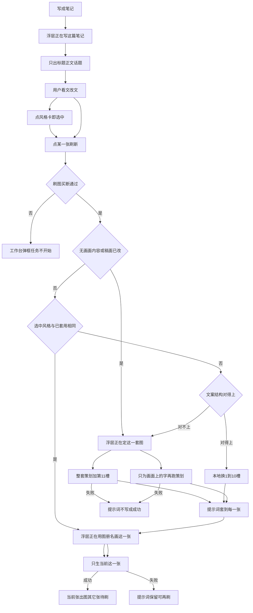
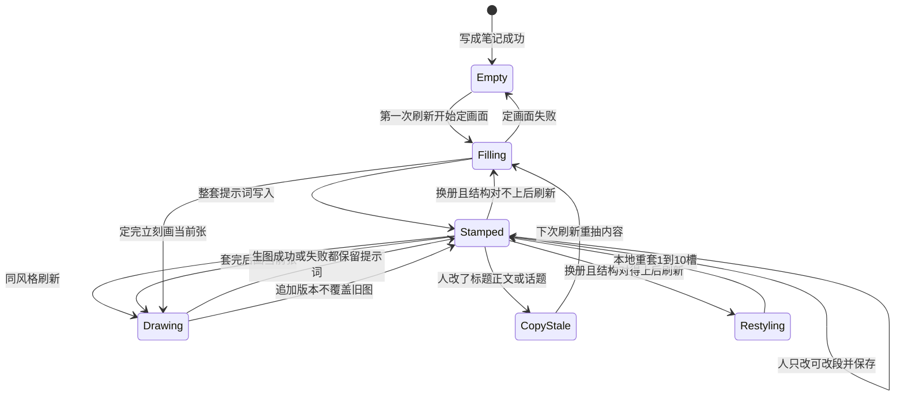

# PRD: 先看文，刷新才出图

| 属性 | 值 |
|------|----|
| 状态 | backlog |
| 范围 | 「这篇笔记」生图入口、风格选用、提示词展示与出图等待文案。仅 Release 0 |
| 顺序号 | 00010 |
| 关联文档 | `docs/workflows/one-post-studio.md`、`docs/DESIGN.md`、`docs/mvp-map.md`、`AGENTS.md`、`src/one-post/run.js`、`src/studio/static/pages/note.js`、`src/studio/static/pages/note.html`、`src/prompts/album/sheet.js`、`specs/prds/prd-00001-one-post-from-article.md`、`specs/prds/prd-00004-image-set.md`、`specs/prds/prd-00009-sdk-entitlement-gates.md` |

## 背景与问题

运营点「写成笔记」是为了先看文。今天文案一落地，系统立刻跑两段模型：画面策划（`prompts:plan`）和第 11 槽主题（`prompts:scenes`），把整册题词填成完整提示词。人还没确认文、也还没选风格，这一步就已经烧了，并且把「这篇笔记」浅灰工具卡上的等待拉得很长。刷新键在提示词为空时是禁用的，人没法「先看文，再点刷新出图」。

风格是第二道多余手续。点风格卡打开详情浮层，再点「按此风格重算提示词」。同一本图册点第二次，模型再跑一遍。人不知道第一张已经把风格套到整套图上，就会在第二张再点一次相同风格。

提示词框把 1–10 槽固定风格（背景、色彩、字体……）和第 11 槽、画面上的字摊在同一个长框里。人要拖过一整段才能改真正会变的内容。

浮层还是那一个 Lottie，下面那一行把「提示词」也说成「正在写这篇笔记」。人在等图，字却在说写文。等待被拉长，不是因为动画不够热闹，是因为句子说错了阶段。

本篇把生图收成一条不被打断的路：进来先看文；要点图时选一本风格、点刷新。第一次可以慢。之后同风格、文没改，不再调模型。提示词框只留可改的那一段。等待那一行跟着真实步骤走。

## 目标与非目标

### 目标（Release 0）

1. 「写成笔记」只生成并展示标题、正文、话题。不跑画面策划，不跑第 11 槽，不生图。空图槽留着，刷新可点。
2. 点图册风格卡即选中（描边）。不再出现「按此风格重算提示词」。笔记页点卡不再打开详情浮层。
3. 点某一张的刷新：若整套还没有可用的画面内容，或标题 / 正文 / 话题相对上次出提示词已经变了，对整套（封面 + 全部配图）跑一次内容，把提示词套到每一张，再只生当前这一张。
4. 风格与已套用的相同、笔记未改：刷新不调策划模型、不调第 11 槽模型，只生当前这一张。
5. 换成另一本图册、笔记未改、文案结构对得上：不调模型，本地用新图册的 1–10 槽重套整套；第 11 槽和已定画面文案留下。
6. 换成另一本、文案结构对不上：这一次刷新才为「画面上的字」再跑策划，第 11 槽能留就留。不弹窗、不加按钮。
7. 「这张的提示词」只展示可改段。1–10 槽、开场套话、发模型前另拼的参考图说明全部不出现。改完失焦仍保存。生图前程序把隐藏段拼回去。
8. 出图等待仍用现有 Lottie，不换动画、不加进度条、不加轮播。浮层那一行按真实步骤切换，点了刷新之后不得再说「写这篇笔记」。
9. 没选风格就点刷新：沿用这篇已有的图册；还没有就随机抽一本并记住。不弹「请先选风格」。
10. 已生成的图不因改文被删。再抽仍追加版本，不覆盖旧图。买断闸门仍只在写成笔记与刷图两处，见 `prd-00009`。

### 非目标

- **备忘 · 笔记页动态增删张数（另立 PRD）**：人要能在「这篇笔记」里增加或删除某一张。加减之后，整套画面的策划（封面与配图如何拆开、每张一句怎么排）必须重算，不能只在末尾插一张空槽。本期张数仍只在「要发什么」里、写成笔记前选定。本备忘不挂 Release 1，不在本篇做交互。
- 给风格、提示词或刷新增加新按钮、新表单、引导气泡、二次确认。
- 换 Lottie、加进度条、加轮播假文案、改学图册那套 `image-scan` 等待。
- 把提示词拆成多个输入框、分槽编辑器、可视化 11 槽表单。
- 一次刷新画出全部图。
- 取消进行中的模型或生图请求。
- 改图册学习、资料库图册详情、上传参考勾选与融图、成稿口吻、买断文案。
- 自动发布、爬取、与捞客仓对接、广告法检查。

禁止定义 Release 2 及更高版本。上面这些溢出项留在非目标或开放项，或另立 PRD。

## 术语

| 术语 | 含义 |
|------|------|
| 稿面 | 标题、正文、话题。人先看、先改的就是这些。 |
| 图册风格 | 一本图册（`look`）。1–10 槽是这本的固定画法；第 11 槽是这一张的主题绘画内容。 |
| 选中风格 | 人点风格卡后的待用 `look`。只改描边，不调模型、不改提示词。点刷新才落地。 |
| 已套用风格 | 已经写进这篇 `prompts.look` 的图册。 |
| 画面内容 | 整套图的策划帧（画面上的字）加上每张第 11 槽。由 `prompts:plan` 与 `prompts:scenes` 产出。 |
| 可改段 | 提示词框里给人看、给人改的部分：第 11 槽正文，加上这一张要写在画面上的文案（可带该册已有小标题，如「主标题：」）。 |
| 隐藏段 | 1–10 槽、开场套话、文末生成约束套话，以及发模型前另拼的参考图说明。不进框，生图前拼回去。 |
| 结构对得上 | 目标图册 `copySchema` 的必填字段，都能从当前每张已定帧里取到非空值。手帐可选 `note` 可空，不挡杂志 → 手帐。 |
| 刷新 | 小图右下角现有图标钮。空槽是「生成这张」，已有图是「再抽一张」。本期它还承担「把选中风格应用到整套提示词」。 |
| 刷图闸门 | `prd-00009` 的买断校验，发生在接受生图之前。第一次刷新若需要先定画面，仍算同一次刷图，不另开购买口。 |

## 已拍板规则

| 项 | 决定 |
|----|------|
| 写成笔记停在哪 | 稿面成功即结束这一轮任务。`job.step` 只经历「成稿」。不进入「提示词」，不开始生图。 |
| 空提示词能否刷新 | 能。有稿面、未在跑任务即可点。不再因为提示词为空禁用。 |
| 风格怎么选 | 点卡即选中。同一时间只有一本描边。再点另一本，只换选中。 |
| 风格详情浮层 | 笔记页去掉。样图在卡片上已经看得见。资料库图册详情不在本篇改。 |
| 应用风格按钮 | 删除。刷新即应用。 |
| 第一次刷新 | 整套套上提示词，只画当前点的那一张。允许这一下慢。 |
| 同风格再刷 | 不调 `prompts:plan`、不调 `prompts:scenes`。提示词保持。只生当前张。 |
| 何时重抽画面内容 | 标题、正文或话题相对上次成功出提示词时的 `basis` 变了。换风格本身不重抽第 11 槽。 |
| 换册且结构对得上 | 本地用新图册模板重套 1–10 与该册固定套话；第 11 槽与已定画面文案不动。 |
| 换册且结构对不上 | 只为画面上的字再跑 `prompts:plan`。第 11 槽能留则留。用户感知仍是「这次刷新稍慢」。这是笔记没改时唯一允许调模型的口子。 |
| 没选风格 | 用 `prompts.look`；仍空则随机抽一本，写入 `prompts.look` 并选中。 |
| 未刷新的选中 | 只活在当前页。刷新浏览器后回到 `prompts.look`。不另存「待用风格」。 |
| 提示词框 | 仍是现在这一个，默认收起。只填可改段。空时仍可提示「还没有这一张的提示词」。 |
| 人改可改段 | 失焦保存。再刷这一张时以人留下的可改段为准，隐藏段按当前图册拼。 |
| 旧稿全文提示词 | 打开时框里只抽出可改段。隐藏段仍按存盘全文发模型，直到换风格本地重套，那时 1–10 改回该册模板。 |
| 改文与旧图 | 改标题或正文不删已生成的图。提示词标过期，下次刷新才重抽内容并给当前张追加新版本。 |
| 等待动画 | 仍是 `animations/job-running.json` 盖在浅灰工具卡上。小图右下角转圈保留。 |
| 等待文案 | 见下表。点刷新之后，这一行不得出现「写笔记」「写这篇笔记」「写小红书」。 |
| 本地换风格要不要一句等待 | 不要。几乎不耗时，直接进入画这一张。 |
| 买断 | 写成笔记仍闸 `generateDraft`。刷新（含顺便定画面）仍闸 `generateImages` / `retryImage`。不给定画面单独加闸。 |
| 一次只画一张 | 与现网一致。套提示词是整套，出像素是当前张。 |
| 张数 | 本期不在笔记页加减。仍回「要发什么」改完再写成笔记（整篇重写，既有行为）。 |

### 出图等待文案

同一张 Lottie，只换下面那一句。图册名取该册 `label` 在逗号或顿号前的第一段（如「杂志编辑风，高辨识度大字报，概念插画」→「杂志编辑风」）。没有逗号顿号则用整段 `label`。还没有图册名时，画图两句退回「正在画封面」「正在画第 N 张」，不空着括号。

| 真实步骤 | 浮层那一行 |
|----------|------------|
| 写成笔记，模型在写标题正文 | 正在写这篇笔记 |
| 刷新后正在给整套图定画面（策划 + 第 11 槽） | 正在定这一套图 |
| 正在画封面 | 正在用{图册名}画封面 |
| 正在画第 N 张配图 | 正在用{图册名}画第 N 张 |

「正在写这篇笔记」只许出现在写文。现网把步骤「提示词」也说成这句，出图路径上删掉这层映射。

## 取舍说明

| 备选 | 不采用 | 采用 |
|------|--------|------|
| 写成笔记后静默出提示词、不生图像素 | 人还在看文，提示词已经按未确认的文和随机风格算完 | 写成笔记完全不碰图 |
| 保留「按此风格重算提示词」 | 多一次点击，同风格会再算一遍 | 点卡即选中，刷新才落地 |
| 点风格卡仍打开详情浮层 | 样图已经在卡片上；浮层里的完整题词会把刚藏起来的固定段再摊开 | 笔记页不打开该浮层 |
| 提示词框拆成 11 个槽 | 形式负担比现在更重 | 一个框，只留可改段 |
| 同风格第二次仍走模型「保证一致」 | 浪费，且让人再等 | 相同则填上即画 |
| 换任何图册都重跑策划 | 杂志换手帐会无谓重写画面上的字 | 结构对得上就本地重套 |
| 换 Lottie 或做轮播文案减等待 | 假动作。阶段说错，换皮没用 | 句子跟真实步骤走 |

破坏者视角：没有「取消本轮」；关掉页或刷新浏览器时，进行中的任务按现网继续，回来仍停在这一篇。定画面失败不得把半截提示词写成成功结果（沿用现网提示词失败合同）。生图失败则提示词留下，可再点刷新。选中风格后不点刷新，等于没应用，允许再点别的卡。

## 用户与角色

| 角色 | 目标 |
|------|------|
| 运营（主） | 先看文、改文；要点图时选风格、点刷新；少等、少翻提示词。 |
| 运营（次） | 只改某一张可改段后再抽这一张；在已有版本里选一张。 |
| 内部工程 | 仍落在现有 `prompts` 与 `job` 上，不新开存储；刷图闸门不拆成两次购买。 |

## 功能域

1. **成稿收口**：`runGenerateDraft` 在稿面写入后结束。不要接着 `producePrompts`。
2. **刷新编排**：点刷新时判断：无内容或稿面过期 → 整套定画面；选中风格与已套用不同且结构对得上 → 本地重套；结构对不上 → 只重跑策划；然后只生当前张。
3. **风格选用**：卡片描边绑定选中 id。去掉笔记页图册详情浮层与重算按钮。
4. **提示词展示**：从存盘全文抽出可改段给框；保存时把可改段嵌回当前图册模板。发模型仍走现有 `composeImagePrompt`（隐藏段 + 参考图说明在那一层拼）。
5. **等待文案**：`stepText` 按上表。定画面步骤不得映射成写笔记。
6. **同风格短路径**：`look` 相同且 `basis` 未变，刷新跳过模型，直接 `generateImages` 当前槽。

## 用户故事地图与版本切片

### 旅程主干

| 步 | 人在做什么 | 起止 |
|----|------------|------|
| 1 | 在「要发什么」点「写成笔记」 | Entry |
| 2 | 进入「这篇笔记」，空图槽，先读标题正文 | |
| 3 | （可选）改标题或正文 | |
| 4 | （可选）点一本图册风格，只见描边 | |
| 5 | 点某一张刷新 | |
| 6 | 若需要定画面：看见「正在定这一套图」，再看见「正在用{图册名}画…」 | |
| 7 | 当前张出图；整套提示词已套上；其它张仍空像素 | |
| 8 | 点另一张刷新（同风格、文未改）：不再定画面，直接画这一张 | |
| 9 | （可选）展开提示词，只改可改段，再刷这一张 | |
| 10 | 复制这篇，或回去改「要发什么」整篇重写 | Exit |

失败：写成笔记失败 → 错误可见，稿面或材料页按现网停留。定画面失败 → 提示词不写成成功结果，刷新仍可再点。生图失败 → 提示词保留，当前张可再刷。未点刷新就离开 → 可以没有图，这是正常 Exit。

### 故事地图（Release 0）

1. 作为运营，我想写成笔记后立刻读文，以便先改不对的句子，而不是先等图。
   - 验收：稿面出现后这一轮 `job.running` 为假；任务步骤没有「提示词」；像素全空；刷新可点。

2. 作为运营，我想点一本风格再点刷新，以便用这本画法出第一张。
   - 验收：点卡只换描边、不开浮层、无「按此风格重算提示词」；刷新后 `prompts.look` 等于该卡；当前张出图；其它张有提示词、无新像素。

3. 作为运营，我想第一张用过的风格在第二张直接画，以便不必再点一次相同风格去「应用」。
   - 验收：`look` 与 `basis` 未变时，第二次刷新不出现 `prompts:plan` / `prompts:scenes`；即便人又点了同一本风格卡，仍然不调这两段模型。

4. 作为运营，我想改完标题或正文后再刷新，以便画面上的字跟着新文走。
   - 验收：改文不删旧图；下次刷新出现定画面等待文案；新提示词按新稿面；当前张追加版本。

5. 作为运营，我想换一本结构相近的图册再刷新，以便只换画法、不重写已经定下的字。
   - 验收：杂志与手帐这类 `line` 能对上的切换，刷新不跑 `prompts:plan`；1–10 变成新册内容；第 11 槽与画面上的那句中文仍在。

6. 作为运营，我想从大字报换成信息图再刷新，以便字能装进新结构，而且不必对付一个说明弹窗。
   - 验收：结构对不上时这次刷新会跑策划；无弹窗、无新按钮；等待文案仍是「正在定这一套图」再进入画这一张。

7. 作为运营，我想打开提示词时只看到能改的字，以便不用拖过背景和字体。
   - 验收：框里看不见「1. 背景」到「10. 光影与质感」；看不见开场「竖版 3:4」套话；看得见第 11 槽正文和画面上的文案。

8. 作为运营，我想没选风格也能刷新，以便不被拦住。
   - 验收：无描边时刷新仍开始；事后有一个 `prompts.look`；无「请先选风格」。

9. 作为运营，我想等图的时候看见现在在画什么，以便知道这一步还要不要等。
   - 验收：写文时是「正在写这篇笔记」；点刷新后先是「正在定这一套图」（仅需要定画面时），接着是「正在用{图册名}画封面」或「正在用{图册名}画第 N 张」；出图路径全程没有「写这篇笔记」。

10. 作为运营，我想提示词还没出来也能点刷新，以便一条手势走完「定画面 + 出这一张」。
    - 验收：空提示词时刷新钮可用；一次点击后整套提示词落地且只出当前张；买断仍只走刷图闸门一次。

### Release 0 可验收结果

写成笔记只出文。选风格是描边。刷新才给整套套提示词并画当前张。同风格且稿面未改不调模型。提示词框只留可改段。等待那一行跟步骤走。笔记页没有「按此风格重算提示词」，也没有用详情浮层当应用入口。

本 PRD **不定义 Release 1**。动态增删张数见非目标备忘，另立 PRD。

## 核心流程与状态机图

提示词对象生命周期。没有「选中风格但未刷新」的持久状态；那只是页面临时描边，刷新浏览器后回到已套用。失败节点都能再点刷新，不是死胡同。

## 数据与 API 衔接（高层）

| 能力 | 说明 |
|------|------|
| 成稿 | `generateDraft` 成功后 `prompts.cover` / `prompts.gallery` 保持空（新篇）；`prompts.look` 可空；`stale` 为假。不要写随机风格的完整提示词。 |
| 刷新 | 现有 `generateImages`（当前槽）。内部在缺内容、稿面过期或风格结构对不上时先定画面，再只跑当前槽生图。页面不再为「应用风格」调用独立的 `generatePrompts`。 |
| 风格 | 选中 id 是页面状态。落地后写入既有 `prompts.look`。 |
| 过期 | 继续用既有 `prompts.basis` 与 `basisFrom`（标题、正文、话题、张数等）。改文后与 `basis` 不等即过期。 |
| 存盘提示词 | 仍是 `prompts.cover` 与 `prompts.gallery[]` 的完整字符串，供生图拼装。框里是抽出的可改段，不是第二份存储。 |
| 结构对得上 | 工程用目标册 `copySchema` 必填字段对已定帧做有无检查。出厂例：杂志 `line` 与手帐 `line` 对得上；杂志对信息图的 `modules` / `steps` 对不上。 |
| 等待 | `job.step` 须能区分成稿、定画面、封面、配图 N。页面 `stepText` 按文案表映射。 |
| 买断 | 刷新整条路径只在接受生图前 `requireEntitlement` 一次。定画面是这条路径的前半段，不单独买一次。 |
| 锁 | 沿用现网单篇 `lock`：进行中不能并行再刷、不能再写成笔记。 |

本 PRD 锁语义与等待原句，不锁内部函数名。字段继续落在现有 draft store，不新开表。

## 假设与开放项

| 项 | 说明 |
|----|------|
| 假设 | 题词合同仍是 v2、11 槽；第 11 槽是 `主题绘画内容`。 |
| 假设 | 参考图说明与纯文字禁插画句仍在 `composeImagePrompt` 发模型前拼接，本来就不在可编辑题词里。 |
| 假设 | 成稿仍立刻切到「这篇笔记」骨架；写文等待盖在浅灰工具卡上。 |
| 假设 | 独立运行时刷图闸门仍直接通过，行为与 `prd-00009` 一致。 |
| 开放 | 可改段是否保留「主标题：」这类小标题：默认保留，作为人改字的锚；若某册没有小标题，只展示纯文本。 |
| 开放 | 人把可改段删空后仍点刷新：按现网「提示词是空的」失败，提示词框自己能看见是空的，不另做引导。 |
| 开放 | 用户自加图册 `label` 很长且无逗号：浮层用整段。不为此加「短名」字段。 |
| 待与工程对齐 | 旧稿已有完整提示词时，抽出可改段的规则（按槽位标题切 vs 按模板反填）。验收以「看不见 1–10、看得见第 11 槽与画面文案」为准。 |
| 待与工程对齐 | `generatePrompts` 桥方法可保留给内部或测试，笔记页入口必须拿掉。 |
| 冲突与决议 | `prd-00001` 把封面与配图写进「写成笔记」同一刀出口。本篇起：文是写成笔记的出口；图是刷新的出口。不改 `prd-00001` 历史正文。 |
| 冲突与决议 | `prd-00004` 写「稿面变更后必须重跑提示词才能再生图」。本篇同意重跑发生在**下一次刷新**，不是改字当下，也不是写成笔记当下。 |
| 冲突与决议 | 现网 workflow 写「还没有这一张的提示词时不能抽」。本篇改为可以抽，由刷新自己先定画面。实现时改 `docs/workflows/one-post-studio.md` 与 `docs/DESIGN.md` 等待文案，不要求先改历史 PRD。 |

## 成功标准

- 新篇从写成笔记到稿面可见，网络面板（或步骤键）没有 `prompts:plan` / `prompts:scenes` / 生图。
- 空提示词时刷新可点；一次刷新后整套提示词非空，且只有当前槽出现新版本文件。
- 同 `look`、同 `basis` 的第二次刷新，步骤键没有新的 `prompts:plan` / `prompts:scenes`。
- 提示词展开后，文本不含 `1. 背景`。
- 点刷新且需要定画面时，浮层出现「正在定这一套图」；进入生图后出现「正在用」或退回句「正在画封面 / 正在画第 N 张」；该轮浮层不出现「正在写这篇笔记」。
- 笔记页 DOM 没有「按此风格重算提示词」按钮。

## 修订记录

| 日期 | 说明 |
|------|------|
| 2026-10-29 | 初稿。写成笔记只出文；风格点选；刷新才套整套提示词并画当前张；同风格跳过模型；提示词只留可改段；等待文案跟步骤走；增删张数仅备忘。仅 Release 0。 |
