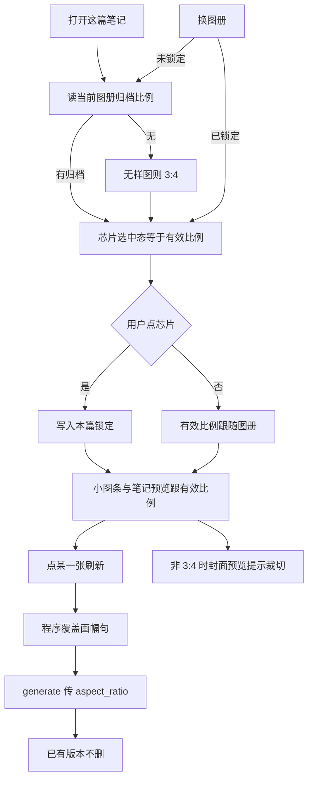
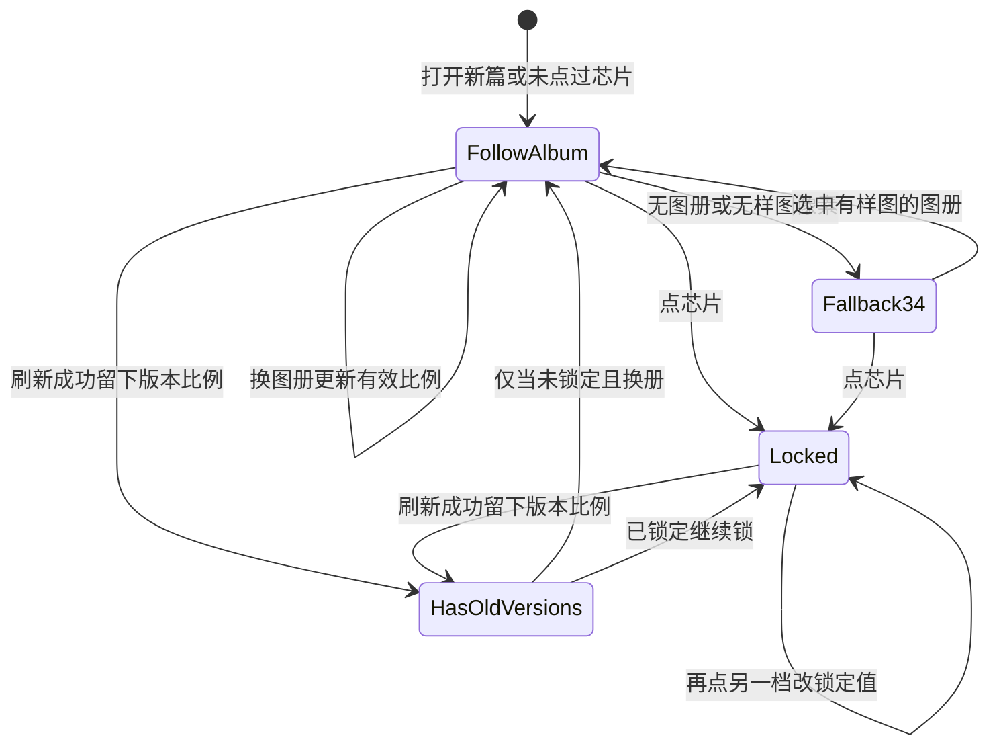

# PRD: 一篇一个生图比例

| 属性 | 值 |
|------|----|
| 状态 | 工程：accepted（见文末「工程验收状态」） |
| 范围 | 笔记页生图比例、图册样图归档比例、学图题词画幅句、出图 `aspect_ratio`、预览画框。仅 Release 0 |
| 顺序号 | 00011 |
| 关联文档 | `docs/workflows/one-post-studio.md`、`docs/DESIGN.md`、`docs/mvp-map.md`、`AGENTS.md`、`src/image/generate.js`、`src/prompts/album/learn.js`、`assets/prompts/one-post/learn-album/system.md`、`src/studio/static/pages/note.html`、`src/studio/static/pages/note.js`、`lib/dex-buddy-sdk.js`、`specs/prds/prd-00001-one-post-from-article.md`、`specs/prds/prd-00008-dexbuddy-host-models.md`、`specs/prds/prd-00010-image-prompt-on-refresh.md` |

## 背景与问题

生图比例今天焊死在 `3:4`：`src/image/generate.js` 的 `IMAGE_ASPECT_RATIO`、出厂五本题词开头「竖版 3:4」、学图系统提示「小红书固定出图规格」。同事需要常见比例：`1:1`、`9:16`、`16:9`、`3:4`、`4:3`、`2:3`、`3:2`。学图入口其实从不按比例拒图（只验 JPEG / PNG / WebP、≤8MB），横图、方图、长图都能学；焊死的是提示词和出图参数，不是上传门禁。

一篇小红书图文是一套轮播。公开规格与实操都要求同一篇图用同一比例；内页高度一跳，滑动就散。按张改比例会把「画纸」塞进「当前张」的小图条、提示词和参考图里，布局和心智都错。人一定在生图之前选比例；不改则跟图册走。

## 目标与非目标

### 目标（Release 0）

1. 一篇笔记只有一个生图比例。封面与全部配图槽共用。
2. 支持七档：`9:16`、`2:3`、`3:4`、`1:1`、`4:3`、`3:2`、`16:9`（从高到宽排列）。
3. 比例芯片放在笔记页生图区：`图片 n/m` 下方、小图条上方。不进「要发什么」，不挂在每张缩略图上。
4. 用户未点过芯片时，有效比例等于当前图册的归档比例；还没选图册或读不出样图像素时落到 `3:4`（兜底，不是学图规格）。
5. 用户点过芯片后，这篇锁定所选档；换图册不再改比例。之后刷新新出的版本都用锁定档；已落盘 PNG 不自动重画、不删除。
6. 学图继续接受任意比例参考图。程序读样图像素，归到七档最近档，写入图册 `aspectRatio`；题词开头画幅句由程序写，不让识图模型报比例。
7. 发给生图模型的 `aspect_ratio` 与提示词开头画幅句一致。用户锁定时用锁定档；跟随图册时用图册档。可编辑提示词框仍不露出画幅句（沿用 `prd-00010`）。
8. 小图条与「笔记预览」画框跟有效比例变。选用图若是旧比例，框内完整露出（contain）。「封面预览」仍按发现页 `3:4` 裁；有效比例不是 `3:4` 时加一行提示。「以前的笔记」墙仍是 `3:4` 封面卡。
9. 图库与「图册风格」格子按归档比例显示样图（contain），不再用 `3:4` 裁切把横图裁成竖卡。

### 非目标

- 同一篇里封面与配图各用各的比例（单张改比例）。
- 自定义比例、像素宽高、清晰度档、张数上限。
- 改比例后自动重画或清空历史版本。
- 视频笔记、发现页假卡片的比例。
- 让识图模型自己判断并书写比例。
- 按比例拒收学图参考图。
- 在「要发什么」里提前选比例。
- 改买断闸门、成稿口吻、融图勾选、提示词可改段规则（除画幅句程序覆盖外）。

禁止定义 Release 2 及更高版本。溢出进非目标、开放项或另立 PRD。

## 术语

| 术语 | 含义 |
|------|------|
| 七档 | 固定枚举 `9:16`、`2:3`、`3:4`、`1:1`、`4:3`、`3:2`、`16:9`。 |
| 归档比例 | 图册样图像素归到七档后写入的 `aspectRatio`。 |
| 最近档 | 宽高比与样图距离最小的一档；距离相同取从高到宽列表中先出现的；极高 → `9:16`，极宽 → `16:9`。 |
| 有效比例 | 本篇当前出图与预览画框使用的比例。未锁定时跟图册；已锁定时用锁定值。 |
| 用户锁定 | 人在本篇点过比例芯片。`draft.json` 写入锁定值后，换图册也不跟走。 |
| 画幅句 | 题词开头说明画幅的那一句（如「竖版 3:4，…」）。对人隐藏；发模型前由程序按有效比例覆盖。 |
| 兜底 3:4 | 无图册或无样图像素可读时的有效比例。不是「学图必须 3:4」。 |

## 已拍板规则

| 项 | 决定 |
|----|------|
| 粒度 | 一篇一个比例。不做按张比例。 |
| 何时选 | 生图之前。芯片在笔记页生图工具卡，出图前可见可改。 |
| 默认行为 | 未点芯片 → 跟随当前图册归档比例。芯片无单独「默认」徽章；选中态等于当前有效比例。 |
| 锁定 | 点芯片 → 写入本篇锁定；之后刷新与换册都不改锁定，直到人再点另一档。 |
| 旧图 | 改比例不删、不重画已有 PNG。新抽版本用新有效比例；历史版本各自记住自己的出图比例。 |
| 学图门禁 | 仍只验格式与大小。比例不是拒收条件。 |
| 归档谁算 | 程序读样图像素。识图模型不报比例、不写「实测像素 / 识别画幅」。 |
| 题词开头 | 学成与出厂发送前，画幅句由程序按归档或有效比例写上。模型只写风格与 11 槽内容。 |
| 出厂五本 | 同一条：按 `sample.*` 像素归档；样图本身是 3:4 则仍是 3:4。五份 `prompt.md` 不必手改。 |
| 旧用户册 | 打开时若无 `aspectRatio`，按样图补算，不必重新学习。样图丢失 → 兜底 `3:4`。 |
| 可编辑框 | 仍看不见画幅句（`prd-00010`）。 |
| 笔记预览 | 画框 aspect 跟有效比例；旧比例图 contain。 |
| 封面预览 | 发现页假环境仍 `3:4` 裁封面；非 3:4 时文案：「发现页按 3:4 裁封面」。示例卡不动。 |
| 历史墙 | 「以前的笔记」竖卡墙保持 `3:4`。那是信息流，不是画布。 |
| 图册格子 | 图库与笔记页「图册风格」格内 contain + 归档比例，不强制 `aspect-[3/4]` 裁切样图。 |

### 取舍说明

| 备选 | 不采用 | 采用 |
|------|--------|------|
| 每张单独比例 | 轮播高度跳动；控件塞进当前张区；心智碎 | 一篇一个比例 |
| 全局设置里改默认比例 | 远离生图决策点 | 生图工具卡上芯片 |
| 「要发什么」里选比例 | 写成笔记只出文（`prd-00010`）；比例是出图决策 | 笔记页、刷新前选 |
| 识图模型写画幅 | 不可靠；测试还禁止「识别画幅」类话术 | 程序读像素归档 |
| 改比例后自动重画全部 | 费积分、吓人 | 只影响后续新版本 |
| 学图拒收非 3:4 | 与「任何图都能学」冲突 | 门禁不变，归档变 |

破坏者视角：锁定后换册仍出旧比例图——允许，人可再点芯片。无样图册落到 3:4——允许并在开放项记下是否提示。历史版本与当前有效比例不一致——contain，不裁切撒谎。半截锁定字段损坏——非法值当未锁定并记日志/回退。

## 用户与角色

| 角色 | 目标 |
|------|------|
| 运营（主） | 学任意比例参考图成册；出图前一眼看到比例；不改则跟册；改则整篇一起改。 |
| 运营（次） | 换比例后再刷一张，旧版本还在；预览不把横图裁成竖图骗人。 |
| 内部工程 | `aspect_ratio` 进宿主 generate；图册与 draft 有明确字段；画幅句程序覆盖，不拆提示词合同。 |

## 功能域

1. **七档常量与最近档算法**：共享枚举与像素 → 档位映射。
2. **图册归档**：学图确认写入、出厂扫描、旧册补算 → `album.json` 的 `aspectRatio`；题词开头画幅句程序写。
3. **本篇有效比例**：跟随 / 锁定读写；刷新生图传 `aspect_ratio`；版本记录出图比例。
4. **笔记页芯片**：生图工具卡一条芯片；选中态 = 有效比例。
5. **预览与格子**：小图条、笔记预览、图册风格卡、图库卡的 aspect / object-fit。
6. **学图提示**：去掉「固定出图规格 3:4」硬要求；改成由程序写画幅，模型勿自编比例。

## 用户故事地图与版本切片

### 旅程主干

| 步 | 人在做什么 | 起止 |
|----|------------|------|
| 1 | （可选）资料库交任意比例参考图学习并确认写入 | Entry（学图） |
| 2 | 写成笔记进入「这篇笔记」 | Entry（出图） |
| 3 | 见比例芯片；未点过时选中态 = 当前图册归档比例（无则 3:4） | |
| 4 | （可选）点另一档芯片，整篇锁定 | |
| 5 | （可选）换图册：未锁定则芯片跟新册；已锁定则芯片不动 | |
| 6 | 点某一张刷新 | |
| 7 | 生图请求带有效比例；题词画幅句与之一致 | |
| 8 | 小图条 / 笔记预览画框跟有效比例；旧比例选用图 contain | |
| 9 | （可选）再改比例后只影响后续新版本 | |
| 10 | 复制或离开 | Exit |

失败：学图仍只因格式 / 大小失败，不因比例。生图失败不改锁定与图册归档。样图丢失的旧册打开时归档兜底 3:4，不阻断浏览。

### 故事地图（Release 0）

1. 作为运营，我想交一张横图学成图册，以便不必先裁成 3:4。
   - 验收：JPEG / PNG / WebP 横图能学成写入；不因比例报错；`album.json` 有归档比例（如 `16:9` 或最近档）。

2. 作为运营，我想学完后图册题词画幅跟样图最近档一致，以便出图不跟题词打架。
   - 验收：题词开头画幅句与 `aspectRatio` 同档；可编辑框仍看不见画幅句；识图返回里不要求模型写实测像素。

3. 作为运营，我想打开笔记后不点比例也能出图，以便默认跟当前图册走。
   - 验收：未点芯片时刷新请求的 `aspect_ratio` 等于当前图册 `aspectRatio`；无图册 / 无像素时为 `3:4`。

4. 作为运营，我想在生图前改整篇比例，以便封面和配图用同一张画纸。
   - 验收：点芯片后 `draft` 有锁定值；封面与任一张配图刷新都传同一 `aspect_ratio`；无按张比例控件。

5. 作为运营，我想改过比例后再换图册，以便比例不被样图带走。
   - 验收：锁定后换册，芯片与下次出图比例仍是锁定档。

6. 作为运营，我想改比例后旧图还在，以便对比后再决定要不要重抽。
   - 验收：改芯片不删版本文件；新刷新追加新版本；旧版本预览 contain。

7. 作为运营，我想在笔记预览里看到真实画框，以便判断构图。
   - 验收：有效比例变化时笔记预览主图区域 aspect 跟着变；封面预览在非 3:4 时出现「发现页按 3:4 裁封面」。

8. 作为运营，我想在图库里看到样图完整露出，以便横图不被竖卡裁掉主体。
   - 验收：图库 / 图册风格格不再强制用 3:4 裁切样图主体；格内 contain。

9. 作为工程，我想宿主 generate 收到正确 `aspect_ratio`，以便渠道出对尺寸。
   - 验收：`generatePng`（或等价路径）不再写死常量 `3:4`；传入有效比例；宿主转发字段已存在则复用。

10. 作为运营，我想打开没有归档字段的旧用户册不必重学，以便旧资产还能用。
    - 验收：打开时按样图补算并持久化 `aspectRatio`；样图丢失则按 `3:4` 兜底且册仍可选。

### Release 0 可验收结果

七档可选；一篇一个比例；未锁定跟图册最近档；锁定后整篇固定；学图不按比例拒收；程序归档；出图 `aspect_ratio` 与画幅句一致；预览与图册格 contain。本 PRD **不定义 Release 1**。

## 核心流程与状态机图

学图归档：

无死胡同：失败可再刷；锁定可再点改档；跟随可随时锁定。

## 数据与 API 衔接（高层）

| 能力 | 说明 |
|------|------|
| 七档 | 共享常量数组；非法字符串拒绝或回退未锁定 / 兜底，实现时择一并测。 |
| 图册 | `album.json` 增加 `aspectRatio`（七档之一）。旧册缺字段打开时补算。 |
| 学图 | `learn-album/system.md` 去掉「固定 3:4」；要求开头画幅由程序保证。`normalizeReferenceImage` 门禁不变。 |
| 出图 | `generatePng` 接收 `aspectRatio`；写入宿主 `input.aspect_ratio`。去掉唯一常量死写死（可保留 `3:4` 作兜底常量名）。 |
| 本篇 | `draft.json`：仅用户点过芯片后写锁定字段（建议名 `aspectRatioLocked` 或 `aspectRatio` + `aspectRatioSource`）；未写 = 跟随。具体字段名由工程定，验收以行为为准。 |
| 版本 | 每次成功 PNG 旁或版本元数据记下该次 `aspectRatio`，供预览 contain 判断。 |
| 画幅句 | 发模型前按有效比例覆盖题词开头；可编辑抽出逻辑继续隐藏该句（`prd-00010`）。 |
| 宿主 | `lib/dex-buddy-sdk.js` 已转发 `aspect_ratio`；本篇消费该字段。 |

本 PRD 锁行为与字段语义，不锁内部函数名。

## 假设与开放项

| 项 | 说明 |
|----|------|
| 假设 | 渠道七档枚举与本文七档一致；若宿主拒收某档，进开放项与渠道对齐。 |
| 假设 | 出厂五本 `sample.*` 像素确为 3:4 或极近 3:4。 |
| 假设 | `prd-00010` 刷新编排不变；本篇只在刷新生图像素前注入比例。 |
| 开放 | 无样图兜底为 3:4 时，芯片旁是否一句灰字「暂按 3:4」——默认不做，避免噪音。 |
| 开放 | 距离算法：用 `|w/h - aw/ah|` 即可；是否对竖/横先分类再比——默认统一距离，极值夹到两端。 |
| 开放 | 锁定字段是否允许「点回当前图册档并清除锁定」——默认再点同档仍保持锁定（值相同即可）；若要「恢复跟随」需显式控件，本期不做。 |
| 待与工程对齐 | 版本元数据落在 `draft.json` 的 images 槽还是文件旁 sidecar。 |
| 待与工程对齐 | 图册风格网格 CSS：固定格宽 + 变高 vs 统一行高 + contain；验收以主体不被裁切为准。 |
| 冲突与决议 | `prd-00001` / `00008` / `mvp-map` 写死比例 `3:4`。本篇起出图比例可变；历史 PRD 不改正文，实现时改 workflow / DESIGN / 代码与测试。 |
| 冲突与决议 | `album-learn` 测试要求 system 含「竖版 3:4」且禁止「实测像素」。本篇实现时改测试与 `learn-album/system.md`。 |

## 成功标准

- 新学横图册：`aspectRatio` 不是强制 `3:4`，而为最近档之一。
- 未点芯片：刷新请求 `aspect_ratio` = 当前图册归档（或兜底 `3:4`）。
- 点芯片后换册：下次刷新仍为锁定档。
- 同一篇封面与配图刷新传入同一 `aspect_ratio`。
- 可编辑提示词框不含画幅句；发给模型的完整提示含与请求一致的画幅句。
- 改比例不减少已有版本文件数。
- 笔记预览主图区域 aspect 随有效比例变化；非 3:4 时封面预览出现裁切提示文案。

## 修订记录

| 日期 | 说明 |
|------|------|
| 2026-11-03 | 初稿。一篇一个比例；七档；未锁定跟图册最近档；学图不焊死 3:4；程序归档；生图前芯片；仅 Release 0。 |

## 12. 工程验收状态

> 由 `/team:prd-accept` 维护；勿手工编造「通过」。最后更新：2026-11-03T07:00:16Z，dev@e81d90b，范围：R0。

### 总览

- 工程状态：`accepted`
- 验收判定：Release 0 故事与成功标准均有代码 / 测试 / DESIGN 证据；无「未实现」
- 最近验收：2026-11-03T07:00:16Z，用户人工测过后关闭
- 代码提交：`e81d90b`（`dev`）
- 摘要：
  1. 七档与最近档算法落在 `src/image/aspect.js`，单测覆盖
  2. 本篇 `aspectRatioLocked` + 图册 `aspectRatio` 跟随 / 锁定；刷新生图传 `aspect_ratio`
  3. 学图不按比例拒收；程序读像素归档并覆盖画幅句；`learn-album/system.md` 已改
  4. 笔记页比例入口为工具卡横向胶囊浮层（后定交互，一篇共用）
  5. 预览 / 小图 / 图册格：固定 `3:4` 占位 + `object-contain`（后定布局稳定）；非 3:4 封面预览有裁切提示

### Release 交付

| Release | 状态 | 说明 |
|---------|------|------|
| R0 | 通过 | 仅本 PRD 定义的 Release；行为与文档已落地 |
| R1 | 范围外 | PRD 声明不定义 R1 |

### 功能验收清单（Agent 优先读此表）

| ID | 能力摘要 | Release | 状态 | 证据 |
|----|----------|---------|------|------|
| US1 | 任意比例参考图可学成册并写入归档比例 | R0 | 通过 | `src/prompts/album/learn.js`（`aspectRatioFromImage`）；`normalizeReferenceImage` 仍只验格式/大小；`tests/prompts/album-learn.test.js` |
| US2 | 题词画幅句与 `aspectRatio` 同档；可编辑框不露画幅；模型不报实测像素 | R0 | 通过 | `applyFrameSentence`（`src/prompts/album/refs.js`）；`assets/prompts/one-post/learn-album/system.md`；album-learn 测试 |
| US3 | 未点比例时出图跟图册归档；无册/无像素兜底 3:4 | R0 | 通过 | `resolveEffectiveAspectRatio` / `ensureAlbumAspectRatio`（`src/one-post/run.js`、`src/prompts/album/store.js`） |
| US4 | 点比例锁定整篇；封面与配图同一 `aspect_ratio`；无按张比例 | R0 | 通过 | `setAspectRatio` → `draft.aspectRatioLocked`；`note.html` 比例浮层七档；刷图路径共用有效比例 |
| US5 | 锁定后换册比例不变 | R0 | 通过 | `resolveEffectiveAspectRatio` 优先 `aspectRatioLocked` |
| US6 | 改比例不删旧版本；新刷追加；旧图 contain | R0 | 通过 | 版本元数据带 `aspectRatio`（`src/draft/store.js`）；缩略/预览 `object-contain` |
| US7 | 笔记预览不骗人；非 3:4 封面预览提示裁切 | R0 | 通过 | `docs/DESIGN.md`：主图区固定 3:4 + contain（后定，换比例不撑高）；`note.html`「发现页按 3:4 裁封面」 |
| US8 | 图库 / 图册风格格样图 contain，不裁主体 | R0 | 通过 | 卡面 `aspect-[3/4]` + `object-contain`（开放项验收口径：主体不被裁切）；`library.html` / `note.html` |
| US9 | `generatePng` 传有效比例，不再死写唯一常量 | R0 | 通过 | `src/image/generate.js` `input.aspect_ratio`；`tests/image/generate.test.js` |
| US10 | 旧用户册缺字段打开时按样图补算；样图丢则 3:4 | R0 | 通过 | `ensureAlbumAspectRatio` / `ensureAllAlbumAspectRatios` |
| SC1–SC7 | 成功标准（横图归档、跟随/锁定、同篇一致、画幅句、不删版本、预览提示） | R0 | 通过 | 同上 + `pnpm test` 相关套件 25 通过；用户人工回归 |

### 未完成与遗留

- 开放项仍开放：无样图时芯片旁灰字「暂按 3:4」、点同档「恢复跟随」显式控件——本期不做
- 历史 PRD / 部分 workflow 摘要仍写「芯片在小图条上方」；实现为胶囊浮层，以 `docs/DESIGN.md` 为准（文案债，非阻塞）

### 质量检查

| 检查项 | 状态 |
|--------|------|
| 测试 | 通过：`node --test tests/image/aspect.test.js tests/image/generate.test.js tests/prompts/album-learn.test.js tests/prompts/album-refs.test.js` → 25 pass / 0 fail |
| Lint | N/A（无独立 lint 脚本；有 `pnpm run check:types`） |
| 文档与 OpenAPI | 无 OpenAPI；`docs/DESIGN.md`、`docs/workflows/one-post-studio.md`、`docs/mvp-map.md` 已含比例行为 |

---
统计：通过 11 / 部分 0 / 未实现 0 / 范围外 1（R1）

