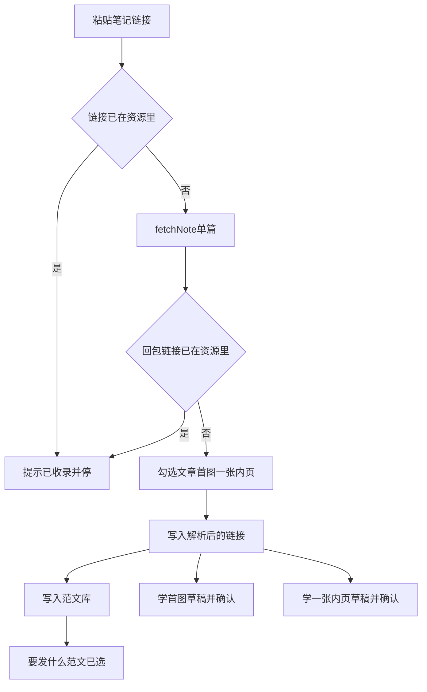
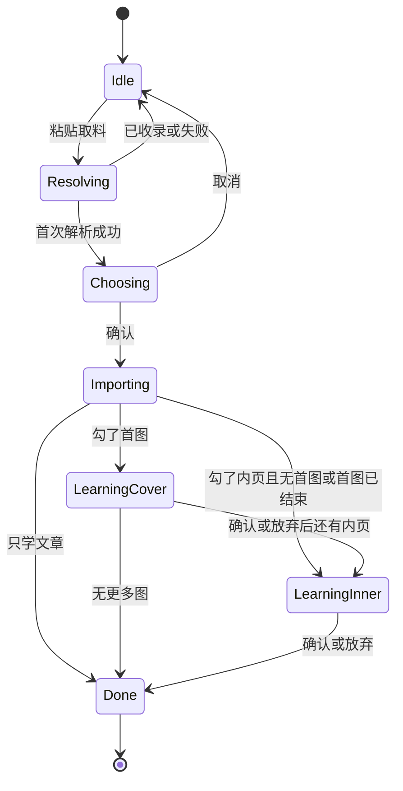

# PRD: 从小红书笔记学进现有柜子

| 属性 | 值 |
|------|----|
| 状态 | 工程：backlog |
| 范围 | 资料库进料。Release 0 |
| 顺序号 | 00012 |
| 关联文档 | `docs/workflows/one-post-studio.md`、`docs/DESIGN.md`、`AGENTS.md`、扩展仓 `docs/dex-buddy-native-messaging.md`、`specs/prds/prd-00005-album-library.md`、`specs/prds/prd-00007-note-style-samples.md`、`specs/prds/prd-00009-sdk-entitlement-gates.md` |

## 背景与问题

运营在资料库里加图册要本机传图，加范文要手贴正文。想学一篇公开小红书笔记时，要自己拆封面、内页和正文。本机 Chrome 里智赢内部特供版已能经 Native Messaging 取回 `NoteImportPayload`，增长引擎侧还没有入口。

用户真正要走的写稿路径已经存在：范文管写法，「这篇想讲什么」管产品。本篇只补进料：贴链接 → 拆进现有范文与图册 → 带着范文去写。

## 目标与非目标

### 目标（Release 0）

1. 资料库右上「新建」增加「小红书笔记」：粘贴 explore 或 xhslink 链接。
2. 经本仓 Native Host 侧通道调用扩展 `fetchNote`，按对接文档错误码提示。
3. 解析成功的链接写入 `runtime/materials/xhs-notes/`；收过没有只看链接相等。
4. 弹出复选框：学习文章、学习首图、学习内页；默认勾上载荷里有的项；至少一项；内页多张时只选一张。
5. 文章进现有范文库；首图与所选内页各走现有学图册草稿 → 确定写入。
6. 学完若有范文，可「用这篇写法去写」：打开「要发什么」并选中该范文。
7. 页面服从 `docs/DESIGN.md`。

### 非目标

- 新开「小红书笔记」写稿类型或产品库。
- 改范文 `meta.json` / 图册 `album.json` 现有字段去挂链接。
- 按图片、正文或图册是否还在判断是否同一篇。
- 本期链接资源的浏览 Tab；批量抓取；视频文件；自动重学入口。
- 对接捞客仓；公开版扩展通道。
- Release 2 及更高。

## 术语

| 术语 | 含义 |
|------|------|
| 首图 | 载荷 `images[].role === "cover"` 的封面图。 |
| 内页 | `role !== "cover"` 的配图；一次只学一张。 |
| 链接资源 | `runtime/materials/xhs-notes/<id>/meta.json`；身份认 `sourceUrl`。 |
| 收录过 | 粘贴串或回包 `sourceUrl` 已在某条链接资源的 `sourceUrl` / `inputUrls` 中。 |

## 已拍板规则

| 项 | 决定 |
|----|------|
| 拆分 | 正文 → 范文库；图 → 学图册；链接 → 独立资源。 |
| 去重 | 只比链接字符串（trim 后全等）。不比图、不比正文。 |
| 写链接时机 | 人在勾选层确认并开始学时写入。取消或取料失败不写。 |
| 删范文/图册 | 链接记录仍在，仍算收录过。 |
| 并发 | 同时一条取料/学习；第二条提示正在收录。 |
| Host | 本仓 stdio Host + `127.0.0.1` 侧通道；host name 仍以对接文档为准。 |

## 用户与角色

| 角色 | 目标 |
|------|------|
| 账号运营 | 贴一篇爆款链接，拆出写法与画面，再换成自己的产品写一篇。 |
| 工程 | 复用范文库与 learnAlbum；契约只消费扩展文档。 |

## 功能域

```text
src/xhs-note/                 # 链接资源、取料客户端、拆分、下图
scripts/dexbuddy-native-host.js
src/one-post/run.js           # resolveXhsNote / importXhsNote
src/studio/static/pages/library*
docs/workflows/one-post-studio.md
docs/DESIGN.md
```

## 用户故事地图与版本切片

### 旅程主干

| 步 | 人在做什么 | 起止 |
|----|------------|------|
| 1 | 资料库 → 新建 → 小红书笔记，粘贴链接 | Entry |
| 2a | 链接已收录 → 提示并停 | Exit |
| 2b | 取料；回包链接已收录 → 补 inputUrls，提示并停 | Exit |
| 3 | 勾选文章/首图/内页，确认 | |
| 4 | 写入链接资源；按勾选写范文、串行学图 | |
| 5 | （可选）用这篇写法去写 | Exit |

### 故事地图（Release 0）

1. 作为运营，我想从新建菜单贴小红书链接，以便不用手拆素材。
   - 验收：菜单有「小红书笔记」；非法 URL 有人话错误。
2. 作为运营，我想同一篇链接第二次贴上时不再学，以便不浪费取料与识图。
   - 验收：已收录提示；不调用 learnAlbum；短链解析到同一 sourceUrl 也停。
3. 作为运营，我想勾选学文章、首图、一张内页，以便只进我要的柜子。
   - 验收：默认全勾可用项；内页单选；至少一项；无封面/无内页对应项禁用。
4. 作为运营，我想文章进范文库、图走学图草稿再确认，以便半成品不进柜子。
   - 验收：范文可在「范文」Tab 看见；图确认前 `runtime/albums` 无新册。
5. 作为运营，我想学完带着范文去写，以便照写法写我的产品。
   - 验收：「用这篇写法去写」打开要发什么且范文已选。

### Release 0 可验收结果

新建可贴链接；链接资源可判断收录；拆进范文与至多两本图册；可带着范文写稿。无 Release 1。

## 核心流程与状态机图





## 数据与 API 衔接

- 取料：对接文档 `ping` / `fetchNote`；图片本仓下载，单张失败跳过。
- 链接资源字段：`sourceUrl`、`inputUrls`、`title`、`body`、`tags`、`images`、`fetchedAt`。
- 桥方法：`resolveXhsNote`、`importXhsNote`；学图继续 `learnAlbum` / `commitAlbum` / `discardAlbum`。

## 假设与待确认

- Host name 与扩展仓联调前仍为占位；生产安装脚本不得写死占位。
- 本机须已装内部特供版并打开「允许 Dex Buddy 连接」，且 Chrome 已登录小红书。

## 修订记录

| 日期 | 说明 |
|------|------|
| 2026-11-04 | 首版：链接资源去重；拆进范文与图册；无浏览 Tab |
