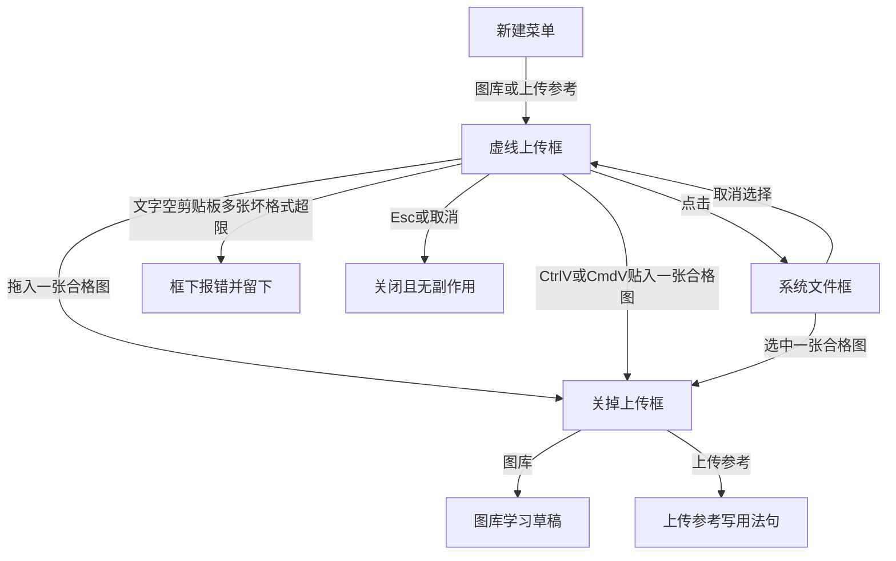
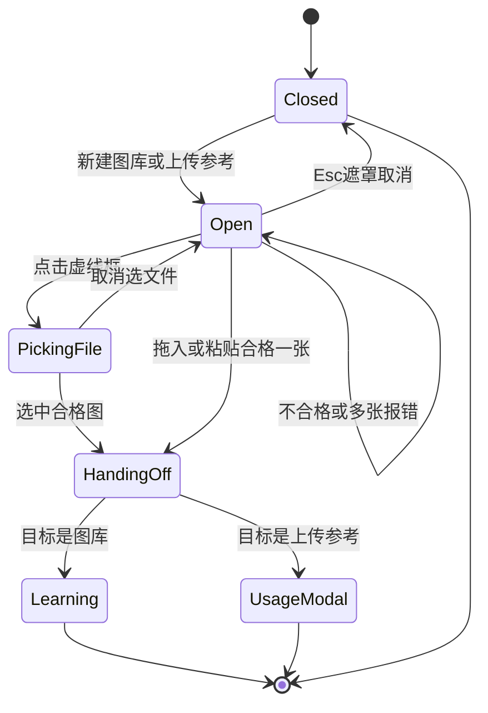

# PRD: 资料库粘贴传图浮层

| 属性 | 值 |
|------|----|
| 状态 | 工程：accepted（见文末「工程验收状态」） |
| 范围 | 资料库「新建 → 图库」「新建 → 上传参考」的进图入口。Release 0 |
| 顺序号 | 00013 |
| 关联文档 | `docs/workflows/one-post-studio.md`、`docs/DESIGN.md`、`AGENTS.md`、`specs/prds/prd-00005-album-library.md`、`specs/prds/prd-00006-fuse-reference-images.md` |

## 背景与问题

运营在资料库加图册或上传参考时，右上「新建」直接打开系统文件框。人已经从浏览器或截图工具把图复制到剪贴板，却要先存到本机，再从文件夹里找出来。这一步是多余的绕路。

图库选完一张后仍要学成风格草稿再确认。上传参考选完一张后仍要写用法句。这两段后半程已经可用。缺的是前半程：同一块上传框里拖进来、复制后粘贴、或点击从本机选择。

## 目标与非目标

### 目标（Release 0）

1. 资料库右上「新建 → 图库」与「新建 → 上传参考」先打开一块居中的虚线上传框，不再立刻弹出系统文件框。
2. 同一块虚线框接受三种放图方式，一次一张：
   - 把图片文件拖到框上松开；
   - 框打开并获得焦点后，用系统粘贴（Windows：Ctrl+V；Mac：⌘V）送入剪贴板里的图；
   - 点击虚线框，打开系统文件框，从本机选一张。
3. 框内没有单独的「粘贴」按钮；打开时不主动读取剪贴板。
4. 拖拽不是唯一入口；点击从本机选择与复制后粘贴都可用。
5. 格式与体积沿用现规则：JPEG / PNG / WebP，单张不超过 8MB。
6. 图到手且合格后关掉上传框，交回现有下一步：
   - 图库 → 现有 `learnAlbum` / `onLearnDataUrl` 学习 → 风格草稿；
   - 上传参考 → 现有「写上用法句」对话框 → 确认入库。
7. 不合格、剪贴板无图、贴进来的是文字、一次给了多张：错误写在框下，框留着，不学习、不入库。
8. Esc、点遮罩、取消：关掉框，无副作用。
9. 页面服从 `docs/DESIGN.md` 的现有对话框节奏与 Cal 色板。

### 非目标

- 「这篇笔记」页里的上传参考入口。
- 范文、小红书笔记进料改动。
- 一次多张、连传队列、批量导入。
- 新的入库 API、新的存储路径、改用法句或学图草稿逻辑。
- 参考图里的森林底、蓝色盒子、最多 20 张、付费链接、自动转换开关。
- 单独一颗「粘贴」按钮，或打开浮层时静默读剪贴板。
- Release 2 及更高。溢出能力进非目标、开放项或独立 PRD。

## 术语

| 术语 | 含义 |
|------|------|
| 上传框 | 资料库新建图库 / 上传参考时先弹出的虚线圆角浮层。 |
| 放图 | 拖入、粘贴、或点击从本机选择，把一张合格图片交给上传框。 |
| 交回 | 上传框关掉后，把同一张图的 dataUrl 交给现有图库学习或上传参考写用法句流程。 |
| 系统文件框 | 浏览器原生 `<input type="file">` 弹出的本机选文件窗口。 |

## 已拍板规则

| 项 | 决定 |
|----|------|
| 入口 | 仅资料库「新建 → 图库」「新建 → 上传参考」。 |
| 数量 | 一次一张。剪贴板或多选一次给了多张 → 框下写「一次一张」，不交回。 |
| 三种放法 | 拖入、系统粘贴、点击选本机。拖拽不是唯一入口。 |
| 粘贴触发 | 听 `paste` 事件。无粘贴按钮。打开时不读剪贴板。 |
| 格式体积 | JPEG / PNG / WebP；单张 ≤8MB。与现有图库、上传参考一致。 |
| 图库交回 | 合格图 → `onLearnDataUrl` / `learnAlbum` → 现有草稿浮层。 |
| 上传参考交回 | 合格图写入 `uploadPending` → 打开现有「写上用法句」。 |
| 关闭 | Esc / 遮罩 / 取消 → 不学习、不入库。 |
| 视觉 | 白底卡片 + 虚线框 + 大加号 `lucide:plus`；错误用现有 error 色，不叠第二层。 |
| DESIGN | 实现本功能时同步改 `docs/DESIGN.md` 资料库段「点图库交参考图 / 点上传参考选本机图」的表述。本 PRD 落盘时不改 DESIGN。 |

## 用户与角色

| 角色 | 目标 |
|------|------|
| 账号运营 | 从浏览器或截图里复制一张参考图，粘贴进资料库；或拖文件、或从本机点选。少一步「先存盘」。 |
| 工程 | 只改资料库进图入口；复用现有学习与用法句管道。 |

## 功能域

```text
src/studio/static/pages/library.js          # 新建菜单：先开上传框，不再直接 pick
src/studio/static/pages/library.html        # 上传框 DOM、文案、错误位
src/studio/static/pages/library/albums.js   # 接收框交出的 dataUrl → onLearnDataUrl
src/studio/static/pages/library/upload-refs.js  # 接收框交出的 dataUrl → 用法句浮层
docs/DESIGN.md                              # 实现时改资料库新建进图描述
docs/workflows/one-post-studio.md           # 实现时补一句进图捷径（若 workflow 已写死系统文件框）
```

不新增后端方法。仍走现有 `learnAlbum`、`addLibraryUploadRef`、`draftUploadRefUsage`。

## 上传框长什么样

外层：现有对话框（遮罩、白底卡片、`border-base-300`）。

内层虚线框：

- `border-dashed` + `--color-base-300`（`#e5e7eb`）。
- 拖到框上时只改边框与浅灰底（`--color-base-200`），框尺寸不动。
- 中间一枚大加号：Iconify + Lucide `lucide:plus`；对读屏 `aria-hidden`。
- 整块框是一颗按钮，可访问名称：「上传图片，可拖入、粘贴或从本机选择」。
- 键盘焦点：`focus-visible` 环，颜色跟近黑主色 `#111111`。

框内固定文案：

1. 主句：**把图片放进来**
2. 次句：**拖到这里，或 Ctrl+V / ⌘V 粘贴。点击从本机选择。**
3. 限制：**JPEG、PNG、WebP，一次一张，不超过 8MB。**

错误接在限制下一行，用现有错误色。不弹第二层。

## 用户故事地图与版本切片

### 旅程主干

| 步 | 人在做什么 | 起止 |
|----|------------|------|
| 1 | 资料库 → 新建 → 图库或上传参考 | Entry |
| 2 | 看见虚线上传框；焦点在框上 | |
| 3a | 拖入一张合格图 | |
| 3b | Ctrl+V / ⌘V 粘贴一张合格图 | |
| 3c | 点击框 → 系统文件框选一张合格图 | |
| 4a | 不合格 / 无图 / 多张 / 文字 → 框下报错，停在框里 | Exit（可再试） |
| 4b | Esc / 遮罩 / 取消 → 关掉，无副作用 | Exit |
| 5 | 合格图关掉上传框 | |
| 6a | 图库：进入学习 → 风格草稿 | Exit（交回现有） |
| 6b | 上传参考：打开写用法句 → 确认入库 | Exit（交回现有） |

### 故事地图（Release 0）

1. 作为运营，我想新建图库或上传参考时先看到上传框，以便不必立刻面对系统文件框。
   - 验收：点「新建 → 图库」或「新建 → 上传参考」出现虚线上传框；此时系统文件框未弹出。
2. 作为运营，我想复制一张图后用 Ctrl+V / ⌘V 贴进框，以便跳过先存本机。
   - 验收：框开着且有焦点时，粘贴一张合格 JPEG/PNG/WebP（≤8MB）后框关闭并进入对应下一步；框内无「粘贴」按钮；打开框时不读剪贴板。
3. 作为运营，我想把图片文件拖进框，以便桌面文件也能直接交。
   - 验收：拖入一张合格图后交回；拖到框上有边框/底色反馈；尺寸不跳。
4. 作为运营，我想点击框从本机选文件，以便没有剪贴板图时仍能上传。
   - 验收：点击虚线框打开系统文件框；选中一张合格图后交回；取消选文件后框仍开着。
5. 作为运营，我想一次只交一张，以便流程跟现在一样简单。
   - 验收：一次拖入或多张剪贴板图时框下提示「一次一张」，不学习、不打开用法句。
6. 作为运营，我想不合格时停在框里看见人话，以便立刻换一张。
   - 验收：文字粘贴、空剪贴板、非 JPEG/PNG/WebP、超过 8MB 均在框下报错；框不关。
7. 作为运营，我想取消时什么都不发生，以便误开可以退出。
   - 验收：Esc、点遮罩、取消后框关；`runtime/albums` 与上传参考库无新条目；无学习中态。
8. 作为运营，我想图库路径仍进风格草稿、上传参考仍写用法句，以便后半程不变。
   - 验收：图库交回后出现现有学习/草稿；上传参考交回后出现「写上用法句」；不新增后端方法。

### Release 0 可验收结果

资料库新建图库与上传参考先出虚线上传框；拖入、粘贴、点击三种放法各可用；一次一张；合格后交回现有下一步；错误与取消无副作用。无 Release 1。

## 核心流程与状态机图





死胡同预警：`PickingFile` 取消必须回到 `Open`，不可丢状态却不关框、也不可静默交回空图。`Open` 报错不得转入 `HandingOff`。

## 数据与 API 衔接

- 无新 API。
- 图库：前端把 dataUrl 交给现有 `learnAlbum`（与 `onLearnDataUrl` / 文件读入路径相同）。
- 上传参考：前端把 dataUrl 写入现有 `uploadPending`，再走 `draftUploadRefUsage`（可选）与 `addLibraryUploadRef`。
- 校验：类型与 8MB 在前端上传框侧先拦一层；后端现有校验仍保留。

## 假设与待确认

| 项 | 假设 / 开放 |
|----|-------------|
| 粘贴焦点 | 打开上传框后自动把焦点放到虚线框上，否则 Ctrl+V / ⌘V 可能落到页面其他处。实现须验证插件隔离窗里的焦点行为。 |
| 剪贴板图片形态 | 接受 `image/*` 的 clipboard item 与粘贴进来的图片文件；纯文本 URL 不自动下载。 |
| 「这篇笔记」 | 本期不做；若运营反馈同样绕，另开 PRD。 |
| DESIGN / workflow | 实现时同步改文案；本 PRD 落盘不同步改，避免事实源早于界面。 |

## 修订记录

| 日期 | 说明 |
|------|------|
| 2026-11-05 | 初稿。资料库新建图库与上传参考先出虚线上传框；拖入 / 粘贴 / 点击；一次一张；交回现有下一步。 |
| 2026-11-05 | 工程验收：R0 accepted；进图格式在实现侧扩至 JPEG 别名大小写 + BMP（仍不含 GIF）。 |

## 1. 工程验收状态

> 由 `/team:prd-accept` 维护；勿手工编造「通过」。最后更新：2026-11-05T07:53:00Z，prd/library-paste-image@38d6ae2（工作区含未提交实现，以当前树为准），范围：R0（PRD 声明无 R1）。

### 总览

- 工程状态：`accepted`
- 验收判定：Release 0 故事均有代码与文档证据；人已手工冒烟确认可用并要求关单；**不必再补一轮 UI 验收**
- 最近验收：2026-11-05T07:53:00Z / `prd/library-paste-image` / `38d6ae2`
- 摘要：
  1. 「新建 → 图库 / 上传参考」先出虚线上传框，不再立刻 `input.click()`
  2. 同一框支持拖入、Ctrl+V / ⌘V 粘贴、点击选本机；无粘贴钮、打开不读剪贴板
  3. 合格后交回 `onLearnDataUrl` / `learnAlbum` 或 `uploadPending` +「写上用法句」
  4. 不合格 / 多张 / 文字 / Esc·遮罩·取消：框下报错或关框，无学习无入库
  5. DESIGN / one-post-studio / doc_index 已同步；进图格式实现为 JPEG（含别名大小写）/ PNG / WebP / BMP

### Release 交付

| Release | 状态 | 说明 |
|---------|------|------|
| R0 | 通过 | 虚线上传框与三种放法可验收 |
| R1 | 范围外 | PRD 写明无 Release 1 |

### 功能验收清单（Agent 优先读此表）

| ID | 能力摘要 | Release | 状态 | 证据 |
|----|----------|---------|------|------|
| S1 | 新建图库/上传参考先出虚线框，不立刻弹系统文件框 | R0 | 通过 | `library.js` `onCreateAlbums`/`onCreateUploadRefs` → `openIntake`；`library.html` `#library-intake-modal` |
| S2 | Ctrl+V / ⌘V 粘贴合格图；无粘贴钮；打开不读剪贴板 | R0 | 通过 | `@paste.window` + `onIntakePaste`；框内无「粘贴」按钮；无 `navigator.clipboard.read` |
| S3 | 拖入合格图；拖悬停改边框/底色、尺寸不跳 | R0 | 通过 | `onIntakeDrop`/`onIntakeDragOver`；`intakeDragOver` → `border-base-content bg-base-200` |
| S4 | 点击虚线框选本机；取消选文件框仍开着 | R0 | 通过 | `clickIntakeZone` → hidden `intakeFileInput`；`onIntakeFileChange` 空 files 直接 return |
| S5 | 一次一张；多张框下「一次一张」 | R0 | 通过 | `acceptIntakeFiles` 多图分支 |
| S6 | 文字/空剪贴板/坏格式/超 8MB 框下报错且不关 | R0 | 通过 | `intakeError` 文案；超限 `INTAKE_MAX_BYTES`；不合格不 `handoff` |
| S7 | Esc / 遮罩 / 取消无副作用 | R0 | 通过 | `closeIntake`；遮罩 `aria-label=取消`；`@keydown.escape.window` |
| S8 | 图库交回学习草稿；上传参考交回写用法句；无新 API | R0 | 通过 | `library-learn-album-dataurl` → `albums.js` `onLearnDataUrl`；`library-intake-upload-ref` → `upload-refs.js` `onIntakeDataUrl` |
| D1 | 服从 DESIGN（白底对话框 + 虚线框 + lucide:plus） | R0 | 通过 | `library.html` 虚线框 + `lucide:plus`；`docs/DESIGN.md` / `one-post-studio.md` 已改 |

### 未完成与遗留

- PRD 目标原文写「格式沿用 JPEG / PNG / WebP」；实现已额外支持 JPEG 别名大小写与 BMP（已按产品口头确认去掉 GIF）。**关单不阻塞**；若要正文与实现完全一致可另开小修订改目标第 5 条。
- 「这篇笔记」上传参考入口仍为非目标（本期不做）；笔记页进图校验已顺带与资料库格式白名单对齐，但不算本 PRD 范围交付。
- 假设「插件隔离窗焦点」：本机操作台已对焦虚线框并有 `@paste.window` 兜底；人冒烟通过即可，无单独隔离窗自动化证据。

### 质量检查

| 检查项 | 状态 |
|--------|------|
| 测试 | 人已手工冒烟；`pnpm test` 全绿（含 `album-learn` / `aspect` BMP 用例）。关单**不要求**再补 UI 轮次 |
| Lint | 本仓无 lint 命令，记 N/A |
| 文档与 OpenAPI | 无 OpenAPI；DESIGN / workflow / doc_index 已跟进 |

---
统计：通过 9 / 部分 0 / 未实现 0 / 范围外 1（R1）
