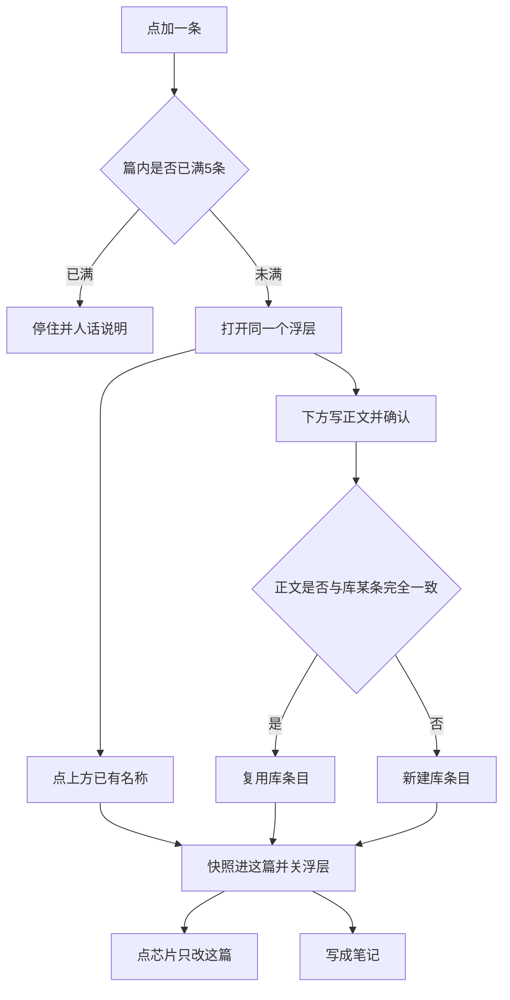

# PRD: 参考资料库

| 属性 | 值 |
|------|----|
| 状态 | 工程：accepted（见文末「工程验收状态」） |
| 范围 | 「要发什么」参考资料与资料库「参考资料」Tab。仅 Release 0 |
| 顺序号 | 00014 |
| 关联文档 | `docs/workflows/one-post-studio.md`、`docs/DESIGN.md`、`AGENTS.md`、`specs/prds/prd-00007-note-style-samples.md`、`specs/prds/prd-00006-fuse-reference-images.md` |

## 背景与问题

运营写多篇笔记时，同一产品的事实材料（卖点、价格、课程信息）反复用。今天「要发什么」里的参考资料是最多 5 颗文档芯片，正文是这篇草稿里的纯字符串。加一条只打开编辑浮层，写完只留在这一篇。下一篇还要重新打。

范文已经解决了同类问题：资料库有「范文」Tab；笔记上可从库挑。上传参考是图，不管事实。参考资料管事实，却没有库。

`prd-00007` 当时把「参考资料进库」放进非目标。本篇把它单独立项。

目标不是多一套入口。加一条仍是现在那颗 `+`。同一个浮层里点已有产品，或写一次就同时记住。人不用先去资料库，也不用先选「手写还是从库选」。

## 目标与非目标

### 目标（Release 0）

1. 本机有参考资料库：一条 = 名称 + 正文；路径 `runtime/materials/reference-docs/<id>/meta.json`；只留本机、不入库 git。
2. 资料库增加「参考资料」Tab 与「新建 → 参考资料」；可浏览、新建、改、删；删除用页内确认。
3. 「要发什么」点 `+` 仍打开**一个**浮层。上面是库里已有条目（一行一个名称）；下面是正文框。没有「手写 / 从库选」二选一菜单。
4. 库为空时，上方列表不占位、不写说明、不指路；浮层就是正文框，和今天能写下一条一样。
5. 点上方一行：把该条**快照**进这篇，浮层关上；库内原条目还在。
6. 在下方确认新正文：同时做完两件——这篇多一颗芯片，库里多一条。名称用第一行（与范文新建同一规则），不另给标题框。
7. 确认时若正文与库里某条完全一样：复用该条，不复制出第二条。
8. 改已在这篇上的芯片，只改这篇快照；不弹「要不要更新库」。改下次再用的那份，去资料库改那一条。
9. 一篇仍最多 5 条；空正文不送模；有名称时成稿提示词写「名称 + 正文」，无名称只送正文。
10. 旧稿 `references: string[]` 原样可读：当作无名称、正文为该字符串。
11. 页面服从 `docs/DESIGN.md`：资料库卡墙同范文节奏；笔记页仍是文档芯片；Lucide 图标；浮层焦点可见。

### 非目标

- 标签、文件夹、搜索、SKU / 价格 / 卖点分栏。
- 「存进库」第二按钮、「只用这一次」开关、二选一菜单。
- 从芯片反写回已关联的库条目。
- 参考资料贴图片、上传文件、链接抓取；与「上传参考」合并。
- 改范文库、图库、上传参考融图、生图、成稿三段骨架以外的拼装语义（除参考资料段可带名称）。
- 自动发布、爬取、与捞客仓对接。
- Release 1 及更高版本切片。溢出能力进本节或开放项。

禁止定义 Release 2 及更高版本。

## 术语

| 术语 | 含义 |
|------|------|
| 参考资料 | 管事实的材料（产品卖点、课程信息等）。不管结构；结构归范文。 |
| 参考资料库 | 资料库「参考资料」Tab 下的本机条目集合；路径 `runtime/materials/reference-docs/`。 |
| 库条目 | 库里一条：名称 + 正文。名称来自第一行。 |
| 芯片快照 | 进这篇草稿的参考资料副本（名称 + 正文）。与库条目脱钩。 |
| 加一条浮层 | 点 `+` 打开的同一浮层：上方点选已有；下方写新并确认。 |

## 已拍板规则

| 项 | 决定 |
|----|------|
| 入口 | 笔记页仍是 `+`；资料库 Tab / 新建菜单可整理。第一次记住发生在「加一条」确认上。 |
| 浮层结构 | 上：已有名称列表（可点）；下：正文框。无二选一。库空时上块消失。 |
| 名称 | 第一行当名称；与范文新建一致。确认时名称与正文都要有。 |
| 正文上限 | trim 后超过 8000 字符拒绝；页面与桥都拦。 |
| 绑定 | **快照**。点选或确认后，草稿留名称与正文；不挂活库 id。删库、改库，已进篇的芯片不动。 |
| 去重 | 确认新正文与库内某条正文完全一致 → 复用该条，不新建。 |
| 改芯片 | 只改这篇；不弹更新库。 |
| 篇内上限 | 最多 5 条；超限拒绝新增，人话说明。 |
| 空条 | trim 后空正文不送模；零条时提示词无参考资料段。 |
| 成稿拼装 | 沿用 `buildContentBlock`；有名称时写「名称：正文」或等价清晰格式；无名称只送正文。 |
| 旧稿 | `string[]` → 无名称 + 该字符串为正文。 |
| 库路径 | `runtime/materials/reference-docs/<id>/meta.json`；与 `article-samples`、`upload-refs`、图册分开。 |
| 删除库 | 页内二次确认，不用 `window.confirm`。删库后已进篇芯片仍在。 |
| 生成中 | `job.running` 时不可加、不可改参考资料。 |
| 视觉 | 资料库：窄屏 3 列、大屏 6 列、`aspect-[3/4]` 竖卡、底叠名称、空列表浅灰 +「新建」。笔记：现有 14×14 文档芯片，悬停看名称与正文。图标 Lucide。 |
| DESIGN | 实现时同步改 `docs/DESIGN.md` 与 `docs/workflows/one-post-studio.md` 中参考资料表述。本 PRD 落盘时不改 DESIGN。 |

## 用户与角色

| 角色 | 目标 |
|------|------|
| 账号运营 | 同一产品事实写一次；下一篇点一下就能加进「要发什么」。 |
| 写笔记的人（同一人） | 加一条还是现在那一下；不必先学资料库。 |
| 工程 | 新增 reference-docs store；扩展草稿参考结构；加一条浮层读库；资料库新 Tab。 |

## 功能域

```text
src/studio/static/pages/note.html|.js     # 加一条浮层：上列表下正文；芯片快照
src/studio/static/pages/library.*         # Tab「参考资料」；新建菜单项
src/studio/static/pages/library/reference-docs.js  # 列表 / 详情 / 新建 / 删
src/reference-docs/store.js               # 或工程等价包名；list/get/save/delete
runtime/materials/reference-docs/         # 本机库
src/draft/store.js / validate.js          # references 条目含 name + body；兼容 string
src/prompts/article.js                    # buildContentBlock 可带名称
docs/workflows/one-post-studio.md         # 实现时同步
docs/DESIGN.md                            # 实现时同步资料库与要发什么段
```

### 要发什么（加一条）

1. 人点 `+`（未满 5 条）。
2. 浮层打开：有库则上方列出名称；下方可写新正文。
3a. 点上方一行 → 快照进这篇 → 关浮层。
3b. 写正文并确认 → 快照进这篇 + 写入库（或去重复用）→ 关浮层。
4. 点已有芯片 → 只编辑这篇快照。

### 资料库参考资料

1. 打开资料库 →「参考资料」Tab；或顶栏「新建 → 参考资料」。
2. 新建：单框粘贴（第一行名称、其余正文）；确认写入库。
3. 列表浏览；点开可改；删除须页内二次确认。

## 用户故事地图与版本切片

### 旅程主干

| 步 | 人在做什么 | 起止 |
|----|------------|------|
| 1 | 打开「写一篇笔记」→「要发什么」 | Entry |
| 2 | 写「这篇想讲什么」（既有） | |
| 3 | 点参考资料 `+` | |
| 4a | 库已有：点上方产品名 → 芯片出现 | |
| 4b | 库空或要新写：在下方写正文并确认 → 芯片出现且库有一条 | |
| 5 | （可选）再点 `+`，点刚存的那条加进同一篇或其他篇 | |
| 6 | （可选）点芯片改正文；只影响这篇 | |
| 7 | 点「写成笔记」；参考资料进新内容段 | Exit（成稿） |
| 8 | （可选，另开时段）在资料库整理参考资料 | 库侧 Entry/Exit |

取消浮层：草稿不变。删掉芯片：该条离开这篇。删库条目：已进篇芯片仍在。满 5 条：`+` 不可用并说明。离开页面：草稿按现网 persist。

### 故事地图（Release 0）

1. 作为运营，我想点 `+` 仍只开一个浮层，以便不用先选手写还是从库选。
   - 验收：无「手写 / 从库选」步骤；一个浮层含上方列表（可空）与下方正文框。

2. 作为运营，我想库空时加一条和今天一样，以便第一次不学新流程。
   - 验收：库空时上方不占位；确认后这篇有芯片；库里同时有一条；名称为第一行。

3. 作为运营，我想再写一篇时从浮层上方点产品名，以便不用重打事实。
   - 验收：点名称后芯片出现并关浮层；库条目仍在；之后改库，已打开这篇的快照不变。

4. 作为运营，我想确认过的产品下次出现在上方，以便跨篇复用。
   - 验收：A 篇确认入库后，B 篇点 `+` 上方可见该名称；点一下可加进 B 篇。

5. 作为运营，我想改正文芯片只改这篇，以便不误改库。
   - 验收：改芯片后库内原文不变；无「更新库」弹层。

6. 作为运营，我想在资料库看、改、删参考资料，以便整理常用产品。
   - 验收：有 Tab 与新建项；可建改删；删除页内确认；文件在 `runtime/materials/reference-docs/`。

7. 作为运营，我想删库后已写进笔记的材料还在，以便不丢这篇事实。
   - 验收：删库条目后，已含该快照的草稿仍显示并可送模。

8. 作为运营，我想旧稿里的纯字符串参考资料还能用，以便不丢材料。
   - 验收：仅 `string[]` 的草稿打开后芯片可看、可编辑、可送模；视为无名称。

9. 作为运营，我想满 5 条时被拦住，以便知道上限。
   - 验收：第 6 条无法新增；人话说明最多 5 条。

10. 作为运营，我想成稿提示词带上产品名，以便模型分清多条事实。
    - 验收：有名称的条目在「参考资料」段含名称；空正文不进提示词。

### Release 0 可验收结果

点 `+` 一个浮层：可点已有或写一次即入库并快照；跨篇复用；改芯片不改库；资料库可整理；旧字符串兼容；成稿可带名称；上限 5。范文、上传参考、生图行为与改前一致。

本 PRD **不定义 Release 1**。标签、搜索、反写库、图片附件等见非目标。

## 核心流程与状态机图



库条目与笔记芯片生命周期（正反向对称；删库不是死胡同）：

```mermaid
stateDiagram-v2
  [*] --> EmptyLib: 本机尚无参考资料库
  EmptyLib --> InLibrary: 加一条确认或资料库新建
  InLibrary --> InLibrary: 资料库改条目
  InLibrary --> EmptyLib: 删光库内条目
  InLibrary --> InLibrary: 删除其中一条

  [*] --> NoChip: 这篇无参考芯片
  NoChip --> ChipSnapshot: 点选库条目或确认新正文
  ChipSnapshot --> ChipSnapshot: 编辑芯片正文或名称
  ChipSnapshot --> NoChip: 删掉该芯片
  ChipSnapshot --> ChipSnapshot: 删库条目后快照仍在

  note Generating: 写成笔记进行中
  NoChip --> Generating: 写成笔记
  ChipSnapshot --> Generating: 写成笔记
  Generating --> NoChip: 失败且仍无芯片
  Generating --> ChipSnapshot: 失败且仍有芯片
```

说明：从库点选只产生 `ChipSnapshot`，不删除 `InLibrary`。没有「选中后库条目消失」或「删库后芯片必空」的死胡同。

## 数据与 API 衔接（高层）

| 能力 | 说明 |
|------|------|
| 草稿字段 | `references` 语义为条目列表：`{ name?: string; body: string }[]`；读旧 `string[]` 时迁为 `{ body }`。字段名由工程定。 |
| 成稿 | `buildContentBlock(business, references)`：有名称则带名称；空 body 跳过。 |
| 库列表 | 列 `runtime/materials/reference-docs/`（id、名称、更新时间、正文预览）。 |
| 库读写 | 新建 / 更新 / 删除；删除前二次确认由页面完成。 |
| 加一条点选 | 只读库 → 返回名称与正文 → 前端写入草稿快照；不修改库文件。 |
| 加一条确认 | 校验名称与正文 → 去重或 save → 写入草稿快照。 |
| 校验 | 业务一句既有规则；参考 ≤5 条；单条正文 ≤8000；确认时名称与正文非空。 |

具体 JSON 字段名与 bridge 方法名由工程与现有 `onePost` / draft store / article-samples 对齐。本 PRD 锁语义，不锁字段字符串。

## 假设与开放项

| 项 | 说明 |
|----|------|
| 假设 | 范文新建「第一行标题、其余正文」规则可复用为参考资料名称拆分。 |
| 假设 | 资料库加 Tab 的方式与 `docs/DESIGN.md`「以后加其它资源类型」一致。 |
| 假设 | 成稿仍走现有成稿通道；本篇只扩展参考资料段展示。 |
| 开放 | 去重按 trim 后正文全等即可，或再比名称；验收以「不产生重复库条目」为准。 |
| 开放 | 浮层上方列表排序（最近更新优先建议）；验收以能点选为准。 |
| 开放 | 草稿条目是否额外存 `libraryId` 仅作展示；**不得**用活绑定改写快照语义。 |
| 待与工程对齐 | 实现时同步 `DESIGN.md` / `one-post-studio.md`；本 PRD 落盘不同步改它们。 |
| 冲突与决议 | `prd-00007` 非目标含「参考资料进库」。本篇覆盖该非目标；不要求改 `prd-00007` 历史正文。 |

## 修订记录

| 日期 | 说明 |
|------|------|
| 2026-11-05 | 初稿。参考资料本机库；加一条同一浮层点选或写一次即入库；快照绑定；旧字符串兼容；仅 Release 0。 |
| 2026-11-05 | 产品反馈后加一条改为互斥：有可选先卡墙选库，否则写新；篇内正文去重；满 5 隐藏加号。 |
| 2026-11-05 | 工程验收：R0 accepted；UI 冒烟 6/6 通过。 |

## 1. 工程验收状态

> 由 `/team:prd-accept` 维护；勿手工编造「通过」。最后更新：2026-11-05T08:50:44Z，prd/reference-library@a6a97ec，范围：R0（PRD 声明无 R1）。

### 总览

- 工程状态：`accepted`
- 验收判定：Release 0 故事均有代码、文档与 UI 证据；无阻塞未实现项
- 最近验收：2026-11-05T08:50:44Z / `prd/reference-library` / `a6a97ec`
- 摘要：
  1. 本机库 `runtime/materials/reference-docs/<id>/meta.json`；资料库 Tab / 新建可建改删（页内确认）
  2. 加一条：有可选先范文式卡墙选库，底部「新增资料」；库空或无可选直接写新；无「手写/从库选」二选一菜单
  3. 快照进篇；改芯片不写库；库级正文去重 + 篇内正文去重；满 5 隐藏 `+`
  4. 旧 `string[]` 读成无名称；成稿有名称拼「名称：正文」
  5. DESIGN / one-post-studio / doc_index 已同步

### Release 交付

| Release | 状态 | 说明 |
|---------|------|------|
| R0 | 通过 | 库 + 加一条选库/写新 + 快照 + 兼容均可验收 |
| R1 | 范围外 | PRD 写明不定义 Release 1 |

### 功能验收清单（Agent 优先读此表）

| ID | 能力摘要 | Release | 状态 | 证据 |
|----|----------|---------|------|------|
| S1 | 加一条无二选一菜单；有库先选、无库写新 | R0 | 通过 | `note.js` `addReference` → pick/write 互斥；UI 冒烟 dialog「从库挑一条参考资料」/「加一条参考资料」 |
| S2 | 库空写新即入库并快照；第一行名称 | R0 | 通过 | `saveLibraryReferenceDoc` + `pushReferenceSnapshot`；`splitPasteToDoc` |
| S3 | 点库条目快照进篇；改库不影响已进篇芯片 | R0 | 通过 | `pickLibraryReference` 只读 get；芯片编辑无「更新库」 |
| S4 | 跨篇可再点选同一库条目 | R0 | 通过 | 库文件仍在；新篇点 + 可见未加过的卡 |
| S5 | 改芯片只改这篇 | R0 | 通过 | UI 编辑后 `listLibraryReferenceDocs` 正文不变 |
| S6 | 资料库 Tab 建改删；页内确认；路径正确 | R0 | 通过 | `library/reference-docs.js`；`runtime/materials/reference-docs/*/meta.json` |
| S7 | 删库后已进篇芯片仍在 | R0 | 通过 | 快照无活绑定 id；草稿仅存 name/body |
| S8 | 旧 `string[]` 可读可编可送模 | R0 | 通过 | `draft/store` / `validate` 迁 `{ body }`；`fill.test.js` |
| S9 | 满 5 条不可再加；加号隐藏 | R0 | 通过 | `x-show="references.length < 5"`；UI 满 5 无加号 |
| S10 | 成稿参考资料段可带名称；空正文跳过 | R0 | 通过 | `buildContentBlock` → `早鸟课：9月开课` |
| D1 | 资料库卡墙同范文；笔记文档芯片；Lucide | R0 | 通过 | `library.html` 3/6 列竖卡；`note.html` `lucide:file-text` |
| X1 | 篇内同正文不可重复加（产品反馈增强） | R0 | 通过 | `isReferenceAlreadyOnNote`；UI「这篇已经加过相同的参考资料。」 |

### 未完成与遗留

- 初稿目标条文写「同一浮层上列表下正文」；实现按产品反馈改为互斥选库/写新。DESIGN / workflow 已跟进；**关单不阻塞**。若要 PRD 目标原文与实现逐字一致，可另开小修订改目标第 3–6 条措辞。
- 开放项（标签/搜索/反写库等）仍为非目标，不纳入本期。
- UI 验收环境为本机 `http://127.0.0.1:8768/`（`run-studio.js`），非 Dex Buddy 隔离窗；插件窗焦点行为未单独自动化。

### 质量检查

| 检查项 | 状态 |
|--------|------|
| 测试 | UI 冒烟 6/6 通过；相关单测（reference-docs / draft / fill）绿 |
| Lint | 本仓无 lint 命令，记 N/A |
| 文档与 OpenAPI | 无 OpenAPI；DESIGN / workflow / doc_index 已跟进 |

---
统计：通过 12 / 部分 0 / 未实现 0 / 范围外 1（R1）
