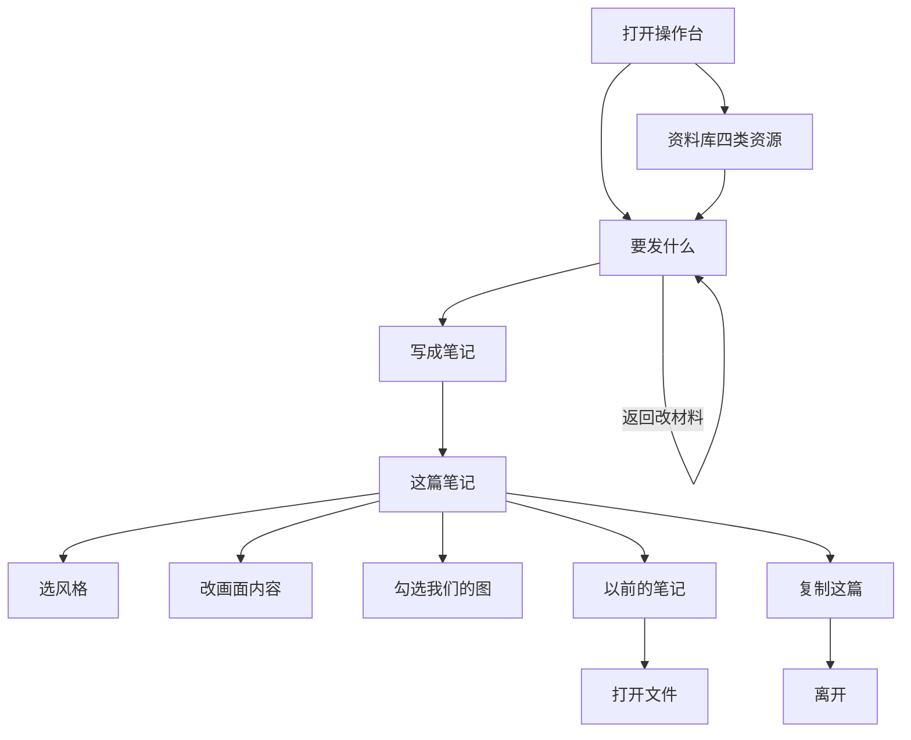
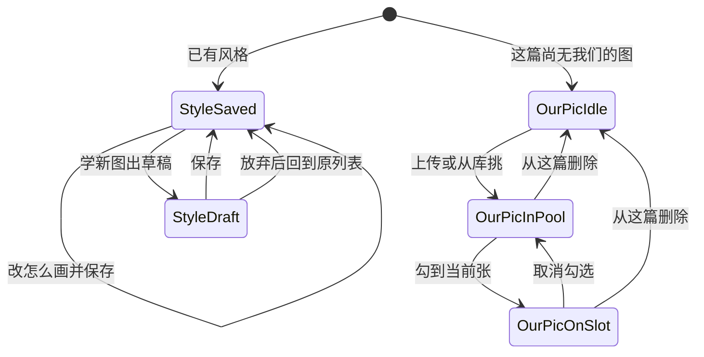

# PRD: 运营一眼能看懂的界面用词

| 属性 | 值 |
|------|----|
| 状态 | 工程：accepted（见文末「工程验收状态」） |
| 范围 | 操作台可见文案：资料库、写笔记、「要发什么」「这篇笔记」、以前的笔记、相关弹层 / 空状态 / 等待句 / 错误句 / aria-label。仅 Release 0 |
| 顺序号 | 00015 |
| 关联文档 | `docs/DESIGN.md`、`docs/workflows/one-post-studio.md`、`docs/doc_index.md`、`AGENTS.md`、`specs/prds/prd-00005-album-library.md`、`specs/prds/prd-00006-fuse-reference-images.md`、`specs/prds/prd-00007-note-style-samples.md`、`specs/prds/prd-00014-reference-library.md` |

## 背景与问题

运营同事看不懂界面上的词。他们要上传公司 logo 和产品照，界面说「上传参考」「参考图」；他们以为那张图会坐在成片格子上。他们要抄一篇爆款，界面说「范文」。他们要改这一张画什么，界面说「提示词」。

同一件事还有多张嘴：侧栏「生成笔记」、页题「写一篇笔记」、底栏「写成笔记」；保存叫「确认入库」「存进库」「新建到库」「确定写入」「写入柜子」；删除叫「拿走」。人设、目的底下的身份 / 语气 / 目标说明书还会和当前目的选项对不上。

本机走查（写笔记 → 资料库四 Tab → 新建菜单 → 以前的笔记 → 打开一篇进「这篇笔记」）确认：问题是整站用词，不是某一个标签。

目标：一个东西只留一个词；说明书灰字能少就少；一眼知道这是什么。不改交互、不改模型提示词、不抽语言包。

## 目标与非目标

### 目标（Release 0）

1. 资料库与写笔记共用一套用词表（见「用词表」）。禁止一页一个叫法。
2. 侧栏「生成笔记」与页题「写一篇笔记」统一为 **写笔记**；底栏「写成笔记」、右上「写新的一篇」作为动作保留。
3. 四个资源名统一：**风格**、**我们的图**、**对标文案**、**产品资料**；新建菜单「小红书笔记」改为 **对标笔记**。
4. 「这篇笔记」三颗胶囊改为 **风格**、**画面内容**、**我们的图**（保留 `n/9`）；资料库风格长文标签改为 **怎么画**。
5. 「封面之外还要几张」改为 **笔记内图数量**；步进器仍为 0–9、不含封面；槽位名「封面 / 配图 1」保留。
6. 「用法句」全家改为 **图片用法**；占位去掉 Hero / 锁脸，改为人话示例「我们的 logo，放在右上角。」
7. 「识图起草」改为 **自动识别**；「生成这张 / 再抽一张」改为 **画这张 / 再画一张**；「显示文件」改为 **打开文件**。
8. 保存动词收成 **保存**（选用时「保存并选用」；放进资料库「保存到资料库」）。删除统一为 **删除** + 带名词的确认句。
9. 按「删掉的废话」清单去掉说明书灰字、错误的组合说明、点击路径教程、「题词结构 v{n}」展示等。
10. 实现时同步 `aria-label`、toast、空状态、弹层标题、等待轮播、错误句名词；同步 `docs/DESIGN.md`、`docs/workflows/one-post-studio.md`、`docs/doc_index.md` 中引用旧词的句子；同步测试里写死的旧可见文案。
11. 不做 i18n / `copy.js`；字继续写在页面与页面脚本里。本 PRD 用词表是可见文案唯一事实源。

### 非目标

- 改交互、张数上限、勾选规则、学习草稿流程、入库流程。
- 改模型提示词正文（如 `【参考图】`、`第一张是版式模板参考图`）。
- 改代码 id、目录、接口字段（`upload-refs`、`article-samples`、`reference-docs`、`albums` 等）。
- 改手机框假小红书文案（说点什么、点赞、收藏、评论、关注、示例笔记标题）。
- 改人设 / 目的选项名（种草、涨粉、引流等）。
- 未上线菜单（选题、角色、危险词等）。
- 抽语言包、多语言、文案 CMS。
- Release 1 及更高版本切片。

禁止定义 Release 2 及更高版本。

## 术语

| 术语 | 含义 |
|------|------|
| 写笔记 | 侧栏与页题统一后的产品名；入口仍是今天的 note 页。 |
| 风格 | 原图库 / 图册 / 图册风格。照着这套长得像。 |
| 我们的图 | 原上传参考 / 参考图。logo、产品、人脸都进这一格；被画进画面，不是成片本身。 |
| 对标文案 | 原范文。要抄的那篇正文。 |
| 产品资料 | 原参考资料。卖点、日期、价格等事实。 |
| 对标笔记 | 原新建「小红书笔记」。拆开后正文进对标文案，图进风格。 |
| 笔记内图数量 | 原「封面之外还要几张」。步进器 0–9，不含封面。 |
| 画面内容 | 原「这篇笔记」上的提示词。这一张画什么、写什么。 |
| 怎么画 | 原图册提示词 / 题词。资料库里那套风格的长文。 |
| 图片用法 | 原用法句。说明这张我们的图是什么、放哪。 |
| 可见文案 | 用户看得见或读屏读到的字；不含模型提示词与代码标识符。 |

## 用词表（今 → 新）

一个东西只留一列「新」。资料库、写笔记、弹层、空状态、等待句、错误句、aria-label 全部跟这一列。

### 资源与导航

| 今 | 新 | 出现位置（示例） |
|----|----|------------------|
| 生成笔记（侧栏） | 写笔记 | `shell.js` 菜单 |
| 写一篇笔记（页题） | 写笔记 | `note.html` h1 |
| 图库 / 图册 | 风格 | 资料库 Tab、新建菜单、空状态、删除确认 |
| 图册风格 | 风格 | 「这篇笔记」胶囊 |
| 上传参考 / 参考图 / 上传参考图 | 我们的图 | 资料库 Tab、新建、面板、弹层、错误句 |
| 范文 | 对标文案 | 资料库 Tab、新建、「要发什么」、挑库弹层 |
| 参考资料 | 产品资料 | 资料库 Tab、新建、「要发什么」、芯片相关文案 |
| 小红书笔记（新建菜单项） | 对标笔记 | 新建菜单 |
| 封面之外还要几张 | 笔记内图数量 | 「要发什么」 |
| 提示词（这篇笔记胶囊） / 这张的提示词 | 画面内容 | 「这篇笔记」 |
| 图册提示词 / 题词 | 怎么画 | 风格详情 / 草稿浮层 |
| 用法句 / 写上用法句 / 放哪里 / 怎么用 / 编辑用法 | 图片用法 | 我们的图相关弹层与标签 |

### 动作与状态

| 今 | 新 |
|----|----|
| 确认入库 / 确定写入 / 存进库 / 新建到库 / 写入柜子 | 保存；选用时「保存并选用」；放进资料库「保存到资料库」 |
| 保存用法 | 保存 |
| 识图起草 | 自动识别 |
| 识图失败 | 自动识别失败 |
| 生成这张 | 画这张 |
| 再抽一张 | 再画一张 |
| 显示文件 | 打开文件 |
| 拿走 / 删除这本 | 删除；确认句带具体名词（见下） |
| 用这篇写法去写 | 用这篇去写 |
| 正在取料 / 收录 / 正在收录 | 正在读取 / 已保存 |
| 学习文章 / 学习首图 / 学习内页 | 文案 / 封面 / 后面的图 |

### 删除确认句（统一模板）

| 对象 | 确认句 |
|------|--------|
| 我们的图 | 删除这张我们的图？ |
| 风格 | 删除这套风格？ |
| 对标文案 | 删除这篇对标文案？ |
| 产品资料 | 删除这条产品资料？ |

说明文去掉「芯片」：改成「这篇里已经加过的，不受影响。」（或等价人话，禁止工程词「芯片」）。

### 占位与轮播

| 今 | 新 |
|----|----|
| `人物照片。按 Hero 放在画面中央，锁脸。` | `我们的 logo，放在右上角。` |
| 正在端详这张参考图… | 正在看这张图 |
| 提炼配色、构图与字体气质… | 在看配色和排版 |
| 把风格拆成可复用的题词… | 在整理这套风格 |
| 马上生成你的图册草稿… | 马上出一套草稿 |

### 保留不动

| 文案 | 原因 |
|------|------|
| 资料库 | 总入口已是人话 |
| 写成笔记 / 写新的一篇 / 复制这篇 | 动作句 |
| 要发什么 / 这篇笔记 | 两步名清楚 |
| 以前的笔记 / 笔记预览 / 封面预览 | 清楚 |
| 封面 / 配图 1 | 与笔记内图数量配套 |
| 人设、目的、种草、涨粉、引流等选项 | 业务选项，不是资源名 |
| 发现页按 3:4 裁封面 | 事实说明 |
| 用一句话说。卖什么、给谁看。 | 告诉用户输入什么，不是重复控件上的数字 |
| 已加 n/5 | 快满提示，留 |
| 手机框：说点什么 / 点赞 / 收藏 / 评论 / 关注 / 示例笔记标题 | 平台假环境 |
| 模型提示词里的「参考图」等 | 给模型，不给运营 |

## 已拍板规则

| 项 | 决定 |
|----|------|
| 范围 | 只换可见文案；交互与数据模型不动。 |
| 我们的图 | 一个 Tab / 一个胶囊名；不按 logo / 产品 / 人脸拆库。靠「图片用法」区分。 |
| 笔记内图数量 | 标签改名；步进器语义仍是封面之外 0–9，**不含封面**；生成逻辑不变。 |
| 画面内容 vs 怎么画 | 单张用「画面内容」；风格库长文用「怎么画」。禁止再混用「提示词」「题词」。 |
| 说明书 | 控件上已有数字或按钮能说话的灰字删掉；见「删掉的废话」。 |
| 语言包 | 不抽。PRD 用词表是唯一事实源。 |
| 文档同步 | 实现本 PRD 时同步 DESIGN / workflow / doc_index；本 PRD 落盘时不改页面。 |

## 删掉的废话

| 删除项 | 原因 |
|--------|------|
| 我们的图面板：「可囤多张，当前图最多勾 9 张。点 + …悬停看用法。」 | 按钮已有 `n/9` |
| 产品资料旁：「事实材料。点文档看详情，最多 5 条，可空。」 | 名词已说明；上限由加号消失表达 |
| 对标文案旁：「可选。从库挑一篇仿写…」 | 名词已说明 |
| 人设 / 目的旁问号 + 整段身份 / 语气 / 目标 | 会与当前目的选项打架；下拉自己会说话 |
| 空列表点击路径（「用右上新建 → …」「可先在这篇…」） | 留「还没有我们的图。」等一句 +「新建」按钮 |
| 新建菜单「创建新内容」 | 五项名字就是菜单 |
| 「题词结构 v{n}」 | 工程版本号不对运营展示 |
| 「悬停可看大图」 | 动作可留；说明书删 |
| 删除说明里的「芯片」 | 换人话 |

空列表目标句（示例）：

- 还没有风格。
- 还没有我们的图。
- 还没有对标文案。
- 还没有产品资料。

错误句保留，只换名词。例如：

- 产品资料最多 5 条。
- 一张图最多 9 张我们的图。
- 笔记内图数量要在 0 到 9 之间。
- 请写上图片用法。
- 自动识别失败。

## 用户与角色

| 角色 | 目标 |
|------|------|
| 运营（主用户） | 不读说明书也能认出风格、我们的图、对标文案、产品资料；敢上传 logo 与产品照；敢选对标去写。 |
| 内容同事 | 打开「画面内容」知道改的是这一张画什么；打开「图片用法」知道写的是这张我们的图怎么用。 |
| 工程 | 按用词表改可见字符串与测试断言；不改桥字段与目录名。 |

## 功能域

| 域 | 实现指引 |
|----|----------|
| 壳层导航 | `shell.js` 菜单「写笔记」 |
| 写笔记材料步 | `note.html` / `note.js`：「产品资料」「对标文案」「笔记内图数量」；删灰字与组合说明 |
| 写笔记成稿步 | 胶囊「风格 / 画面内容 / 我们的图」；画这张 / 再画一张；打开文件；我们的图面板删说明书 |
| 资料库壳 | Tab 与新建菜单五项新名；删「创建新内容」 |
| 风格模块 | 空状态、详情「怎么画」、轮播、删除确认、toast；隐藏题词结构版本号 |
| 我们的图模块 | 「图片用法」「自动识别」「保存」；空状态与删除确认 |
| 对标文案 / 产品资料模块 | Tab、弹层、空状态、删除确认换名 |
| 对标笔记进料 | 菜单名、学习选项、完成句、读取/保存等待句 |
| 以前的笔记 | 「打开文件」与写笔记对齐 |
| 文档与测试 | DESIGN / workflow / doc_index / 写死旧词的测试 |

## 用户故事地图与版本切片

### 旅程主干

| 序 | 节点 | 说明 |
|----|------|------|
| Entry | 打开操作台 | 侧栏见「写笔记」「资料库」 |
| 1 | 进资料库 | 四个 Tab 名一眼可分 |
| 2 | 新建我们的图 / 对标文案 / 产品资料 / 风格 / 对标笔记 | 菜单无「创建新内容」；项名与 Tab 一致 |
| 3 | 写笔记 · 要发什么 | 产品资料、对标文案、笔记内图数量；无说明书灰字 |
| 4 | 写成笔记 | 动作名保留 |
| 5 | 这篇笔记调图 | 风格、画面内容、我们的图；画这张 / 再画一张 |
| 6 | 以前的笔记 | 打开文件 |
| Exit | 复制这篇 / 离开 | 文案不变；Teardown 无新状态 |

### 用户故事地图（含验收要点）

| 阶段 | 目标 | 故事 | 验收要点 |
|------|------|------|----------|
| 认出资源 | 一眼分清四类资料 | 作为运营，我想在资料库看到风格 / 我们的图 / 对标文案 / 产品资料，以便不再猜「上传参考」是什么 | Tab、新建菜单、空状态、aria-label 四名一致；页面上不再出现旧四名作为标题 |
| 上传资产 | 敢传 logo 与产品照 | 作为运营，我想把公司图放进「我们的图」并写「图片用法」，以便模型知道这是什么、放哪 | 弹层标题与标签为图片用法；占位无 Hero/锁脸；自动识别按钮可见 |
| 抄一篇 | 选对标去写 | 作为运营，我想从「对标文案」挑一篇，以便仿写爆款结构 | 「要发什么」与资料库都叫对标文案；挑库弹层标题同步 |
| 写事实 | 加产品资料 | 作为运营，我想加「产品资料」而不读「事实材料」灰字，以便专注贴卖点 | 灰字删除；错误句仍提示最多 5 条 |
| 定张数 | 设内页数量 | 作为运营，我想看到「笔记内图数量」，以便知道步进器管的是内页张数 | 标签已换；步进仍 0–9 不含封面；槽位仍封面/配图 |
| 改画面 | 改这一张要画什么 | 作为运营，我想打开「画面内容」，以便改这一张而不是去猜提示词 | 胶囊与空状态用画面内容；风格库长文用怎么画 |
| 画图 | 用同一动词 | 作为运营，我想点「画这张 / 再画一张」，以便和「正在画封面」是一件事 | 按钮与等待句动词一致 |
| 找文件 | 打开本机文件 | 作为运营，我想在笔记页和以前的笔记都点「打开文件」，以便找到成片 | 两处文案一致 |
| 少废话 | 不被说明书淹没 | 作为运营，我不想读「可囤多张…悬停看用法」和身份/语气/目标长段，以便专注操作 | 清单内灰字与组合说明消失；`n/9`、`已加 n/5` 仍在 |

### Release 切片

#### Release 0（MVP）

- 交付：整站可见文案按用词表替换；删掉的废话清单落地；DESIGN / workflow / doc_index / 相关测试同步。
- 可验收结果：
  1. 运营不看说明，能指出风格、我们的图、对标文案、产品资料分别是什么。
  2. 「这篇笔记」三颗胶囊为风格、画面内容、我们的图。
  3. 保存只有「保存」这一组动词；删除确认带具体名词。
  4. 说明书灰字按清单消失；笔记内图数量步进语义未变。

本 PRD **不定义 Release 1**。溢出能力进非目标或开放项。

## 核心流程与状态机图

换词不改闭环。主流程仍是写笔记；资料进出仍是勾选 / 快照 / 草稿。

我们的图与风格的状态不变（正反向对称）：

说明：没有「勾选后文件变成成片」的状态。我们的图始终是素材；成片仍在图片槽。

## 数据与 API 衔接（高层）

| 能力 | 说明 |
|------|------|
| 存储 / 桥 | 字段名、目录名、方法名可继续用 `upload-refs`、`article-samples`、`reference-docs`、`albums`。只改展示字符串。 |
| 草稿语义 | 不变：产品资料快照、对标文案正文、我们的图勾选、风格 id、笔记内图数量 0–9。 |
| 模型提示词 | 文件内工程用语可不改；用户可见「画面内容」编辑框展示的是既有可改段。 |
| 测试 | 断言可见文案 / aria-label 的用例跟用词表改；断言内部 id 的用例不动。 |

## 假设与开放项

| 项 | 说明 |
|----|------|
| 假设 | 「我们的图」对运营足够清楚；不需要本期再拆 logo / 产品 / 人脸 Tab。 |
| 假设 | 「笔记内图数量」用户理解为内页张数；若验收中被理解成含封面，再开文案微调用「内页张数」等，不改步进语义。 |
| 假设 | 人设 / 目的选项旁帮助全文删除后，组合灰字（身份/语气/目标）一并删除即可；选项名自解释。 |
| 开放 | toast「已保存题词」等零散句实现时按用词表扫全仓静态页；本表未逐条列出的，以「禁止旧词作标题」为验收原则。 |
| 开放 | 读屏 aria-label 与可见标签保持同词；具体句式工程可略作通顺，不得换回旧术语。 |
| 待与工程对齐 | 实现时改 DESIGN / one-post-studio / doc_index；本 PRD 落盘不同步改页面。 |

## 修订记录

| 日期 | 说明 |
|------|------|
| 2026-11-05 | 初稿。整站用词统一；删说明书灰字；笔记内图数量 / 图片用法 / 自动识别按产品拍板；仅 Release 0；不抽语言包。 |

## 1. 工程验收状态

> 由 `/team:prd-accept` 维护；勿手工编造「通过」。最后更新：2026-11-05T09:49:22Z，prd/studio-plain-copy@5b3147a（交付在工作区未提交），范围：R0。

### 总览

- 工程状态：`accepted`
- 验收判定：Release 0 范围内功能均通过；本 PRD 不定义 R1
- 最近验收：2026-11-05T09:49:22Z
- 代码提交：基线 `5b3147a`；可见文案与文档改动仍在工作区（未 `git commit`）
- 摘要：
  1. 侧栏 / 页题统一「写笔记」；资料库四 Tab + 新建「对标笔记」与写笔记材料步四名一致
  2. 「这篇笔记」三胶囊为风格 / 画面内容 / 我们的图；画这张 / 再画一张；打开文件对齐
  3. 保存动词收成保存 / 保存并选用 / 保存到资料库；删除确认带具体名词；芯片工程词已换人话
  4. PRD「删掉的废话」清单在 `src/studio/static` 搜不到；人设/目的帮助与 `#combo-brief` 已删
  5. `USAGE_PLACEHOLDER` 与校验错句已换「图片用法」；模型侧 `【参考图】` 测试仍绿；studio 静态断言 3/3 通过

### Release 交付

| Release | 状态 | 说明 |
|---------|------|------|
| R0 | 通过 | 可见文案、删废话、DESIGN / workflow / doc_index、studio 测试同步 |
| R1 | 范围外 | PRD 明确不定义 Release 1 |

### 功能验收清单（Agent 优先读此表）

| ID | 能力摘要 | Release | 状态 | 证据 |
|----|----------|---------|------|------|
| R0-01 | 侧栏「写笔记」 | R0 | 通过 | `src/studio/static/shell.js` label `写笔记`；`tests/studio/run-studio.test.js` |
| R0-02 | 页题「写笔记」；材料步产品资料 / 对标文案 / 笔记内图数量 | R0 | 通过 | `note.html` h1 与标签；无旁灰字；`run-studio.test.js` |
| R0-03 | 三胶囊：风格 / 画面内容 / 我们的图；画这张 / 再画一张；打开文件 | R0 | 通过 | `note.html` aria-label；`note.js` `画这张`/`再画一张`；`history.html` 打开文件 |
| R0-04 | 图片用法 / 自动识别 / 占位「我们的 logo，放在右上角。」 | R0 | 通过 | `note.html` / `library.html`；`src/upload-refs/rules.js` `USAGE_PLACEHOLDER`；`validateUsage` 错句 |
| R0-05 | 保存动词统一；删除确认模板；无「芯片」 | R0 | 通过 | 各弹层「保存」「保存并选用」「保存到资料库」；删除确认四句；产品资料删除说明「这篇里已经加过的，不受影响。」 |
| R0-06 | 资料库 Tab / 新建五项 / 空状态一句化 / 怎么画 / 轮播 | R0 | 通过 | `library.js` tabs；`library.html` 新建与空状态；`albums.js` 四句轮播与 toast「已保存怎么画」；无「创建新内容」「题词结构 v」 |
| R0-07 | 对标笔记：文案/封面/后面的图；正在读取/已保存；用这篇去写 | R0 | 通过 | `library.html` xhs 弹层；`xhs-note.js` |
| R0-08 | 删掉的废话清单落地 | R0 | 通过 | `src/studio/static` 无：可囤多张 / 事实材料 / 可选从库挑 / 创建新内容 / 题词结构 v / 悬停可看大图 / combo-brief / PERSONA_HELP |
| R0-09 | 文档同步 DESIGN / workflow / doc_index | R0 | 通过 | 三文件叙述已用新词；workflow §4 与路径说明已跟用词表 |
| R0-10 | 测试跟可见文案；模型提示词断言不动 | R0 | 通过 | `tests/studio/run-studio.test.js` 3 通过；`tests/prompts/*` / `tests/one-post/*` 仍含 `【参考图】` |
| R0-11 | 不改交互 / 桥字段 / 目录 id / i18n | R0 | 通过 | 仍用 `upload-refs` / `albums` 等 id；无 `copy.js` |

### 未完成与遗留

- 交付改动尚未 `git commit`（工作区相对 `5b3147a`）；合入后可将 `accepted_commit` 更新为真实交付 commit
- 未跑 Dex Buddy 插件页端到端 UI 走查：本 PRD 仅换可见文案、交互未变；以静态文件 + studio 断言为证即可，不阻塞关闭
- workflow 后半仍有工程向「题词 / 参考图」描述（模型拼装与内部路径），属非目标保留，不按旧 UI 标题验收

### 质量检查

| 检查项 | 状态 |
|--------|------|
| 测试 | 通过：`node --test tests/studio/run-studio.test.js tests/upload-refs/rules.test.js`（12/12） |
| Lint | N/A（本仓无 lint 命令） |
| 文档与 OpenAPI | 文档已同步；本项目无 OpenAPI，跳过 |

---
统计：通过 11 / 部分 0 / 未实现 0 / 范围外 1（R1）
