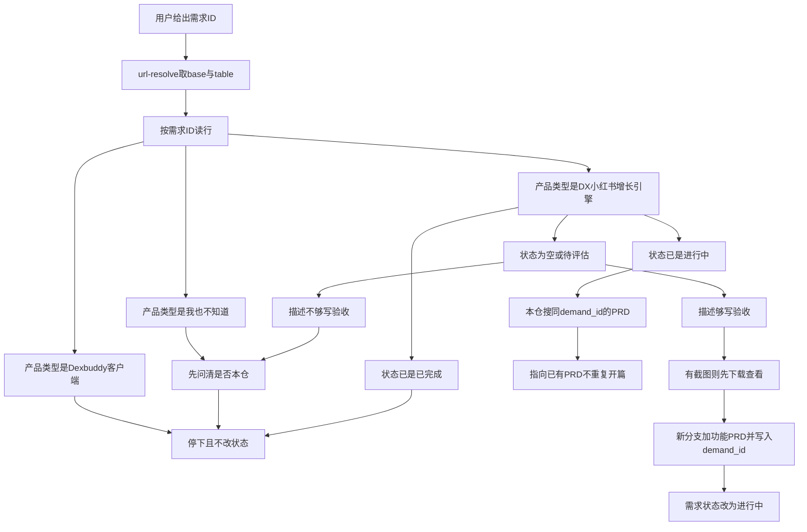
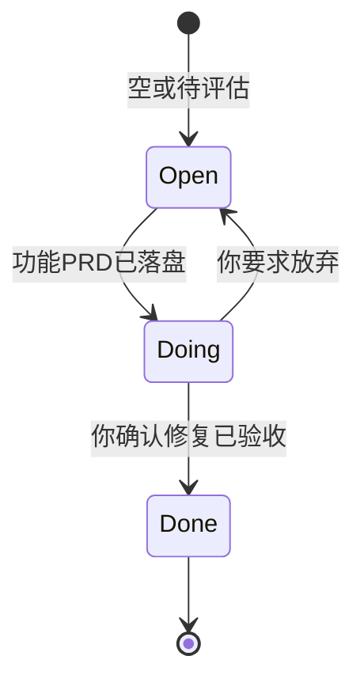

# PRD: 飞书需求池转入与状态回填

| 属性 | 值 |
|------|----|
| 状态 | 工程：accepted（见文末「工程验收状态」） |
| 范围 | 用户反馈路线：飞书「需求收集管理」→ 本仓功能 PRD → 只回填「需求状态」。仅 Release 0 |
| 顺序号 | 00016 |
| 关联文档 | `docs/workflows/feishu-demand-to-prd.md`、`docs/workflows/feishu-demand-writeback.md`、`.cursor/commands/team/feishu-demand-to-prd.md`、`.cursor/commands/team/feishu-demand-writeback.md`、`docs/doc_index.md`、`AGENTS.md`、`specs/prds/prd-wiki-index.md`、`.cursor/commands/team/product-manager.md` |

## 背景与问题

同事把小红书增长引擎相关的 bug 与卡点记在飞书多维表格「🛠️ Dexbuddy需求收集与管理」→ 表「需求收集管理」、视图「需求池」。本仓要修问题时，需要一条可复跑的路线：你指定一条需求 ID，Agent 读行、判断能否在本仓处理；能处理则另开功能分支、写成功能 PRD，并把飞书该行标为进行中；修完并验收后只把状态改成已完成。

这条路线与「直接口述需求 → `/team:product-manager`」并存，不是唯一入口。表同时服务 Dexbuddy 客户端，本仓只自动处理产品类型为「DX-小红书增长引擎」的行。

## 目标与非目标

### 目标（Release 0）

1. 固定飞书事实源与身份：`lark-cli --as user`；稳定入口是 wiki URL；执行时 `base +url-resolve` 解析 `base_token` / `table_id`，不把 token 写死成唯一入口。
2. 入口是**你指定的需求 ID**（如 `20261105_0003`）。不扫全表自动开 PRD，不按「代际」过滤（表无代际列）。
3. 可处理时：另开功能分支、写功能 PRD（frontmatter 带 `demand_id` / `demand_record_id` / `demand_source`），落盘后再把该行「需求状态」改为 **进行中**。
4. 对应修复已验收后：只把该行改为 **已完成**；你要求放弃时改回 **待评估**。
5. 分流明确：客户端行停下；「我也不知道」或描述不足则先问你；已完成不改；已进行中则搜本仓同 `demand_id` 的 PRD 并指向它。
6. 交付两篇可复跑 workflow：转入、回填。本 PRD 的可验收结果就是这两篇可按需求 ID 执行。

### 非目标

- 新增飞书列（PRD 路径、处理说明等）。
- 改「需求描述」、负责人、优先级、分类、截图。
- 自动处理表内全部小红书需求，或在本 PRD 内修任何一条具体 bug。
- 把飞书路线写成唯一需求入口；口述需求仍走 `/team:product-manager`。
- 新建自动化脚本或定时同步。
- 合并相似描述的多条需求（只提示，不自动合并）。
- Release 1 及更高版本切片。

禁止定义 Release 2 及更高版本。

## 术语

| 术语 | 含义 |
|------|------|
| 需求池 | 飞书 Base「🛠️ Dexbuddy需求收集与管理」中表「需求收集管理」、视图「需求池」 |
| 需求 ID | 表字段「需求ID」（自动编号，如 `20261105_0003`），人可读主键 |
| record_id | 飞书行稳定主键（如 `reczz28Vqa8brNY6`），写入 API 用 |
| 流程 PRD | 本篇 `prd-00016-feishu-demand-loop`，描述转入/回填流程 |
| 功能 PRD | 从某一行转出的产品 PRD（`prd-NNNNN-<feature-slug>.md`），带 `demand_id` 等 frontmatter |
| 转入 | 读行 → 分流 → 写功能 PRD → 状态改为进行中 |
| 回填 | 你确认验收或放弃后，只更新「需求状态」 |

## 已拍板规则

| 规则 | 值 |
|------|----|
| 回填字段 | 仅「需求状态」 |
| 状态取值 | 待评估 / 进行中 / 已完成（与表现有选项一致） |
| 空状态语义 | 与「待评估」同等，视为开放行，可转入 |
| 改进行中时机 | 功能 PRD 文件已落盘之后 |
| 改已完成时机 | 你明确说该需求对应修复已修好 / 已验收 |
| 放弃 | 进行中 → 待评估；功能 PRD 文件默认保留 |
| 产品类型自动处理 | 仅「DX-小红书增长引擎」 |
| Dexbuddy客户端 | 停下说明，不改状态 |
| 我也不知道 | 先问是否本仓，不改状态 |
| 本仓定位键 | `demand_id` + `demand_record_id`（写在功能 PRD frontmatter） |
| 身份 | `--as user` |
| 入口 URL | `https://fcnegd976pzo.feishu.cn/wiki/VKnpwNGxuiwwKgkUhvqcpc6OnJb?fromScene=spaceOverview&table=tbl3wVH0rGdbIKlO&view=vewMnpNgGD` |

## 用户与角色

| 角色 | 目标 |
|------|------|
| 你（产品 / 负责人） | 指定需求 ID、拍板能否处理、确认验收或放弃 |
| 提需求的同事 | 在飞书表里写描述与截图，看状态从开放变为进行中再变为已完成 |
| Agent（产品经理角色） | 读行、分流、写功能 PRD、改状态 |
| 工程 | 按功能 PRD 实现与验收；不负责本流程 PRD 的表结构变更 |

## 功能域

1. **解析与读行**：wiki URL → `base_token` / `table_id`；按需求 ID 找到 `record_id` 与字段。
2. **分流**：产品类型、状态、描述充分度、本仓是否已有同需求 ID。
3. **转入写 PRD**：新分支、功能 PRD（含需求溯源 frontmatter）、有截图先下载查看。
4. **状态写入**：`base +record-batch-update`，只提交 `需求状态`，值为单选数组。
5. **回填**：验收 → 已完成；放弃 → 待评估；当前状态不符则停下。

## 用户故事地图与版本切片

### 旅程主干

| 步骤 | 节点 | 说明 |
|------|------|------|
| Entry | 你给出需求 ID | 触发转入 |
| 1 | 解析 Base | `+url-resolve` |
| 2 | 按需求 ID 读行 | 拿到 record_id 与字段 |
| 3 | 分流 | 产品类型 / 状态 / 描述 |
| 4 | 写功能 PRD | 新分支 + `specs/prds/prd-*-*.md` |
| 5 | 标进行中 | 只改需求状态 |
| 6 | 工程按功能 PRD 修复 | 本流程 PRD 外 |
| 7 | 你确认验收 | 触发回填 |
| Exit | 标已完成 | 或放弃改回待评估 |

### 用户故事地图

| 阶段 | 目标 | 故事 | 验收要点 |
|------|------|------|----------|
| 转入 | 读对一行 | 作为负责人，我想按需求 ID 读飞书那一行，以便确认描述与截图 | 用 `--as user`；resolve 后能列出该行需求描述、产品类型、状态、record_id |
| 转入 | 只处理本仓 | 作为负责人，我希望客户端行被拦住，以便不误改别的产品 | 产品类型为 Dexbuddy客户端时停下且不改状态 |
| 转入 | 可开 PRD | 作为产品经理，我想把可处理行写成功能 PRD，以便工程按故事验收 | 新分支存在；功能 PRD frontmatter 含 `demand_id`、`demand_record_id`、`demand_source: feishu-demand-pool` |
| 转入 | 同步进行中 | 作为提需求同事，我想看到状态变成进行中，以便知道已立项 | PRD 落盘后该行「需求状态」为进行中；此前不为进行中 |
| 回填 | 验收关闭 | 作为负责人，我想在修好后把状态改成已完成，以便需求池关闭 | 仅当当前为进行中且你确认验收；只更新需求状态 |
| 回填 | 放弃复位 | 作为负责人，我想放弃时改回待评估，以便以后再捡 | 进行中 → 待评估；不删功能 PRD（除非你另说） |

### Release 0（MVP）

- 两篇 workflow 可按需求 ID 执行转入与回填。
- 分流与状态机与本 PRD 一致。
- 本仓索引已登记流程 PRD 与两篇 workflow。
- **不做**：改表结构、自动扫表、修具体需求行。

不设 Release 1。溢出能力进非目标或独立 PRD。

## 核心流程与状态机图

### 转入流程图

### 需求状态机

进行中且本仓已有同 `demand_id`：不重复开 PRD，不强制改状态。描述相似的多行只提示，不自动合并。

## 数据与 API 衔接

| 项 | 约定 |
|----|------|
| 读 | `lark-cli base +url-resolve` → `+record-list` / 按需求 ID 定位 → 需要时 `+record-get` |
| 写 | `lark-cli base +record-batch-update`，JSON 形如 `{"update_records":{"<record_id>":{"需求状态":["进行中"]}}}` |
| 附件 | 有「需求截图」时用 `+record-download-attachment`（相对路径输出） |
| 本仓 | 功能 PRD 路径 `specs/prds/prd-{五位}-{slug}.md`；序号按目录现有最大 +1 |

字段（只读了解，除状态外不写）：需求提出人、最后更新时间、需求状态、需求描述、需求提出日期、产品类型、需求负责人、需求分类、需求ID、需求截图、优先级。

## 假设与待确认 / 开放项

| 项 | 说明 |
|----|------|
| 假设 | 执行 Agent 已登录 `lark-cli` 用户身份且对该 Base 有读写权限 |
| 假设 | 需求 ID 在表内唯一 |
| 开放 | 若日后需要表上展示 PRD 链接，另开 PRD 再加列；本期不加 |
| 开放 | 表内多条违禁词类需求是否合并，由你在转入时口头拍板 |

## 修订记录

| 日期 | 说明 |
|------|------|
| 2026-11-06 | 初稿：转入 + 只回填需求状态；Release 0 |
| 2026-11-06 | R0 落地：两篇 workflow、team 命令、AGENTS 触发；status → implemented |

## 1. 工程验收状态

> 由 `/team:prd-accept` 维护；勿手工编造「通过」。最后更新：2026-11-06T09:06:05Z，prd/feishu-demand-loop@eafc26d（交付在工作区未提交），范围：R0。

### 总览

- 工程状态：`accepted`
- 验收判定：Release 0 范围内均无「未实现」；本 PRD 不定义 R1
- 最近验收：2026-11-06T09:06:05Z
- 代码提交：基线 `eafc26d`；流程 PRD / workflow / AGENTS / 索引改动仍在工作区（未 `git commit`）
- 摘要：
  1. 两篇业务 workflow 可按需求 ID 执行转入与只回填「需求状态」
  2. AGENTS 第 11/12 条与 `/team:feishu-demand-*` 提供触发入口（team 命令在 gitignore 的 `.cursor/`，与现有 team 命令一致）
  3. 分流 / 状态机 / frontmatter 溯源字段写进 workflow，与 PRD 一致
  4. `doc_index` / `prd-wiki-index` 已登记；飞书只读联通已验证（resolve + 按需求 ID 读行）
  5. 用户确认跳过飞书写入路径的端到端试写；不阻塞关闭本流程 PRD

### Release 交付

| Release | 状态 | 说明 |
|---------|------|------|
| R0 | 通过 | workflow + 触发 + 索引 + 只读联通 |
| R1 | 范围外 | PRD 明确不定义 Release 1 |

### 功能验收清单（Agent 优先读此表）

| ID | 能力摘要 | Release | 状态 | 证据 |
|----|----------|---------|------|------|
| R0-01 | 两篇可复跑 workflow（转入 / 回填） | R0 | 通过 | `docs/workflows/feishu-demand-to-prd.md`、`docs/workflows/feishu-demand-writeback.md` |
| R0-02 | 按需求 ID 进入；不扫全表 | R0 | 通过 | workflow 入口与 AGENTS 第 11 条；命令 Usage 要求需求 ID |
| R0-03 | `--as user` + wiki URL resolve | R0 | 通过 | 两篇 workflow 入口命令；只读联通命中表「需求收集管理」 |
| R0-04 | 分流：仅 DX-小红书增长引擎；客户端停下 | R0 | 通过 | `feishu-demand-to-prd.md` 分流表；只读可见客户端行 `20261105_0001` 与本仓行 `20261105_0003` |
| R0-05 | 功能 PRD frontmatter 溯源字段 | R0 | 通过 | 转入 workflow 强制 `demand_id` / `demand_record_id` / `demand_source: feishu-demand-pool` |
| R0-06 | 落盘后再改进行中；回填只改需求状态 | R0 | 通过 | 转入步骤 6；回填 workflow 硬约束只写「需求状态」 |
| R0-07 | 验收→已完成；放弃→待评估 | R0 | 通过 | `feishu-demand-writeback.md` 状态表与 update 示例 |
| R0-08 | 触发入口：AGENTS + team 命令 | R0 | 通过 | `AGENTS.md` 11/12；本地 `.cursor/commands/team/feishu-demand-*.md`；`docs/doc_index.md` 已登记 |
| R0-09 | 索引登记 | R0 | 通过 | `docs/doc_index.md`、`specs/prds/prd-wiki-index.md` |
| R0-10 | 非目标：不加列 / 无脚本 / 不修具体 bug | R0 | 通过 | 无 Base schema 变更；无新建 `scripts/`；未改具体需求行状态 |

### 未完成与遗留

- 交付改动尚未 `git commit`（工作区相对 `eafc26d`）；合入后可将 `accepted_commit` 更新为真实交付 commit
- 飞书「进行中 / 已完成」写入路径未做真实试写：用户确认本流程 PRD 关闭前不要求；首次跑 `/team:feishu-demand-to-prd <需求ID>` 时再实操验证
- `.cursor/commands/team/` 整目录 gitignore：与仓内其他 team 命令相同；可复跑事实源以 `docs/workflows/` 与 AGENTS 触发为准

### 质量检查

| 检查项 | 状态 |
|--------|------|
| 测试 | N/A（流程 PRD，无单测命令；只读 `lark-cli` 联通已人工验证） |
| Lint | N/A（本仓无 lint 命令） |
| 文档与 OpenAPI | 文档与索引已同步；本项目无 OpenAPI，跳过 |

---
统计：通过 10 / 部分 0 / 未实现 0 / 范围外 1（R1）

