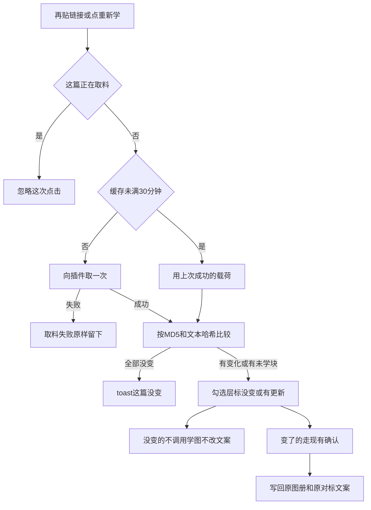
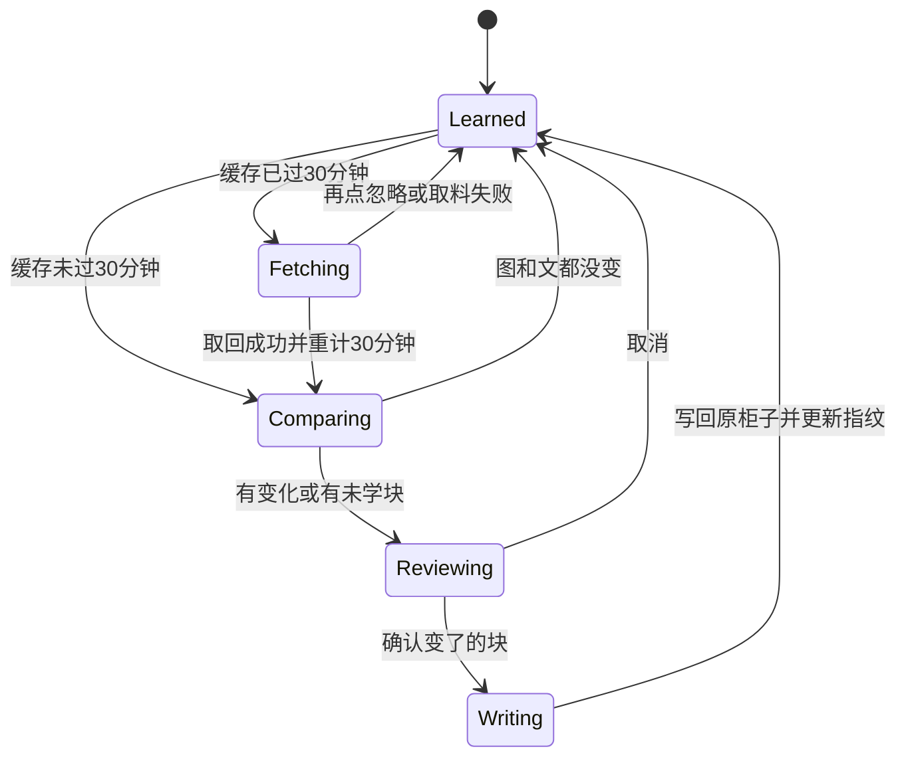

# PRD: 对标笔记反复学，并从笔记走进去

| 属性 | 值 |
|------|----|
| 状态 | 工程：accepted（见文末「工程验收状态」） |
| 范围 | 资料库对标笔记浏览与重新学习。Release 0 |
| 顺序号 | 00017 |
| 来源需求 | 飞书 `20261110_0012`（record `reczz28XouksvjKP`）；表上产品类型为 Dexbuddy客户端，负责人指定由本仓处理 |
| 关联文档 | `specs/prds/prd-00012-learn-xhs-note.md`、`docs/workflows/one-post-studio.md`、`docs/DESIGN.md`、`docs/workflows/feishu-demand-to-prd.md`、`AGENTS.md` |

## 背景与问题

运营已经能从资料库「新建 → 对标笔记」贴链接，拆进对标文案与风格图册（见 `specs/prds/prd-00012-learn-xhs-note.md`）。学完之后只有四个按素材类型分的柜子：风格、我们的图、对标文案、产品资料。人找不到「我学过哪些笔记」；同一链接再贴会被 `ALREADY` 直接拦住，原笔记在小红书上更新后也没法再学。

飞书原描述希望：能看见学过的对标笔记历史；原笔记更新后仍可删后重传或重新学习。本期在此基础上拍板：笔记是门，图和文是门后面的两个柜子；同一篇可以反复学，字节没变就不要再学一遍。

## 目标与非目标

### 目标（Release 0）

1. 同一 `noteId` 可以反复学：触发为再贴该链接，或在对标笔记浮层点「重新学」。
2. 取料缓存保留，成功取回后 30 分钟内复用；超时才再向插件取；取料进行中的同一篇忽略连点。
3. 图片比下载后文件字节 MD5；文案比 trim 后标题加正文的文本哈希。没变的不调用学图、不改写对标文案；变了的写回原来的 `albumId` / `articleSampleId`。
4. 资料库 Tab 行末尾增加「对标笔记」卡墙（顺序：风格、我们的图、对标文案、产品资料、对标笔记）；点卡开浮层看这篇学过的图与文。
5. 浮层不写第二套编辑器：改图的学法进风格图册「怎么画」；改文的学法进对标文案那一条。
6. 从笔记删这篇：删链接并删掉名下图册与对标文案。从风格或对标文案删掉一条：笔记还在，浮层对应块显示已删除。

### 非目标

- 定时后台去小红书扫更新。
- 「忽略缓存、马上再取一次」的第二按钮。
- 浮层里直接改「怎么画」或改正文。
- 没变也重跑识图。
- 一张笔记学出第二本图册、第二条对标文案。
- 改四个旧 Tab 的格子与空状态。
- 把「以前的笔记」（自己写过的稿）与对标笔记合成一页。
- 一次学完笔记内全部内页（仍只学一张内页）。
- 改飞书产品类型、描述、优先级等非「需求状态」字段。
- Release 2 及更高。

## 术语

| 术语 | 含义 |
|------|------|
| 对标笔记 | 从公开小红书链接学进本仓的一篇；链接资源在 `runtime/materials/xhs-notes/` |
| noteId | 小红书笔记身份；短链与长链解析到同一 id 即同一篇 |
| 内容指纹 | 已学图的文件 MD5、文案的文本哈希；记在链接 `meta.json` |
| 取料缓存 | `runtime` 下按 noteId 存的 `payload.json`；成功取回才写，时效 30 分钟 |
| 写回 | 变了的内容覆盖原来那本图册或那条对标文案，不另开第二份 |
| 学法 | 图侧「怎么画」、文侧对标正文；在原柜子编辑，不在笔记浮层另抄一份 |

## 已拍板规则

| 项 | 决定 |
|----|------|
| 身份 | 仍认 `noteId` |
| 触发重新学 | 再贴链接；或浮层「重新学」。打开卡墙 / 浮层不取料。无后台巡检 |
| 缓存时效 | 成功取回后 30 分钟；失败不刷新时效；无「强制绕过缓存」按钮 |
| 进行中锁 | 同一篇正在取料时再点忽略，返回现有 `IMPORTING` 语义；按钮保持忙 |
| 图片比较 | 下载后文件字节 MD5；不比 URL |
| 文案比较 | trim 后标题 + 正文的文本哈希 |
| 没变 | 不学图、不改对标文案；全部没变 toast「这篇没变」 |
| 变了 | 经现有确认后写回原 `albumId` / `articleSampleId` |
| 补学 | 上次没学、这次勾上 → 按首次新建写入 |
| 取料失败 | 已学内容原样留下 |
| 缺指纹旧数据 | 第一次重新学不标成「有更新」吓人，也不静默覆盖手改过的怎么画；确认后补指纹 |
| Tab 顺序 | 风格、我们的图、对标文案、产品资料、**对标笔记**（末尾）；默认仍开「风格」 |
| 编辑 | 浮层只展示；改学法跳到风格 / 对标文案现有详情 |
| 从笔记删除 | 删链接 + 名下图册 + 对标文案；不删「我们的图」「产品资料」；旧稿快照不改写 |
| 从柜子删除 | 笔记记录仍在；浮层该块显示已删除 |
| 内页 | 仍只学一张 |

## 用户与角色

| 角色 | 目标 |
|------|------|
| 账号运营 | 从笔记找回学过的图文；原笔记更新后只重学变了的部分 |
| 提需求同事 | 飞书看到状态变为进行中，再变为已完成 |
| 工程 | 改 resolve / import、链接 meta 指纹、资料库 Tab 与浮层；复用学图与对标文案编辑 |

## 功能域

1. **重新学与比较**：推翻 00012「第二次贴上就停」；进缓存时效 → 取料或复用 → MD5/文本哈希比较 → 勾选层标「没变 / 有更新」。
2. **写回原柜子**：变了的图/文走现有确认，落回原 album / article-sample。
3. **对标笔记 Tab**：卡墙列表、详情浮层、跳转改学法、删除级联。
4. **指纹与缓存元数据**：链接 `meta.json` 增加内容指纹；缓存记录成功取回时间。

## 用户故事地图与版本切片

### 旅程主干

| 步 | 人在做什么 | 起止 |
|----|------------|------|
| Entry | 资料库打开「对标笔记」Tab，或新建再贴已学链接 | |
| 1 | 卡墙看见学过的笔记（封面 / 标题 / 上次学习时间） | |
| 2 | 点卡开浮层：左图右文，不进编辑 | |
| 3a | 点「改这张的学法」→ 风格图册「怎么画」 | Exit（编辑） |
| 3b | 点「改这篇文案」→ 对标文案那一条 | Exit（编辑） |
| 4 | 点「重新学」或再贴链接 | |
| 5 | 30 分钟内用缓存比较；过期才取料；进行中再点忽略 | |
| 6a | 全部没变 → toast「这篇没变」 | Exit |
| 6b | 有更新或补学 → 勾选层 → 只处理勾上的变了的块 → 写回 | Exit |
| 7 | 点「删除」→ 确认后删链接与名下图文 | Exit(Teardown) |

### 用户故事地图

| 阶段 | 目标 | 故事 | 验收要点 |
|------|------|------|----------|
| 浏览 | 从笔记找素材 | 作为运营，我想在资料库末尾「对标笔记」里看见学过的笔记卡墙，以便按笔记找回图文 | Tab 顺序末尾为对标笔记；默认仍开风格；卡墙网格与「以前的笔记」同档；空列表「还没有对标笔记。」 |
| 浏览 | 看学习详情 | 作为运营，我想点卡开浮层看见这篇学过的图和文，以便确认学了什么 | 左图可翻 + 当前张两行怎么画；右标题、可点原链接、可滚正文；不直接进编辑 |
| 编辑 | 改学法回原柜 | 作为运营，我想从浮层改图的学法或文的学法，以便仍用现有编辑器 | 「改这张的学法」关浮层并打开风格该册详情；「改这篇文案」打开对标文案该条；保存落在原柜子 |
| 重学 | 挡连点 | 作为运营，我想卡了连点时不要不停取小红书，以便不把通道打爆 | 取料进行中再点忽略；成功后 30 分钟内用缓存比较不再取 |
| 重学 | 只学变了的 | 作为运营，我想原笔记更新后再学时跳过没变的图文，以便不浪费识图 | 勾选层标没变/有更新；没变默认不勾且不可硬学；有更新默认勾；确认后写回原 id |
| 重学 | 全部没变 | 作为运营，我想内容没变时立刻知道，以便不用空跑流程 | toast「这篇没变」；不进学习写入 |
| 删除 | 从笔记清掉 | 作为运营，我想删这篇对标笔记时清掉它名下的图和文，以便柜子不留孤儿 | 删链接 + 名下图册 + 对标文案；不碰我们的图/产品资料；旧稿快照不动 |
| 删除 | 从柜子删一条 | 作为运营，我从风格或对标文案删掉一条后，笔记页仍能看见这篇并标已删除 | 链接仍在；浮层对应块显示已删除 |

### Release 0（MVP）

- 反复学 + 30 分钟缓存 + 进行中锁 + MD5/文本比较 + 写回原柜子。
- 资料库末尾「对标笔记」卡墙与详情浮层；改学法跳转；删除级联。
- 推翻 00012「第二次贴上就停」；00012 其余（勾选、一张内页、写稿走对标文案）不动。
- **本期不做**：见非目标。不设 Release 1。

## 核心流程与状态机图

### 重新学流程图

### 链接学习状态图

死胡同预警：取料失败必须回到 `Learned` 且不丢已学内容；缺指纹旧数据不得静默覆盖「怎么画」。

## 界面（用户心智）

资料库 Tab 末尾「对标笔记」。人先以笔记为前提进来，再决定改图的学法或文的学法。

卡墙：与「以前的笔记」同一网格（`aspect-[3/4]`，窄屏 3 列到大屏 8 列）。封面优先学过的首图，否则内页，再否则正文缩略。卡下两行标题、一行上次学习时间。点卡开浮层，不进编辑。空列表：「还没有对标笔记。」并可用新建里的「对标笔记」。

浮层左图右文（小红书详情式，非表格）：

- 左：学过的图可翻；当前张下两行「怎么画」+「改这张的学法」。
- 右：标题、可点原链接、可滚正文 +「改这篇文案」。
- 右下整篇动作：「重新学」「删除」。

「改这张的学法」关浮层 → 切风格 Tab → 打开该图册现有详情。「改这篇文案」→ 切对标文案 → 打开该条。四个旧 Tab 陈列不动。

## 数据与 API 衔接

- 链接 `meta.json`：在现有 `learned.articleSampleId` / `learned.albums[{albumId, role}]` 上增加每张图 `contentMd5`、文案文本哈希、上次学习时间等字段（工程定具体键名）。
- 取料缓存：成功取回写 `payload.json` 与取回时间；比较与预览可读缓存；超过 30 分钟的重新学才调插件。
- 桥方法：扩展现有 `resolveXhsNote` / `importXhsNote`（或等价）；学图仍 `learnAlbum` / `commitAlbum`；列表与详情需能列出链接并解析关联图册/对标文案是否仍存在。
- 删除：笔记侧级联删链接名下图册与对标文案；柜子侧单删不级联删链接。

## 假设与待确认

| 项 | 说明 |
|----|------|
| 假设 | 飞书该行虽标 Dexbuddy客户端，负责人已指定本仓实现 |
| 假设 | 30 分钟对连点足够；运营接受窗口内看不到站上刚改的内容，除非等过期后再学 |
| 待与工程对齐 | 指纹与缓存时间字段名；写回图册是整册重学确认还是仅换样图字节 |
| 冲突 | 与 `prd-00012`「第二次贴上就停」冲突；以本 PRD 为准；00012 其余不变 |
| 开放 | 验收后走 `feishu-demand-writeback` 将 `20261110_0012` 标已完成 |

## 修订记录

| 日期 | 说明 |
|------|------|
| 2026-11-11 | 初稿。来源飞书 `20261110_0012`；反复学、30 分钟缓存、对标笔记 Tab 末尾、写回原柜子。 |
| 2026-11-11 | 工程验收 accepted（R0）；交付 commit `8c58cfc`。 |

## 1. 工程验收状态

> 由 `/team:prd-accept` 维护；勿手工编造「通过」。最后更新：2026-11-11T09:51:47Z，`prd/xhs-learned-notes`@`8c58cfc`，范围：R0。

### 总览

- **工程状态**：`accepted`
- **验收判定**：Release 0 范围内能力均有代码与单测证据；本轮对话内运营路径（删后关浮层、学图留对标笔记、去 token、有 token 才可点开）已按反馈修完。Cursor 浏览器无 Dex Buddy 插件页，**未再跑 UI 冒烟**；用户确认无额外待测项后关闭本 PRD。
- **最近验收**：2026-11-11T09:51:47Z
- **代码提交**：分支 `prd/xhs-learned-notes`；交付 commit `8c58cfc`
- **摘要**：
  1. 对标笔记 Tab / 卡墙 / 详情浮层与跳转改学法、级联删除已落地。
  2. 30 分钟按 noteId 缓存、指纹比较、allUnchanged、写回原柜子、缺指纹补指纹有单测。
  3. 空取料不覆盖可学缓存；取料/入库规范链；详情仅带 `xsec_token` 可点。
  4. 学图时切对标笔记 + 全局扫图/草稿浮层，不打断风格 Tab 浏览。

### Release 交付

| Release | 状态 | 说明 |
|---------|------|------|
| R0 | 通过 | MVP 全量；PRD 声明不设 R1 |
| R1 | 范围外 | 本期不做 |

### 功能验收清单（Agent 优先读此表）

| ID | 能力摘要 | Release | 状态 | 证据 |
|----|----------|---------|------|------|
| F01 | 资料库末尾「对标笔记」Tab；默认风格 | R0 | 通过 | `src/studio/static/pages/library.js` Tab 顺序；`library.html` 卡墙 |
| F02 | 卡墙封面/标题/学习时间；空态文案 | R0 | 通过 | `learned-notes.js` + `listLibraryXhsNotes` |
| F03 | 详情浮层左图右文；改学法跳原柜 | R0 | 通过 | `learned-notes.js` `editCurrentAlbum` / `editArticle` |
| F04 | 再贴/重新学；推翻 ALREADY | R0 | 通过 | `resolveXhsNote` / `importXhsNote`；`tests/xhs-note/run-import.test.js` |
| F05 | 30 分钟 cache 按 noteId；进行中 IMPORTING | R0 | 通过 | `src/xhs-note/cache.js`；`cache-ttl.test.js`；run-import 缓存用例 |
| F06 | MD5/文本哈希比较；没变 toast；变了写回原 id | R0 | 通过 | `fingerprint.js` / `compare.js`；run-import allUnchanged / 写回用例 |
| F07 | 缺指纹 missing_fp 补指纹不吓人覆盖 | R0 | 通过 | run-import `missing_fp` 用例；`xhs-note.js` 勾选逻辑 |
| F08 | 从笔记删除级联图文；柜子单删笔记仍在 | R0 | 通过 | `deleteLibraryXhsNote`；get 浮层 `articleMissing` / album missing |
| F09 | 空取料不污染缓存（交付加固） | R0 | 通过 | `hasLearnableNoteContent`；run-import 空取料三用例 |
| F10 | 规范链入库；有 token 才可点开（交付加固） | R0 | 通过 | `canonicalExploreUrl` / `pickOpenableXhsUrl`；links + HTML |

### 未完成与遗留

- 飞书 `20261110_0012` 验收回填：随本轮提交后执行 writeback。
- 本轮未在 Dex Buddy 插件页做自动化 UI 复测（浏览器无插件页）；若发版前要再冒烟，手动验删浮层 / 学图留对标笔记 / 详情链可点即可。

### 质量检查

| 检查项 | 状态 |
|--------|------|
| 测试 | 聚焦 `tests/xhs-note/{run-import,links,cache-ttl,compare,fingerprint,split*,note-id}.test.js`：**35 通过**；全量含 `register-host` 在沙盒写 Chrome 清单会 EPERM（环境限制，非本 PRD 回归） |
| Lint | 本仓无 lint 命令，记 N/A |
| 文档与 OpenAPI | `docs/workflows/one-post-studio.md` / `docs/doc_index.md` 已同步；无 OpenAPI，跳过 |

---
统计：通过 10 / 部分 0 / 未实现 0 / 范围外 1（R1）
