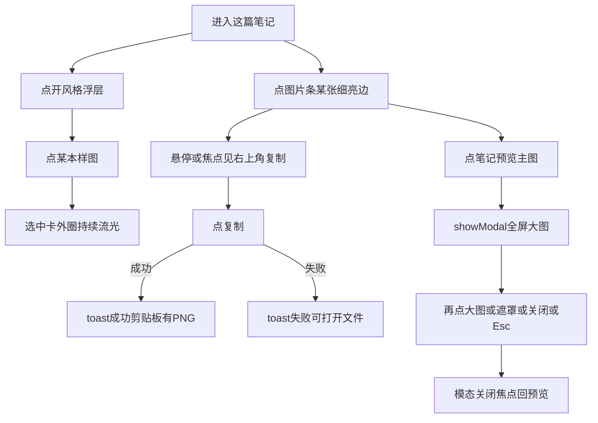
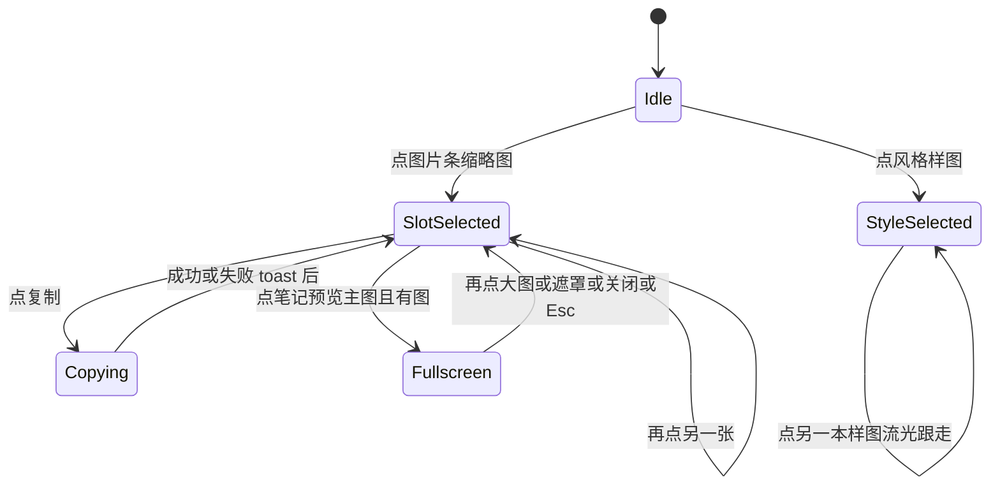

# PRD: 成稿图选中更醒目，并支持复制与全屏

| 属性 | 值 |
|------|----|
| 状态 | 工程：accepted（见文末「工程验收状态」） |
| 范围 | 写笔记页「这篇笔记」成稿图片条与笔记预览主图。Release 0 |
| 顺序号 | 00018 |
| 来源需求 | 飞书 `20261111_0015`（record `reczz28YLtmXIp8C`，产品缺陷）与 `20261112_0016`（record `reczz28YZeUXcfJO`，需求改进 · 中 P1）；产品类型均为 `DX-小红书增长引擎`；提出人 / 负责人为布鲁托 |
| 关联文档 | `docs/workflows/one-post-studio.md`、`docs/DESIGN.md`、`AGENTS.md` |

## 背景与问题

运营在「这篇笔记」里核对封面与配图时，图片条当前张只靠细描边表示选中，和未选中挤在一起时很难一眼看出选的是哪张（飞书 `20261111_0015`）。成稿后要发到手机端小红书，今天只能点「打开文件」再经 QQ 倒手，链路长、容易漏传或发错（飞书 `20261112_0016`）。右侧「笔记预览」主图只能看缩略，核对细节时没有全屏入口。

两则需求都落在同一块写笔记交互上，收成一份 PRD。事后修正：外圈流光挂在「风格」浮层选中样图格并持续旋转；图片条只保留细亮边选中、复制与全屏。

## 目标与非目标

### 目标（Release 0）

1. 「风格」浮层里当前选中的样图格外侧有醒目流光：亮段持续绕外框转（约 1.5 秒一圈、`infinite`）；系统「减少动态」时不转，只留静止亮边。
2. 图片条当前张与历史版本选用格用细亮边表示选中，**不做**外圈流光。
3. 每张已有图的图片条缩略图右上角有复制图标；点一下把该张当前选用的图片写入系统剪贴板（PNG）。右下角刷图按钮位置与行为不变。
4. 点右侧「笔记预览」里的主图，打开全屏模态看这张图；再点大图、点遮罩、点关闭或按 Esc 收起。
5. 复制成功 / 失败都给出现有 toast 可见文案；失败时仍可用「打开文件」。

### 非目标

- 改「我们的图」勾选方块、比例格的选中样式。
- 资料库卡墙、「以前的笔记」、对标笔记内页单选的选中或复制 / 全屏。
- 「封面预览」主图全屏。
- 历史版本小格上单独放复制钮。
- 从图片条二次点击进入全屏。
- 自动发小红书、代发 QQ、或把整篇文件夹一键打包。
- 一闪一闪的频闪选中；不为持续流光加暂停按钮（减少动态时改为静止亮边）。
- 改飞书产品类型、描述、优先级等非「需求状态」字段。
- Release 2 及更高。不设 Release 1。

## 术语

| 术语 | 含义 |
|------|------|
| 图片条 | 「这篇笔记」工具卡里横向一排成稿缩略图（封面 + 配图） |
| 当前张 | 图片条上 `selectImage` 选中的那一张；右侧笔记预览主图跟它 |
| 选用版本 | 某一张槽位当前用于预览 / 复制 / 打开的那一版文件（含刚点选的历史版本） |
| 外圈流光 | 风格浮层选中样图外侧亮段持续绕框旋转；减少动态时只留静止亮边 |
| 复制这张 | 把选用版本的位图以 PNG 写入系统剪贴板 |
| 全屏模态 | 原生 `<dialog>` 模态，内容为当前张大图 `object-contain`，不是整只手机框 |

## 已拍板规则

| 项 | 决定 |
|----|------|
| 范围 | 风格浮层选中流光；成稿图片条复制；笔记预览主图全屏。我们的图 / 资料库 / 比例选中样式不动 |
| 选中动效 | 风格浮层选中卡外圈亮段 `transform: rotate` 约 1.5 秒一圈、`infinite` 持续转；不频闪；图片条不做流光 |
| 减少动态 | `prefers-reduced-motion: reduce` 时不转，只留静止亮边；选中指示不得因关动画而消失 |
| 切换当前张 | 点缩略图仍走现有 `selectImage`；复制钮、刷图钮不改变当前张 |
| 复制位置 | 图片条缩略图右上角；刷图留在右下角 |
| 复制对象 | 该槽当前选用文件；无图 / 生成中 / 失败不放复制钮 |
| 剪贴板 | `navigator.clipboard.write` + PNG `ClipboardItem`；不用 `writeText` 冒充图片 |
| 复制反馈 | 成功 / 失败都用现有 toast；反馈期间不禁用复制钮；失败保留「打开文件」 |
| 复制可见性 | 有 hover 的设备默认透明，悬停、焦点或反馈期间显现；触摸设备保持可见；只用透明度藏 |
| 全屏入口 | 仅笔记预览主图；图片条不二次点击进全屏 |
| 全屏实现 | 原生 `<dialog>` + `showModal()`；`closedby="any"`；再点大图也关；可见关闭按钮 |
| 全屏内容 | 当前张大图 `object-contain`；无图时点预览不开模态 |
| 背景滚动 | `dialog:modal` 与 `::backdrop` 用 `overscroll-behavior: contain`；不锁 `html`/`body` overflow |
| 平台关闭 | Esc / 系统返回交给原生模态；不手写焦点陷阱，不加 `role="dialog"` / `aria-modal` |

## 用户与角色

| 角色 | 目标 |
|------|------|
| 账号运营 | 一眼看出选中哪张；一键复制图发到手机；全屏核对细节 |
| 提需求同事 | 飞书两行需求进同一份 PRD，修完后可分别回写状态 |
| 工程 | 改 `note.html` / `note.js` 与选中样式；复用现有 toast；不动资料库页 |

## 功能域

1. **选中流光**：风格浮层选中样图格的持续外圈动效与减少动态时的静止亮边。
2. **复制图片**：图片条缩略图右上角按钮、PNG 剪贴板写入、成功 / 失败反馈。
3. **全屏预览**：笔记预览主图触发原生模态、关闭路径、滚动隔离。

## 用户故事地图与版本切片

### 旅程主干

| 步 | 人在做什么 | 起止 |
|----|------------|------|
| Entry | 已进入「这篇笔记」 | |
| 1 | 点开「风格」，选中样图外圈持续流光；点图片条另一张细亮边跟上，右侧预览跟上 | |
| 2 | 悬停或焦点到缩略图，右上角看见复制图标 | |
| 3a | 点复制 → toast 成功，可粘贴到 QQ / 其他应用 | Exit（复制） |
| 3b | 点复制失败 → toast 失败，可改点「打开文件」 | Exit（复制失败） |
| 4 | 点笔记预览主图 → 全屏模态打开 | |
| 5 | 再点大图 / 点遮罩 / 点关闭 / Esc → 模态关闭，焦点回到触发处 | Exit(Teardown) |

### 用户故事地图

| 阶段 | 目标 | 故事 | 验收要点 |
|------|------|------|----------|
| 选中 | 看清选中风格 | 作为运营，我想风格浮层里当前样图外侧一直有流光，以便立刻知道选的是哪本 | 仅选中样图有外圈流光；约 1.5 秒一圈持续转；未选中无壳；减少动态时只留静止亮边 |
| 选中 | 切换风格跟走 | 作为运营，我想点另一本样图后流光跟到新卡上，以便确认切换成功 | 点样图切换 `selectedLook`；图片条细亮边选中；复制 / 刷图不改当前张 |
| 复制 | 一键拿图 | 作为运营，我想点缩略图右上角复制图标，把这张图放进剪贴板，以便发到手机端 | 右上角复制、右下角刷图；写入 PNG；成功 toast；无图 / 生成中 / 失败无复制钮 |
| 复制 | 失败可退 | 作为运营，我想复制失败时仍能打开文件，以便不卡死发图 | 失败 toast；「打开文件」仍可用；反馈期间复制钮不禁用 |
| 全屏 | 核对细节 | 作为运营，我想点笔记预览主图全屏看这张图，以便核对文字与构图 | 仅笔记预览主图可开；模态内为大图 contain；无图不开 |
| 全屏 | 快速收起 | 作为运营，我想再点一下或按 Esc 收起全屏，以便马上继续改稿 | 再点大图、点遮罩、关闭按钮、Esc 均可关；关后回到笔记页 |

### Release 0（MVP）

- 风格浮层选中样图：外圈持续流光；尊重减少动态（静止亮边）。
- 成稿图片条 / 历史版本选用格：细亮边选中，不做流光。
- 图片条右上角复制 PNG；刷图位置不变；成功 / 失败 toast。
- 笔记预览主图 → 原生全屏模态；再点 / 遮罩 / 关闭 / Esc 收起。
- **本期不做**：见非目标。不设 Release 1。

## 核心流程与状态机图

### 成稿图操作流程图

### 选中与全屏状态图

死胡同预警：减少动态时风格选中仍须可见静止亮边；全屏关闭必须回到可继续编辑；复制失败不得锁死在 `Copying`。

## 界面（用户心智）

- **风格浮层选中卡**：外侧持续绕框流光；减少动态时静止亮边。安全盾仍表示审核，不充当选中。
- **图片条当前张**：细亮边选中，无流光。历史版本选用格同规则。
- **复制**：缩略图右上角图标按钮（`aria-label`「复制这张图片」）；刷图仍在右下角近黑小方钮。
- **全屏**：深色遮罩上居中大图；可见关闭按钮；不是手机框再放大一倍。

实现时须同步更新 `docs/DESIGN.md`「这篇笔记」小节中风格浮层、图片条与预览相关描述（开发阶段，不在本 PRD 落盘动作内改代码）。

## 数据与 API 衔接

- 风格选中：沿用 `selectedLook` / `selectAlbumStyle`；流光纯 CSS，不新增业务字段。
- 图片条选中：沿用现有 `activeSlot` / `slotSelected` / 历史版本 `versionChosen`；细亮边样式。
- 复制：读取该槽当前预览或文件路径，转成 PNG blob 后 `clipboard.write`；宿主若已有读文件桥则复用，禁止用标题正文冒充图片。
- 全屏：页内一个 `<dialog>`，打开时绑定当前张预览 URL；关闭不改稿、不切槽。
- Toast：复用操作台现有 success / error toast 组件。

## 假设与待确认

| 项 | 说明 |
|----|------|
| 假设 | 用户口中的「样图 / 图库」在截图语境下指成稿图片条当前张；风格浮层与我们的图勾选不在本期 |
| 假设 | 本机 studio / Dex Buddy 插件页为安全上下文，剪贴板 API 可用；权限被拒走失败 toast |
| 假设 | 目标浏览器支持原生 `<dialog>`；`closedby` 缺失时用指针落点兜底 light dismiss |
| 待与工程对齐 | PNG 转换路径（canvas / 已有预览 blob / 宿主读文件）；历史版本文件与槽位预览一致性 |
| 开放 | （已关闭）飞书 `20261111_0015`、`20261112_0016` 已回写「已完成」 |

## 修订记录

| 日期 | 说明 |
|------|------|
| 2026-11-12 | 初稿。合并飞书 `20261111_0015` 与 `20261112_0016`；成稿图外圈流光选中、右上角复制 PNG、笔记预览主图全屏。 |
| 2026-11-12 | 工程验收 accepted（R0）；分支 `prd/image-select-copy-preview`（验收时尚未 commit）。 |
| 2026-11-12 | 修正：流光改到风格浮层选中样图并改为持续旋转（修转一圈就停）；图片条恢复细亮边选中，保留复制 / 全屏。文末验收章仍记 R0 当时取证，以本修订为准。 |

## 1. 工程验收状态

> 由 `/team:prd-accept` 维护；勿手工编造「通过」。最后更新：2026-11-12T07:24:28Z，`prd/image-select-copy-preview`@`52d5569`（工作区含未提交修正），范围：R0,R1。

### 总览

- **工程状态**：`accepted`
- **验收判定**：Release 0 范围内能力均有代码证据；产品方本会话口头验收通过。R1 未定义，标范围外。
- **最近验收**：2026-11-12T07:24:28Z
- **代码提交**：分支 `prd/image-select-copy-preview`；基线 commit `52d5569`；风格流光修正与文档仍在工作区未 commit
- **摘要**：
  1. 风格浮层选中样图 `style-glow-ring`，`1.5s linear infinite` 持续流光；减少动态时静止亮边
  2. 成稿图片条 / 历史版本仅细亮边选中，无流光；右上角复制 PNG（`clipboard.write` + `image/png`）
  3. 笔记预览主图原生 `<dialog>` 全屏可关
  4. DESIGN / workflow / doc_index / 本 PRD 修订已同步；飞书两需求另行回写已完成

### Release 交付

| Release | 状态 | 说明 |
|---------|------|------|
| R0 | 通过 | 风格流光、复制 PNG、全屏预览 |
| R1 | 范围外 | 本 PRD 未定义 R1 |

### 功能验收清单（Agent 优先读此表）

| ID | 能力摘要 | Release | 状态 | 证据 |
|----|----------|---------|------|------|
| S2-1 | 风格浮层选中样图持续外圈流光 | R0 | 通过 | 代码：`note.html` 选中卡 `style-glow-ring`；`index.html` `animation: style-glow-spin 1.5s linear infinite`；`prefers-reduced-motion: no-preference` 才转；产品方口头验收通过 |
| S2-2 | 图片条当前张细亮边选中（无流光） | R0 | 通过 | 代码：`slot-thumb.is-selected` 仅 `box-shadow: 0 0 0 2px`；无 `slot-glow`；历史版本同规则 |
| S2-3 | 右上角复制 PNG，成功 / 失败 toast | R0 | 通过 | 代码：`onCopySlotImage` → `ClipboardItem` `image/png`；toast「已复制」/「没有复制成功」；刷图仍在右下角；此前会话曾实测写出 PNG blob |
| S2-4 | 笔记预览主图全屏，可关闭 | R0 | 通过 | 代码：`#note-image-fullscreen` + `showModal` / `close`；遮罩点击与 Esc；此前会话 UI 实测可开可关 |

### 未完成与遗留

- 工作区改动尚未 git commit；`accepted_commit` 待提交后补。
- 内嵌浏览器未聚焦时系统剪贴板可能拒写，需在聚焦窗口再点复制确认。

### 质量检查

| 检查项 | 状态 |
|--------|------|
| 测试 | N/A（本仓无测试命令） |
| Lint | N/A（本仓无 lint 命令） |
| 文档与 OpenAPI | DESIGN / workflow / doc_index / PRD 修订已同步；无 OpenAPI |

---
统计：通过 4 / 部分 0 / 未实现 0 / 范围外 1（R1）
