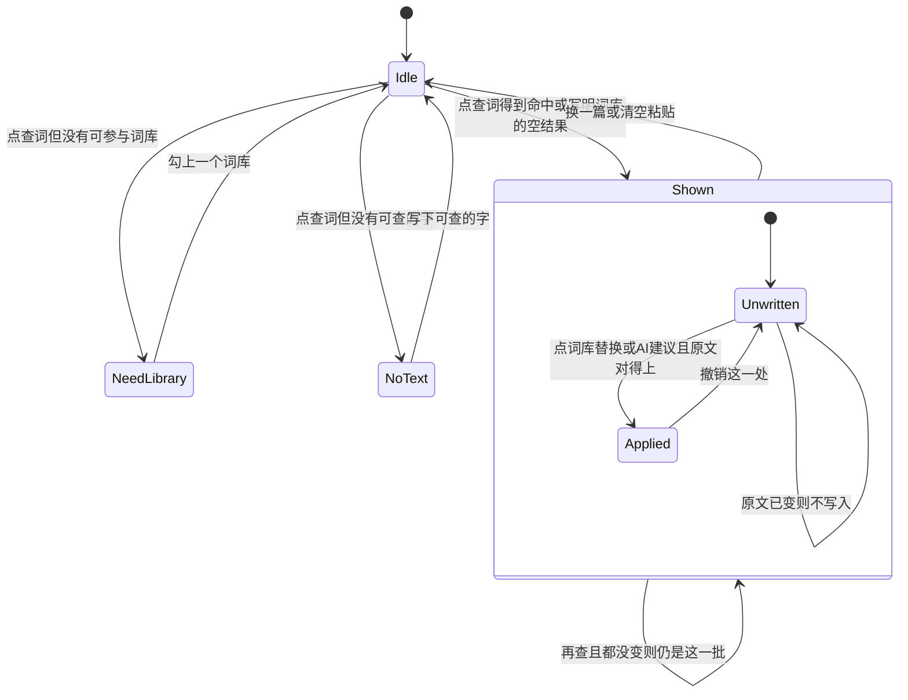
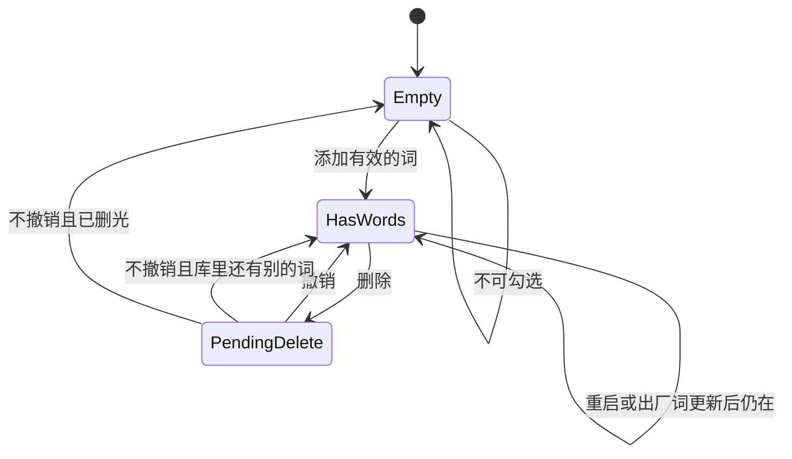
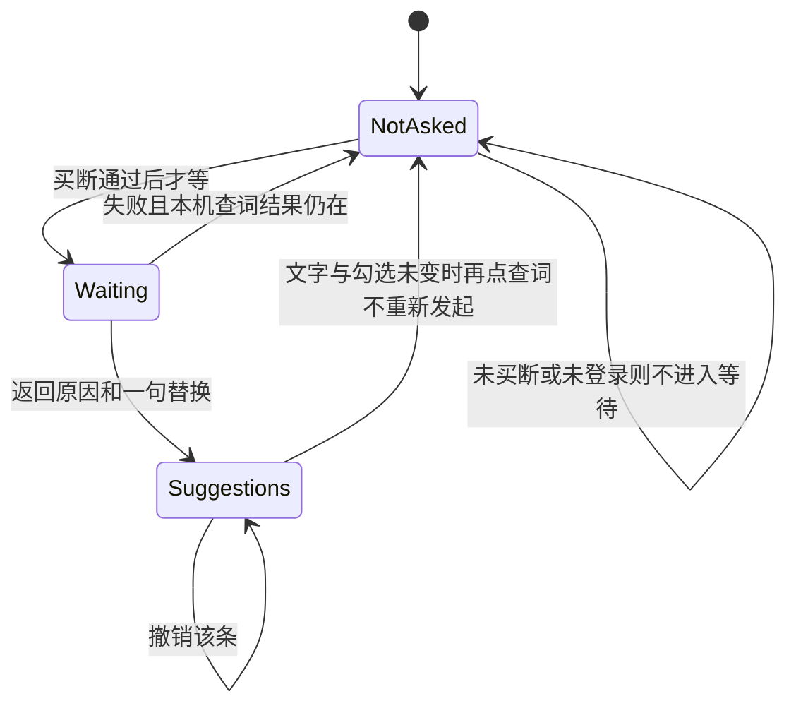

# PRD: 发之前查危险词

| 属性 | 值 |
|------|----|
| 状态 | 工程：accepted（见文末「工程验收状态」） |
| 范围 | 这篇笔记的标题、正文、话题，以及侧栏「危险词」页上粘贴的一段文字。Release 0 本机查词；Release 1 才出现「用 AI 再看一遍」 |
| 顺序号 | 00019 |
| 关联文档 | `docs/mvp-map.md`、`docs/workflows/one-post-studio.md`、`docs/workflows/image-prompt-safety.md`、`docs/DESIGN.md`、`specs/prds/prd-00009-sdk-entitlement-gates.md`、`specs/prds/prd-00015-studio-plain-copy.md` |

来源是试验场交接说明（不入库）。本篇是增长引擎里的正式 PRD。无飞书需求 ID。

## 背景与问题

运营已经在「写笔记」里写好标题、正文、话题，下一步是自己复制到小红书去发。发出去之前，他们要知道哪些说法不能发、哪些说法最好改口。

侧栏里已有一项「危险词」，目前未开放。若另做一套叫「敏感词 / 标准查词」的工具，写完还得整段复制过去再查一遍，同一条规则会有两个名字。

生图提示词已有单独的说法对照（`docs/workflows/image-prompt-safety.md`）。笔记上看得见的字和画图用的说法不是同一份词，不能混用。

## 目标与非目标

### 目标（Release 0）

1. 写成笔记进入「这篇笔记」后，自动用当前勾选词库本机查标题、正文、话题，结果写入草稿；也可再点「查词」。词库指纹未变不重查；勾选变更要等再点「查词」。
2. 侧栏「危险词」打开后，用同一套词库、同一种说法、同一组勾选；可粘贴一段还没进笔记的文字来查。个人词的添加 / 搜索 / 删除在资料库「个人词」Tab，不在查词主路径。
3. 查之前就能看见：查的是哪些字、在本机、不走模型。
4. 有命中时，列表和原文标记是同一批；点一条就到那几个字。无命中时写明这次查了哪些库。
5. 人可以自己改字。某条若带词库替换，点了才改那一处，并可撤销。原文已经对不上时不写入。
6. 查出「不能发」也不禁用「复制这篇」。

### 目标（Release 1）

1. 标准查词之外，另有一次「用 AI 再看一遍」：每处给原因和一句合规替换。
2. 买断通过后立刻落 `risk.ai` 任务 ID（`status=running`）并返回可取回；不占成稿 `job.running`。超时 / 断网后页面轮询 `loadLatest` 取回；本机查词结果不冲掉。建议不点不改字。点一条只改一处，可撤销。不做全部替换。

### 非目标

- 谐音、拆字、表情、零宽字符等规避写法，以及教人「怎样改完还能过审」。
- 图片内文字、封面图风险、整篇图文「查内容」。
- 自动改完全部命中、自动发布、自动重试直到无命中。
- 爬取或搬运转发零克、小红书或其他第三方词库。
- 抖音 / B 站 / 医疗等专库。
- 第二套付费货币。付费只沿用现有买断。
- 批量养号、自动评论私信、与捞客仓对接。
- 把这一次的命中存成可按编号回查的查词档案。
- 与生图说法对照库共用、互相改写。
- Release 2 及更高版本。

## 术语

| 术语 | 含义 |
|------|------|
| 危险词 | 侧栏与本功能的名字。界面不叫「敏感词」「标准查词」。 |
| 查词 | 两处入口上的同一个动作。旁边写清这次查的范围。 |
| 不能发 / 要改口 | 仅有的两档严重程度。汇总、列表、原文标记都用这两词。 |
| 处 | 计数单位。一处 = 一个字段里一段起止位置。不用字数口径。 |
| 词库替换 | 出厂词上可选的一句合规说法。没有这句就不出现该按钮。 |
| AI 建议 | Release 1 才有。和词库替换分开标，不合成一条。 |
| 个人词 | 用户自己加的词，长期留在本机。 |
| 这篇笔记 | 当前可编辑稿的标题、正文、话题。 |
| 这段文字 | 危险词页粘贴区里的字，不是某篇笔记。 |

## 已拍板规则

| 项 | 规则 | 状态 |
|----|------|------|
| 可见名 | 危险词、查词、不能发、要改口、个人违禁词库、词库替换。两处入口同一套说法 | 已定 |
| 范围先写明 | 查词控件旁直接写：这篇查标题、正文、话题；危险词页查这段文字。不含图片，不含生图提示词。并写明：查词在本机，不走模型 | 已定 |
| 词库 | 广告法极限词、站外引流、违禁表达默认勾选。个人词有词才可勾，默认勾选；空库时该项在，但不可勾、不参与 | 已定 |
| 勾选存在哪 | 四项勾选记在本机，笔记旁和危险词页是同一组。重启后还在。改勾选只记偏好、不立刻查；点「查词」才按新勾选本机查。「查词」一直可点 | 已定 |
| 点查词即出结果 | 默认勾选已生效。点「查词」就查，不必先再确认一遍词库。成稿进入这篇后也会自动本机查，结果进 `draft.risk.check` | 已定 |
| AI 可取回 | Release 1：先写 `risk.ai.id` 再烧模型；超时轮询 `loadLatest` 取回，不复用 `job.running` | 已定 |
| 个人违禁词库入口 | 资料库 Tab「个人违禁词库」维护；危险词页与笔记旁只查词 / 勾选，不增删 | 已定 |
| 至少一个库 | 没有可参与的词库时不能开查，并说明先勾一个 | 已定 |
| 匹配 | 只回当前文字里命中的词，不回整库。最长优先：命中「最好」后，不再把其中的「好」另报一条 | 已定 |
| 同一处一条 | 出厂词与个人词打到同一处时只报一条。出厂库也勾着时归出厂库；只勾个人词时归个人词 | 已定 |
| 列表第一层 | 每条写出：字段（标题 / 正文 / 话题，或「这段文字」）、词、词库名、不能发或要改口。同一词多处各占一条。出现次数不占第一层 | 已定 |
| 汇总 | 只写「不能发 N 处 / 要改口 M 处」，与列表条数一致 | 已定 |
| 空结果 | 有可查的字但无命中：写明这次查了哪些库，以及「这篇没有危险词」或「这段没有危险词」。关掉的库不算进「没有」 | 已定 |
| 没有可查的字 | 标题、正文、话题都空，或粘贴区为空：说明没有可查的字。不说成没有危险词 | 已定 |
| 定位 | 点列表一条，对应字段里该处被选中或高亮，视口滚到附近 | 已定 |
| 再查 | 点「查词」时：文字或勾选变了，词库结果换成新的一批；都没变则保留这一批并用成功 toast 说明无需重复查询。视口留在人正在改的地方；还在的那一处保持选中 | 已定 |
| 词库替换 | 点一条才写入该处。写入前留得住原文，可撤销回改前。原文那几个字已经变了、对不上时不写入，并说明这处已经变了 | 已定 |
| 复制 | 仍有不能发也不禁用「复制这篇」。复制仍是人手点 | 已定 |
| 粘贴 | 粘贴区与笔记正文互不覆盖。查词和替换只发生在粘贴区。改完的这段可以复制走，不写回任何笔记 | 已定 |
| 个人词 | 在资料库「个人词」可添加、搜索、删除。每词最多 50 字；一次最多 100 条。超长的那几条不加入，并指出是哪几条；没超长的照常加入。空行跳过。搜索只缩小维护列表，不改勾选、不清库 | 已定 |
| 删除个人词 | 删除后立刻可点撤销，把这个词加回来。不撤销就不再参与之后的查词。不默认清空词库 | 已定 |
| 留存 | 个人词和勾选重启后还在。出厂词库更新时，个人词、勾选、当前这篇原文都留着。本机命中写入 `draft.risk.check`（含指纹）；不写进笔记正文 | 已定 |
| 字数 | 标题超 20、正文字数变红，查词仍可做 | 已定 |
| 出厂词从哪来 | 首批由产品 / 运营编写。禁止爬零克返回、禁止爬小红书或第三方整表 | 已定 |
| 与生图对照 | 两套词库不共用、不互相改写 | 已定 |

### Release 1 追加规则

| 项 | 规则 | 状态 |
|----|------|------|
| 另一次动作 | 「用 AI 再看一遍」不藏在查词里。Release 0 不显示这个按钮 | 已定 |
| 买断 | 与 `prd-00009` 同一闸门：工作台里未买断或未登录，这一轮不开始、不进入等待、不出现半份建议；购买和登录只由工作台弹框。独立运行直接放行。查词、复制、维护个人词不查买断 | 已定 |
| 结果分块 | 笔记页：本机命中与 AI 建议标在标题/正文原文（红标）；悬停浮窗给原因与建议，点「替换」或「放弃」。不在危险词区另开开放建议列表。粘贴查词页仍用紧凑卡 | 已定 |
| 写入 | 不自动改稿。点一条只改那一处。可撤销。不做全部替换。对不上当时的字则不写入，并说明这处已经变了 | 已定 |
| 失败与改字 | AI 失败或买断未过时，本机查词结果留在原地。客户端超时则显示取回并轮询；指纹对不上的建议不展示、不写入 | 已定 |
| 查词与 AI 共存 | 自动或手动本机查词只更新 `risk.check`；不冲掉 `running` 或仍带 Idempotency-Key 的可重放 `error`。AI 只跟正文指纹：正文未变时改词库勾选不冲掉 `done` 建议，词库与 AI 两套标叠加；`done` 且正文指纹不符时可置 `idle` 作废旧建议。取回轮询只认本轮 `risk.ai.id` | 已定 |
| 替换口径 | 只给合规说法，不给规避写法 | 已定 |
| 重复点击 | 正文与勾选都没变时，再点不重新发起本机查词或 AI，顶部成功 toast「没有变化，无需重复查询」。正文未变则不重跑 AI。已有 `running` 任务时再点只取回 | 已定 |

## 用户与角色

| 角色 | 目标 |
|------|------|
| 写笔记的人（主要） | 复制去发之前，在这篇上看见不能发和要改口，自己改完或点一条替换 |
| 维护个人词的人（同一人或同事） | 把自家忌讳说法加进个人词，下次查词能打到 |
| 先查草稿的人 | 还没写成笔记时，在危险词页粘贴一段先查，不把这段写进某篇 |
| 工作台宿主 | Release 1 在 AI 开始前弹出购买或登录；插件不画这句文案 |

## 功能域

### 这篇笔记旁

- 范围句与「查词」放在当前这篇上，和标题、正文、话题、复制这篇同一屏能看见。
- 四个词库勾选与危险词页共用。
- 结果区：汇总、列表、原文上的标记。无命中用空结果文案，不用空白。
- Release 0 的替换只有「词库替换」。Release 1 再增加 AI 那一块。

### 危险词页

- 侧栏「危险词」从隐藏改为可进入。可见名仍是「危险词」。
- 同上的四个勾选；页内链到资料库改个人词。
- 一块粘贴区。查词、定位、词库替换、复制这段，都只作用在这块上。

### 资料库 · 个人词

- 添加 / 搜索 / 删除 / 撤销删除。
- 数据仍在本机 `runtime/risk/`；查词勾选立刻能用上新词。
- 不提供「写回某篇笔记」。

### 出厂词与个人词

- 出厂词字段语义：词、所属库、不能发或要改口、可选的一句词库替换。存储形态由工程定。
- 个人词字段语义：词。严重程度固定为要改口，除非添加时人指定不能发。默认要改口。
- 个人词不是出厂词的出口，不能从这里导出或覆盖出厂词。

## 用户故事地图与版本切片

### 旅程主干

| 步 | 人在做什么 | 起止 |
|----|------------|------|
| 1 | 写好这篇的标题、正文、话题 | Entry |
| 2 | 看见查词范围：标题、正文、话题；本机，不走模型 | |
| 3 | 点「查词」 | |
| 4 | 看汇总和列表；点一条到原句 | |
| 5 | 自己改字，或点一条词库替换（可撤销） | |
| 6 | 再点「查词」，人仍停在正在改的地方 | |
| 7 | 自己点「复制这篇」去发 | Exit |
| 8 | （可选）打开侧栏「危险词」，改个人词或粘贴一段先查，复制这段离开 | 危险词页 Entry / Exit |

取消替换：点撤销，该处回到改前。关掉某个库：勾选记下，下次点查词才按新勾选出结果。删个人词：可撤销；不撤销则之后不再命中。

### 故事地图（Release 0）

1. 作为写笔记的人，我想在这篇上点一次「查词」，以便复制去发前看见不能发和要改口。
   - 验收：点「查词」直接出结果，没有单独的「确认词库」步。至少有一个库可参与才能开查，否则有说明。有命中时每条第一层有字段、词、词库名、不能发或要改口。无命中时写明查了哪些库，并写「这篇没有危险词」。三个字段都空时写没有可查的字。

2. 作为写笔记的人，我想在点查词之前就知道查的是什么、走不走模型，以便不用猜。
   - 验收：控件旁能看见「标题、正文、话题」「本机，不走模型」「不含图片和生图提示词」。

3. 作为写笔记的人，我想点结果里的一条，以便跳到原文那几个字。
   - 验收：点一条后，对应字段里该处被选中或高亮，视口在附近。列表条数与原文标记是同一批处。

4. 作为写笔记的人，我想关掉某一类词库再查，以便只看我关心的一类。
   - 验收：关掉「广告法极限词」后再查，该类不再出现。勾选在笔记旁和危险词页一致，重启后还在。只改勾选、不点查词，当前结果不自己跳。

5. 作为写笔记的人，我想自己改字，或只点一条词库替换，以便发出去的字是我确认过的。
   - 验收：不点替换时原文不变。点一条只改那一处，撤销回到改前。该处字已经变了则不写入，并写「这处已经变了」。没有词库替换的条目不出现替换按钮。仍有不能发时「复制这篇」可点。

6. 作为写笔记的人，我想改完再查一次，以便确认还剩哪些，且不被拉回列表顶部。
   - 验收：再查后视口留在正在改的字段。文字和勾选都没变时，结果仍是这一批，并成功 toast「没有变化，无需重复查询」。还在的命中保持选中。

7. 作为维护个人词的人，我想添加、搜索、删除自家忌讳说法，以便下次查词能打到。
   - 验收：添加后个人词可勾且立刻能被查到。删除后可撤销；不撤销则不再命中。空库时个人词不可勾。每词最多 50 字；一次最多 100 条；超长条不加入并指出是哪几条，其余加入。搜索只缩小列表。重启后个人词还在。出厂词更新不删个人词、不改勾选、不改这篇原文。

8. 作为先查草稿的人，我想在危险词页粘贴一段还没进笔记的文字来查，以便不必先生成整篇。
   - 验收：粘贴区与笔记正文互不覆盖。结果只针对这段。词库替换和改字只发生在粘贴区。这段可以复制走，不会写回任何笔记。空结果写「这段没有危险词」，并写明查了哪些库。

### 故事地图（Release 1）

9. 作为写笔记的人，我想在查词之后再点「用 AI 再看一遍」，以便看到每处原因和一句合规替换，且稿子不会被偷偷改掉。
   - 验收：Release 0 的页面上没有这个按钮。点了之后，未买断或未登录时不进入等待、没有半份建议，购买或登录只由工作台弹框。通过后才等待。每条有原因、一句替换、标「AI 建议」和「还没改」。点一条只改该处，状态变为「已改这一处」，可撤销。无全部替换。对不上则不写入。AI 失败时本机查词结果仍在。文字和勾选未变时再点查词不重新发起 AI。

### Release 0 可验收结果

这篇笔记上点「查词」得到与原文标记一致的命中或写明查了哪些库的空结果；点一条能定位；个人词可增删且空库不可勾；危险词页粘贴不写回笔记；有不能发仍可复制这篇。不出现 AI 按钮。

### Release 1 可验收结果

在 Release 0 之上，买断通过后「用 AI 再看一遍」给出分块的原因和一句替换；不点不改字；点一条可撤销；失败不冲掉本机查词结果。

本期不做的能力见非目标。不定义 Release 2。

## 核心流程与状态机图

```mermaid
flowchart TD
  entry[这篇已有标题正文话题]
  scope[旁边写明范围与本机不走模型]
  click[点查词]
  libs{有可参与的词库?}
  needLib[说明先勾一个词库]
  blank{有可查的字?}
  noText[说明没有可查的字]
  match[本机最长优先且同一处只一条]
  empty[写明查了哪些库且没有危险词]
  hits[列表与原文标记同一批处]
  locate[点一条滚到该处]
  hand[人自己改字]
  canReplace{这条有词库替换且原文仍对得上?}
  writeOne[只改这一处]
  stale[不写入并说明这处已经变了]
  undo[撤销回到改前]
  recheck[再点查词且视口留在正在改的地方]
  copy[复制这篇仍可点]
  aiBtn[Release1 点用AI再看一遍]
  gate{买断通过?}
  noWait[不进入等待且本机结果仍在]
  aiWait[等待后另块给出AI建议]
  aiFail[失败且本机结果仍在]

  entry --> scope --> click --> libs
  libs -->|否| needLib
  libs -->|是| blank
  blank -->|否| noText
  blank -->|是| match
  match -->|无命中| empty --> copy
  match -->|有命中| hits
  hits --> locate
  hits --> hand --> recheck
  hits --> canReplace
  canReplace -->|是| writeOne --> undo --> recheck
  canReplace -->|否| stale
  recheck --> copy
  hits --> aiBtn --> gate
  gate -->|否| noWait
  gate -->|是| aiWait
  aiWait -->|失败| aiFail
  aiWait -->|返回| canReplace
```

查词结果贴在当前文字上，不另建档案。换一篇、清空粘贴或离开后，这一批结果不再挂在旧文字上；个人词和勾选还在。



个人词与这一次命中分开。删词不是死胡同：



Release 1 的 AI 与本机结果是两件事。未买断、失败、字已变，都回到「本机结果还在、建议未写入」：



## 数据与 API 衔接

| 能力 | 说明 |
|------|------|
| 出厂词 | 本仓可版本化的词表。字段语义见上。更新是增量换表，不重置个人词、勾选和笔记原文。路径由工程定 |
| 个人词 | 本机长期数据。增、删、撤销删除、搜索。不进笔记正文 |
| 勾选 | 本机一项设置，两处入口共用 |
| 查词 | 输入为当前勾选库 + 分字段文本。输出为处的列表：字段、起止、词、库、严重程度、可选词库替换。无命中时带上本次参与的库名 |
| 写入替换 | 只替换该起止位置；保存改前片段供撤销。对不上则拒绝写入 |
| AI | 仅 Release 1。输入为当前文字与已有命中摘要。开始前走 `prd-00009` 的 `requireEntitlement`。输出独立于本机命中列表 |
| 复制 | 沿用现有「复制这篇」。本功能不新增发布接口 |
| 生图对照 | 不读、不写 `image-prompt-safety` 的 `rewrites.json` |

页面仍是现有操作台：HTML、Alpine、daisyUI。业务放在 `src/` 的新包，不堆进 `src/studio`。具体包名与 bridge 方法由工程按 `docs/mvp-map.md` 的「源码和页面分开」来定。

## 假设与开放项

| 项 | 说明 |
|----|------|
| 假设 | 侧栏 `risk` / 「危险词」就是本功能入口，开放后 `ready` 为真 |
| 假设 | 买断闸门复用 `prd-00009`，不新做购买页 |
| 假设 | 出厂词首批词条在实现时由运营交表；本 PRD 不列具体词 |
| 开放 | 个人词添加时若不另选，严重程度为要改口 |
| 开放 | 原文标记的颜色只区分不能发与要改口，具体色值实现时对照 `docs/DESIGN.md` |
| 待与工程对齐 | 出厂词文件路径、个人词目录、勾选存在哪。验收看行为，不锁字段名 |
| 冲突与决议 | `docs/mvp-map.md` 原写「人改完再定稿 / 出：改过的这一篇」。本篇改为：有不能发也可复制；出口仍是人手复制去发的这一篇。地图 MVP-4 已改成同一说法 |
| 冲突与决议 | `prd-00015` 把危险词列为未上线菜单、不改文案。本篇只把该项从隐藏改为可进，可见名保持「危险词」，不改 `prd-00015` 历史正文 |

## 修订记录

| 日期 | 说明 |
|------|------|
| 2026-11-16 | 初稿。按试验场《查敏感词功能说明》写入；按产品 L4 把范围、计数、入口说法、再查现场、替换撤回和 AI 闸门收成一套。Release 0 本机查词，Release 1 才做 AI。 |
| 2026-11-16 | 工程验收：R0+R1 accepted；本机查词 / 个人词 / AI 再看一遍现场通过。 |
| 2026-11-16 | 查词好用改造：成稿自动本机查并进草稿；AI 任务 ID 可取回；个人词迁资料库 Tab。 |
| 2026-11-17 | 可见名改为「个人违禁词库」；AI 网关失败同 Idempotency-Key 重放取回。 |
| 2026-11-17 | 查词不冲 `running` AI；轮询只认本轮任务 ID，指纹过期给明确文案。 |
| 2026-11-17 | 笔记页改为文内红标 + 浮窗替换/放弃；去掉底部开放 AI 列表。 |
| 2026-11-17 | 文内三色：红待改、绿已替换可撤回、黄已放弃可再改；选区按原文重定位。 |

## 1. 工程验收状态

> 由 `/team:prd-accept` 维护；勿手工编造「通过」。最后更新：2026-11-16T08:38:35Z，prd/danger-word-check（工作区未提交），范围：R0,R1。

### 总览

- 工程状态：`accepted`
- 验收判定：Release 0 与 Release 1 故事主路径均有代码、HTTP 与 UI 证据
- 最近验收：2026-11-16T08:38:35Z / `prd/danger-word-check` / 取证 base `http://127.0.0.1:8770/`（本轮 `node scripts/run-studio.js --port 8770`）
- 摘要：
  1. `src/risk/` 本机匹配 + `runtime/risk/` 个人词/勾选；出厂词 `assets/risk/factory-words.json`
  2. 笔记旁与侧栏「危险词」同一套查词；点命中 `setSelectionRange` 定位；有不能发仍可「复制这篇」
  3. 个人词可添加 / 删除后撤销；粘贴区不写回笔记
  4. Release 1「用 AI 再看一遍」独立块；本机命中仍在；独立运行买断放行后出建议
  5. `pnpm run check:types` 绿；`tests/risk/*.test.js` 8/8 通过

### Release 交付

| Release | 状态 | 说明 |
|---------|------|------|
| R0 | 通过 | 本机查词、定位、个人词、粘贴页、词库替换与复制不锁 |
| R1 | 通过 | AI 再看一遍；建议分块；失败/等待不冲掉本机结果 |

### 功能验收清单（Agent 优先读此表）

| ID | 能力摘要 | Release | 状态 | 证据 |
|----|----------|---------|------|------|
| S2-1 | 这篇笔记可见范围句与「查词」 | R0 | 通过 | UI-see：`http://127.0.0.1:8770/` 这篇笔记危险词区 |
| S2-2 | 标题含「最好」点查词出命中并可定位 | R0 | 通过 | UI-click：查词后「标题 最好…」；selection=`最好`；HTTP `checkRisk` |
| S2-3 | 有命中时「复制这篇」仍可用 | R0 | 通过 | UI-see：`copy-post` disabled=false |
| S2-4 | 危险词页粘贴「加微信」命中且不写回笔记 | R0 | 通过 | UI-click：粘贴查词；结果「这段文字 微信」；粘贴仅留在本页 |
| S2-5 | 个人词添加后可查；删除出现撤销 | R0 | 通过 | UI-click：添加「自家忌讳词」；删除后「撤销」；HTTP personal check |
| S2-6 | 「用 AI 再看一遍」另块建议且本机结果仍在 | R1 | 通过 | UI-click + HTTP `reviewRiskWithAi`：本机命中仍在，AI 建议「还没改」 |
| — | 工作台未买断弹框 | R1 | 部分 | 独立运行闸门放行；未在工作台未买断账号复现购买弹框 |

### 未完成与遗留

- 工作台未买断 / 未登录场景未在本会话真机复现；独立运行下 AI 已通。遗留：Dex Buddy 工作台再点一次未买断账号确认 silenced。
- 验收时改动尚未 git commit，`accepted_commit` 待提交后补。

### 质量检查

| 检查项 | 状态 |
|--------|------|
| 测试 | 通过：`node --test tests/risk/match.test.js tests/risk/store.test.js`（8/8） |
| 类型检查 | 通过：`pnpm run check:types` |
| Lint | 本仓无 lint 命令，N/A |
| 文档与 OpenAPI | 已同步 `docs/DESIGN.md`、`docs/workflows/one-post-studio.md`、`docs/doc_index.md`；无 OpenAPI |

---
统计：通过 6 / 部分 1 / 未实现 0 / 范围外 0
