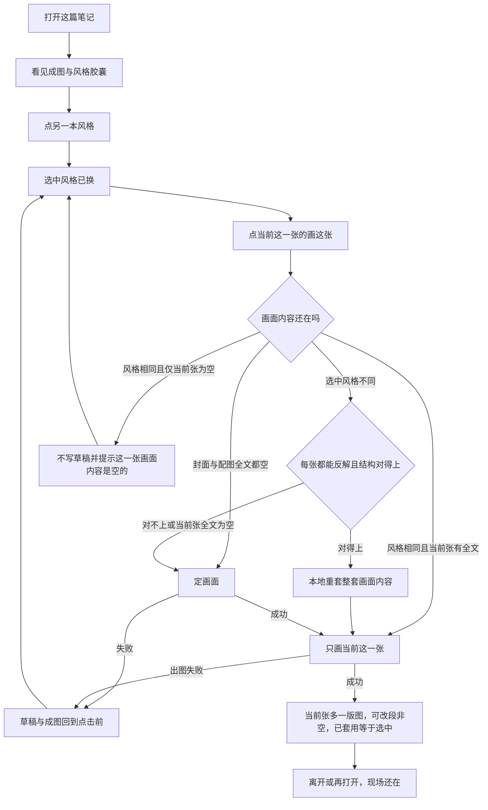
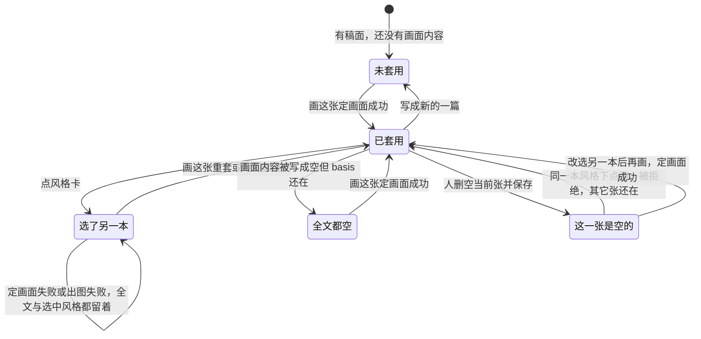

# PRD: 换风格后仍要有画面内容

| 属性 | 值 |
|------|----|
| 状态 | 工程：accepted（见文末「工程验收状态」） |
| 范围 | 「这篇笔记」里选风格、再点某一张的画这张。仅 Release 0 |
| 顺序号 | 00020 |
| 来源需求 | 飞书需求 ID `20261117_0022`（表 `1.0.DexBuddy-需求收集管理`，record `reczz28aiHTWrMHp`） |
| 关联文档 | `docs/workflows/one-post-studio.md`、`docs/DESIGN.md`、`specs/prds/prd-00010-image-prompt-on-refresh.md`、`specs/prds/prd-00015-studio-plain-copy.md`、`src/one-post/runner/draft-images.js`、`src/one-post/runner/helpers.js`、`src/prompts/album/editable.js`、`src/studio/static/pages/note/images.js`、`src/studio/static/pages/note/albums.js` |

## 背景与问题

姜思阳在 Windows 上的 Dex Buddy 0.14.0 里写笔记。截图（`temp/feishu-demand/20261117_0022/image.png`）停在「这篇笔记」，图片 2/2 上已有成图，风格胶囊显示「暗调人像白字封面」。点画图后，顶部出现「还没有这一张的提示词」。需求描述是：选好图文风格再画，没有画面内容，并提示画面内容缺失。

现场拿回的 `draft.json` 已核对：`prompts.look` 仍是 `100015.coverline.lowkey-bouquet-cover`（「暗调花束白色大字封面」）；`prompts.cover` 与 `prompts.gallery` 都是空字符串；`basis`、`galleryLines`、`coverLine` 还在；`stale` 为 false；`galleryCount` 与 `basis.galleryCount` 都是 1；封面与配图都已出图成功；`billing` 里策划与画面各跑过 2 次。图册目录里的 `prompt.md` 有题词。换任何一本风格，画面内容仍是空的。

点风格卡今天只改选中（`selectedLook`），不调模型、不写画面内容。这是 `prd-00010` 的既定动作。下一击「画这张 / 再画一张」才应该把选中风格套进整套画面内容，并只画当前这一张。

卡死点在于：`hasStampedPrompts` 只看见 `basis` 就当作已套词；`generateImages` 先把页面传来的空可改段写进草稿，再被 `slotBlockReason` 以「这一张全文为空」拒绝。定画面与换册重套排在这次拒绝之后，新风格的模板用不上。

## 目标与非目标

### 目标（Release 0）

1. 人在「这篇笔记」选了另一本风格，再点当前这一张的画这张：这一次先得到这一张可用的画面内容，再出这一张的新图。选中风格和已套用风格不同时，沿用 `prd-00010` 的换册规则（结构对得上就本地重套，对不上就为这一次定画面）。
2. 封面与全部配图的画面内容全文都为空时（`basis` 可还在）：同一次画这张先定画面，再画这一张。风格是否更换都一样。
3. 画这张没被接受，或定画面 / 出图失败时，点击前已经写在草稿里的画面内容全文保持原样。空的可改段不得先把非空全文抹成空。
4. 人当场能核对三件事：现在选中的风格、这本风格有没有写进画面内容、当前这一张的画面内容有没有字。缺的时候，提示说出是封面还是配图 n 的画面内容。用词与胶囊一致，写「画面内容」。
5. 同一本已套用风格下，其它张仍有全文、人只把当前这一张删空：这一张仍不单独出图。提示说明是这一张的画面内容是空的。其它张已有的画面内容留在草稿里。

### 非目标

- 只点风格卡就调模型或写画面内容。点卡仍只改选中。
- 一次画这张画出全部图。仍只画当前这一张。
- 改学图册、改题词 v2 槽位、改现场自学图册的文件。
- 批量迁移旧稿。旧稿靠下一次成功的画这张重定画面。
- 取消进行中的模型或生图。
- 改买断闸门、危险词、复制图片、全屏预览。
- 为「要发什么」的张数另做一套交互。这篇现场的张数一致，不是本次原因。

本篇只有 Release 0。上面这些留在非目标里。

## 术语

| 术语 | 含义 |
|------|------|
| 选中风格 | 风格胶囊上当前这本。存在页面的 `selectedLook`。点卡即写入，此时画面内容可以还是上一本。 |
| 已套用风格 | 已经写进这篇 `prompts.look` 的图册。 |
| 画面内容 | 这一张给人看、给人改的可改段，以及背后的存盘全文。胶囊名字是「画面内容」。 |
| 这一张 | 当前选中的封面或配图 n。 |
| 定画面 | `prd-00010` 里那次为整套写出画面内容的步骤。换册且文案结构对得上时改为本地重套，不调策划模型。 |

## 已拍板规则

| 项 | 决定 |
|----|------|
| 点风格 | 仍只改选中并收起浮层。不写画面内容，不调模型，不换已有成图。 |
| 选了另一本再画 | 这一次画这张必须先把选中风格落到整套画面内容（本地重套或定画面），再只画当前这一张。不得以「还没有这一张的提示词」结束这次点击。 |
| 封面与全部配图全文都空 | 不论风格是否更换，同一次点击定画面，再画当前这一张。`basis` 还在也不挡。 |
| 仅当前张全文已空，其它张仍有全文，且选中风格 ≠ 已套用 | 同一次点击走定画面（空槽无法本地重套），再画这一张。 |
| 仅当前张全文已空，其它张仍有全文，且风格就是已套用的那本 | 不画这一张。草稿里其它张的全文保持点击前的内容。 |
| 页面抽不出可改段 | 存盘全文仍非空且没有第 11 槽时，空可改段不得把它写成空。 |
| 写入时机 | 先判定这次点击会不会定画面 / 重套 / 出图。不会出图时，不把可改段写进草稿。 |
| 人故意删空 | 人在画面内容框里把这一张删空并失焦保存后，这一张全文可以是空的。这只影响这一张。紧接着的画这张按上表「仅当前张」或「全部都空」处理。 |
| 提示文案 | 面向人的句子用「画面内容」。点名封面或配图 n。成功出图后不保留这句。 |
| 成图 | 定画面或重套成功之前，已有成图留在槽位上。成功之后只追加当前这一张的新版本，不覆盖旧图。 |
| 风格胶囊 | 选中风格在轮询刷新后仍留在人点的那一本上。 |
| 买断 | 仍只在画这张被接受、即将出图时走现有闸门。被拒绝的那一次不弹购买。 |

## 用户与角色

| 角色 | 目标 |
|------|------|
| 运营（姜思阳，以及同一台操作台上的同事） | 换一本风格后再画当前这张，能看到这张的画面内容，并得到一张新图。 |
| 产品 / 排查 | 同一句提示对应同一种现场：哪一张、风格套上了没有、画面内容还在不在。 |

## 功能域

1. **接受画这张之前**（`src/one-post/runner/draft-images.js` 的 `generateImages`，`src/one-post/runner/helpers.js` 的 `slotBlockReason` / `hasStampedPrompts`）
   - 封面与全部配图全文都空：放行并定画面。`basis` 单独留着不算已套词。
   - 入参里的 `look` 参与判定。选中风格合法且与已套用不同：不因为当前槽全文为空而拒绝。
   - 当前槽全文为空、其它张仍有全文、风格相同：拒绝这一张；拒绝前不写可改段。
   - `embedEditablePrompt`：可改段为空时，没有第 11 槽的非空全文原样返回。
2. **定画面与重套**（`runRefreshThenDraw` / `tryRestylePrompts`）
   - 换册且每张都能反解、结构对得上：本地重套后画当前张。
   - 反解失败、结构对不上、全部全文为空、或当前张全文为空：定画面后再画当前张。
3. **页面**（`src/studio/static/pages/note/images.js`、`note/albums.js`、`note.html`）
   - 画这张仍把选中风格一并交给宿主。
   - 拒绝提示由宿主返回，页面用 toast 原样展示。文案遵守上表。
4. **文案**
   - 去掉对人可见的「还没有这一张的提示词」。
   - 仅当前张为空且风格未换：`配图 n 的画面内容是空的` / `封面的画面内容是空的`。

## 用户故事地图与版本切片

### 旅程主干

| 步骤 | 人在做什么 | 系统留下什么 |
|------|------------|----------------|
| Entry | 打开一篇已有稿面的笔记，停在「这篇笔记」 | 成图、画面内容、选中风格与草稿一致 |
| 选风格 | 点开风格，点中另一本，浮层收起 | 只更新选中风格；已套用风格、画面内容、成图不动 |
| 画这一张 | 点当前张的画这张 / 再画一张 | 先落画面内容，再追加这一张的新图 |
| 没画成 | 看到提示 | 点击前的画面内容还在；选中风格还在；旧图还在 |
| Exit | 离开这一张或关掉笔记 | 成功则这一张画面内容非空且已套用风格等于刚才选中的那本；未成功则草稿与点击前一致 |
| Teardown | 再打开同一篇 | 选中风格、已套用风格、每一张画面内容与离开时相同 |

### 故事地图

| 阶段 | 故事 | 验收要点 |
|------|------|----------|
| 换风格 | 作为运营，我想选另一本风格再画当前这一张，以便这张按新风格有画面内容并出图 | 选中风格 ≠ 已套用时，点击后出现定画面或本地重套；成功后当前张可改段非空，`prompts.look` 等于选中风格，当前张多一个成图版本 |
| 全文都空 | 作为运营，我想在封面与配图全文都空时直接画，以便系统补上画面内容再出图 | `basis` 还在也定画面；换风格与同风格都接受；不出现「还没有这一张的提示词」 |
| 故意删空一张 | 作为运营，我想只把这一张画面内容删掉，以便这一张不要沿用旧句子出图 | 同一本已套用风格下、其它张仍有全文时拒绝；提示含「画面内容」和封面或配图 n；其它张全文与点击前相同 |
| 抽不出可改段 | 作为运营，我想点画这张，以便系统不要把已有全文先擦掉 | 全文非空但没有 `11. 主题绘画内容` 时，空可改段嵌回后全文不变 |
| 失败留原样 | 作为运营，我想在定画面失败时回到刚才，以便不用重写画面内容 | 定画面或出图失败后，各槽全文与点击前一致；已有成图仍在 |

### Release 0

可验收结果：

1. `basis` 在、`cover` 与 `gallery` 都空，请求另一本合法图册：接受画图，会定画面，当前张可改段非空并出图。
2. 同上但风格不变：也定画面，不拿空全文直接出图。
3. 封面全文非空、配图为空、风格不变：拒绝配图，封面全文与点击前一致；提示为「配图 n 的画面内容是空的」。
4. 空可改段遇到没有第 11 槽的非空全文：全文不变。
5. 对人可见文案不再出现「还没有这一张的提示词」。

本篇没有 Release 1。

## 核心流程与状态机图

`选了另一本` 不是终态。定画面失败停在这一态，并带着点击前的画面内容。`全文都空` 与 `这一张是空的` 分开：前者整套重定画面，后者只拒绝当前张。

## 数据与 API 衔接

画这张仍走现有 `generateImages`。payload 继续带 `slot`、`index`、`look`、`promptEdits`。

宿主在拒绝时返回 `{ ok: false, message }`。`message` 使用本篇文案。被拒绝时不改 `prompts`，不改 `images`，不改 `job`。

成功路径仍由 `commitPrompts` 写下整套画面内容，再只生成当前槽的新版本。拒绝路径不调用 `applyPromptEdits`。

`saveEditor` 在人失焦保存时仍可把人删空的那一张写成空。

## 假设与开放项

默认假设（本篇按此落盘）：

1. 点风格本身继续不生成画面内容。要补上的是随后那一次画这张。
2. 现场草稿已核对：全文空、`basis` 在、图册题词在。本篇按这条路径修。
3. 截图胶囊上的「暗调人像白字封面」是选中风格；草稿里已套用的是「暗调花束白色大字封面」。不单独为某一本图册修题词。

开放项：

| 项 | 说明 |
|----|------|
| 全文最初怎么被写成空 | 可能是空可改段先落盘，或其它写入路径。本篇先堵住「空了之后画不出」；根因写入点可另查。 |

## 修订记录

| 日期 | 说明 |
|------|------|
| 2026-11-18 | 初稿。来源飞书 `20261117_0022`。 |
| 2026-11-18 | 按现场 `draft.json` 收窄：全文空且 `basis` 在；拿掉张数不一致目标。 |

## 1. 工程验收状态

> 由 `/team:prd-accept` 维护；勿手工编造「通过」。最后更新：2026-11-18T03:17:29Z，prd/album-switch-missing-prompt（工作区未提交），范围：R0。

### 总览

- 工程状态：`accepted`
- 验收判定：Release 0 闸门、定画面、拒绝不落盘、空可改段嵌回与文案均有代码 + 单测；空全文自愈路径有操作台 UI 证据
- 最近验收：2026-11-18T03:17:29Z / `prd/album-switch-missing-prompt` / base `http://localhost:8768` / 帖 `20261118-110530`
- 摘要：
  1. `hasStampedPrompts` 只看封面/配图全文，不再把单独的 `basis` 当成已套词
  2. `generateImages` 先 `slotBlockReason`，拒绝时不写可改段；换风格或全文都空时放行定画面
  3. `embedEditablePrompt`：没有第 11 槽的非空全文遇空可改段原样保留
  4. 对人可见拒绝句用「画面内容」；代码侧已无「还没有这一张的提示词」
  5. 操作台空全文点「再画一张」已定出封面/配图画面内容；同次真机出图遇 `UPSTREAM_ERROR`（环境，见遗留）

### Release 交付

| Release | 状态 | 说明 |
|---------|------|------|
| R0 | 通过 | 空全文定画面、换风格放行、仅当前张空拒绝不落盘、空可改段不抹全文、旧「提示词」文案已去掉 |
| R1 | 范围外 | 本篇无 R1 |

### 功能验收清单（Agent 优先读此表）

| ID | 能力摘要 | Release | 状态 | 证据 |
|----|----------|---------|------|------|
| R0-1 | `basis` 在、cover/gallery 全空，换风格再画：定画面且当前张可改段非空并出图 | R0 | 通过 | `tests/one-post/run.test.js`「basis 还在但画面内容全空：换风格再画会定画面」；`helpers.js` `hasStampedPrompts` / `slotBlockReason`；`draft-images.js` 先判后写 |
| R0-2 | 同上但风格不变：也定画面 | R0 | 通过 | 同文件「同风格再画也会定画面」；UI：`20261118-110530` 点封面「再画一张」后 cover/gallery 有字 |
| R0-3 | 封面非空、配图空、风格不变：拒绝配图且封面全文不变；提示「配图 n 的画面内容是空的」 | R0 | 通过 | 同文件「同风格下仅配图为空：拒绝且不抹封面全文」；`slotEmptyContentMessage` |
| R0-4 | 空可改段遇没有第 11 槽的非空全文：全文不变 | R0 | 通过 | `tests/prompts/album/editable.test.js`「空可改段不抹掉没有第 11 槽的非空全文」；`editable.js` `embedEditablePrompt` |
| R0-5 | 对人可见不再出现「还没有这一张的提示词」 | R0 | 通过 | 仓内实现文案仅「画面内容」系；`note.html` 空态为「还没有这一张的画面内容」；UI 无旧 toast |

### 未完成与遗留

- 开放项仍在：全文最初如何被写成空，可另查，不阻塞本篇关闭。
- 操作台 UI 自愈后出图撞 `UPSTREAM_ERROR`（定画面已成功、画面内容已落盘）；属上游/环境，非本篇闸门回退。可再点一次取回图。
- 验收时改动尚未 git commit，`accepted_commit` 待提交后补。

### 质量检查

| 检查项 | 状态 |
|--------|------|
| 测试 | 本仓无统一测试命令；相关用例见 `tests/one-post/run.test.js`、`tests/prompts/album/editable.test.js` |
| Lint | 本仓无 lint 命令，N/A |
| 文档与 OpenAPI | 已登记 `docs/doc_index.md`、`specs/prds/prd-wiki-index.md`；无 OpenAPI |

---
统计：通过 5 / 部分 0 / 未实现 0 / 范围外 1 |
