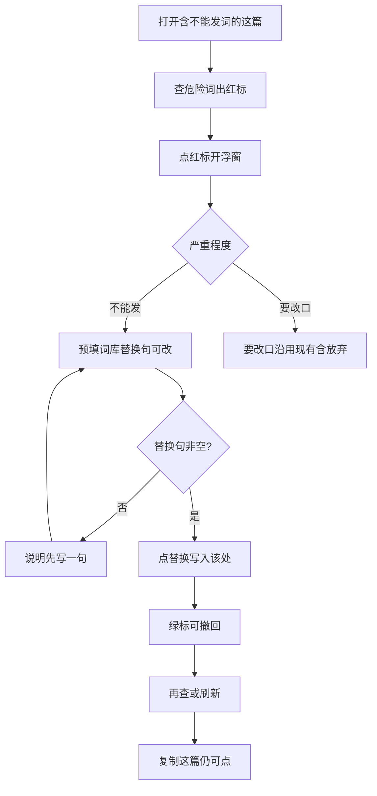
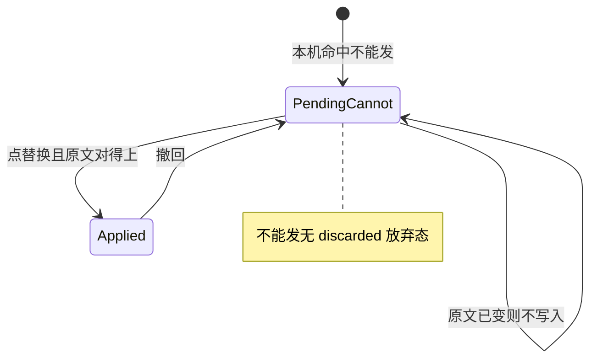

# PRD: 不能发必须可替换

| 属性 | 值 |
|------|----|
| 状态 | 工程：accepted（见文末「工程验收状态」） |
| 范围 | 「这篇笔记」本机危险词命中后，浮窗对「不能发」的替换闭环；出厂词库「不能发」必须带替换句；飞书规则镜像进 `docs/references/`。仅 Release 0 |
| 顺序号 | 00021 |
| 关联文档 | `specs/prds/prd-00019-danger-word-check.md`、`docs/workflows/one-post-studio.md`、`docs/DESIGN.md`、`docs/references/xhs-platform-forbidden-words.md`、`docs/references/xhs-violation-case-notes.md`、`assets/risk/factory-words.json`、`dex-buddy-plugin.pack`、`src/studio/static/lib/risk-client.js`、`src/studio/static/lib/risk-inline-mark.js`、`src/studio/static/pages/note.html` |

无飞书需求 ID。口述复现后立篇，后按现场拍板改为「必须可替换」。

## 背景与问题

运营在「这篇笔记」查危险词。命中「不能发」时，出厂词约 270 条里多数没有 `replacement`，浮窗只剩「放弃」。点放弃只把该处标黄（`uiState=discarded`），原文不动；汇总仍按服务端 `cannotCount`；再查或刷新后还是不能发。人以为处理完了，实际上发之前的死结还在。

`prd-00019` 已定：有不能发也不锁「复制这篇」；点一条才写入；「没有词库替换就不出现替换按钮」。对「要改口」尚可放弃观望；对「不能发」只放弃等于假解决。

两份小红书规则此前只从飞书临时拉取入库，仓内没有可复用的镜像，维护替换句时只能再翻飞书。插件安装包只应收运行时词表，不应把规则长文塞进用户安装物。

## 目标与非目标

### 目标（Release 0）

1. 「不能发」浮窗始终有可编辑的替换框与「替换」按钮：词库有默认句则预填，人可改；改完点「替换」才写入该处。
2. 「不能发」浮窗不出现「放弃」。不能发只许替换或人手改原文。
3. 点替换：只改该处，绿标，可撤回；原文已变则不写入并说明「这处已经变了」（沿用 `prd-00019`）。
4. 出厂词：每条 `severity=不能发` 必须有非空 `replacement`。工程验收时缺替换的不能发条数为 0。新增不能发词条不得无替换入库。
5. 两份飞书规则镜像进 `docs/references/`，登记索引；维护词库与 AI 复查提示时对照本地 Markdown。镜像**不进**插件安装包。
6. 有不能发仍不锁「复制这篇」（沿用 `prd-00019`）。

### 非目标

- 自动改完全部命中；谐音 / 拆字 / 教规避写法。
- 改匹配算法、新增第四词库、锁「复制这篇」、改买断闸门。
- 改「要改口」的放弃语义（要改口仍可放弃变黄）。
- 把飞书镜像 Markdown 打进 `dex-buddy-plugin.pack` 或任何用户安装包。
- 批量养号、自动发布、与捞客仓对接。
- Release 1 AI 建议细则另立；本篇不扩 AI。

## 术语

| 术语 | 含义 |
|------|------|
| 不能发 | 本机命中严重程度一档；与要改口并列。本篇主对象。 |
| 词库替换 | 出厂词上的默认合规说法，字段 `replacement`。 |
| 浮窗替换框 | 点红标后浮窗里可编辑的那一句；预填词库句，人可改后再点「替换」。 |
| 放弃 | 浮窗按钮。本篇起「不能发」不再提供；「要改口」仍可有。 |
| 规则镜像 | `docs/references/` 下飞书文档的本地 Markdown 副本，只供维护，不参与运行时查词。 |

## 已拍板规则

| 项 | 规则 | 状态 |
|----|------|------|
| 不能发主路径 | 词库默认替换句 + 浮窗可改后再点「替换」 | 已定 |
| 不能发 · 放弃 | 去掉；不能发只许替换或人手改原文 | 已定 |
| 要改口 · 放弃 | 沿用现有：仍可放弃变黄 | 已定 |
| 空替换框 | 替换句去掉首尾空白后为空时，「替换」不可点，并说明先写一句 | 已定 |
| 预填 | 有词库 `replacement` 则打开浮窗时预填；人改过的内容在关掉浮窗前保留在该次浮窗会话里 | 已定 |
| 写入与撤回 | 点「替换」才改该处；绿标；可撤回；对不上不写 | 已定 |
| 出厂债 | 既有「不能发」无替换的必须补齐；对照 `docs/references/` 两篇与现有有替换样例 | 已定 |
| 新增词条 | 新加 `不能发` 必须带非空替换；工程上缺字段视为不合格词条 | 已定 |
| 复制 | 有不能发仍可「复制这篇」 | 已定 |
| 规则镜像位置 | `docs/references/xhs-platform-forbidden-words.md`、`docs/references/xhs-violation-case-notes.md` | 已定 |
| 插件边界 | 运行时只用 `assets/risk/factory-words.json`；规则 Markdown 不进 `dex-buddy-plugin.pack` | 已定 |
| 可见名 | 继续用「替换」「放弃」（仅要改口）；不新增「忽略」 | 已定 |

## 用户与角色

| 角色 | 目标 |
|------|------|
| 写笔记的人（主要） | 对「不能发」一眼能改成合规说法，不用假装放弃 |
| 维护出厂词的人（产品 / 运营 / Agent） | 对照本地规则镜像补替换句，不必每次打开飞书 |
| 工程 | 按故事地图改浮窗与词库验收；保证 docs 不进安装包 |

## 功能域

### 这篇笔记 · 文内红标浮窗

- 命中「不能发」：展示词、库名、严重程度、可编辑替换框、「替换」；无「放弃」。
- 命中「要改口」：沿用现有（有替换可替换；可放弃）。
- 汇总仍写「不能发 N 处 / 要改口 M 处」；已替换变绿的处按现有绿标逻辑，不再占「未处理」观感（与 `prd-00019` 文内三色一致）。

### 出厂词库

- 文件：`assets/risk/factory-words.json`（进插件包，运行时用）。
- 每条不能发必须有 `replacement`；补齐时优先用规则镜像里的「建议替换」，无现成句则写一句合规、可公开发布的说法（禁止规避写法）。

### 规则镜像（仅维护）

- `docs/references/xhs-platform-forbidden-words.md` ← 飞书《小红书平台违禁词》
- `docs/references/xhs-violation-case-notes.md` ← 飞书《实操总结违规词与违规点》
- 文首含来源 URL、拉取时间、revision；不参与 `checkRisk` 匹配。

### 危险词页（粘贴）

- R0：粘贴查词对「不能发」同样必须能替换（有默认可预填；可改；无放弃）。若与笔记旁共用同一套浮窗 / 卡片控件，一并改；不得只修笔记旁。

## 用户故事地图与版本切片

### 旅程主干

| 步 | 人在做什么 | 起止 |
|----|------------|------|
| 1 | 打开含「不能发」词的这篇 | Entry |
| 2 | 自动或手动查危险词，看见红标与「不能发 N 处」 | |
| 3 | 点一处「不能发」红标，打开浮窗 | |
| 4 | 看见预填或自写的替换句，可改 | |
| 5 | 点「替换」，该处变绿；可撤回 | |
| 6 | 再点「查危险词」或刷新，已替换处按现有绿标 / 再查规则表现 | |
| 7 | 需要时复制这篇离开 | Exit |

取消：点撤回，该处回到改前。关掉浮窗不写入。空替换句不能点替换。

### 故事地图（Release 0）

1. 作为写笔记的人，我想对「不能发」直接看到可改的替换句并点「替换」，以便原文真的改成合规说法，而不是只变黄。
   - 验收：不能发浮窗有替换框与「替换」；无「放弃」。有词库句则预填。点替换后该处原文变为替换句，绿标，可撤回。

2. 作为写笔记的人，我想在词库默认句不通顺时自己改再替换，以便句子还读得通。
   - 验收：改框内文字后点「替换」，写入的是改后的句。框为空时「替换」不可点，有说明。

3. 作为写笔记的人，我不想对「不能发」再看到「放弃」，以免以为处理完了其实还不能发。
   - 验收：不能发浮窗没有「放弃」。要改口浮窗仍可有「放弃」。

4. 作为维护出厂词的人，我想每条不能发都自带默认替换，并对照仓内规则镜像补词，以便不用每次打开飞书。
   - 验收：`factory-words.json` 中 `severity=不能发` 且替换为空的条数为 0。`docs/references/` 两篇存在且索引已登记。`dex-buddy-plugin.pack` 仍不含 `docs/`。

5. 作为写笔记的人，我想在仍有未替换的不能发时照常复制这篇，以便自己决定发不发。
   - 验收：「复制这篇」可点（沿用 `prd-00019`）。

### Release 0 可验收结果

不能发浮窗可预填、可改、可替换、无放弃；出厂不能发零缺替换；两篇规则镜像在 docs 且不进插件包；要改口放弃行为不变；复制不锁。不定义 Release 1。

## 核心流程与状态机图

## 数据与 API 衔接

| 能力 | 说明 |
|------|------|
| 查词 | 沿用 `prd-00019`；命中带 `severity`、可选 `replacement` |
| 浮窗草稿句 | 仅页面态；点「替换」才调用现有写入路径 |
| 出厂词 | `assets/risk/factory-words.json`；不能发必填 `replacement` |
| 规则镜像 | 只读文档；不进查词 API |
| 插件包 | `dex-buddy-plugin.pack` 白名单不变；禁止加入 `docs/` |
| 复制 | 不新增接口 |

## 假设与开放项

| 项 | 说明 |
|----|------|
| 假设 | 用户说的「忽略」= 界面「放弃」；本篇对不能发取消该按钮 |
| 假设 | 补齐替换句可由工程 / Agent 对照两篇镜像与现有有替换样例批量起草，产品抽查通顺与合规 |
| 开放 | 危险词页卡片若与笔记旁控件不完全共用，工程保证行为一致即可，不强制同一 DOM |
| 开放 | 个人词标成不能发时，若无自带替换，浮窗仍给空框让人自写（与出厂「必须有默认句」分开） |
| 冲突与决议 | `prd-00019`「无词库替换则不出现替换按钮」对**不能发**废止；对要改口仍成立。不改 00019 历史正文，以本篇为准 |

## 修订记录

| 日期 | 说明 |
|------|------|
| 2026-11-19 | 初稿。立「不能发」点放弃无效的问题与复现原料。 |
| 2026-11-19 | 现场拍板：不能发 = 词库默认替换 + 浮窗可改；去掉放弃；出厂补齐替换；飞书两篇镜像进 docs 且不进插件包。覆盖改写本篇。 |
| 2026-11-19 | 工程验收：R0 accepted；出厂补齐 + 笔记旁/危险词页可改替换、不能发无放弃。 |

## 1. 工程验收状态

> 由 `/team:prd-accept` 维护；勿手工编造「通过」。最后更新：2026-11-19T07:25:30Z，prd/block-word-dismiss@18f4093（工作区未提交），范围：R0。

### 总览

- 工程状态：`accepted`
- 验收判定：Release 0 故事主路径均有 UI / HTTP / 单测证据
- 最近验收：2026-11-19T07:25:30Z / `prd/block-word-dismiss` / 取证 base `http://127.0.0.1:8768/`（本轮重启 `node scripts/run-studio.js --port 8768`）
- 摘要：
  1. `assets/risk/factory-words.json` 不能发零缺 `replacement`
  2. 笔记旁浮窗：不能发可编辑「替换成」+「替换」、无「放弃」；草稿句可改后写入绿标
  3. 危险词页粘贴：不能发可改替换、无放弃；点替换改粘贴区原文
  4. 规则镜像仍在 `docs/references/`；`dex-buddy-plugin.pack` 不含 `docs/`
  5. `node --test tests/risk/match.test.js` 9/9；`pnpm run check:types` 绿

### Release 交付

| Release | 状态 | 说明 |
|---------|------|------|
| R0 | 通过 | 出厂补齐、笔记旁与粘贴页不能发可替换、无放弃 |
| R1 | 范围外 | 本 PRD 未定义 R1 |

### 功能验收清单（Agent 优先读此表）

| ID | 能力摘要 | Release | 状态 | 证据 |
|----|----------|---------|------|------|
| S2-1 | 复现笔记不能发浮窗有替换框、无放弃 | R0 | 通过 | UI-see：打开 `【看危险词】…`；点「全网第一」见「替换成」预填「口碑较好的」、有「替换」、无「放弃」 |
| S2-2 | 改替换句后点替换，正文变绿 | R0 | 通过 | UI-click / Alpine：草稿改为「口碑不错的一档」后 apply；`body` 含新句、无「全网第一」；hit `uiState=applied`；绿标文案可见 |
| S2-3 | 出厂不能发零缺替换；命中带 replacement | R0 | 通过 | HTTP：`checkRisk` 四词均有 replacement；`node --test tests/risk/match.test.js` 含 prd-00021 两则断言 |
| S2-4 | 危险词页粘贴不能发可改替换、无放弃 | R0 | 通过 | UI-click：粘贴句后见四条「替换成」输入与「替换」；无「放弃」；点替换后粘贴区变为含「口碑较好的」 |

### 未完成与遗留

- 验收改动尚未 git commit；`accepted_commit` 为验收时 HEAD（`18f4093`），合入后可补新 commit。
- 部分默认替换句偏短，产品可再抽查润色；已修正易叠「的的」的几条（如「全网第一」→「口碑较好」）。
- Studio 启动时缓存出厂词；改 `factory-words.json` 后需重启 `run-studio` 才进运行时。

### 质量检查

| 检查项 | 状态 |
|--------|------|
| 测试 | 通过：`node --test tests/risk/match.test.js`（9/9） |
| 类型检查 | 通过：`pnpm run check:types` |
| Lint | 本仓无 lint 命令，N/A |
| 文档与 OpenAPI | 已同步 `docs/DESIGN.md`、`docs/workflows/one-post-studio.md`；无 OpenAPI；pack 仍不含 docs |

---
统计：通过 4 / 部分 0 / 未实现 0 / 范围外 0
