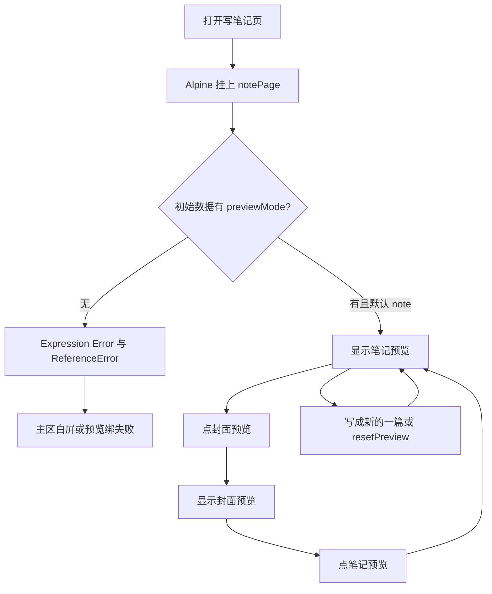
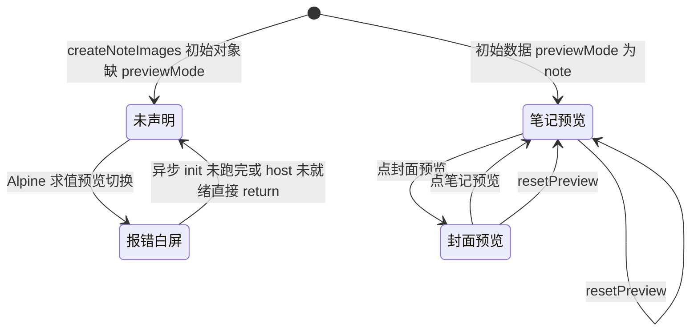

# PRD: 笔记预览须声明 previewMode

| 属性 | 值 |
|------|----|
| 状态 | 工程：accepted（见文末「工程验收状态」） |
| 范围 | 写笔记页右侧「笔记预览 / 封面预览」切换。仅 Release 0 |
| 顺序号 | 00022 |
| 来源需求 | 飞书需求 ID `20261120_0027`（表 `1.0.DexBuddy-需求收集管理`，record `reczz28bnEkUFTf7`） |
| 关联文档 | `docs/workflows/one-post-studio.md`、`docs/DESIGN.md`、`src/studio/static/pages/note.html`、`src/studio/static/pages/note/images.js`、`src/studio/static/pages/note.js` |

## 背景与问题

木子在 Windows 上打开已安装的「小红书增长引擎」0.16.0。截图 `temp/feishu-demand/20261120_0027/image_SgnPbz3SWoLOqhxXmMKc0AjOn47.png`：统一工作台左侧已选中「小红书增长引擎」0.16.0，主区标题栏有「小红书增长引擎」，其下整块内容区全白。另一张 `image_J1RdbJ0kjohOUHxXDlxcL6Qnn4d.png` 是宿主「通用设置」：关于里版本 0.20.1、本机数据目录在 `C:\Users\lzwsn\AppData\Roaming\dex-buddy`。需求描述正文附带 Dex Buddy 插件页诊断：资源失败无；控制台 6 条 Alpine Expression Error / Uncaught ReferenceError，表达式均为 `previewMode === 'note'|'cover'` 及其按钮 `:class` / `:aria-selected`。

同日本机 MacIntel、宿主 0.20.1、本地开发插件 `dev-1a7dc7326bf1b3d805a0e620d21db973` 0.16.0 复现同一组控制台报错。需求正文里宿主写作 0.21.0，与设置截图 0.20.1 不一致；本篇以截图与控制台表达式为准，宿主小版本差不改变根因。

根因：`note.html` 在 Alpine 挂上组件后立刻求值预览切换；`createNoteImages()` 初始对象没有 `previewMode`，只在异步 `resetPreview()`（`notePage().init()` 的 await 之后）赋值。Alpine 3 用 `with (组件数据)` 求值；根名字不在数据上会抛 `ReferenceError`。宿主还没就绪时 `init()` 直接 return，字段会一直缺失。

## 目标与非目标

### 目标（Release 0）

1. 打开写笔记页时，控制台不再出现 `previewMode is not defined`（Expression Error 与 Uncaught ReferenceError 一并消失）。
2. 右侧预览默认停在「笔记预览」；点「封面预览」可切过去，再点「笔记预览」可切回来。
3. 修法按 Alpine 维护者约定：根属性写在初始数据上，不依赖异步 `init` 事后赋值。

### 非目标

- 不安装社区包 `eslint-plugin-alpinejs`（公开规则只有 `no-raw-dom-access`、`no-unused-xrefs`、`prefer-template-x-if`，不能扫 HTML 表达式是否在 x-data 里）。
- 不自写 Alpine 表达式扫描器。
- 不把 `src/studio/static/` 整夹放进 `pnpm run check:types`（会先撞上页面脚本既有写法，且仍看不见 HTML 属性里的表达式）。
- 不改宿主「更新只清 HTTP 缓存、不清 localStorage」策略。
- 不改预览 UI、手机框比例、封面假发现页布局。
- 不回写飞书需求状态（开工 / 验收另走飞书需求管理工程师）。

本篇只有 Release 0。上面这些留在非目标里。

## 术语

| 术语 | 含义 |
|------|------|
| previewMode | 写笔记页右侧预览切换状态。取值 `'note'`（笔记预览）或 `'cover'`（封面预览）。 |
| 初始数据 | `notePage()` 展开后立刻交给 Alpine 的对象字段；含 `createNoteImages()` 返回的普通字段。 |
| Alpine Expression Error | Alpine 求值失败时的控制台 warning；常伴随 Uncaught ReferenceError。 |
| 插件页诊断 | Dex Buddy 宿主在插件页报错时贴出的摘要（宿主版本、插件 id、资源失败、控制台条目）。 |

## 已拍板规则

| 项 | 决定 |
|----|------|
| 修法 | 在 `createNoteImages()` 返回对象的数据字段里声明 `previewMode: 'note'`（与 `activeKey` 并列）。 |
| 默认值 | `'note'`，与现有 `resetPreview()` 一致。 |
| 赋值时机 | 初始数据已有字段；`resetPreview()` 仍可写回 `'note'`，不再是唯一写入点。 |
| Alpine 依据 | 维护者 [Discussion #1497](https://github.com/alpinejs/alpine/discussions/1497)、[#4505](https://github.com/alpinejs/alpine/discussions/4505)：根属性必须存在于作用域；指令可能在异步 `init` 完成前求值。 |
| 静态检查 | 现有 `pnpm run check:types` 不收页面。ESLint [`no-undef`](https://eslint.org/docs/latest/rules/no-undef) 与 TypeScript TS2339 只查 JS；最小样例上 `this.previewMode = "note"` 会报属性不存在，但看不见 `x-show="previewMode === 'note'"`。Alpine 官方仓库没有对应 ESLint 插件。本期不新增检查。 |
| HTML | 不改模板 6 处表达式；只补数据。 |
| 宿主 / 插件版本 | 0.16.0 插件 + 诊断无资源失败即可验收；不绑定某一宿主小版本。 |

## 用户与角色

| 角色 | 目标 |
|------|------|
| 运营（木子，以及同一插件上的同事） | 打开小红书增长引擎就能看见写笔记操作台，不是一片白。 |
| 排查 / 工程 | 控制台不再被同一组 `previewMode` 报错刷屏；修法可复述为「初始数据声明根属性」。 |

## 功能域

1. **页面数据**（`src/studio/static/pages/note/images.js`）
   - `createNoteImages()` 初始状态增加 `previewMode: 'note'`。
   - `resetPreview()` 继续设 `previewMode = 'note'`。
2. **模板绑定**（`src/studio/static/pages/note.html`）
   - 两个预览按钮的 `:class`、`:aria-selected`、`@click`。
   - 两个预览区的 `x-show`。
   - 本期不改这些表达式。
3. **组装**（`src/studio/static/pages/note.js`）
   - 仍 `...window.createNoteImages()`；对象展开带上普通字段。getter 仍留在 `note.js`。

## 用户故事地图与版本切片

### 旅程主干

| 步骤 | 人在做什么 | 系统留下什么 |
|------|------------|----------------|
| Entry | 在 Dex Buddy 打开「小红书增长引擎」或本机操作台写笔记 | 主区渲染写笔记壳；无 `previewMode` 报错 |
| 看见预览 | 看右侧手机框 | 默认笔记预览（`previewMode === 'note'`） |
| 切封面 | 点「封面预览」 | 封面假发现页显示；按钮高亮切换 |
| 切回笔记 | 点「笔记预览」 | 回到笔记预览 |
| Exit | 离开写笔记或关掉插件窗 | 无未捕获的 previewMode ReferenceError |
| Teardown | 再打开写笔记 | 仍默认笔记预览；控制台干净 |

### 故事地图

| 阶段 | 故事 | 验收要点 |
|------|------|----------|
| 打开 | 作为运营，我想打开增长引擎写笔记，以便立刻看到操作台而不是白屏 | 主区不再是整块空白；控制台无 `previewMode is not defined` |
| 默认预览 | 作为运营，我想一进来就看到笔记预览，以便核对标题正文与主图 | 「笔记预览」为选中态；笔记预览区可见 |
| 切换 | 作为运营，我想在笔记预览与封面预览之间切换，以便看发现页裁封面效果 | 点封面预览后封面区可见；再点笔记预览切回 |
| 新开一篇 | 作为运营，我想写新的一篇，以便预览重置回笔记 | `resetPreview()` 后仍是笔记预览，无报错 |

### Release 0

可验收结果：

1. 打开写笔记：控制台无 6 条与 `previewMode` 相关的 Alpine Expression Error / Uncaught ReferenceError。
2. 默认「笔记预览」选中；笔记预览区显示。
3. 点「封面预览」可切换；点「笔记预览」可切回。
4. 代码上 `createNoteImages()` 初始对象含 `previewMode: 'note'`。

本篇没有 Release 1。

## 核心流程与状态机图

`未声明` 不是可接受终态。Release 0 之后打开页只允许落在「笔记预览」或「封面预览」。

## 数据与 API 衔接

无新宿主方法、无新 JSON 字段。`previewMode` 只活在页面 Alpine 状态里，不进草稿、不进 `runtime/`。

读写仍走现有 `window.dex.call` / 本机 HTTP；本篇不改调用面。

## 假设与开放项

默认假设（本篇按此落盘）：

1. 飞书行与本机诊断是同一缺陷；一并收进本 PRD。
2. 白屏与控制台报错同源；补上初始字段后预览切换可工作。
3. 设置截图宿主 0.20.1 与需求正文 0.21.0 的差不影响修法。

开放项：

| 项 | 说明 |
|----|------|
| 其它页面是否同类漏声明 | 本期只修写笔记预览。若再出现「字段只在 async init 里赋值、模板立刻读」另开 PRD。 |
| 飞书状态回写 | PRD 落盘后由飞书需求管理工程师「回写 20261120_0027 开工」；验收后再「回写 … 验收」。 |

## 修订记录

| 日期 | 说明 |
|------|------|
| 2026-11-20 | 初稿。来源飞书 `20261120_0027`；收录本机与 Windows 现场、Alpine 官方修法、静态检查非目标。 |
| 2026-11-20 | 工程验收：R0 accepted；`createNoteImages` 初始声明 `previewMode: 'note'`。 |
| 2026-11-20 | 关闭：人确认现场无问题；飞书 `20261120_0027` 待评估→进行中→已完成。 |

## 1. 工程验收状态

> 由 `/team:prd-accept` 维护；勿手工编造「通过」。最后更新：2026-11-20T06:53:02Z，prd/note-preview-mode@bb0e778（工作区含未提交 `images.js`），范围：R0。

### 总览

- 工程状态：`accepted`
- 验收判定：Release 0 主路径均达到声明取证档；人确认现场无问题
- 最近验收：2026-11-20T06:53:02Z / `prd/note-preview-mode` / 取证 base `http://127.0.0.1:8768/`（S2）+ 人复测
- 摘要：
  1. `createNoteImages()` 初始对象含 `previewMode: 'note'`
  2. 打开写笔记主区非白屏；控制台无 `previewMode is not defined`
  3. 默认「笔记预览」选中（`btn-primary` / `aria-selected=true`）
  4. 点「封面预览」可切、再点「笔记预览」可切回
  5. 飞书需求 `20261120_0027` 已回写为已完成

### Release 交付

| Release | 状态 | 说明 |
|---------|------|------|
| R0 | 通过 | 初始声明 previewMode；预览切换可用 |
| R1 | 范围外 | 本 PRD 未定义 R1 |

### 功能验收清单（Agent 优先读此表）

| ID | 能力摘要 | Release | 状态 | 证据 |
|----|----------|---------|------|------|
| S2-1 | 打开写笔记非白屏；无 previewMode 报错 | R0 | 通过 | UI-see：`http://127.0.0.1:8768/` 写笔记表单可见；CDP 注入 console hook 后 reload，`previewHits=[]` |
| S2-2 | 默认笔记预览选中且区可见 | R0 | 通过 | UI-see：`previewMode=note`；`#preview-note` `aria-selected=true`、`btn-primary` |
| S2-3 | 封面预览与笔记预览可互切 | R0 | 通过 | UI-click：点「封面预览」后 selected；再点「笔记预览」回 `note` / `btn-primary` |
| S2-4 | 初始对象声明 previewMode | R0 | 通过 | HTTP-optional：`src/studio/static/pages/note/images.js` 第 12 行；8768 `/pages/note/images.js` 同源下发 |

### 未完成与遗留

- 验收改动尚未 git commit；`accepted_commit` 为验收时 HEAD（`bb0e778`），合入后可补新 commit。
- 未新增 Lint / 未把 studio 放进 `check:types`（与 PRD 非目标一致）。

### 质量检查

| 检查项 | 状态 |
|--------|------|
| 测试 | N/A（本仓无针对本改动的测试脚本；不得编造 `pnpm test` 充绿） |
| 类型检查 | N/A（页面 `src/studio/static/` 不在 `check:types` 列） |
| Lint | 本仓无 lint 命令，N/A |
| 文档与 OpenAPI | PRD / wiki / doc_index 已登记；无 OpenAPI |

---
统计：通过 4 / 部分 0 / 未实现 0 / 范围外 0

