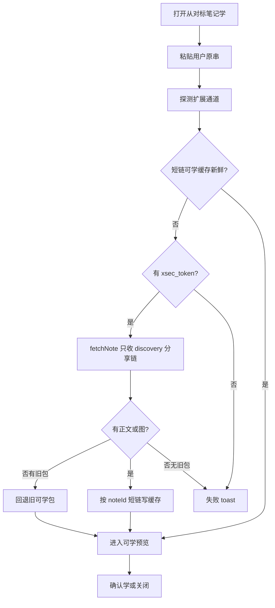
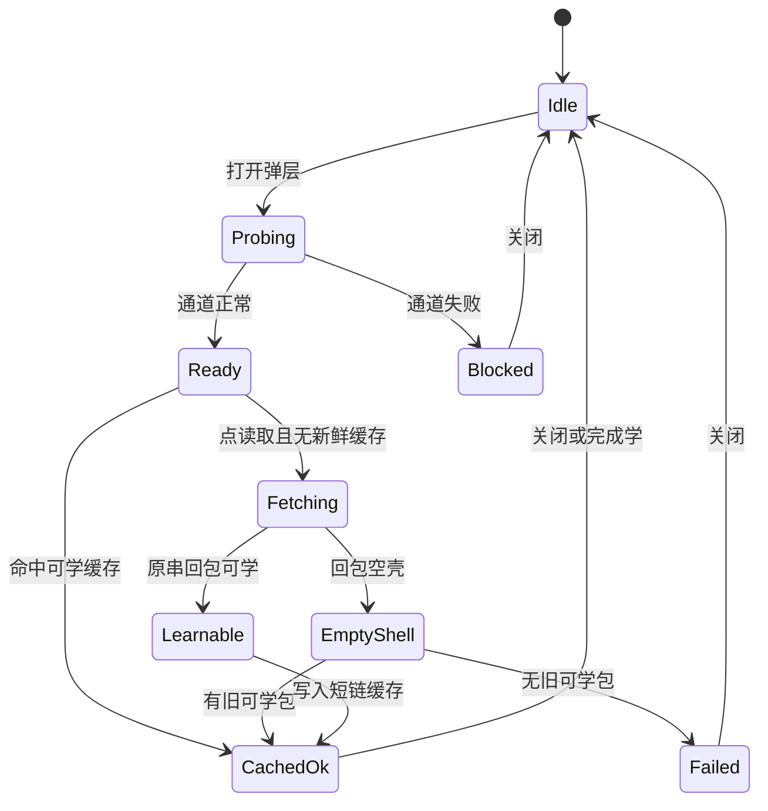

# PRD: 对标笔记取料用粘贴原串

| 属性 | 值 |
|------|----|
| 状态 | 工程：accepted（见文末「工程验收状态」） |
| 范围 | 「从对标笔记学」读取与取料缓存。仅 Release 0 |
| 顺序号 | 00023 |
| 来源需求 | 飞书需求 ID `20261118_0025`（表 `1.0.DexBuddy-需求收集管理`，record `reczz28b64shiGVP`） |
| 关联文档 | `specs/prds/prd-00012-learn-xhs-note.md`、`specs/prds/prd-00017-xhs-learned-notes.md`、`docs/workflows/one-post-studio.md`、`docs/DESIGN.md`、`src/one-post/runner/xhs-resolve.js`、`src/xhs-note/fetch.js`、`src/xhs-note/split.js`、`src/xhs-note/note-id.js`、`src/xhs-note/links.js` |

## 背景与问题

姜思阳在 Windows 上把好看笔记的链接贴进「对标笔记」学习时，经常看到 toast：「取到的笔记没有正文也没有图，没法学。已有内容未改动。」飞书截图（`temp/feishu-demand/20261118_0025/image.png`）停在 Dex Buddy 插件「小红书增长引擎 0.15.1」的「从对标笔记学」弹层：绿字「Chrome插件连接正常」，链接输入框可见 `https://www.xiaohongshu.com/explore/6af3fb12000000002b004d37?xsec_token=AE…`（输入框右侧裁切，token 后半不在图里）。关梯子、关掉小红书后再贴，仍一样。

对照实验：智赢媒体助手内部特供版「测试拉取笔记」对同一类带 `xsec_token` 的分享链可以拉到标题、正文、标签与图片。本仓开发机 `http://127.0.0.1:8768/`、扩展 0.10.1 上复测用户给出的完整链：

`https://www.xiaohongshu.com/explore/6afdb43b000000001601ac36?xsec_token=ABidG9Vq9hZB8gbFVynKMrRyiN8UVnNvpp0k1cGhPPJAA=&xsec_source=pc_search&source=unknown`

- `POST /api/one-post/resolveXhsNote`：`ok: false`，文案与飞书截图相同。
- 直接对桥 `fetchNote` 发**原粘贴串**：成功；标题「下方了11月19日更新兑换码大全」，作者「小白」，正文约 296 字，图片 2 张。
- 直接对桥 `fetchNote` 发**无 query 短链** `https://www.xiaohongshu.com/explore/6afdb43b000000001601ac36`：仍 `ok: true`，但 title / body / tags / images / author 全空。

根因：`src/one-post/runner/xhs-resolve.js` 抽出 noteId 后，取料改走无 query 的规范 explore 链（v0.13 起为降低风控）。插件回的是空壳成功包；`hasLearnableNoteContent` 判定不可学，于是出现上述 toast。字段映射没有丢；本机 `cache/xhs-notes` 也没有这篇旧缓存挡住新取料。`tests/xhs-note/run-import.test.js` 目前锁死「带 token 粘贴 → fetchNote 只收到短链」。

## 目标与非目标

### 目标（Release 0）

1. **拉取**：用户这次粘贴什么，就把那一串原样交给取料通道。不先改成短链，也不按插件 `buildNoteExploreUrl` 重拼。同一次读取打到插件时，用的是这一次粘贴的最新串。
2. **缓存**：按短 explore 链（无 query 的 noteId 链）写入和命中。30 分钟内已有可学缓存时仍可复用，不必为了同一篇再拉一次。
3. **分享链**：展示、入库、点开规则保持 `prd-00017` 现状。短链是库存身份；带 token 的原粘贴串仍只用于「打开原帖」。
4. 同一条分享链，智赢插件能抓到正文或图时，本工具「读取」必须进入可学预览（有正文或至少一张图），而不是空壳 toast。
5. 空壳仍不覆盖已学内容和可学缓存。toast 里的「已有内容未改动」只在确实保留了旧可学内容时出现。

### 非目标

- 自建爬虫或绕过本机 Chrome 扩展取料。
- 改智赢插件抓取实现或扩展协议字段。
- 把完整 `xsec_token` 写进仓库文档或测试夹具以外的产物。
- 改分享链的展示文案、点开规则、卡墙与详情浮层布局。
- 改学笔记入库后的文案柜 / 风格柜拆分规则。
- Release 2 及更高版本（本篇只有 Release 0）。

## 术语

| 术语 | 含义 |
|------|------|
| 粘贴原串 | 用户本次在「笔记链接」框里粘贴或键入的完整 URL（可含 `xsec_token` 等 query）。 |
| 短链 / 规范 explore 链 | `https://www.xiaohongshu.com/explore/<noteId>`，无 query、无 hash。 |
| 取料 | 经本机 Native Host 向扩展发 `fetchNote`，拿回笔记载荷。 |
| 可学内容 | 正文非空，或至少一张带非空 `url` 的图（`hasLearnableNoteContent`）。仅有标题不算可学。 |
| 空壳 | 桥返回 `ok: true`，但无正文且无图。 |
| 分享链展示 | 详情与库存文案显示短链；仅 `inputUrls` 里留有带 `xsec_token` 的原粘贴串时可点开原帖。 |

## 已拍板规则

| 项 | 决定 |
|----|------|
| 拉取 URL | 真拉前改写成 durable 分享链 `discovery/item/<noteId>?source=webshare&xhsshare=pc_web&xsec_token=…&xsec_source=pc_share`；传给插件的永远是这一形态。 |
| 无 token | 不调插件；提示「没有可用的分享链接（缺 xsec_token），请到小红书复制分享链接后再学」。重新学同样：无 openUrl token 则 toast 中止。 |
| 缓存键 | 仍按 noteId / 短链目录写入与命中；新鲜可学包可跳过真拉。 |
| 入库 `sourceUrl` | 仍规范为短链（`canonicalExploreUrl`）。 |
| 原粘贴串 | 继续记入 `inputUrls`；打开原帖仍只返回带 `xsec_token` 的最近粘贴串。 |
| 空壳 | 不写、不刷新 30 分钟可学缓存；有旧可学包则回退旧包；无旧包则失败。 |
| toast「已有内容未改动」 | 仅当本次实际保留了旧可学内容时出现；纯空壳失败用「没法学」类文案，不得假装库里有旧内容。 |
| 短链 / 无 token 粘贴 | 不真拉；有新鲜或可回退的可学缓存则可复用，否则失败并提示复制分享链接。 |

## 用户与角色

| 角色 | 目标 |
|------|------|
| 运营（姜思阳等） | 从分享页复制链接贴进「对标笔记」就能读到正文和图，继续学。 |
| 排查 / 产品 | 同一条链在智赢「测试拉取」成功时，增长引擎读取不得再报空壳。 |
| 工程 | 取料与缓存职责分离：拉用原串，存用短链；单测锁住这条契约。 |

## 功能域

1. **解析与取料**（`src/one-post/runner/xhs-resolve.js`、`src/xhs-note/fetch.js`）
   - `resolveXhsNote`：`fetchNoteByUrl` 的入参 = 用户本次 `url` 原串（trim 后），不再 `canonicalExploreUrl` 后再拉。
   - 仍可从粘贴串抽出 noteId，用于缓存查找、busyKey、入库身份。
2. **缓存**（`src/xhs-note` 缓存目录约定、`docs/workflows/one-post-studio.md`）
   - 命中新鲜可学包：不真拉，返回缓存。
   - 真拉成功且可学：按 noteId 短链身份写缓存。
   - 空壳：不写缓存；能回退旧可学包则回退。
3. **链接库**（`src/xhs-note/links.js`）
   - `rememberInputUrl` / `pickOpenableXhsUrl` 行为保持；展示短链、点开用带 token 原串。
4. **页面**（资料库「从对标笔记学」）
   - 交互不变；失败 toast 遵守上表「已有内容未改动」条件。
5. **测试**
   - 改写「带 token 取料走规范链」用例：`fetchNote` 必须收到带 token 的原串；缓存与返回 `note.sourceUrl` 仍为短链。

## 用户故事地图与版本切片

### 旅程主干

| 步骤 | 人在做什么 | 系统留下什么 |
|------|------------|----------------|
| Entry | 打开资料库，点「新建 → 对标笔记」或从对标笔记浮层「重新学」 | 弹层打开；通道探测通过时显示「Chrome插件连接正常」 |
| 粘贴 | 把小红书分享链粘进「笔记链接」 | 输入框保留用户原串（含 query） |
| 读取 | 点「读取」 | 若无新鲜可学缓存：有 token 则改写分享链后 `fetchNote`，无 token 直接失败；成功则预览正文/图；缓存按短链写入 |
| 学 | 勾选要学的文案 / 封面 / 内页并确认 | 入库身份为短链；`inputUrls` 记住本次原串 |
| 失败空壳 | 桥回无正文无图且无旧可学包 | toast 说明没法学；库与缓存不被空壳覆盖 |
| Exit | 关闭弹层或进入学成结果 | 成功则对标笔记卡墙可见；失败则与点击前一致 |
| Teardown | 再打开同一篇详情 | 展示短链；有带 token 的历史粘贴串才可点开原帖 |

### 用户故事地图

| 阶段 | 目标 | 故事 | 验收要点 |
|------|------|------|----------|
| 读取 | 用分享链取料 | 作为运营，我想粘贴带 `xsec_token` 的链接并读取，以便拿到正文和图 | 桥收到的永远是 `discovery/item` 分享链（含同一 token）；可学内容进入预览 |
| 读取 | 短链缓存复用 | 作为运营，我想对同一篇在 30 分钟内再读，以便不必每次真拉 | 第二次不调用桥或调用被跳过；结果仍可学 |
| 入库 | 库存身份稳定 | 作为运营，我想学成后在卡墙看到这篇，以便以后反复学 | `sourceUrl` 为短链；同 noteId 判重正确 |
| 打开 | 分享链规则不变 | 作为运营，我想在详情里打开原帖，以便回到小红书看原文 | 仅当历史粘贴含 `xsec_token` 时可点；文案显示短链 |
| 失败 | 空壳不污染 | 作为运营，我遇到空壳时，不想丢掉以前学过的内容 | 空壳不写缓存；有旧可学包则回退；「已有内容未改动」仅在真有回退时出现 |

### Release 0

- 改 `resolveXhsNote`：有 token → durable 分享链真拉；无 token → 不调桥。
- 缓存 / 入库 / 打开原帖规则按上表保持短链身份。
- 单测与 workflow 文档对齐。
- 可验收结果：带 token 粘贴在本机「读取」进入可学预览；`fetchNote` 断言为 `discovery/item` 分享链；无 token 零次调桥；缓存目录仍按 noteId。

本篇不做 Release 1。溢出能力进非目标或新 PRD。

## 核心流程与状态机图

### 主流程

### 取料结果状态

## 数据与 API 衔接

| 接口 | 变化 |
|------|------|
| `POST /api/one-post/resolveXhsNote` | 入参 `url` 含义不变；实现上真拉改写分享链，成功 `note.sourceUrl` 仍为短链 |
| 桥 `fetchNote` | 请求体 `url` 必须为 durable 分享链（含同一 `xsec_token`） |
| `cache/xhs-notes/<noteId>/` | 目录键不变；仅可学成功包写入 |
| 链接库 meta | `sourceUrl` 短链；`inputUrls` 累积原串 |

## 假设与待确认 / 开放项

| 项 | 说明 |
|----|------|
| 假设 | 智赢扩展对 durable `discovery/item` 分享链（含 token）能返回可学内容；无 token 不再调桥。 |
| 假设 | 运营粘贴须带 `xsec_token`；纯短链只走缓存复用，否则提示复制分享链接。 |
| 开放 | 飞书原笔记 `6af3fb12000000002b004d37` 的完整 token 未从截图恢复；验收可用任何一条插件测试页能成功、增长引擎当前会空壳的带 token 链。 |
| 开放 | toast 文案微调（去掉误导性的「已有内容未改动」）可在实现时按上表一并改；不另开 PRD。 |
| 不做 | 回写飞书「进行中」须另下「回写 20261118_0025 开工」指令；本篇落盘不改飞书。 |

## 修订记录

| 日期 | 说明 |
|------|------|
| 2026-11-24 | 初稿。来源飞书 `20261118_0025`；本机对照桥实测确认短链空壳；拍板拉取用粘贴原串、缓存用短链、分享链规则不变。 |
| 2026-11-24 | 工程验收：R0 accepted；取料用粘贴原串，缓存短链；重新学优先 openUrl。 |
| 2026-11-24 | 真拉硬规则：无 token 不调桥；有 token 改写为 discovery/item 分享链再 fetchNote；重新学无 token 直接 toast。 |

## 1. 工程验收状态

> 由 `/team:prd-accept` 维护；勿手工编造「通过」。最后更新：2026-11-24T07:39:35Z，prd/xhs-empty-note-fetch@c03ade5，范围：R0。

### 总览

- 工程状态：`accepted`
- 验收判定：Release 0 纳入项均通过（含分享链真拉硬规则）
- 最近验收：2026-11-24T07:39:35Z / `prd/xhs-empty-note-fetch` @ `c03ade5`
- 代码提交：`c03ade5` `fix(xhs-note): 真拉改用 durable 分享链并拒绝无 token`
- 摘要：
  1. 有 `xsec_token` 时 `fetchNote` 只收 `discovery/item` durable 分享链；无 token 零次调桥
  2. 缓存 / 入库 `sourceUrl` 仍为短 explore；打开原帖仍用 `inputUrls` 带 token 串
  3. 重新学无 openUrl token 时 toast 中止，不预填短链
  4. 空壳失败文案不含误导性「已有内容未改动」
  5. 本机曾对带 token 链 resolve 成功；单测锁死分享链契约

### Release 交付

| Release | 状态 | 说明 |
|---------|------|------|
| R0 | 通过 | 分享链真拉；无 token 拒拉；缓存短链；空壳文案；重新学门闩 |
| R1 | 范围外 | 本 PRD 未定义 R1 |

### 功能验收清单（Agent 优先读此表）

| ID | 能力摘要 | Release | 状态 | 证据 |
|----|----------|---------|------|------|
| S2-1 | 带 token 真拉改写为 durable 分享链且可学 | R0 | 通过 | 代码：`toDurableShareFetchUrl` + `xhs-resolve.js`；单测「带 token 真拉改写分享链」；本机 resolve 曾成功取到正文/图 |
| S2-2 | 无 token 不调插件并提示复制分享链 | R0 | 通过 | 单测「无 xsec_token 不调插件」；`noShareMessage`；重新学 `learned-notes.js` 同文案中止 |
| S2-3 | 同 noteId 新鲜可学缓存跳过真拉；入库短链 | R0 | 通过 | 单测 cache 命中；`note.sourceUrl` 仍短 explore |
| S2-4 | 空壳不污染；无旧包文案无「已有内容未改动」 | R0 | 通过 | 单测空取料回退旧包 / 无旧包失败文案 |
| S2-5 | 文档与 PRD 对齐分享链硬规则 | R0 | 通过 | `docs/workflows/one-post-studio.md`；本篇已拍板规则表 |

### 未完成与遗留

- 无（R0）。飞书关单由本轮 `/team:feishu-feature-enginer 回写 … 验收` 执行。

### 质量检查

| 检查项 | 状态 |
|--------|------|
| 测试 | 通过：`pnpm exec node --test tests/xhs-note/note-id.test.js tests/xhs-note/run-import.test.js` 20 pass |
| Lint | 本仓无 lint 命令，N/A |
| 文档与 OpenAPI | `docs/workflows/one-post-studio.md` 已更新；无 OpenAPI |

---
统计：通过 5 / 部分 0 / 未实现 0 / 范围外 0

